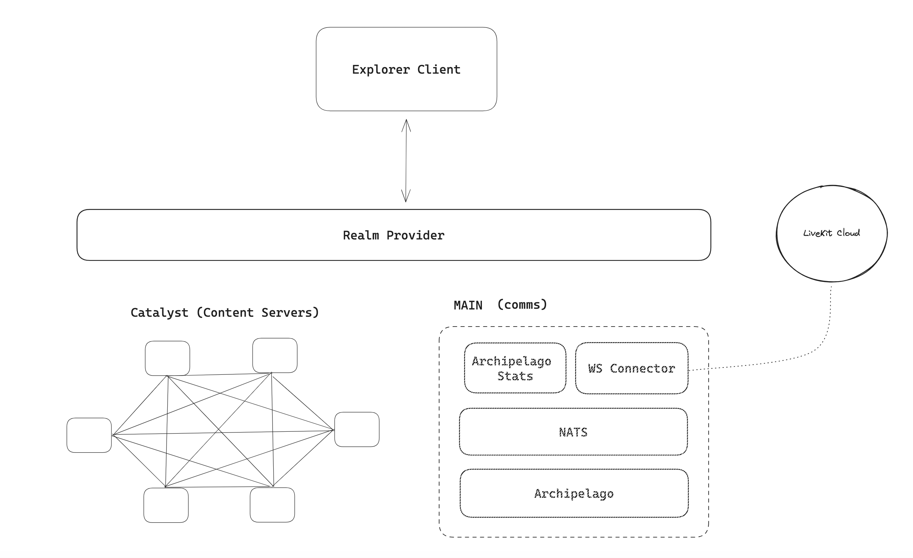

Decentraland tiene tantos realms como Catalysts con servicios de comunicaciones, pero hay un realm distintivo conocido como MAIN que existe fuera de la red de Catalysts. El realm MAIN fue específicamente diseñado para agilizar el proceso de conexión de usuarios, facilitando la interacción y el encuentro. Está construido con un conjunto de servicios capaces de sustituir el servicio de comunicación de un nodo Catalyst. Este realm sirve como destino predeterminado para los usuarios al iniciar sesión en Decentraland.

El servicio [realm provider](https://github.com/decentraland/realm-provider) expone un endpoint [/about](https://realm-provider.decentraland.org/main/about) con una descripción de realm según el [ADR-110: Realm description](https://adr.decentraland.org/adr/ADR-110). Esto proporciona la información para establecer una conexión con la red de gestión de contenido, conocida como uno de los servicios del nodo Catalyst, y también suministra los detalles de conexión para los servicios de comunicación del realm MAIN.

Se accede al servicio de comunicaciones MAIN a través del [WebSocket Connector](https://github.com/decentraland/archipelago-workers). Este componente ligero habilita la interacción con el resto de los componentes backend y puede escalarse fácilmente con instancias adicionales para acomodar una carga de usuarios en expansión, gestionando eficientemente un mayor número de conexiones activas. A través de la conexión WebSocket, el cliente adquiere los datos necesarios para establecer una conexión con LiveKit Cloud, junto con el `islandId` asignado por el Servicio Archipelago. El Servicio Archipelago tiene responsabilidades idénticas tanto en el realm MAIN como en el servicio de comunicaciones de los nodos Catalyst. Gestiona efectivamente el procesamiento de las posiciones de los usuarios y su subsiguiente asignación a islas distintas, cada una de las cuales corresponde a una sala Livekit, organizando así eficientemente clusters de usuarios basándose en sus ubicaciones espaciales dentro del mundo virtual. Para más información sobre el Servicio Archipelago, puedes consultar la página [Archipelago](archipelago).

[NATS](https://nats.io/) funciona como un sistema de transmisión facilitando comunicación sin problemas entre varios servicios. Puede soportar múltiples instancias de WebSocket Connector comunicándose con el mismo Servicio Archipelago. Además, permite al servicio Stats recopilar estadísticas de usuarios de Archipelago, como posiciones y agrupaciones de islas, haciendo estos datos accesibles para utilización externa.

El servicio de stats de Archipelago comparte la misma implementación de API que el servicio Archipelago en el nodo Catalyst. Puedes explorar la API en este enlace: [Catalyst API Specs](https://decentraland.github.io/catalyst-api-specs/#tag/Archipelago). El servicio es accesible a través de la siguiente URL `https://archipelago-stats.decentraland.org/` y los endpoints disponibles están bajo `/comms/` como se describe en la API Spec, ej.: `https://archipelago-stats.decentraland.org/comms/peers`.

La plataforma [LiveKit](transport-types/livekit) Cloud gestiona la intrincada tarea de intercambiar información de usuarios a través de WebRTC y es la plataforma cloud principal compartida por la mayoría de los nodos Catalyst para el mismo propósito.

El concepto fundamental derivado del realm MAIN es que diferentes usuarios tienen la flexibilidad de conectarse a cualquier nodo Catalyst para propósitos de gestión de contenido (descargas de escenas, wearables, emotes, o enviar actualizaciones de perfil) pero a pesar de la selección de un nodo de gestión de contenido específico, la conexión al servicio de comunicación **puede** ser la misma. Como resultado, incluso si los usuarios están utilizando diferentes nodos Catalyst como servidores de contenido pero se encuentran en coordenadas de escena cercanas, tendrán la capacidad de interactuar entre sí.
