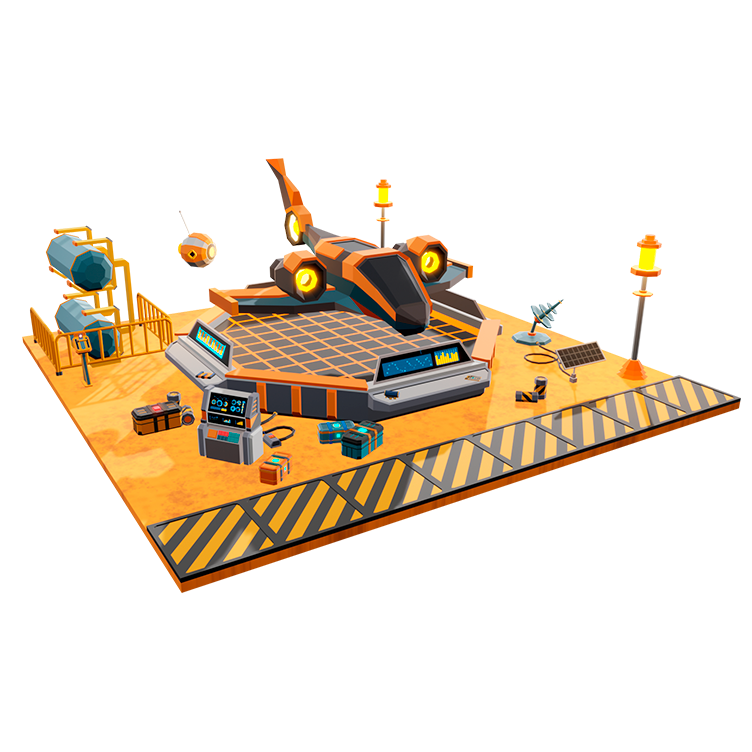
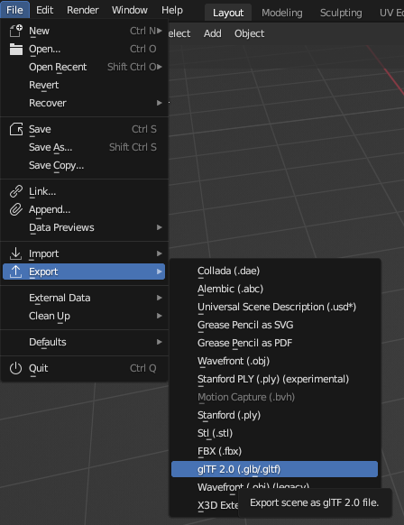
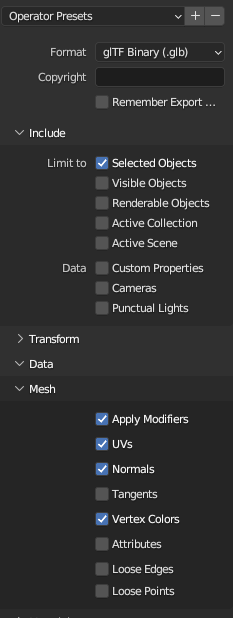
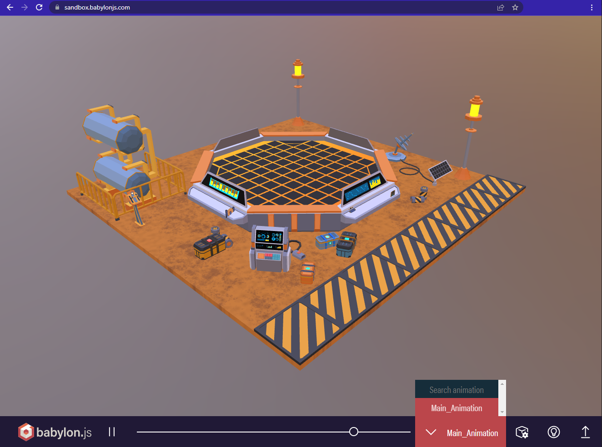
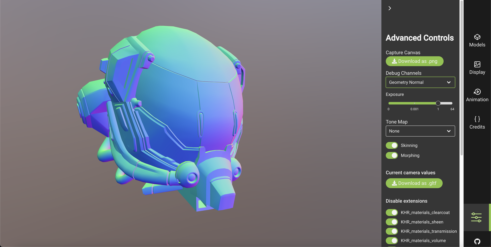
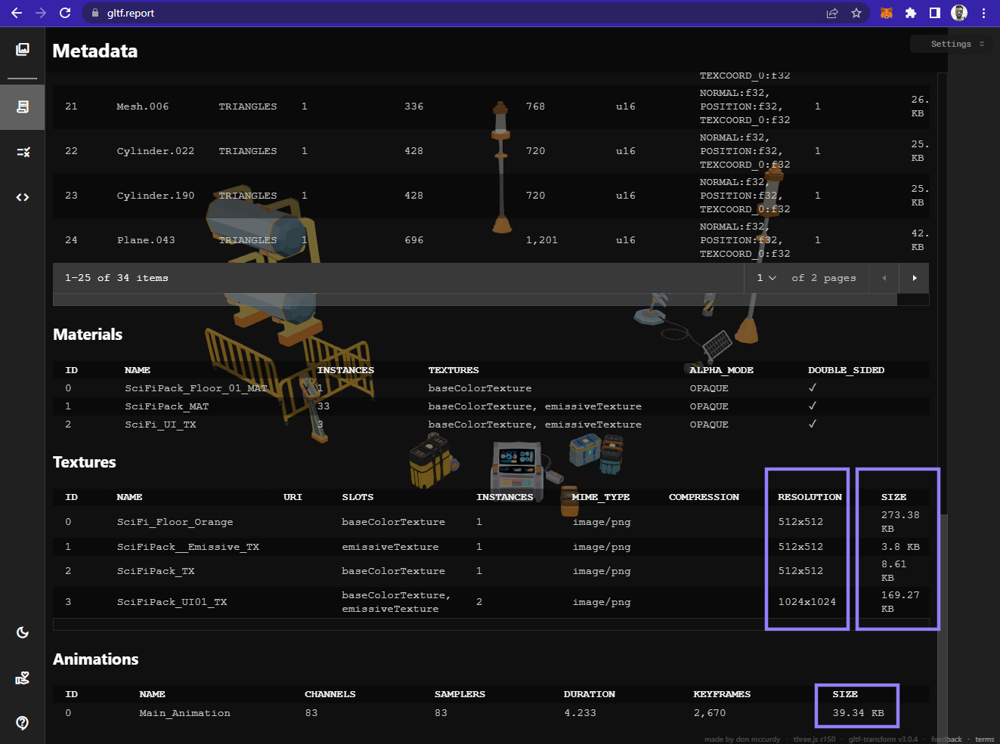

# Modelos 3D

Al importar modelos 3D a Decentraland, es importante asegurarse de que estén en formato glTF. Estos modelos pueden incluir una variedad de características compatibles. Esta sección trata sobre cómo hacerlos compatibles con Decentraland y seguir las mejores prácticas.

Ten en cuenta que todos los modelos, shaders y texturas deben cumplir con las [**limitaciones de escena**](https://docs.decentraland.org/creator/development-guide/scene-limitations/).

### **Formatos de Modelos 3D Compatibles**

Todos los modelos 3D en Decentraland deben estar en formato glTF. [**glTF**](https://www.khronos.org/gltf) (GL Transmission Format) es un proyecto abierto de Khronos que proporciona un formato común y extensible para activos 3D que es eficiente y altamente interoperable con tecnologías web modernas.

Los modelos glTF pueden tener una extensión _.gltf_ o _.glb_. Los archivos glTF son legibles por humanos, puedes abrir uno en un editor de texto y leerlo como un archivo JSON. Esto es útil, por ejemplo, para verificar que las animaciones estén correctamente adjuntas y para verificar sus nombres. Los archivos glb son binarios, por lo que no son legibles pero son considerablemente más pequeños en tamaño, lo cual es bueno para el rendimiento de la escena.

Recomendamos usar _.gltf_ mientras trabajas en una escena, pero luego cambiar a _.glb_ al subirla.

Los siguientes aspectos de un modelo 3D pueden estar incrustados en un archivo _glTF_ o referenciados externamente:

* Las texturas pueden estar incrustadas o referenciadas desde un archivo de imagen externo.
* Los datos binarios sobre geometría, animaciones y otros aspectos relacionados con el buffer del modelo pueden estar incrustados o referenciados desde un archivo _.bin_ externo.


**📔 Nota**: Las animaciones _deben_ estar incrustadas dentro del archivo _glTF_ para usarse en Decentraland. Además, cada modelo solo puede tener 1 mapa UV.


### **Por Qué Usamos glTF**

Usamos glTF porque proporciona un conjunto potente de características que incluye:

* Objetos jerárquicos
* Estructura esquelética y animación
* Pipeline robusto para materiales y shaders
* Información de escena como fuentes de luz y cámaras (que pueden usarse en desarrollos futuros).

Comparado con _COLLADA_, las características compatibles son muy similares. Sin embargo, debido a que glTF se enfoca en proporcionar un "formato de transmisión" en lugar de un formato de editor, es más interoperable con tecnologías web.

### **Exportar y Convertir glTF**

#### **Exportar a glTF desde Blender**

Blender tiene un exportador glTF nativo.

Para exportar selecciona los modelos que deseas que estén contenidos en el archivo .glb luego ve a File - Export - glTF 2.0

 

_En el panel lateral marca "Selected Objects" en caso de que desees exportar solo los objetos seleccionados en la escena. Además, en el menú desplegable Mesh selecciona Apply Modifiers (si fueron aplicados), luego Export._

#### **Exportar a glTF desde 3D Studio Max**

3D Studio Max no admite la exportación a glTF por defecto, pero puedes instalar un plugin para habilitarlo.

1. Descarga el plugin desde [este enlace](https://github.com/BabylonJS/Exporters/tree/master/3ds%20Max).
2. Instala el plugin siguiendo [estas instrucciones](http://doc.babylonjs.com/resources/3dsmax#how-to-install-the-3ds-max-plugin).
3. Exporta archivos glTF usando el plugin siguiendo [estas instrucciones](http://doc.babylonjs.com/resources/3dsmax_to_gltf).

#### **Exportar a glTF desde Maya**

Maya no admite la exportación a glTF por defecto, pero puedes instalar un plugin para habilitarlo.

1. Instala el plugin siguiendo [estas instrucciones](http://doc.babylonjs.com/resources/maya).
2. Exporta archivos glTF usando el plugin siguiendo [estas instrucciones](http://doc.babylonjs.com/resources/maya_to_gltf#pbr-materials).


**📔 Nota**: Como alternativa, también puedes probar [este otro plugin](https://github.com/WonderMediaProductions/Maya2glTF).


#### **Exportar a glTF desde Unity**

Unity no admite la exportación a glTF por defecto, pero puedes instalar un plugin para habilitarlo.

Descarga el plugin desde [este enlace](https://github.com/sketchfab/Unity-glTF-Exporter).


**📔 Nota**: Como alternativa, también puedes probar [este otro plugin](https://assetstore.unity.com/packages/tools/utilities/collada-exporter-for-unity2017-99793).


#### **Exportar a glTF desde SketchUp**

SketchUp no admite la exportación a glTF por defecto, pero puedes instalar un plugin para habilitarlo.

Descarga el plugin desde [este enlace](https://extensions.sketchup.com/en/content/gltf-exporter).

#### **Convertir FBX a glTF**

_.fbx_ es un estándar muy popular para modelos 3D. No es compatible con nuestro motor, pero puedes exportar fácilmente un modelo _.fbx_ a formato _.gltf_.

Recomendamos usar estas herramientas:

* [**Blender**](https://www.blender.org/download/): Una forma fácil de convertir .fbx a glTF es importando el .fbx a una escena usando Blender y luego exportarlo desde allí.
* [**Herramienta CLI de Facebook**](https://github.com/facebookincubator/FBX2glTF): esta es la alternativa más robusta, pero requiere usar la línea de comandos.
* [**Blackthread**](https://blackthread.io/gltf-converter): Esta es la herramienta basada en web más completa. Menos robusta que el CLI, pero mucho más fácil de usar.
* [**Modelconverter**](https://modelconverter.com/convert.html): Otra herramienta basada en web fácil de usar.

### **Previsualizar un Modelo glTF**

Una forma rápida y fácil de previsualizar el contenido de un modelo glTF antes de importarlo a una escena es usar el [**Babylon.js Sandbox**](https://sandbox.babylonjs.com/). Simplemente arrastra y suelta el archivo glTF (y su archivo _.bin_ si aplica) en el lienzo para ver el modelo.

En el sandbox también puedes previsualizar las animaciones que están incrustadas en el modelo, selecciona cuál mostrar eligiéndola de un menú desplegable.

### **Analizar glTF**

Una gran herramienta para analizar tus glTFs es usar [**glTF Sample Viewer**](https://github.khronos.org/glTF-Sample-Viewer-Release/). Esta herramienta te permite inspeccionar canales, texturas, reacción a diferentes entornos de luz, previsualizar animaciones ¡y mucho más! Ideal para modelos individuales.

Otra herramienta útil es [**gltf.report/**](https://gltf.report/). Simplemente arrastra y suelta tus modelos en el sitio web para ver el contenido del paquete glTF y evaluar qué partes del modelo se pueden optimizar.

Esta herramienta puede ser especialmente útil para archivos grandes que contienen múltiples modelos, texturas y animaciones. Por ejemplo, al organizar texturas por tamaño, puedes identificar fácilmente qué texturas están usando más recursos.

### **Optimizar un glTF**

La siguiente herramienta ofrece algunas optimizaciones que harán que los modelos 3D sean más ligeros y más rápidos de descargar para los jugadores en tu escena.

[glTF pipeline](https://github.com/AnalyticalGraphicsInc/gltf-pipeline)

Entre otras cosas, convierte el formato _.gltf_ a _.glb_, que es binario y por lo tanto ocupa mucho menos. También coloca archivos de textura fuera del modelo 3D, lo que te permite usar la misma textura en múltiples modelos.


**📔 Nota**: El formato _.glb_ por defecto siempre tiene texturas incrustadas en el archivo. El motor no puede reconocer dos texturas incrustadas como la misma, necesitan ser archivos externos que compartan un mismo hash.


### Ver también

Las siguientes páginas también cubren temas relacionados con modelos 3D para Decentraland:

* [Mallas](meshes.md)
* [Materiales](materials.md)
* [Texturas](textures.md)
* [Colisionadores](colliders.md)
* [Animaciones](animations.md)
