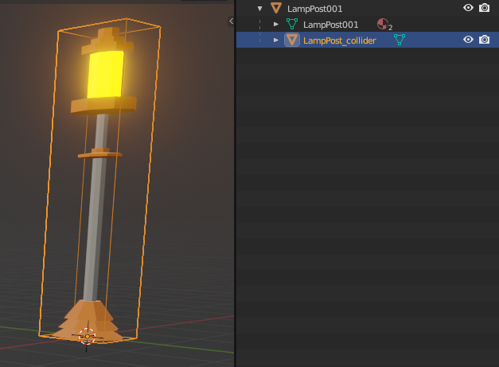
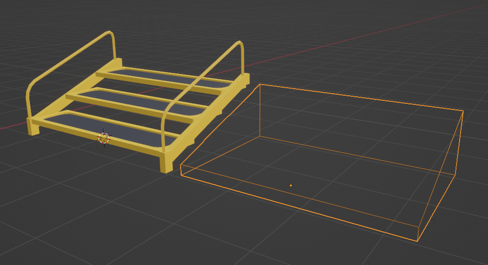
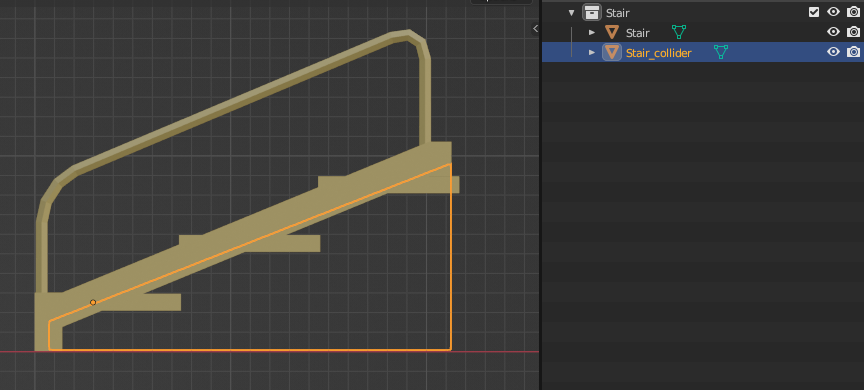
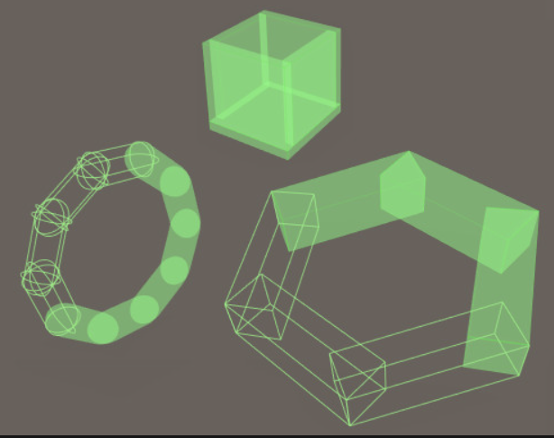
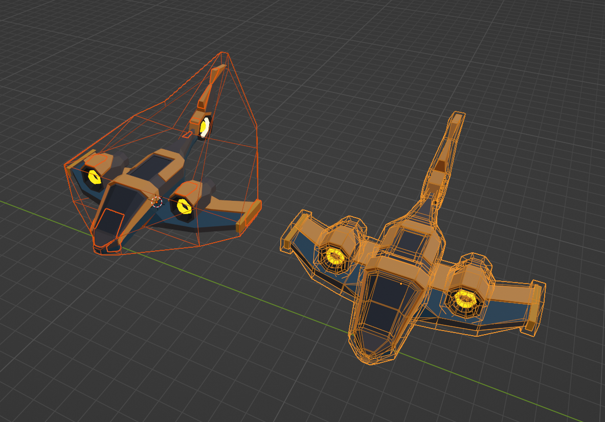

# Colliders

Para habilitar colisiones entre un modelo 3D y los usuarios de tu escena, debes darle colliders al modelo. Sin un collider, los jugadores podrán caminar a través de los modelos como si no estuvieran allí. Los colliders también son requeridos para hacer que un objeto responda a los pointer events del jugador o los bloquee, o para ser intersectado por raycasts o bloquearlos. Por razones de performance, los colliders a menudo se modelan por separado como una geometría invisible más simple que tiene menos vértices que la geometría visible.

El modelo puede usar una geometría invisible para usar como colliders, o (desde SDK7) puedes en su lugar asignar la geometría visible para que se comporte como un collider. Ve [**Colliders on 3D models**](https://docs.decentraland.org/creator/development-guide/sdk7/colliders/#colliders-on-3d-models). También puedes asignar diferentes capas de colisiones a las diferentes geometrías, para controlar por separado la física del jugador, pointer events y otras capas personalizadas, ve [**Colliders on 3D models**](https://docs.decentraland.org/creator/development-guide/sdk7/colliders/#collision-layers).

Los colliders no afectan cómo los modelos y entities interactúan entre sí, siempre pueden superponerse. Los colliders solo afectan cómo el modelo interactúa con el avatar del jugador.

Para que un objeto sea reconocido por una escena de Decentraland como un collider, todo lo que necesita es ser nombrado de cierta manera. El nombre del objeto debe incluir el sufijo "\_collider" al final.

Por ejemplo, para crear un collider para un poste de luz puedes crear un objeto box simple rodeando su tronco. Los jugadores en la escena no verán esta caja, pero bloqueará su camino.

En este caso, podemos nombrar la caja "LampPost\_collider" y exportar tanto el árbol como la caja como un solo modelo _gltf_. La etiqueta _\_collider\__ alerta al motor del mundo de Decentraland que el objeto box pertenece a la colección de colliders, haciendo el collider mesh invisible.

Siempre que un jugador vea el modelo del poste de luz en tu escena, verá el modelo complejo de tu lámpara. Sin embargo, cuando caminen hacia él, colisionarán con la caja, no con el árbol.

### Restricciones Espaciales del Jugador

Cuando diseñas modelos que están destinados a que los jugadores caminen alrededor, debes tener en cuenta las siguientes medidas de referencia:

* Los jugadores pueden subir un escalón de hasta 30 centímetros de altura sin saltar
* Los jugadores pueden subir pendientes de un ángulo de hasta 45 grados sin saltar
* Los jugadores pueden saltar hasta 1,8 metros de altura
* Los avatars miden alrededor de 1,9 metros de altura, pero considera que pueden tener sombreros u otros wearables en su cabeza.

Siempre que un jugador vea el modelo del árbol en tu escena, verá el modelo complejo de tu árbol. Sin embargo, cuando caminen hacia tu árbol, colisionarán con la caja, no con el árbol.

#### Agregar un Collider a una Escalera

Las escaleras son un caso de uso muy común para objetos collider. Para que los jugadores suban escaleras, debe haber un objeto \_collider correspondiente en el que los jugadores puedan pisar.

Recomendamos usar un objeto ramp para tus colliders de escaleras, esto proporciona una experiencia mucho mejor al subir o bajar. Cuando suben tus escaleras, aparecerá como un ascenso o descenso suave, en lugar de requerir que "salten" cada escalón individual.

Usar un objeto ramp también evita crear geometría innecesaria, ahorrando espacio para otros modelos más complicados. Ten en cuenta que la geometría del collider también se tiene en cuenta al calcular las [**scene limitations**](https://docs.decentraland.org/creator/development-guide/scene-limitations/)

1. Crea un nuevo objeto en forma de ramp que se asemeje al tamaño y proporciones de las escaleras originales.

2. Nombra el objeto ramp algo similar a &#x53;_&#x74;air\_collider_. Debe terminar en \__collider_.
3. Superpón el objeto ramp a las escaleras para que ocupen el mismo espacio.

4. Exporta ambos objetos juntos como un solo modelo _glTF_.

Ahora, cuando los jugadores vean las escaleras en tu escena, verán el modelo más elaborado de las escaleras, pero cuando las suban, colisionarán con el ramp.

### Optimizando Colliders

* Prefiere usar collision meshes **Box**, **Sphere** y **Capsule**, porque será más performante en la carga y en runtime.
* Considera aproximar collision mesh complejos con varios collision meshes Primitivos (**Box**/**Sphere**/**Capsule**)

_Ejemplo: El collider para Ring puede componerse de varios colliders Capsule o Box_

* Coloca el collision mesh dentro de la Hierarchy del objeto al que está relacionado. Por ejemplo, Spaceship\_collider puede ser un child dentro del parent Spaceship (desde el punto de vista de Hierarchy)

#### Colliders Convex vs Concave

Si usar un collision mesh arbitrario es la única posibilidad, entonces haz que el collision mesh sea Convex (no Concave). Esto evitará situaciones físicas extrañas, como stuttering, quedarse atascado dentro del collider o clipping a través de él. Ten en cuenta que a menudo es posible imitar un mesh concave con varios meshes convex.

### Nomenclatura de Colisiones

**Usa nombres significativos. El nombre debe dar contexto de dónde se usa el asset o a qué parte del objeto se relaciona.**

Para la nomenclatura de assets usamos una mezcla de `PascalCase` y `snake_case`, que podemos llamar `PascalSnake_case`. Las reglas básicas allí son: una palabra nueva o palabra después del separador (`_`) comienza con **Letra Mayúscula.**

Collision Mesh es el mesh que se usa como referencia para crear un collider en el Explorer

* Sigue los mismos principios que Meshes arriba, pero tiene el sufijo `_collider` al final **Ejemplos:** 🟢 **Prefiere** nombres - `Tram_Wheel_LeftFront_collider` 🔴 **Evita** nombres - `Primitive.001_Collider`, `collider (1)`, `Cylinder.007_collider`,


**🔥Tip de Optimización🔥**

Si un collider puede ser aproximado por una forma Box, Sphere o Capsule, entonces usa un sufijo adicional con una de estas 3 variaciones posibles \_box, \_sphere o \_capsule. Usar estas 3 formas en lugar de mesh arbitrario para detección de colisiones aumentará el performance de tu escena y el tiempo de carga 💪🚀

Ejemplos: 🟢 Teater\_MainWall\_North\_collider\_box, Fountain\_Statue\_collider\_sphere


### Mejores Prácticas para Colliders

* **Siempre usa el menor número posible de triángulos al crear colliders.** Evita hacer una copia de un objeto complejo para usar como collider. Los colliders simples garantizan una buena experiencia de usuario y mantienen tu escena dentro de las limitaciones de triángulos.
* **Los objetos collider no deben tener ningún material**, ya que los jugadores de tu escena nunca lo verán. Los colliders son invisibles para los jugadores.
* **Todos los nombres de objetos collider deben terminar con \_**_**collider**_**.** Por ejemplo, &#x54;_&#x72;ee\_collider_.
* **Si usas un \_plane**\_\*\* como collider, solo bloqueará en una dirección.\*\* Si quieres que los colliders bloqueen desde ambos lados, por ejemplo para una pared, necesitas crear dos planes con sus normales mirando en direcciones opuestas.
* Al duplicar objetos collider, presta atención a sus nombres. Algunos programas agregan un \__1_ al final del nombre de archivo para evitar duplicados, por ejemplo _tree\_collider\_1_. Los objetos que se nombran así serán interpretados por el Motor del Mundo de Decentraland como objetos normales, no colliders.
* Puedes evitar agregar un collider mesh si agregas un componente `MeshCollider` invisible a la entity, que aproxima la forma del modelo 3D.
* También puedes evitar agregar un collider mesh si configuras el componente `GLTFContainer` para usar la geometría visible como collider. Ve [**Colliders on 3D models**](https://docs.decentraland.org/creator/development-guide/sdk7/colliders/#colliders-on-3D-models).
* Si estás creando un modelo 3D con muchas mesh shapes que cada una necesita su collider, hay algunos add-ons útiles que pueden ayudar. Para Blender puedes usar la opción batch rename dentro de Blender para agregar automáticamente un sufijo `_collider` a todos los nombres de mesh en un grupo. Más sobre esta herramienta en la sección "\*\*Using Blender to rename assets"
