# Create a Rig

Este documento muestra cómo configurar un rig básico en Blender. Si quieres familiarizarte más con algunos conceptos de rigging, consulta [The Rig: Basic Concepts](https://docs.decentraland.org/creator/emotes/avatar-rig/).

#### Agregando el Armature

Primero que nada, necesitarás importar tu modelo 3D a Blender o, si ya lo hiciste en Blender, simplemente abre tu archivo blend. En object mode, presiona `Shift+A` y selecciona _**Armature**_ en el menú, como se muestra a continuación. Luego, en _**Object Data Properties**_, bajo _**Viewport Display**_, activa _**In Front**_, para que puedas ver el bone a través del mesh. Mesh y armature deben estar alineados, así que asegúrate de que el modelo esté bien posicionado en el centro del mundo antes de agregar los bones. El origin del armature debe estar en 0,0,0 (X,Y,Z).

_Agregando un armature y mostrándolo a través del mesh._

#### Editando el Armature

Después de agregar el objeto Armature, selecciónalo y ve a _**Edit Mode**_. Aquí es donde agregas los otros bones extruyendo el original (presiona `E`), duplicándolo (`Shift+D`) o simplemente agregando uno nuevo con `Shift+A`. El skeleton debe seguir la forma del modelo, como un esqueleto real. Los bones se pueden escalar, agarrar y rotar y tienen dos partes: la cabeza (head) y la cola (tail). La head es el pivot point, lo que significa que las rotaciones y el scale comenzarán desde allí. Eso también significa que es donde ocurrirá la deformación del mesh, así que posiciona los bones lo más centrados posible en el mesh.

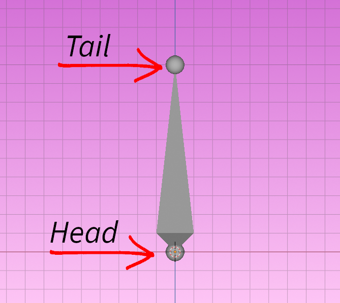

_Estructura del bone._

_Bone rotando desde su pivot point._

No hay necesidad de preocuparse por crear bones para el lado derecho e izquierdo por ahora. Concéntrate primero en crear solo un lado.

#### Renombrando los Bones

Algo realmente importante a tener en cuenta es renombrar todos tus bones apropiadamente, según [la convención de nombres de Blender](https://docs.blender.org/manual/en/latest/animation/armatures/bones/editing/naming.html). Esto no solo mantendrá todo organizado, sino que también hará posible hacer mirror de poses y weight paint. Podrías simplemente renombrarlo como la parte del cuerpo que representa, como Spine\_01 o podrías ser más específico y llamarlo DEF\_spine.001 (DEF significa deforming bone, para que sepas que este bone es de la jerarquía deformante).

#### Orientación del Bone

Antes de continuar, debes verificar la orientación de tus bones. Puedes hacerlo yendo a _**Object Data Properties**_ y bajo _**Viewport Display**_, activa _**Axes**_. Esto hará visibles los ejes del bone, para que puedas verificar si van a rotar en la dirección correcta.

Los ejes deben estar alineados con la dirección en la que quieres que los bones roten. Si se siente un poco mal, selecciona el bone y, en el menú _**Item Transform**_ a la derecha del viewport, ajusta el _**Roll**_ hasta que la orientación se sienta correcta.

_Arreglando el bone roll._

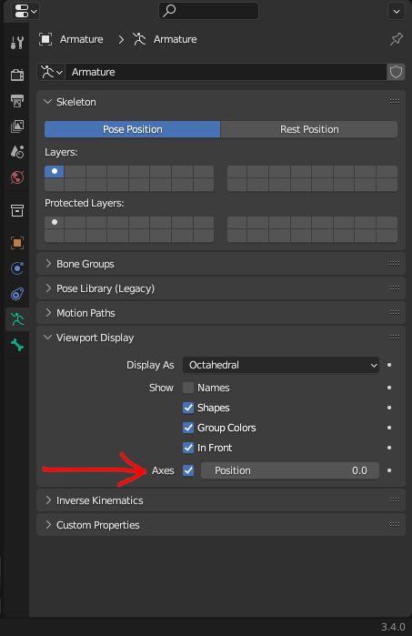

_Activa Axes para que puedas ver la dirección en la que el bone rotará._

Arreglar el bone roll es especialmente importante para los dedos, para que todas las articulaciones se doblen en la misma dirección correcta. No tienes que hacerlo para todos los bones en un dedo, solo consigue que uno esté correcto. Luego, selecciona los que quieres arreglar primero y el que tiene el roll correcto al último, ve a _**Armature > Bone Roll > Recalculate Roll > Active Bone**_ y todos tendrán el mismo roll. O puedes simplemente presionar `Shift+N` > _**Active Bone**_. Esto se puede usar en muchas situaciones donde tienes una cadena larga de bones, como un tentáculo, una cola, una cola de caballo larga o un brazo mecánico.

_Presiona `Shift+N` para recalcular el bone roll._

#### Haciendo Mirror del Rig

No tienes que crear bones para ambos lados. Solo haz un lado primero y cuando hayas arreglado todos los nombres y la orientación de los bones, selecciona todos los bones que quieras hacer mirror, haz clic con el botón derecho del mouse y selecciona _**Symmetrize**_. De esa manera, todos los bones se reflejarán correctamente, con las orientaciones correctas. Recuerda que para que esta herramienta funcione, los bones deben nombrarse según la convención de nombres de Blender. Si hay una "L", "R", "left" o "right" en minúscula o mayúscula, Blender maneja la contraparte correctamente.

Algunos ejemplos de convención de nombres correcta:

* Hand\_L –> Hand\_R
* Hand.L –>Hand.R
* HandLeft –> HandRight

**Todos los ejemplos anteriores son válidos, pero elige solo uno y mantenlo consistente a través del rig.**

_Usa la opción Symmetrize para hacer mirror de tus bones._


**⚠️ Atención!** Symmetrize solo funcionará si los bones están renombrados correctamente. Si no hace mirror correctamente, es posible que quieras verificar dos veces los nombres de los bones.


#### Skinning

Skinning es el proceso de vincular el mesh al armature. Para hacerlo, en _**Object Mode**_, selecciona el mesh, luego el armature y presiona `CTRL+P` > _**Armature Deform > With Automatic Weights.**_ Luego, ve a _**Pose Mode**_ y prueba diferentes poses para probar la deformación del mesh. La mayoría de las veces necesitará algunos ajustes, como se ve a continuación.

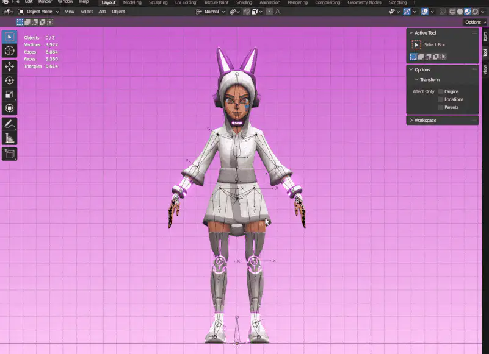

_Para el Skinning, haz que el mesh sea child del armature presionando `CTRL+P` y pruébalo en Pose Mode._

Si sientes que un bone ha sido mal colocado o que el pivot point no es preciso, siempre puedes volver al _**Edit Mode**_ del armature y ajustarlo. Esto no afectará el skinning en absoluto y siempre puedes usar _**Symmetrize**_ para hacer mirror de los cambios.

Para arreglar deformaciones extrañas, ve a _**Object Mode**_, selecciona el mesh y ve a _**Weight Paint**_. En _**Object Data Properties**_ encontrarás los _**Vertex Groups**_.

_Edita la influencia de un bone en Weight Paint._

Antes de comenzar a editar, para que tu weight paint se refleje automáticamente mientras pintas, activa _**Mirror Vertex Groups**_ y selecciona _**X**_ en _**Mirror**_ bajo _**Symmetry**_ (en Blender 3.4.0). Para editar las influencias, selecciona el vertex group que quieras y, en el menú _**Tool**_, bajo _**Blend**_, cambia entre _**Add**_ y _**Subtract**_ según tus necesidades. También puedes cambiar el size, weight y strength del brush.

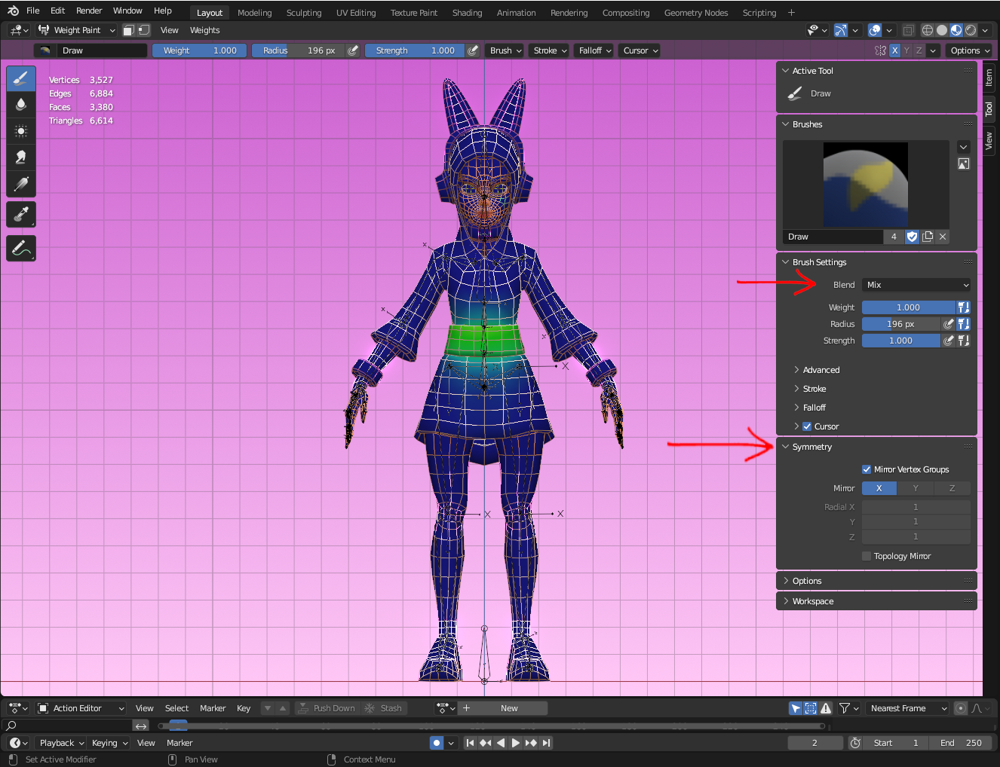

_Cambia el Blend para agregar o quitar influencia. Asegúrate de que Symmetry esté correcto._

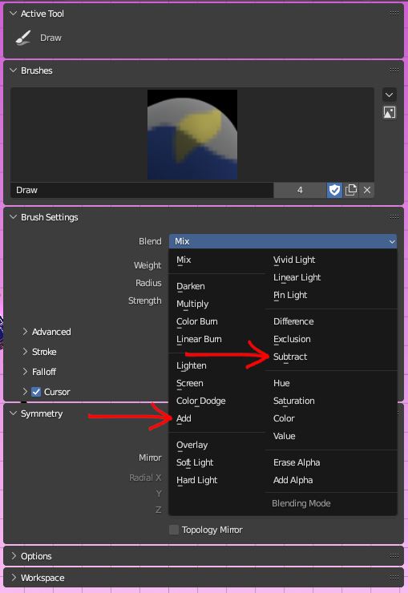

Usa la herramienta _**Blur**_ en el lado izquierdo de la pantalla para suavizar el weight paint y hacerlo más uniforme.

_Blur Tool._

#### Configurando el IK

IK es esencial cuando quieres que algo se quede en su lugar. El mejor ejemplo de su uso es en las piernas, pero se puede adoptar en una variedad de situaciones, como en los ejemplos a continuación:

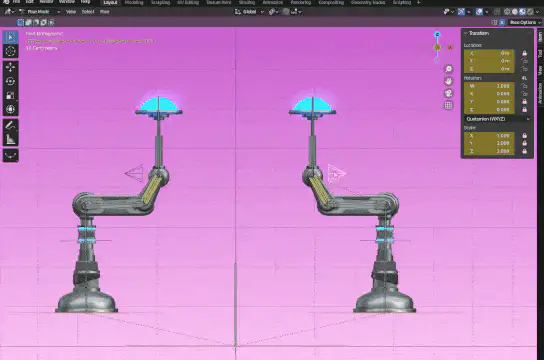

_Uso de IK en un brazo mecánico._

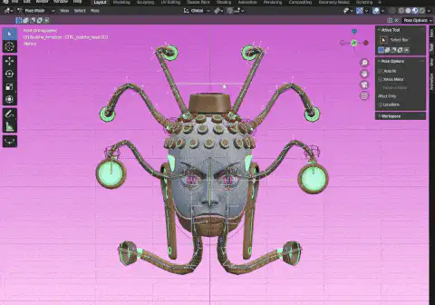

_Uso de IK en cables._

Como cambiará la jerarquía de bones, es mejor mantenerlo como una configuración separada. Entonces, lo primero que necesitas hacer es duplicar la cadena de bones que será afectada por el IK. Usemos la pierna como ejemplo. Selecciona los bones, presiona `Shift+D` para duplicarlos y muévelos a una capa diferente presionando `M` y seleccionando un slot diferente para ello.

Recuerda renombrar los bones duplicados, agregando IK al nombre para que sepas que son parte de la configuración IK. Y como no deben deformar el mesh, selecciona todos ellos y en _**Bone Property**_, presiona y mantén presionado `Alt` y desmarca _**Deform**_.

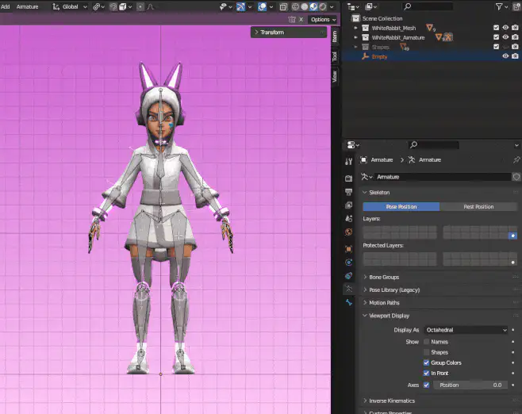

_Duplica los bones y muévelos a una capa diferente._

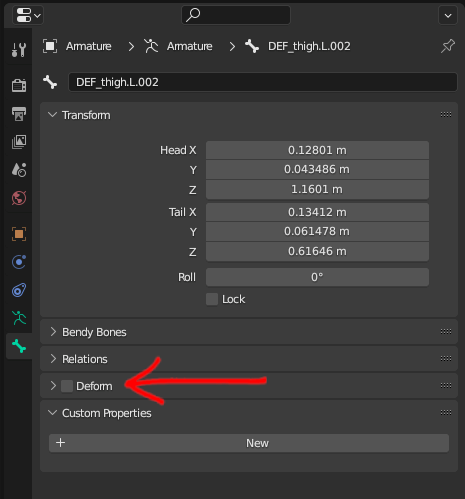

_Selecciona todos los bones IK y, mientras mantienes presionado `Alt`, desmarca Deform._

A continuación, necesitarás crear un bone que conducirá la cadena IK. Selecciona la head del foot bone y extrúyela en Y. Luego, presiona `Alt+P` para desemparentarlo porque el bone IK no puede ser parte de la cadena y no puede estar conectado a otros bones. Necesitarás hacer que el foot sea child del IK, así que selecciona primero el foot bone y el IK bone al último y presiona `CTRL+P` > _**Keep Offset**_.

_Creando un bone IK._

En _**Pose Mode**_, haz clic en el shin bone, presiona `CTRL+Shift+C` y selecciona _**Inverse Kinematics**_. Se verá todo desordenado, pero no te preocupes, se arreglará una vez que cambies algunas configuraciones. Con el shin seleccionado, ve a las _**Bone Constraint Properties**_ como se muestra a continuación.

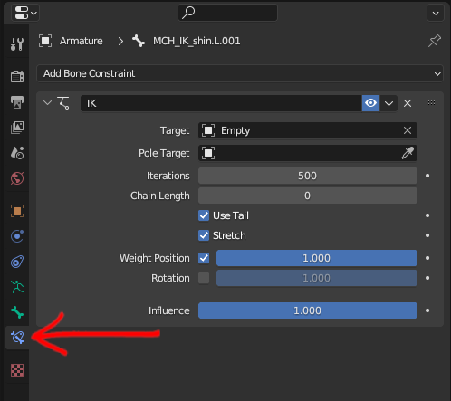

_En Bone Constraint Properties puedes editar las configuraciones IK._

Para el _**Target**_, selecciona _**Armature**_. Una vez que lo hagas, aparecerá una opción llamada _**Bone**_ debajo de Target. Para eso, selecciona el bone IK que creaste. En _**Chain Length**_ establecerás el número de bones que deben ser afectados por el IK. Como estamos haciendo una pierna, queremos que afecte al shin y al thigh, así que configúralo en _**2**_.

#### Pole Target

El Pole Target te permite controlar la dirección en la que los bones se doblarán. Estos son los pasos para agregar correctamente un pole target (o pole vector) a la cadena IK:

* En _**Edit Mode**_, duplica el thigh bone y colócalo en cualquier lugar.
* Selecciona la articulación de la rodilla (o la tail del thigh bone), presiona `Shift+S` > _**Cursor to Selected.**_
* Seleccionado el thigh bone duplicado, presiona `Shift+S` > _**Selection to Cursor**_.
* En _**Transform Orientation**_, cámbialo a _**Normal**_ y en _**Tansform Pivot Point**_ cámbialo a _**Active Element**_.
* Rota el bone en X -90 (o 90, dependiendo de la orientación que estableciste) para que apunte hacia adelante y agárralo en Y hasta que tenga una buena posición frente a la pierna. También puedes escalarlo un poco.

_Creando un Pole Target._

De regreso en _**Pose Mode**_, selecciona el shin nuevamente y ve a las _**Bone Constraint Properties**_. Para _**Pole Target**_ selecciona _**Armature**_ y para _**Bone**_, selecciona el pole target que acabas de crear. Si muestras los deform bones, verás que el pole target rotó el IK un poco.

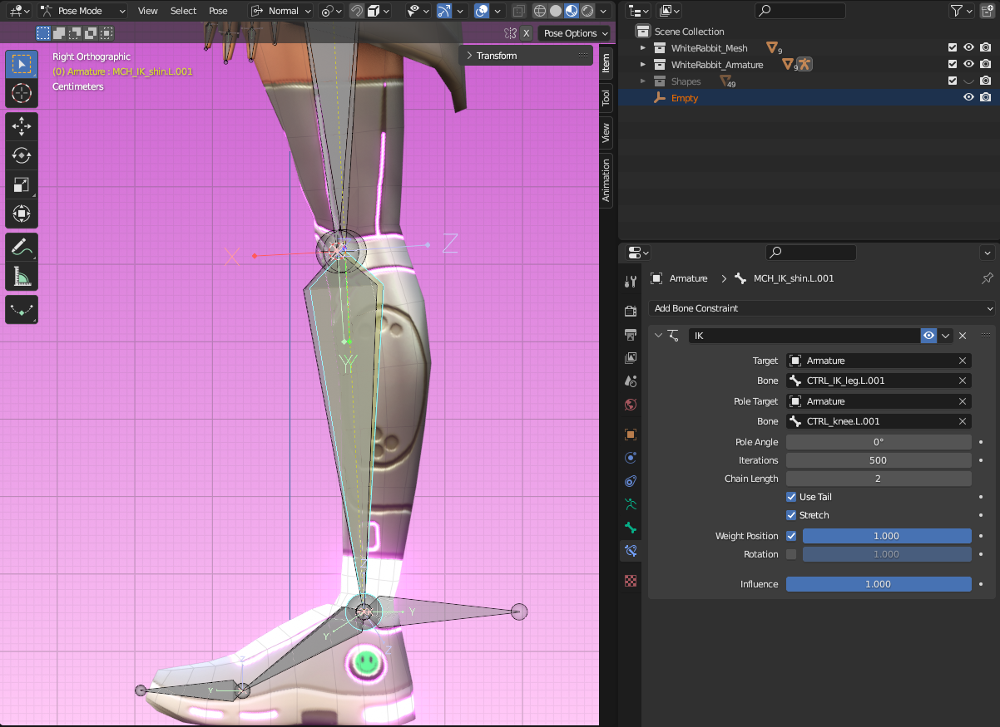

_La cadena IK y los deform bones ya no están alineados debido al pole target._

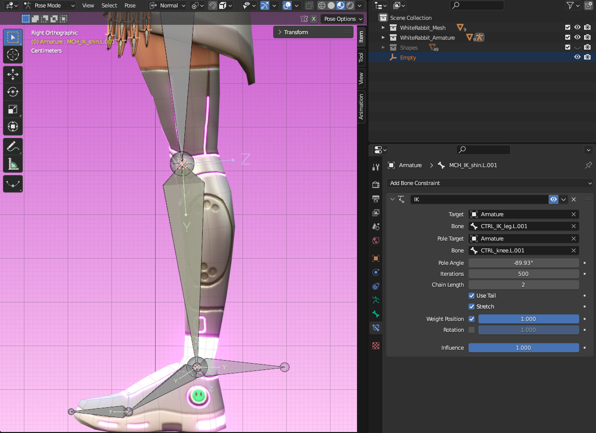

_La rotación se puede arreglar cambiando el Pole Angle._

Eso se puede arreglar fácilmente cambiando el _**Pole Angle**_. Usualmente -90° hará el truco, pero siempre puedes ajustarlo manualmente para asegurarte de que estén perfectamente alineados.

Finalmente, haz que tanto el bone IK como el pole target sean child del root bone seleccionándolos a ambos, luego el root, presiona `CTRL+P` > _**Keep Offset**_.

Mueve el thigh y el shin a otra capa ya que no los necesitarás para la animación, solo son parte de la configuración IK.

#### Vinculando Deform Bones a No Deformantes

La cadena IK está toda configurada, pero debería conducir los deform bones y ahora mismo eso no está sucediendo, pero puedes usar constraints para arreglar eso. En _**Pose Mode**_, selecciona primero un bone de la cadena IK y el respectivo deforming bone al último, presiona `CTRL+Shift+C` y selecciona _**Copy Transforms**_. Haz eso para todos los bones, que en el ejemplo son thigh, shin, foot y toes. Los deform bones tendrán un color verde, lo que significa que tienen un constraint. Si haces clic en _**Bone Constraint Properties**_, puedes ver qué constraint se está usando y qué bone lo está conduciendo.

_Los bones verdes tienen constraints. Puedes verificarlos en Bone Constraints Properties._


**💡 Tip**: No tienes que configurar el IK de nuevo para el otro lado. En _Edit Mode_, simplemente elimina todos los bones del lado que no tiene el IK, luego selecciona todos los deforming bones y la cadena IK que quieras hacer mirror, haz clic derecho con el mouse y selecciona _Symmetrize_. ¡No solo hará mirror de los bones, sino también de todos los constraints!


_¡Usa la opción Symmetrize para hacer mirror de los constraints también!_

#### Skeleton No Deformante y Controls

Es una buena práctica no animar directamente los deforming bones ya que podrías terminar rompiendo el rig y agregar constraints al armature deformante afectará la jerarquía y el comportamiento de los bones cuando se exporte.

La solución a esto es crear un skeleton no deformante que conducirá el deformante a través de constraints, y que se puede animar de manera segura, sin arriesgar romper nada. También puedes personalizar su forma para que sea más fácil identificar la función de un bone. Serán los controls para tu rig.

El proceso para esto es prácticamente el mismo hecho para la configuración IK. Duplica todos los bones (excepto la configuración IK) con `Shift+D` y muévelos a una capa diferente presionando `M` y eligiendo otro slot. Renómbralos todos agregando **Control\_** o **CTRL\_** como sufijo para que sepas que estos son parte de la jerarquía de controls. Presiona `A` para seleccionarlos todos y en _**Bone Property**_, presiona y mantén presionado `Alt` y desmarca _**Deform**_.

Ahora tendrás que agregar constraints para vincular los dos skeletons juntos. Para hacer este proceso más fácil, puedes cambiar la forma del bone haciendo clic en _**Object Data Properties**_ y, bajo _**Viewport Display**_, cambia _**Display As**_ de _**Octahedral**_ a _**B-Bone**_. Luego, presiona `CTRL+Alt+S` para escalar los bones un poco para que sean más grandes que los originales.

_Cambia la forma del bone y escálalos para que sea más fácil diferenciar entre los dos skeletons._

Para los constraints, selecciona primero un control bone y el respectivo deforming bone al último, presiona `CTRL+Shift+C` y selecciona _**Copy Transforms**_. Haz eso para todos los control bones.

Puedes separar los control bones en diferentes grupos y asignarles colores. Ve a _**Pose Mode**_ > _**Object Data Properties**_ > _**Bone Groups**_. Haz clic en el ícono _**+**_ para agregar un nuevo grupo, renómbralo como mejor te parezca y selecciona un color para él. Luego, selecciona los bones que quieras que sean parte de ese grupo y haz clic en _**Assign**_. Puedes crear tantos grupos como quieras para mantener todo organizado. También puedes mover diferentes bone groups a diferentes capas.

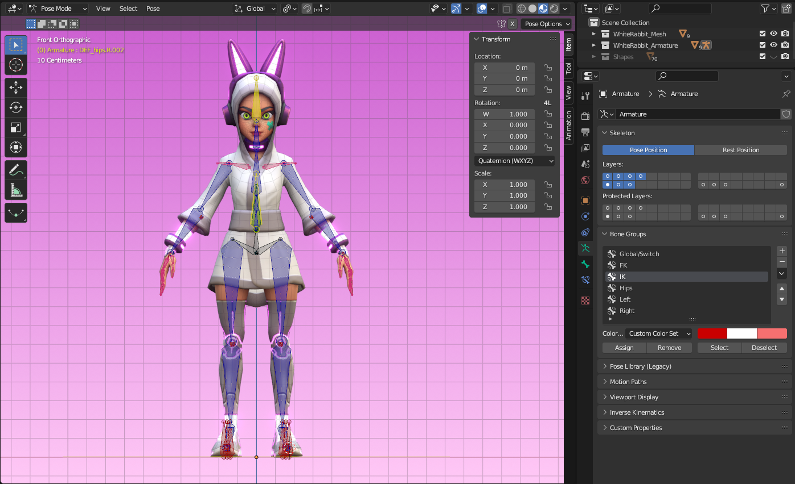

_Los bone groups te ayudarán a mantener tu rig organizado y más intuitivo._

Una forma extra de mejorar tu rig es personalizar la forma de los bones. Para hacer eso, ve a _**Object Mode**_, presiona `Shift+A` para agregar un mesh, como un círculo, por ejemplo. Para mantener todo organizado, crea una collection para tus formas y mueve allí el círculo que acabas de crear. Vuelve a Pose Mode y, en _**Object Data Properties**_ > _**Viewport Display**_ marca _**Shapes**_. Selecciona el bone que quieras y luego, en _**Bone Properties**_, haz clic en _**Viewport Display**_ > _**Custom Shape**_. En _**Custom object**_, selecciona el círculo en el outliner.

_Personalizando la forma del bone._

Si la forma se siente mal, siempre puedes editarla en _**Edit Mode**_, como se muestra a continuación. Asegúrate de que la forma tenga la misma orientación que el bone.

_Edita la forma en Edit Mode._

Crea diferentes formas para diferentes controls según su función para hacer tu rig más intuitivo.

¡Y eso es todo! ¡Con toda esta información estás listo para hacer un rig básico!
