# Materials

Los materials están embebidos en un archivo _.gltf_ o _.glb_.

Este documento se refiere a materials que se importan en un modelo 3D. Para materials definidos via código para aplicar en primitive shapes, ve [**materials**](https://docs.decentraland.org/creator/development-guide/materials/).


**📔 Nota**: Actualmente no puedes cambiar dinámicamente los materials de un modelo 3D desde el código de tu escena, a menos que sea una primitive shape.


### Soporte de Shader

No todos los shaders se pueden usar en modelos que se importan a Decentraland. Asegúrate de usar uno de los siguientes:

* **Standard materials:** cualquier shader es soportado, por ejemplo diffuse, specular, transparency, etc.
* **PBR (Physically Based Rendering) materials**: Este shader es más flexible, ya que incluye propiedades como diffuse, roughness, metalness y emission que te permiten configurar cómo un material interactúa con la luz.

La imagen a continuación muestra dos modelos idénticos, creados con los mismos colores y texturas. El modelo a la izquierda usa todos los materials _PBR_, algunos de ellos incluyen _metalness_, _transparency_ y _emissiveness_. El modelo a la derecha usa todos los materials _standard_, algunos incluyen _transparency_ y _emissiveness_.

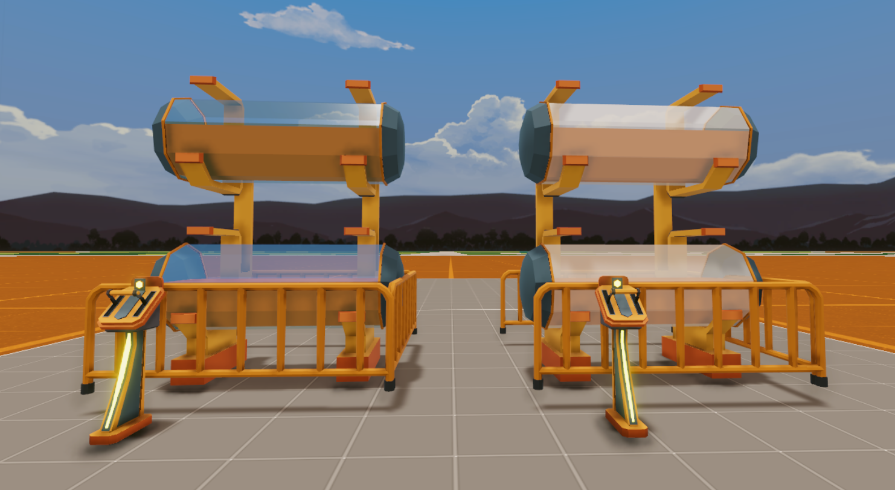

#### Propiedades PBR que Actualmente Funcionan con el Motor de Decentraland

> * Base Color
> * Metallic
> * Roughness
> * Specular
> * Emissive
> * Emission Strength
> * Alpha
> * Normal

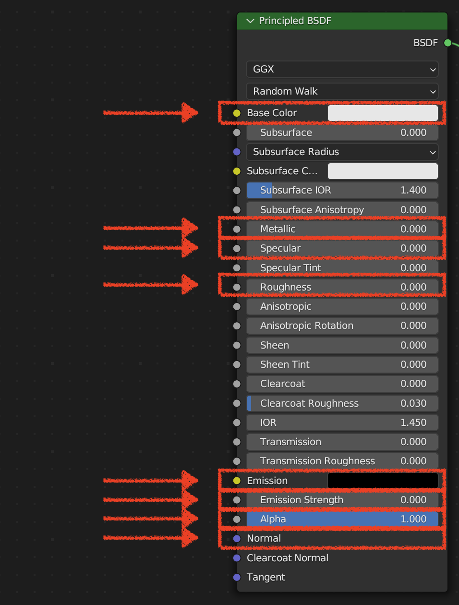

Para visualizar cómo se comportan estas propiedades en el mundo, puedes ir a este [testing world](decentraland://?realm=TestEnvironment.dcl.eth) para encontrar diferentes objetos y materials y cómo interactúan con las luces y el entorno del mundo.

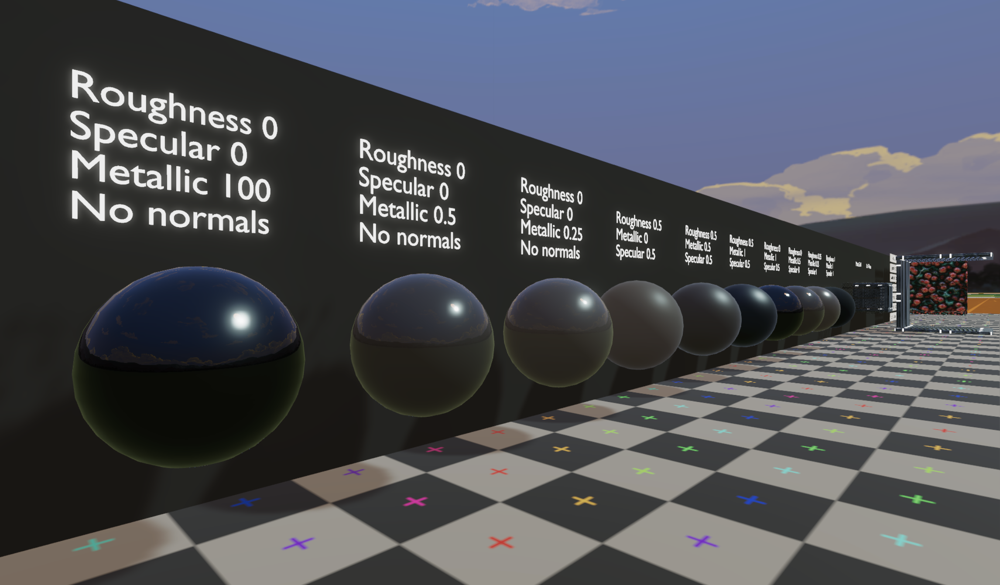

#### Base/Diffuse Color

Define el color base de la superficie del objeto. Por sí solo no tiene ninguna afectación por la iluminación, es por eso que se combina con otros nodos como roughness, metallic, specular, etc.

#### Metallic

Un shader metallic se refiere a un tipo de técnica de rendering usado para simular la apariencia de superficies metálicas. Un shader metallic tiene en cuenta las propiedades físicas de los metales y cómo interactúan con la luz para producir las cualidades características brillantes y reflectantes del metal.

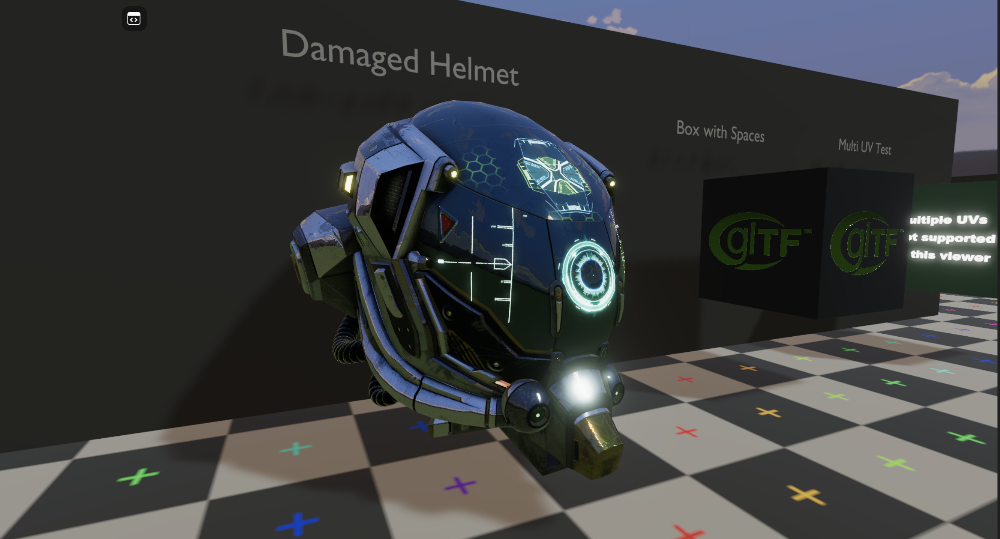

#### Roughness

Los materials roughness están relacionados con la simulación realista de cómo la luz interactúa con la superficie del material. Normalmente se usan roughness maps para darle a los modelos un rango de "suavidad" o "rugosidad" en sus superficies. Un texture map de valor de escala de grises se usa normalmente para proporcionar información de este tipo.

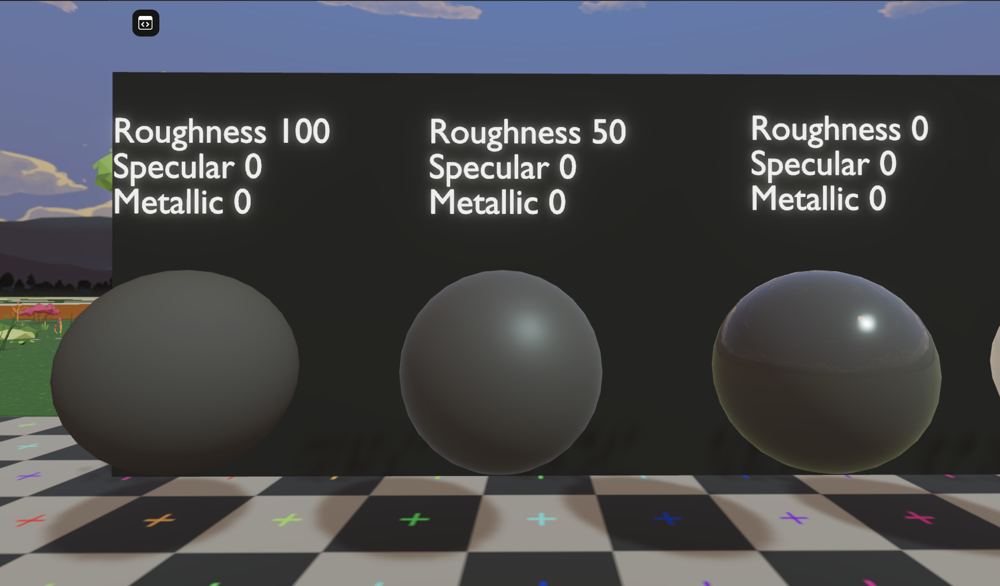

Esta propiedad mezcla entre un modelo de material no metálico y metálico. Un valor de 1.0 da una reflexión specular completamente teñida con el color base, sin reflexión diffuse o transmisión. En 0.0 el material consiste en una capa base diffuse o transmisiva, con una capa de reflexión specular encima.

#### Specular

En un shader Physically-Based Rendering (PBR), las propiedades specular se refieren a cómo la luz interactúa con una superficie en términos de su reflectividad y brillo. La reflexión specular es la reflexión tipo espejo de la luz fuera de una superficie. En PBR, esta propiedad se usa para controlar cuánta luz refleja una superficie de manera similar a un espejo. Materiales como metales típicamente tienen alta reflexión specular, creando highlights brillantes y nítidos, mientras que materiales no metálicos como plásticos tienen menor reflexión specular, resultando en highlights más amplios y suaves.

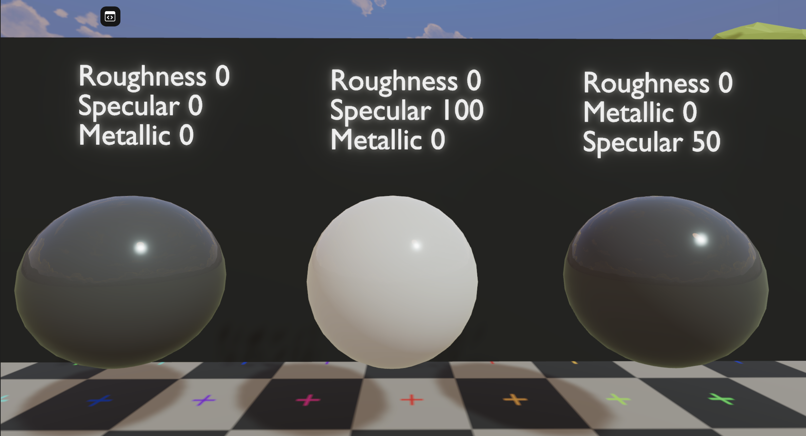

#### Alpha

Puedes configurar un material para que sea _transparent_. Los materials transparentes se pueden ver a través de ellos en diversos grados, dependiendo de su _alpha_. Para hacer esto, activa la propiedad transparency del material y luego establece su _alpha_ a la cantidad deseada. Un alpha de 1 hará que el material sea completamente opaco, un alpha de 0 lo hará invisible.

La imagen a continuación muestra dos modelos idénticos creados con standard materials. El de la izquierda usa solo materials opacos, el de la derecha usa materials tanto transparentes como opacos en algunas de sus partes.


💡 Recuerda que usar materials transparentes siempre es más costoso en términos de performance que materials diffuse. Siempre trata de mantener los materials transparentes lo más bajos que puedas.


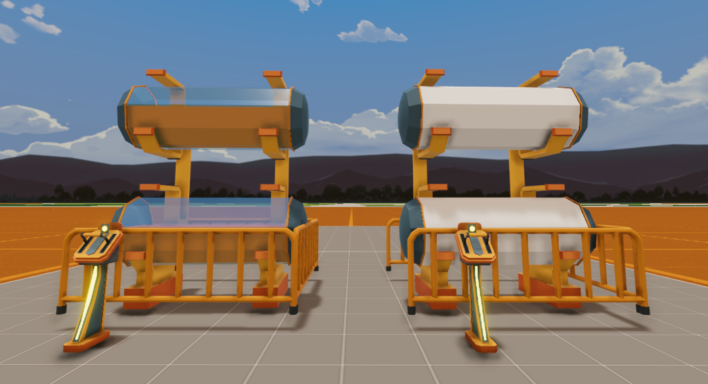

Hay dos modos de transparencia principales diferentes: _Alpha Clip_ y _Alpha Blend_. Las principales diferencias son:

* **Alpha Clip:** Alpha Clip renderiza valores absolutos siendo 0 o 1 dado un clip threshold de un valor en escala de grises. El color anterior será sobrescrito por el color de la superficie, pero solo si el valor alpha está por encima del valor Clip Threshold.

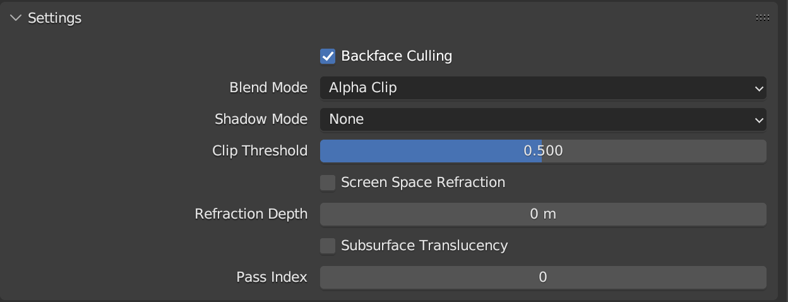

* **Alpha Blend:** Alpha Blend interpola los valores entre 0 y 1. Puedes usar alpha blending para superponer el color de la superficie encima del color anterior.

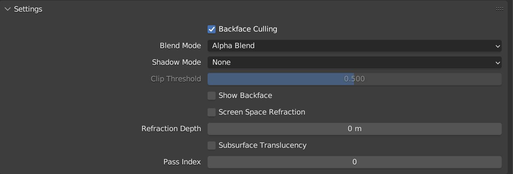


**🔥Tip de Optimización🔥** A menos que específicamente quieras poder tener un nivel intermedio de transparencia, **siempre es más performante para rendering usar \_Alpha Clip**_\*\* en lugar de \*\*_**Alpha Blend**\_**.**



**⚠️ Problemas de Sorting**

Cuando usas blend modes transparentes en tu juego, es crucial considerar el orden en el que tiene lugar el color blending. Esto es porque el color de salida final puede verse significativamente afectado por el blending order. Actualmente, el motor solo soporta per-object sorting, lo que significa que automáticamente ordena todas las superficies transparentes basándose en el origen del objeto. Sin embargo, per-fragment (pixel) sorting y per-triangle sorting no están actualmente soportados.

Para evitar problemas relacionados con sorting, es mejor evitar usar objetos con alpha clip y alpha blend en el mismo mesh. Esto puede ayudar a prevenir artefactos de blending inesperados y asegurar que tu juego se vea de la mejor manera.


#### Emissive

También puedes hacer un material _emissive_. Los materials emissive proyectan su propia luz. Ten en cuenta que cuando se renderizan, no iluminan realmente objetos cercanos en la escena, solo parecen tener un resplandor difuminado alrededor de ellos.

La imagen a continuación muestra dos modelos idénticos creados con standard materials. El de la derecha tiene materials emissive brillantes en algunas de sus superficies.

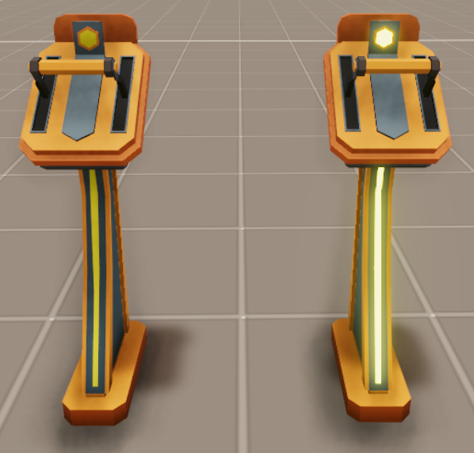 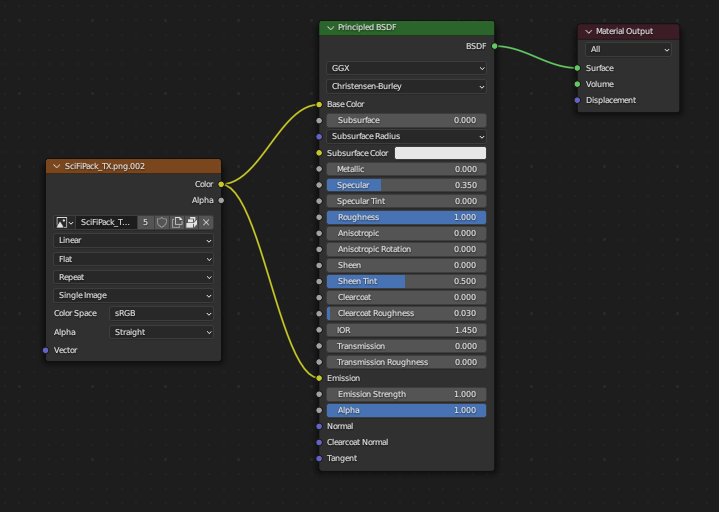

_Para hacer un material emissive en Blender, simplemente agrega un shader `emission` al material._

#### Emissive Strength

Strength de la luz emitida. Un valor de 1.0 asegurará que el objeto en la imagen tenga exactamente el mismo color que el Emission Color, es decir, lo hace 'shadeless'.

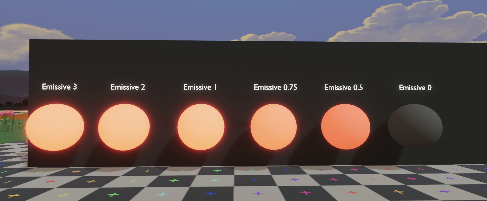

_Puedes verificar en el_ [_testing world_](decentraland://?realm=TestEnvironment.dcl.eth) _cómo se comporta el emission strength en el mundo_

#### Normal

El nodo "normal" en un shader PBR es un componente fundamental usado para controlar las normales de superficie de un material. Las normales son vectores que definen la dirección perpendicular a una superficie en un punto específico, y juegan un papel crucial en determinar cómo la luz interactúa con la superficie.

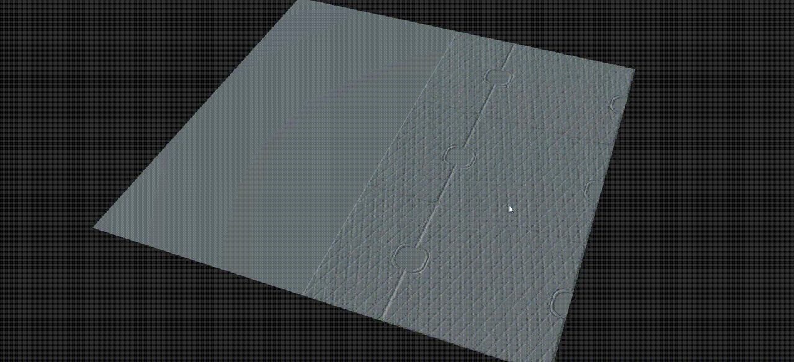

### Vertex Painting

El vertex painting de modelos 3D actualmente no es soportado por el motor de Decentraland.

### Limitaciones de Material

Ten en cuenta que los límites de material por parcel son:

> log2(n+1) x 20 Cantidad de materials en la escena. Incluye materials importados como parte de modelos.

Es importante tener en cuenta que cada material representa un draw call por objeto, así que es crucial mantener los materials lo más mínimo posible y tratar de reutilizar materials tanto como sea posible haciendo técnicas como Texture Atlases, esto también beneficiará a la escena teniendo un estilo cohesivo entre los assets de tu escena.

### Nomenclatura de Material

Para tener un pipeline de arte organizado y saludable, recomendamos nombrar tus materials apropiadamente. Una forma de hacerlo es usando este método de convención.

```
<Object>_<Classification>_<Sub-Classification(opcional)>_<_MAT>
```

Entonces, por ejemplo, digamos que hicimos 2 árboles diferentes, uno que es emissive y brillante para primavera y otro frío y metálico para invierno. Podríamos nombrar los materials: _"TreeSpring\_Emissive\_MAT"_ y otro _"TreeWinter\_Metallic\_MAT"_

En conclusión,

* 🟢 **Prefiere** usar nombres comenzando con el objeto y clasificación: _"Wood\_Oak\_MAT"_, _"SciFiFence\_Metallic\_MAT"_, etc.
* 🔴 **Evita** usar nombres como _"Material009"_, _"material1"_, que hace que la escena y los modelos sean realmente difíciles de rastrear y analizar.

### Override de glTF materials

Puedes sobreescribir los materials de un modelo _glTF_ usando el componente [GltfNodeModifiers](../sdk7/3d-essentials/materials.md#modify-gltf-materials) en el código de tu escena. Ve [Modify glTF materials](../sdk7/3d-essentials/materials.md#modify-gltf-materials) para más detalles.

### Mejores Prácticas para Materials

* Si tu escena incluye múltiples modelos que usan la misma textura, referencia la textura como un archivo externo en lugar de tenerla embebida en el modelo 3D.

Las texturas embebidas se duplican para cada modelo y se agregan al tamaño de la escena. Los archivos _.glb_ tienen sus texturas embebidas por defecto, pero puedes usar [**glTF pipeline**](https://github.com/AnalyticalGraphicsInc/gltf-pipeline) para extraerla afuera.

> Nota: Después de referenciar un archivo para una textura que no estará embebida, asegúrate de que ese archivo no se moverá o renombrará, ya que de lo contrario la referencia al archivo se perderá. El archivo también debe estar dentro de la carpeta de la escena para que se cargue junto con la escena.

* Al configurar transparency de un material, trata de siempre usar _Alpha clip_ en lugar de _Alpha blend_, a menos que específicamente necesites tener un material que sea parcialmente transparente (como vidrio). Esto evitará problemas donde el motor renderiza el modelo incorrecto frente al otro.
* Como regla general recuerda siempre establecer _backface culling_ en tus materials. Esto hará que tu escena sea más performante dado que el motor va a renderizar solo la cara visible de tus modelos. Solo desactiva _backface culling_ en caso de que necesites que un modelo se renderice en ambos lados (por ejemplo, un grupo de hojas de un árbol hechas por planos 3D).

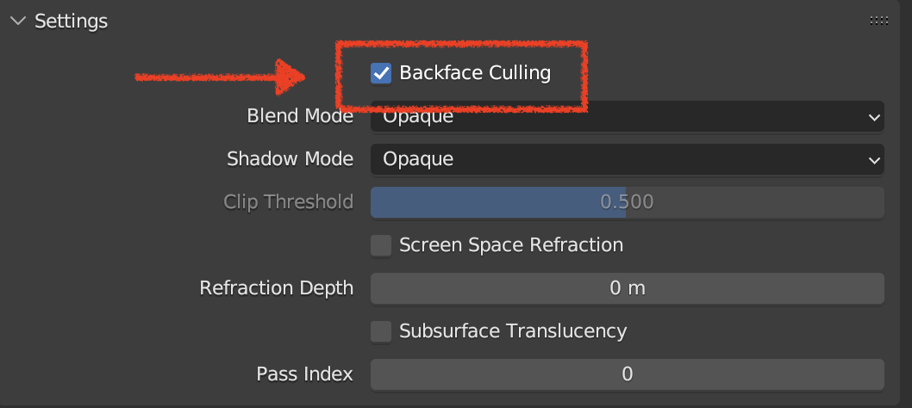

* Usa las [**texturas por defecto**](https://github.com/decentraland/builder-assets/tree/master/textures) de Decentraland, que están pre-cargadas por los jugadores, haciendo que tus assets se rendericen mucho más rápido.
* Lee [**este artículo**](https://www.khronos.org/blog/art-pipeline-for-gltf) para una descripción detallada de un pipeline de arte completo que usa texturas PBR en modelos glTF.
* Puedes encontrar una referencia detallada sobre cómo crear materials compatibles con glTF con Blender en [**la documentación de Blender**](https://docs.blender.org/manual/en/latest/addons/import_export/scene_gltf2.html).
* Encuentra texturas PBR gratuitas de alta calidad en [**cgbookcase**](https://cgbookcase.com/).
