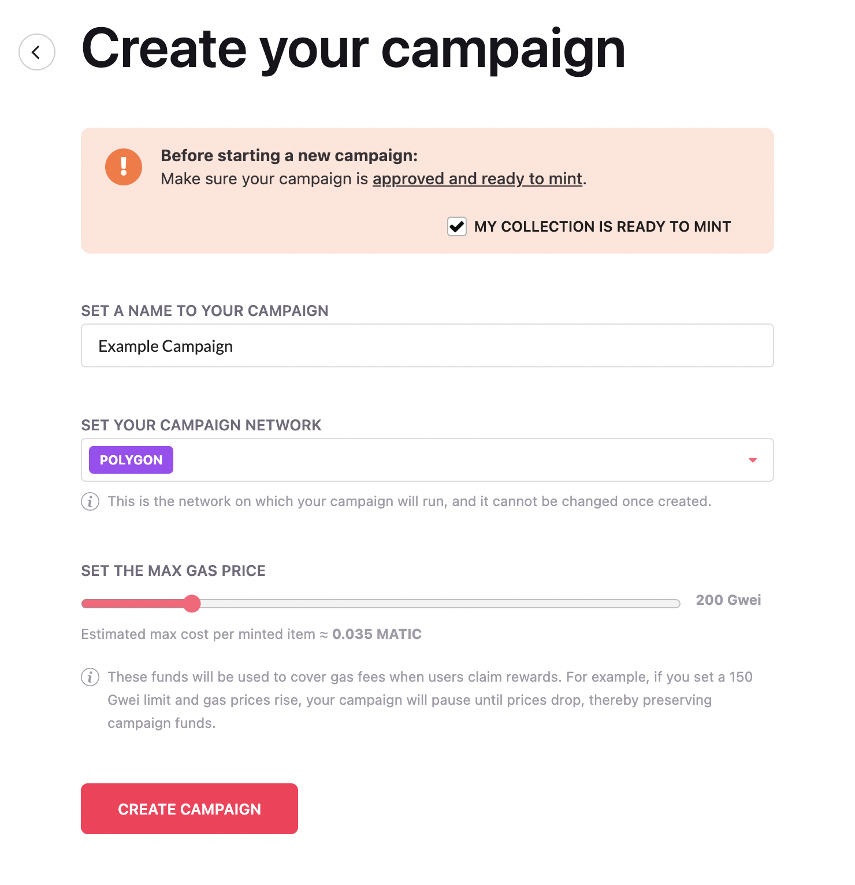
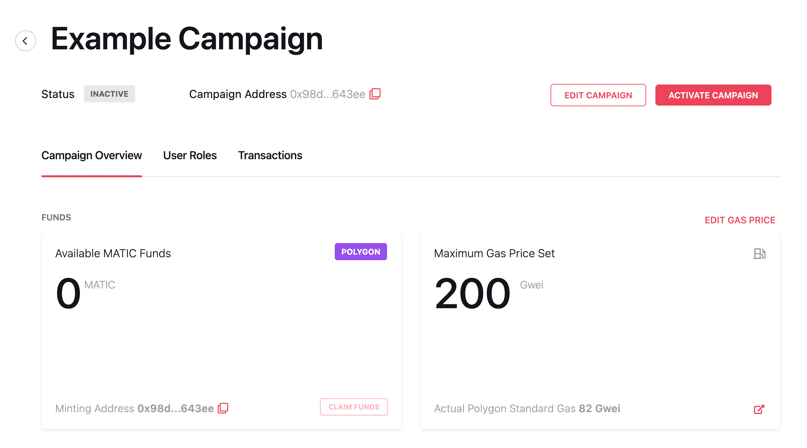
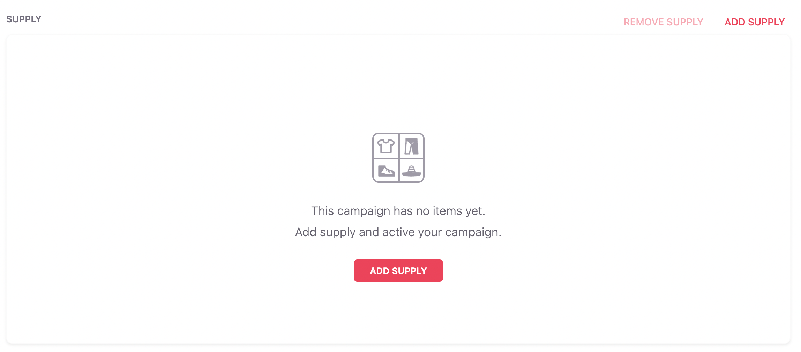
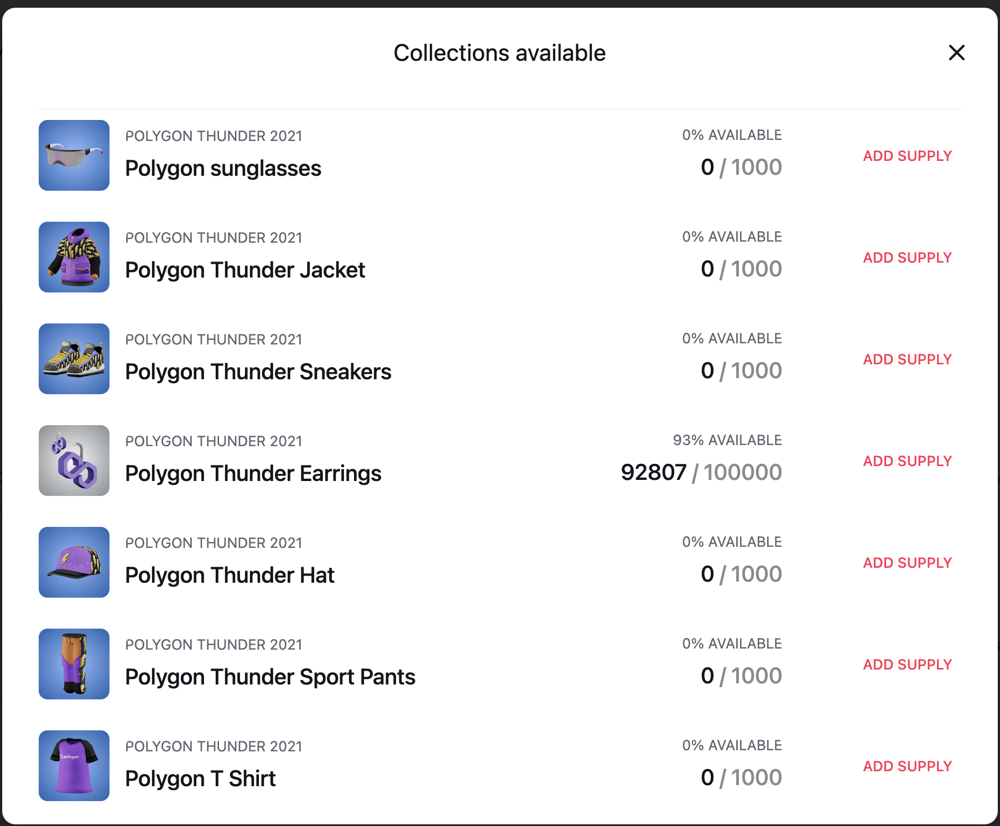
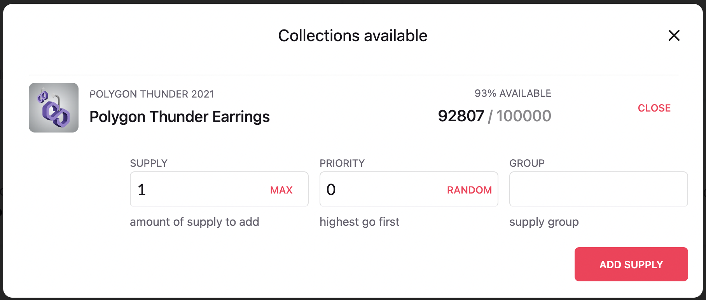
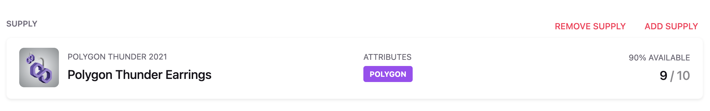
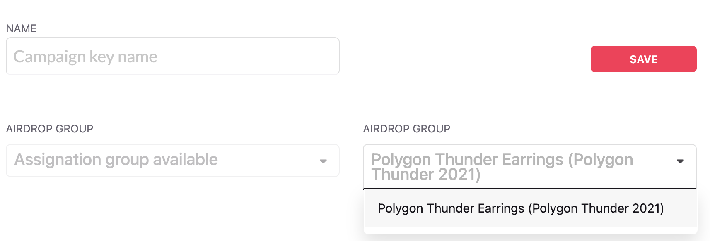
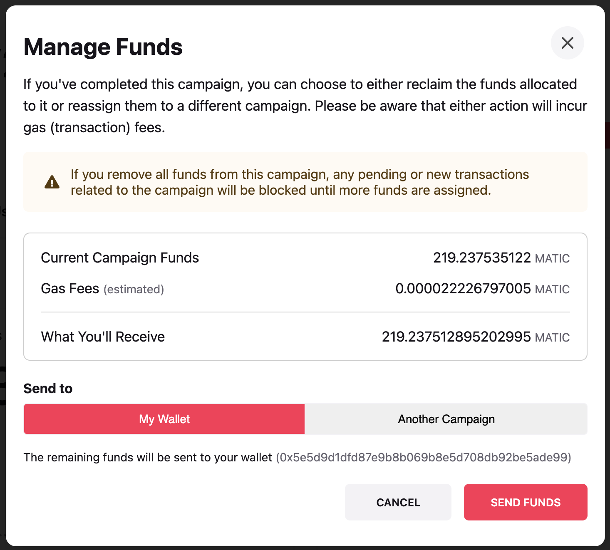

---
metaLinks:
  alternates:
    - /broken/spaces/oPnXBby9S6MrsW83Y9qZ/pages/plBKCIK6oDBlWLw0Bm3U
---

# Comenzando

Esta página te guiará a través del proceso de usar el sistema de Rewards para incentivar la participación de los usuarios con Wearables y Emotes de Decentraland. Aprenderás cómo configurar y gestionar una campaña de recompensas, incluyendo crear una campaña, agregar artículos al inventario de la campaña, gestionar fondos y usar dispensadores para entregar recompensas. Además, encontrarás instrucciones para activar tu campaña y manejar tarifas de transacción.

### Prerequisitos

Antes de comenzar a usar el sistema de Rewards, asegúrate de tener una colección [aprobada y lista para acuñar](../../creator/creator/wearables-and-emotes/publishing/publishing-collections.md). Esta colección debe contener los artículos que planeas ofrecer como recompensas en tu campaña.

### Crear tu primera campaña

Una campaña se refiere a una iniciativa de incentivo diseñada para impulsar la participación de los usuarios a través de ofertas de recompensas. En esta sección, descubrirás los detalles de configuración de la campaña, junto con los prerequisitos para iniciar la distribución de recompensas.

1. Accede a la [dApp de Rewards](https://decentraland.org/rewards)
2. Conecta tu billetera
3. Haz clic en la pestaña **Campaigns**
4. Haz clic en el botón **Create Campaign**. Serás redirigido al formulario de creación de campaña.



5. Completa los siguientes campos:

* **Campaign Name**: Elige un nombre para tu campaña. Este nombre será visible para los usuarios en su página de recompensas.
* **Campaign Network**: Selecciona la red donde tus wearables serán acuñados. Ten en cuenta que esta elección es final y no puede cambiarse una vez que se crea la campaña.
* **Max Gas Price**: Establece el precio máximo de gas que estás dispuesto a pagar por transacción. Si el precio de gas de una transacción excede este límite, se aplazará hasta que el precio baje. La interfaz proporcionará una estimación del costo para acuñar cada artículo basándose en esta configuración.

6. Haz clic en el botón **Create Campaign**. Serás redirigido a la página de la campaña.



Después de crear tu campaña, hay algunos pasos más que completar antes de que puedas comenzar a entregar recompensas:

* **Agregar un Suministro de Tokens MATIC**: Asegúrate de tener suficientes tokens MATIC en tu cuenta para cubrir tarifas de transacción.
* **Agregar Artículos al Inventario de la Campaña**: Llena tu campaña con los artículos que planeas ofrecer como recompensas.
* **Crear un Dispensador**: Configura un dispensador que manejará la distribución de recompensas a los usuarios.
* **Activar tu Campaña**: Finalmente, activa tu campaña para hacerla activa y comenzar a entregar recompensas.

#### Agregar MATIC para pagar tarifas de transacción

Para acuñar artículos, necesitarás cubrir las tarifas de transacción agregando un suministro de tokens MATIC a la dirección de tu campaña. Puedes encontrar esta dirección listada debajo del nombre de la campaña.

Para transferir MATIC desde tu billetera, primero, asegúrate de estar conectado a la misma red que la campaña. Luego, copia la dirección de la campaña y envía la cantidad deseada de MATIC a ella. Si no tienes MATIC en tu billetera, puedes seguir \[esta guía]\([Ver documentación](../)#where-can-i-get-matic-to-pay-for-transaction-fees) para adquirir algo.


**💡 Consejo**: Para campañas que se ejecutan en la red de prueba **AMOY**, puedes obtener algo de MATIC desde [este faucet](https://faucet.polygon.technology/).


Para enviar MATIC desde un exchange solo necesitas retirar el token MATIC a la Red de Polygon (generalmente la Red Amoy no está disponible en exchanges).

#### Agregar artículos al inventario de la campaña

Cuando creas una nueva campaña, comienza con un inventario vacío. Para comenzar a entregar recompensas, necesitarás agregar artículos a la campaña:



* **Otorgar Permisos de Acuñación**: Primero, autoriza a la campaña para acuñar artículos. Sigue \[esta guía]\([Ver documentación](../)#adding-minters-to-the-collection) y usa la dirección de la campaña (ubicada debajo del nombre de la campaña) como la dirección del acuñador. Después de enviar, espera a que la transacción se confirme.
*   **Agregar Artículos al Inventario de la Campaña**: Una vez que se otorgan los permisos de acuñación, puedes comenzar a agregar artículos al inventario de la campaña.

    a) Haz clic en el botón **Add Supply** para ver todas las colecciones para las cuales la campaña tiene permisos de acuñación.



```
b) Selecciona el artículo de la colección que deseas agregar al inventario, luego haz clic en el botón **Add Supply**.
```



```
c) Selecciona la cantidad de artículos que deseas agregar al inventario de la campaña y haz clic en el botón **Add supply**.
```




Los campos Priority y Group son características avanzadas que se cubrirán en una sección dedicada.


#### Crear un dispensador para entregar las recompensas

Los dispensadores son las herramientas utilizadas para enviar o reclamar recompensas de tu inventario. Cada dispensador está asociado con una clave única, que se requiere para la autenticación con la API HTTP. Aunque la clave no se muestra en la interfaz, puedes copiarla haciendo clic en el botón Copiar.

Cuando creas una nueva campaña, se proporciona automáticamente un dispensador predeterminado con una clave maestra solo con fines de prueba. Para configurar un nuevo dispensador, haz clic en el botón **Add Dispenser**.



Selecciona el grupo de artículos del que deseas tomar artículos, y haz clic en el botón **Save**.


Los dispensadores tienen algunas opciones de configuración que se cubrirán en una sección dedicada.


#### Activar tu campaña

Por defecto tu campaña está inactiva. Esto evita que el servicio de recompensas asigne nuevas recompensas. Para activar tu campaña, haz clic en el botón **Activate campaign**.


**📔 Nota**: Si una campaña activa se establece como inactiva, las recompensas pendientes aún se enviarán. Sin embargo, las nuevas reclamaciones o reclamaciones que necesiten ser reintentadas por alguna razón serán prevenidas.


**Ahora estás listo para comenzar a acuñar wearables/emotes usando la** [**API**](../../creator/land/api.md)

#### Gestionar fondos

Una vez que se completa la campaña, si quedan fondos de las tarifas de transacción, el propietario puede elegir reclamar los fondos o reasignarlos a otra campaña. Para reclamar fondos, simplemente haz clic en el botón Manage Funds en la página de detalles de la campaña.




**📔 Nota**: Si se eliminan todos los fondos de una campaña, cualquier transacción pendiente o nueva relacionada con esa campaña se bloqueará hasta que se asignen más fondos.

