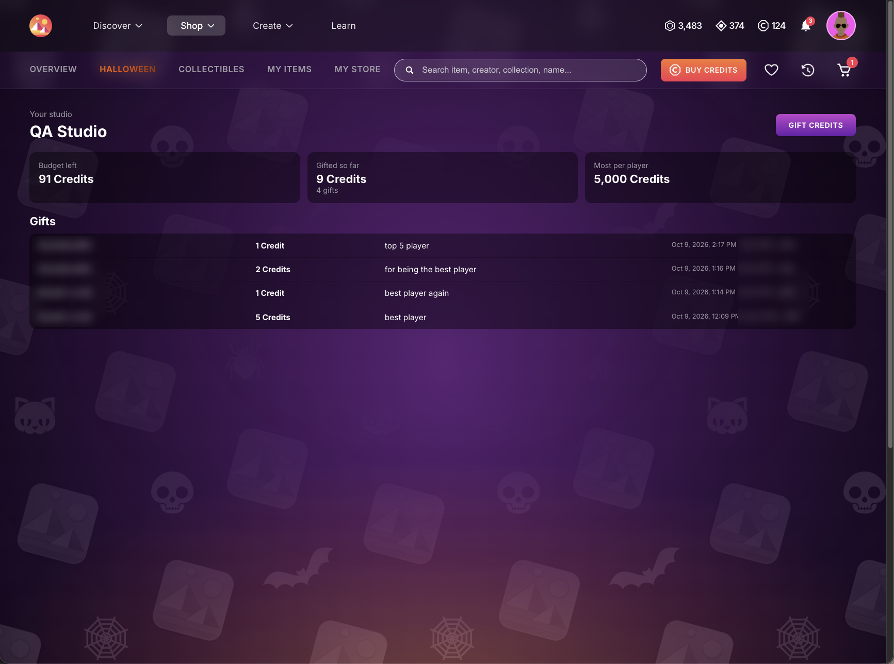
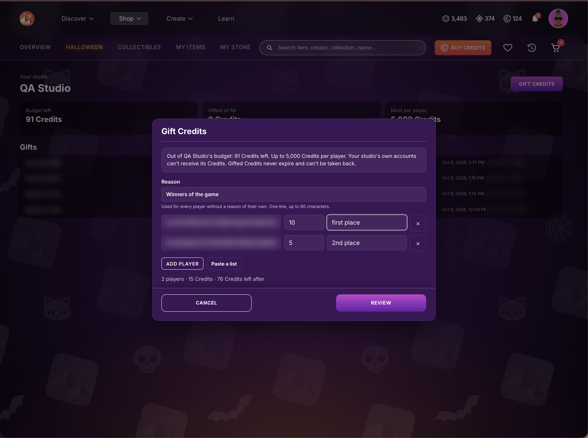
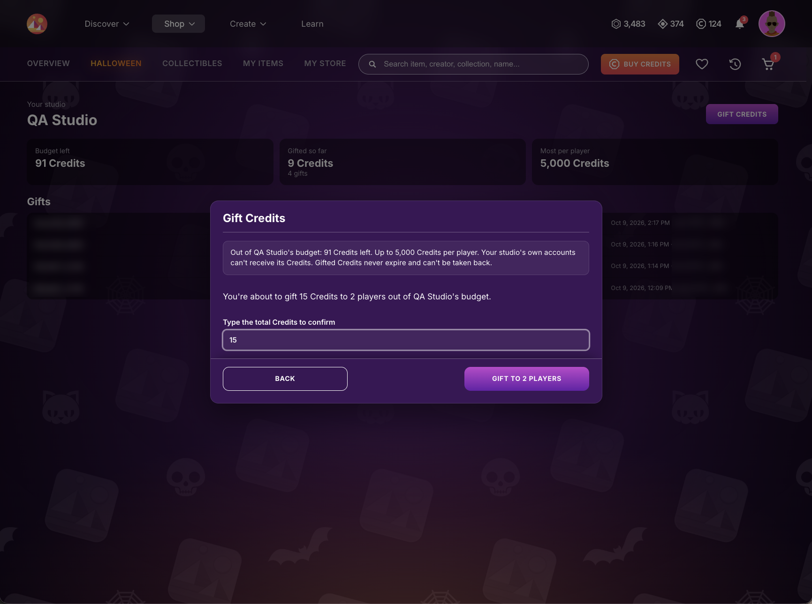

# Regalar Créditos (Beta)

Regalar Créditos es, por ahora, un programa beta solo por invitación. Los estudios que participan pueden regalar Créditos a sus jugadores.

Si tu estudio fue invitado a participar, puedes regalar Créditos desde la página Studio del Shop, en [decentraland.org/shop/studio](https://decentraland.org/shop/studio). Los jugadores pueden gastar estos Créditos en cualquier cosa del Shop.

## Antes de empezar

* **Tu cuenta debe gestionar el estudio.** Decentraland agrega las cuentas que pueden regalar por tu estudio. Si inicias sesión y ves _Esta cuenta no gestiona ningún estudio_, pídele a tu contacto de Decentraland que agregue esa cuenta.
* **Las cuentas de tu propio estudio no pueden recibir sus Créditos.** Usa otra cuenta para cualquier regalo de prueba.
* **Los regalos son definitivos.** Los Créditos regalados no vencen y no se pueden quitar, así que revisa la lista antes de confirmarla.

## Tu página Studio

Inicia sesión en la página Studio, en [decentraland.org/shop/studio](https://decentraland.org/shop/studio). Si tu cuenta gestiona más de un estudio, elígelo en el menú **Estudio**. La página muestra:

* **Presupuesto disponible**: los Créditos que tu estudio todavía puede regalar.
* **Regalado hasta ahora**: lo que tu estudio regaló, y en cuántos regalos.
* **Máximo por jugador**: el regalo más grande que puede recibir un jugador de una vez.
* **Regalos**: cada regalo que hizo tu estudio, con el jugador, los Créditos, el motivo, la fecha y quién lo envió.



Si la página dice que el estudio está en pausa, no puede regalar hasta que Decentraland lo reactive.

## Regalar Créditos

1. Presiona **Regalar Créditos**.
2. Escribe un **Motivo**. Se usa para cada jugador que no tenga un motivo propio: una línea, hasta 80 caracteres, por ejemplo _Mejor jugador de la semana_.
3. Agrega los jugadores, uno por fila: su cuenta (la dirección `0x…`) y los Créditos a regalar. Puedes darle a una fila su propio motivo.
   * **Agregar jugador** agrega una fila.
   * **Pegar una lista** toma un jugador por línea: cuenta, Créditos y un motivo opcional. También sirven columnas copiadas de una planilla.

     ```
     0x…, 100, Mejor jugador de la semana
     0x…, 50
     ```
   * Escribe los montos sin separadores de miles (`1000`, no `1,000`).
   * Cada cuenta va en una sola fila: si un jugador recibe dos montos, súmalos.
4. Revisa el resumen debajo de la lista (jugadores, total de Créditos y el presupuesto que queda después) y presiona **Revisar**.

   
5. La revisión te avisa si algún jugador recibió el mismo regalo (mismos Créditos y motivo) de tu estudio en los últimos 30 días. Vuelve y quítalo, salvo que quieras regalarle de nuevo.
6. Escribe el total de Créditos para confirmar y presiona **Regalar a … jugadores**.

   

Los regalos se envían de a uno y cada fila muestra cómo salió. Si la ventana se cierra o detienes la lista, vuelve a abrir **Regalar Créditos** y presiona **Continuar**: los jugadores que ya recibieron su regalo nunca lo reciben dos veces.

## Qué reciben tus jugadores

* Una notificación en Decentraland que dice que tu estudio les regaló Créditos.
* Un email, si confirmaron su email en su cuenta de Decentraland.
* El regalo en su actividad del Shop, y los Créditos en su saldo, listos para gastar.

## Si un regalo no sale

| Mensaje | Qué hacer |
| --- | --- |
| Esta cuenta pertenece a tu estudio | Las cuentas de tu propio estudio no pueden recibir sus Créditos. Quita la fila. |
| Esta cuenta no puede recibir regalos | Este jugador no puede recibir Créditos. Quita la fila. |
| Supera el máximo por jugador | Baja el monto al **Máximo por jugador** que muestra tu página Studio. |
| No queda presupuesto suficiente | Regala menos, o habla de tu presupuesto con tu contacto de Decentraland. |
| El estudio está en pausa | Espera a que Decentraland reactive el estudio y presiona **Continuar**. |
| No recibimos confirmación | Revisa la lista de **Regalos** antes de enviarlo de nuevo: puede que el regalo ya esté. **Continuar** nunca le regala dos veces a nadie. |
