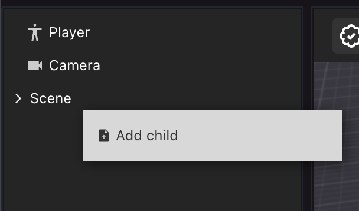

# Components

Selecciona un ítem haciendo clic en él en el canvas o en el entity tree. Luego verás sus componentes mostrados en el panel de propiedades, a la derecha de la pantalla. Diferentes ítems tienen diferentes componentes que cada uno muestra configuraciones específicas.

La mayoría de los ítems no interactivos tienen los siguientes componentes:

* **Transform**: Establece la posición, rotación y escala del ítem. Si el ítem es hijo de otro ítem en el [Entity Tree](../scene-editor/get-started/scene-editor-essentials.md#the-entity-tree), estos valores son relativos a los del padre.
* **GLTF**: Qué modelo 3D cargar. Incluye la ruta local al archivo para este modelo 3D. También incluye algunas propiedades para configurar [colliders](../sdk7/3d-essentials/colliders.md#colliders-on-3d-models) en el modelo.

Los ítems en tu escena son todos **Entities**. Todo en una escena es una Entity, son los bloques de construcción básicos de las escenas. Los ítems son Entities que tienen al menos una posición y una forma visible.

### Agregar componentes

Para agregar Components a cualquier Entity, haz clic en el signo **+** en la parte superior de la pestaña de propiedades y selecciona el Component de la lista. Consulta [Make any item smart](../scene-editor/interactivity/make-any-item-smart.md)

Puedes eliminar cualquier Component de una Entity haciendo clic en el ícono de tres puntos a su derecha y seleccionando **Delete Component**.

### Crear una entidad desde cero

Para crear una nueva Entity desde cero, haz clic derecho en la Entity raíz **Scene** en el Entity tree, o en cualquier otra Entity, y selecciona **Add Child**

Esto crea una Entity vacía con solo un Component **Transform**. La nueva entidad es hija de la entidad padre en la que hiciste clic. Luego puedes agregar cualquier otro Component que desees para darle forma a lo que desees.

### Componentes disponibles

Los siguientes Components se pueden agregar a cualquier Entity a través de la UI del Scene Editor:

* **Mesh Renderer**: Le da a la Entity una forma visible basada en una forma primitiva (cubo, plano, cilindro, cono o esfera).
* **Mesh Collider**: Le da a la Entity una geometría de collider invisible. Esto puede bloquear al jugador de caminar a través del ítem, y/o puede hacerlo clickeable. Consulta [collider](../sdk7/3d-essentials/colliders.md).
*   **Material**: Define el color, textura y otras propiedades de una Entity que tiene un Component **Mesh Renderer**. Consulta [materials](../sdk7/3d-essentials/materials.md).

    \{% hint style="warning" %\} **📔 Nota**: El ítem DEBE tener un Component **Mesh Renderer**. No afecta ítems con una forma visible **GLTF**. \{% endhint %\}
* **Visibility**: Define si una Entity es invisible.
* **Light Source**: Agrega una luz a la Entity.

\-- **Swap Material**: Intercambia el material de una Entity que tiene un componente **GLTF**. Si el modelo 3D tiene múltiples meshes, puedes intercambiar el material de cada mesh individualmente.

* **Audio Source**: Reproduce un sonido desde un archivo de sonido en la ubicación de la Entity. Consulta [Sounds](../sdk7/3d-essentials/sounds.md).
* **Text Shape**: Muestra texto en el espacio 3D. Consulta [Text](../sdk7/3d-essentials/text.md).
* **Pointer Events**: Marca una Entity como clickeable, mostrando un hover-hint.


**📔 Nota**: El Component **Pointer Events** solo proporciona retroalimentación. Para realizar acciones cuando se interactúa con una Entity, consulta [Make any item smart](../scene-editor/interactivity/make-any-item-smart.md)


* **Multiplayer**: Comparte cualquier cambio que ocurra en la Entity para que todos los jugadores en la escena también lo vean. Se puede configurar para compartir solo cambios en ciertos componentes. Consulta [Serverless Multiplayer](../sdk7/networking/serverless-multiplayer.md#mark-an-entity-as-synced) para más detalles.


**📔 Nota**: Existen otros componentes en el SDK que actualmente solo son utilizables a través de código. También puedes crear tus propios [Custom components](../sdk7/architecture/custom-components.md) a través de código, estos no tendrán una representación UI, pero se pueden agregar y editar a través de código.

Consulta [Combine with code](../scene-editor/code/overview.md) para saber cómo editar el código de tu escena.

También ten en cuenta que una Entity solo puede contener **uno** de cada Component. No es posible asignar una segunda instancia de un Component que ya existe en la entidad. Por ejemplo, no puedes tener dos componentes **Actions** en una misma Entity.


### Smart items

Los [Smart items](../scene-editor/interactivity/smart-items.md) también pueden incluir componentes especiales que controlan la interactividad de la Entity. Estos son típicamente:

* **Actions**: Lista todas las acciones posibles que el ítem puede llevar a cabo.
* **Triggers**: Determina cuándo se llevan a cabo las acciones del componente Actions.
* **States**: Rastrea el estado actual del ítem. El estado se puede usar para lógica condicional, para activar solo ciertas acciones si el ítem está en cierto estado.
* **Counter**: Rastrea un contador. El contador se puede usar para lógica condicional, para activar solo ciertas acciones si el valor del contador es igual/mayor/menor que un valor dado.

Consulta [Smart items advanced](../scene-editor/interactivity/smart-items-advanced.md) para más detalles.

### Acerca de entidades y componentes

Todo en una escena es una Entity. Todos los ítems y smart items en la escena son Entities.

Todos los rasgos de una Entity están determinados por sus componentes. Definen qué es la Entity, dónde está, cómo suena y cómo se comporta. Por ejemplo, un componente **Transform** almacena las coordenadas, rotación y escala de la Entity. Un componente **MeshRenderer** le da a la Entity una forma visible (como un cubo o una esfera), y un componente **Material** le da a la Entity un color o textura.

Los valores en los componentes pueden cambiar con el tiempo. En el Scene Editor configuras los valores iniciales para estos componentes. Pero una vez que tu escena está en ejecución, las acciones del jugador o el paso del tiempo pueden cambiar esos valores.

Por ejemplo, un Smart Item de plataforma móvil tiene una posición inicial que estableces a través de su componente **Transform**, pero después de que las acciones de este ítem lo hagan moverse, su **Transform** tendrá valores diferentes.

Consulta [Entities and components](../sdk7/architecture/entities-components.md) para una mirada en profundidad de este concepto y cómo se usan en las escenas de Decentraland.
