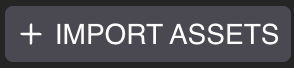
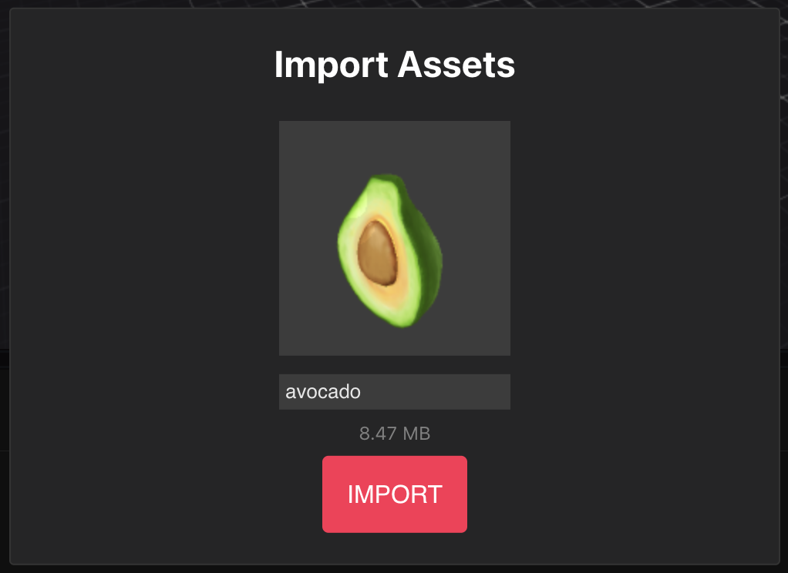

# Importar Ítems

Puedes importar tus propios modelos 3D al Scene Editor. Elige modelos de una amplia selección de fuentes gratuitas o de pago en internet, o crea tus propios modelos personalizados. También puedes importar otros assets como imágenes, archivos de sonido y videos.

### Importar un asset

Para importar un modelo 3D, una imagen, un archivo de sonido o un video a tu escena desde tu disco local:

1. Arrastra archivos directamente al panel inferior. También puedes hacer clic en el botón **+ Import Assets** en la parte superior izquierda del panel inferior y seleccionar desde tu unidad local.

2. Verifica la miniatura del modelo y haz clic en **Import**. Al importar múltiples assets, usa los botones de flecha para recorrer cada asset.

Ahora puedes encontrar tu asset en la pestaña **Local Assets**, bajo la carpeta **scene**. Los modelos 3D aparecen bajo la carpeta _scene/3D Model_, las imágenes bajo _scene/Image_

* Para modelos 3D, arrastra los archivos `.glb` o `.gltf` al canvas para agregarlos como ítems en tu escena.
* Otros tipos de assets como imágenes y archivos de sonido se pueden arrastrar a los campos de un ítem. Por ejemplo, puedes arrastrar un archivo `.mp3` al campo _Path_ de un componente _Audio Source_.


**💡 Tip**: También puedes pegar archivos directamente en la carpeta del proyecto. Después de hacer esto, presiona el botón **Refresh** junto al botón **Import Assets** para ver los nuevos archivos.



### Formatos soportados

#### Audio

Los siguientes formatos de Audio son soportados:

* _.mp3_
* _.wav_
* _.ogg_

#### Image

Los siguientes formatos de imagen son soportados:

* _.png_
* _.jpg_
* _.jpeg_

#### Video

Los siguientes formatos de video son soportados:

* _.mp4_

#### Modelos 3D

Los siguientes formatos de modelo 3D son soportados:

* _.glTF_
* _.glb_

Ambos pueden incluir archivos de imagen de textura externos, o archivos binarios externos (_.bin_).

Puedes convertir otros formatos a estos formatos con varios editores y herramientas diferentes. Consulta [3D modeling](../3d-modeling/3d-models.md) para recomendaciones y tips.

Todos los materiales en los modelos deben ser _basic material_ o _PBR_, y todas las texturas deben tener tamaños que sean potencias de dos (ej: 256, 512). Consulta [Scene limitations](../sdk7/optimizing/scene-limitations.md) para detalles.

Todos los archivos de modelo 3D deben ocupar menos de 50 MB cada uno para ser utilizables en una escena. Los archivos más grandes no son soportados.

**Bibliotecas gratuitas para modelos 3D**

En lugar de construir tus propios modelos 3D, también puedes descargarlos de varias bibliotecas gratuitas o de pago.

Para comenzar, a continuación hay una lista de bibliotecas que tienen contenido gratuito o relativamente económico:

* [IWB Catalog](https://dcl-iwb.co/)
* [SketchFab](https://sketchfab.com/)
* [Clara.io](https://clara.io/)
* [Archive3D](https://archive3d.net/)
* [SketchUp 3D Warehouse](https://3dwarehouse.sketchup.com/)
* [Thingiverse](https://www.thingiverse.com/) (modelos 3D hechos principalmente para impresión 3D, pero adaptables a Mundos Virtuales)
* [ShareCG](https://www.sharecg.com/)


**📔 Nota**: Presta atención a las restricciones de licencia que tiene el contenido que descargas.


También puedes usar herramientas de AI Generativa para generar tus propios modelos 3D. Consulta:

* [Meshy](https://www.meshy.ai/)
* [Luma AI](https://lumalabs.ai/genie)
* [TRipo3D](https://www.tripo3d.ai/app)
* [Rodin](https://hyper3d.ai/rodin)

Ten en cuenta que en varios de estos sitios, puedes elegir en qué formato descargar el modelo. Siempre elige el formato _.glTF_ o _.glb_ si está disponible. Si no está disponible, debes convertirlos a _.glTF_ o _.glb_ antes de poder usarlos en una escena. Para eso, recomendamos importarlos a Blender y exportarlos con uno de los add-ons de exportación _.glTF_ disponibles.

### Colliders

Puede que encuentres que al ejecutar un preview el jugador puede caminar a través de tus modelos 3D importados. Esto es probable porque los modelos están faltando un _collider mesh_ para definir una geometría de colisión. Consulta [colliders](../3d-modeling/colliders.md) para más detalles e instrucciones.


**💡 Tip**: En lugar de editar el modelo para agregar un _collider mesh_, una alternativa más simple es agregar un smart item _Invisible wall_ con aproximadamente la misma forma para estar en su lugar.


### Animaciones

Si un modelo importado incluye animaciones, la primera animación que está empaquetada en el modelo se reproducirá en un bucle.

Ten en cuenta que no tienes ningún control sobre cuándo comienza o se detiene la animación, o cuál se reproduce en caso de varias animaciones.

Si hay múltiples jugadores en la escena, pueden estar viendo la animación fuera de sincronización entre sí.

Para cambiar este comportamiento, puedes incluir un componente **Animator**. Consulta [Make any item smart](../scene-editor/interactivity/make-any-item-smart.md) para herramientas sin código para hacer tu ítem interactivo.
