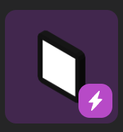

# NFTs

Puedes agregar NFTs (Tokens No Fungibles) a tu escena, mostrados como marcos de cuadros.

Todos los formatos de imagen y gif que son soportados en OpenSea también son soportados por Decentraland mediante marcos de cuadros. Los NFTs en formato de video o audio actualmente no son soportados. Los NFTs que también tienen representaciones 3D, como los wearables de Decentraland, se muestran en marcos de cuadros como imágenes 2D.

### Agregar un NFT

Usa el smart item NFT, que puedes encontrar en el asset pack **Smart Items**, o simplemente buscando _NFT_ en la barra de búsqueda arriba. Una vez que arrastres una copia del ítem NFT a tu escena y lo selecciones, hay algunos campos que puedes configurar.

Los campos principales a configurar determinan qué NFT mostrar:

* **Network**: La red blockchain en la que está tu NFT. Usa Ethereum mainnet por defecto, pero también puedes elegir Polygon (matic), Solana, etc.
* **NFT Collection Contract**: La dirección del contrato de la colección a la que pertenece este NFT (es decir: Cryptokitties, SuperRare, Decentraland Halloween Wearables 2019, etc)
* **Token ID**: El id único de este NFT específico

Para obtener estos, la forma más simple es buscarlos en el Marketplace de Decentraland y luego revisar la URL. Por ejemplo, de la URL del siguiente ítem:

_https://market.decentraland.org/contracts/0xb932a70a57673d89f4acffbe830e8ed7f75fb9e0/tokens/20175_

Puedes inferir que el contrato es _0xb932a70a57673d89f4acffbe830e8ed7f75fb9e0_ (refiriéndose a SuperRare) y el ID es _20175_.

De manera similar, también puedes obtener estos de la URL de OpenSea del token. Por ejemplo, de la URL del siguiente ítem:

_https://opensea.io/assets/0x31385d3520bced94f77aae104b406994d8f2168c/2614_

Puedes inferir que el contrato es _0x31385d3520bced94f77aae104b406994d8f2168c_ (refiriéndose a CryptoPunks) y el ID es _2614_.

Otros campos opcionales que se pueden configurar en el smart item NFT son:

* **Frame Type**: El estilo de marco predeterminado tiene un margen brillante que puede no coincidir con el estilo de la obra de arte o tu escena. Hay varias otras opciones para elegir con estilos variados, desde barroco hasta minimalista, o incluso cinta en las esquinas de la pintura.
* **Background Color**: A los NFTs con fondo transparente se les da un color de fondo, violeta por defecto. Puedes elegir cualquier otro color. Ten en cuenta que algunos estilos de marco, como _None_, no incluyen un color de fondo en absoluto.


**📔 Nota**: Solo puedes ver estos cambios tomar efecto al entrar a la escena en modo Preview. Ninguno de estos cambios modifica la representación del smart item que arrastras en modo de edición.


Consulta [Display an NFT](nfts.md) para más detalles sobre cómo Decentraland maneja retratos de NFT.
