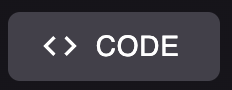
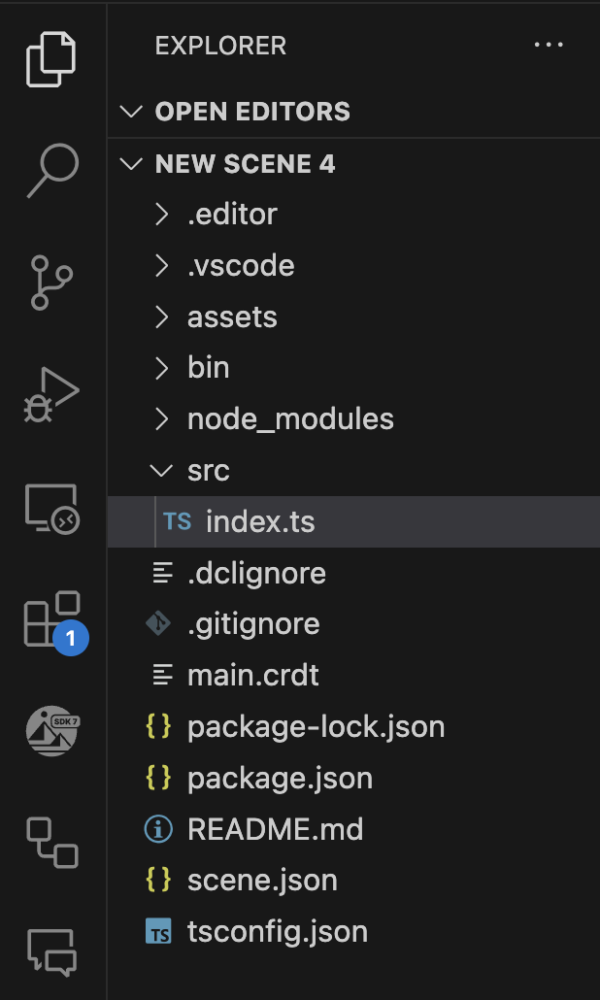

# Overview

El Creator Hub más código personalizado es una combinación muy poderosa para crear contenido. Puedes usar el canvas para posicionar ítems visualmente de forma intuitiva, y luego escribir código que interactúa con estos ítems con completa libertad. Incluso puedes colocar un smart item, que tiene su propio comportamiento predeterminado, y escribir código que reacciona cuando el ítem se activa.

Por ejemplo, puedes aprovechar un smart item de palanca existente, que ya viene con sus sonidos y animaciones y estados, y escribir código que detecta cuándo se tira de la palanca para ejecutar tu propia lógica personalizada.

Consulta [Reference items in code](reference-items.md) para saber cómo obtener ítems por nombre o por tags desde tu código.

### Editar código

Debes instalar un editor de código en tu máquina para editar el código de tu escena. Las opciones recomendadas son:

*  [Visual Studio Code](https://code.visualstudio.com/): Esta es la opción recomendada para desarrolladores experimentados.
*  [Cursor AI](https://www.cursor.com/): Este es un poderoso editor de código que está integrado con AI. Te permite elegir diferentes modelos de AI para ayudarte a escribir código, todos ellos son gratuitos. Esta es una buena opción para desarrolladores que son nuevos en Decentraland o TypeScript, o si quieres ahorrar tiempo escribiendo código.


**📔 Nota**: Si estás en macOS, asegúrate de que la aplicación del editor de código esté en el directorio Applications.


Una vez instalado, puede que necesites seleccionar tu Code Editor en la configuración del Creator Hub. Para hacer esto,

1.  Abre el ícono de rueda en la parte superior derecha de la pantalla

    
2. Bajo **Code editor of choice**, selecciona tu Code Editor. Puedes encontrar tu editor listado en el desplegable, o puede que necesites seleccionar **Chose from your device** para encontrarlo.

### Abrir el código de una escena

Una vez que instalaste un editor de código en tu máquina y lo seleccionaste en la configuración del Creator Hub, puedes hacer clic en el botón **< > CODE** para abrirlo en tu proyecto de escena.



Esto abre una ventana separada con el editor de código. En el margen izquierdo puedes navegar los archivos y la estructura de carpetas de tu proyecto.



Agrega tu código personalizado en el archivo `index.ts` bajo `/src`, dentro de la función `main()`. De lo contrario, puedes agregar código personalizado fuera de esa función o crear nuevos archivos `.ts` dentro de la carpeta `/src`, pero estos deben ser referenciados de alguna manera dentro de la función `main()` de `index.ts`.


**📔 Nota**: Si tienes VS Code o Cursor instalado pero el botón **CODE** no lo abre, puede ser que VS Code no esté configurado correctamente en tu máquina para abrirse a través de la línea de comandos. En la mayoría de los casos, esto se maneja como parte de la instalación predeterminada, pero en caso de que no sea así, consulta [estas instrucciones de VS](https://code.visualstudio.com/docs/setup/mac#_launching-from-the-command-line) para habilitar VS Code desde la línea de comandos.


Si tienes una ventana de preview abierta ejecutando tu escena, cada vez que cambias el código en tus archivos y guardas, la escena se recarga automáticamente con tus cambios.

### Usar AI con Cursor

Si estás usando Cursor, puedes usar el asistente AI para ayudarte a escribir código. Para hacer esto,

1.  Abre el asistente AI de Cursor haciendo clic en el botón **AI** en la parte superior derecha de la pantalla

    
2. Allí puedes solicitar al asistente AI que te ayude a escribir código. También puedes seleccionar un modelo para usar desde el desplegable.

Decentraland proporciona una carpeta de contexto para que el asistente AI te ayude a escribir código, esta carpeta de contexto se encuentra en `/dclcontext` en tu proyecto de escena. El asistente AI sabrá buscar este contexto cada vez que genere código, para familiarizarse con el Decentraland SDK.

Esta carpeta se actualiza con los últimos archivos de contexto cada vez que se actualizan las dependencias de tu escena. También puedes forzar la actualización de esta carpeta ejecutando lo siguiente:

```
npx sdk-commands get-context-files
```


**💡 Tip**: También puedes agregar tus propios archivos de contexto a esta carpeta para ayudar al asistente AI a entender tu escena y proyecto. Si lo haces, asegúrate de agregarlos a un nuevo archivo en esa carpeta, ya que los archivos predeterminados se sobrescriben cuando ocurren actualizaciones del SDK.


### Control de versiones

Recomendamos que crees un repositorio para tu proyecto en GitHub y lo uses para hacer seguimiento de las versiones de tu proyecto y trabajar colaborativamente con otros.

Si no estás familiarizado con cómo hacer esto, consulta [Quickstart for repositories](https://docs.github.com/en/repositories/creating-and-managing-repositories/quickstart-for-repositories), o usa la [aplicación de escritorio de GitHub](https://desktop.github.com/download/) para un flujo más simple basado en UI.


**📔 Nota**: Sube toda la carpeta del proyecto a un repositorio de GitHub, pero asegúrate de que las carpetas `/node-modules` o `/bin` y el archivo `package-lock.json` estén todos incluidos en el archivo `.gitignore`, para evitar sincronizarlos. Este debería ser el caso si configuras el repositorio para que sea de tipo `node`. Todos estos archivos se generan automáticamente, y el contenido puede diferir para diferentes máquinas.


### Ver también

* [Smart items - Basics](../interactivity/smart-items.md)
* [Smart items - Advanced](../interactivity/smart-items-advanced.md)
* [States and conditions](../interactivity/states-and-conditions.md)
* [Making any item smart](../interactivity/make-any-item-smart.md)
* [SDK Quick start](../../sdk7/getting-started/sdk-101.md): sigue este mini tutorial para un curso intensivo rápido.
* [Development workflow](../../sdk7/getting-started/dev-workflow.md): lee esto para entender la creación de escenas de principio a fin.
* [Examples](https://studios.decentraland.org/resources?sdk_version=SDK7): sumérgete directamente en ejemplos de escenas funcionales.
