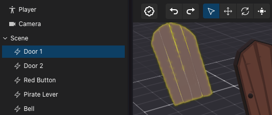
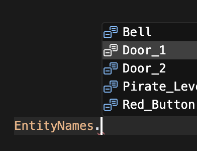
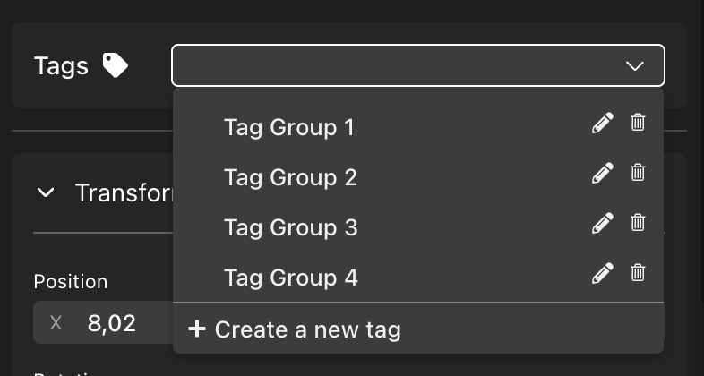
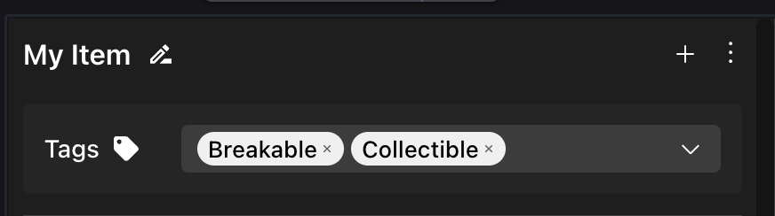
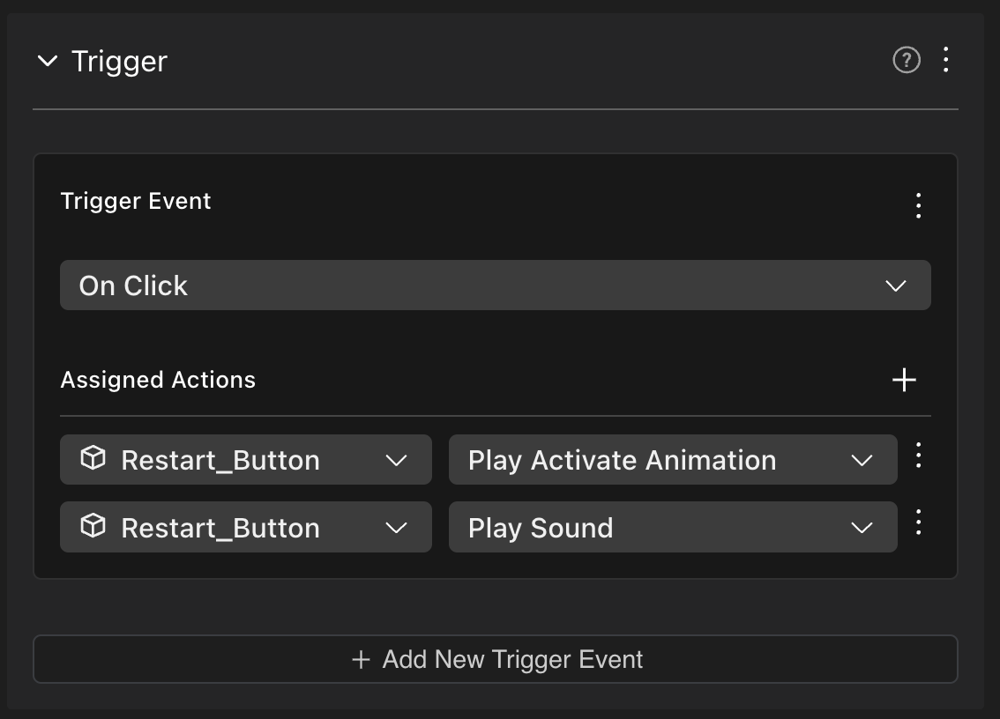
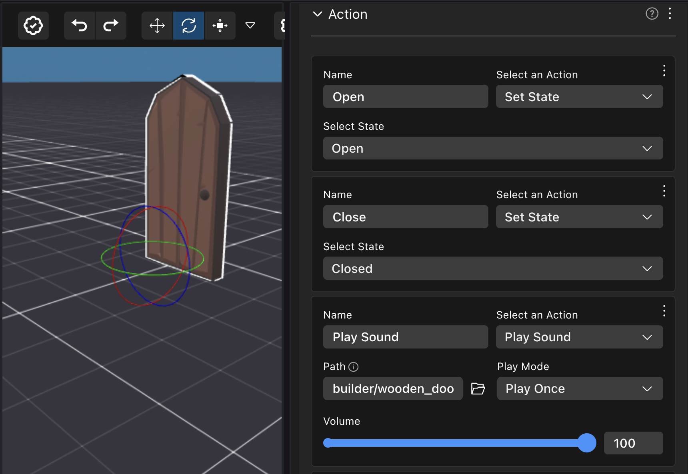

# Referenciar Ítems

Puedes referenciar ítems que se agregan a través de la interfaz de arrastrar y soltar del Creator Hub en tu código. Esto es útil para agregar comportamiento sofisticado a esos ítems, o para referenciarlos desde otras partes de tu código.

### Obtener por nombre

Cuando usas el Creator Hub y agregas entidades arrastrándolas al canvas, cada entidad tiene un nombre único. Usa la función `engine.getEntityOrNullByName()` para referenciar una de estas entidades desde tu código.

Usa el enum `EntityNames` para acceder fácilmente a los nombres de las entidades que agregaste a través del Creator Hub, o escribe el nombre como una cadena tal como está escrito en la vista del entity tree de la escena en el Scene Editor.

```ts
import { EntityNames } from '../assets/scene/entity-names'

function main() {

	// Usa el enum EntityNames
	const door1 = engine.getEntityOrNullByName(EntityNames.Door_1)

	// Escribe el nombre como una cadena
	const door2 = engine.getEntityOrNullByName('Door 2')

	// Asegúrate de que ambas puertas existan en la escena
	(if door1 && door2){
		// 
	}

}
```



El enum `EntityNames` contiene la lista completa de entidades agregadas por el Creator Hub y se actualiza inmediatamente tan pronto como haces cualquier cambio. Si importas `EntityNames.` en tu código, tu IDE te presentará un desplegable que incluye todos los nombres de las entidades disponibles.



También puedes usar la función `engine.getEntityByName<EntityNames>()`, pasando `<EntityNames>` como un [genérico de TypeScript](https://www.typescriptlang.org/docs/handbook/2/generics.html), para validar que una entidad con ese nombre realmente existe en tu escena. Si la entidad referenciada se renombra en el Creator Hub, este método te advertirá con un error. Como la salida de esta función no puede ser `null`, puedes evitar verificar que la entidad existe.

```ts
import { EntityNames } from '../assets/scene/entity-names'

function main() {

	const door1 = engine.getEntityByName<EntityNames>(EntityNames.Door_1)

	// No es necesario verificar null
	console.log(Transform.get(door1).position.x)

}
```


**📔 Nota**: Asegúrate de usar solo `engine.getEntityOrNullByName()` y `engine.getEntityByName()` dentro de la función `main()`, en funciones que se ejecutan después de `main()`, o en un system. Si se usa fuera de uno de esos contextos, las entidades creadas en el Scene Editor puede que aún no estén instanciadas.


Una vez que obtuviste una referencia a una entidad con cualquiera de los métodos anteriores, eres libre de realizar cualquier acción con ella, como agregar o eliminar componentes, modificar valores de componentes existentes, o incluso eliminar la entidad del motor.

```ts
import { EntityNames } from '../assets/scene/entity-names'

function main() {
	// obtener entidad
	const door = engine.getEntityOrNullByName(EntityNames.Door_3)
	// verificar que la entidad existe
	if (door) {
		// agregar un callback de pointer events
		pointerEventsSystem.onPointerDown(
			{
				entity: door,
				opts: { button: InputAction.IA_PRIMARY, hoverText: 'Open' },
			},
			function () {
				// abrir puerta
			}
		)
	}
}
```

Todas las entidades agregadas a través del Scene Editor tienen un componente `Name`, también puedes iterar sobre todas ellas así:

```ts
function main() {
	for (const [entity, name] of engine.getEntitiesWith(Name)) {
		console.log({ entity, name })
	}
}
```

### Obtener por Tag

También puedes obtener entidades por sus tags. Los tags son una forma de agrupar entidades juntas, y son útiles para identificar entidades que tienen el mismo propósito o comportamiento.

Agrega Tags a una entidad a través de la sección **Tags** en la parte superior del panel de propiedades del ítem. Puedes elegir de los tags genéricos como **Tag Group 1** hasta **Tag Group 4**, o crear el tuyo propio con un nombre más específico.




**💡 Tip**: Una sola entidad puede tener múltiples tags asignados a ella.




Luego puedes obtener todas las entidades que tienen un tag específico usando la función `engine.getEntitiesByTag()`. Esto es ideal para cuando quieres iterar sobre un grupo de entidades que tienen el mismo propósito o comportamiento.

```ts
import { engine } from '@dcl/sdk/ecs'

export function main() {
	const taggedEntities = engine.getEntitiesByTag('myTag')
  
	for (const entity of taggedEntities) {
      // Hacer algo con cada entidad
    }
}
```

También puedes agregar o eliminar tags a una entidad desde tu código. Esto es útil si quieres cambiar tags basándote en alguna lógica, o para generar entidades dinámicamente que tienen tags específicos.

```ts
import { Tags } from '@dcl/sdk/ecs'

Tags.remove(entity, tagName);
Tags.add(entity, tagName);
```

### Obtener todos los hijos de un ítem

También puedes escribir un script que te permita tratar con todos los ítems que están agrupados como hijos de un cierto ítem en el entity tree a la izquierda de la pantalla. El siguiente script itera sobre todas las entidades que tienen un Transform y un padre, y verifica si el nombre del padre coincide con el nombre `some-parent` en este caso. Luego puedes aplicar cualquier lógica personalizada que desees a esas entidades específicas.

```ts
import { engine, Entity, Transform, Name } from '@dcl/sdk/ecs'
import { EntityNames } from '../assets/scene/entity-names'

function main() {
	// obtener entidad padre
	const parent = engine.getEntityByName<EntityNames>(EntityNames.ParentEntity)
	
	// obtener todas las entidades hijas de ese padre
	const childEntities = getChildren(parent)
	
	// recorrer cada hijo
	for(const entity of childEntities){
		// manejar entidad
	}

}

// función reutilizable para obtener todas las entidades hijas de un padre
function getChildren(parent: Entity): Entity[] {
	const childEntities: Entity[] = []
	for (const [entity, transform] of engine.getEntitiesWith(Transform)) {
		if (transform.parent === parent) {
			childEntities.push(entity)
		}
	}
	return childEntities
}
```

### Triggers de smart item

Puedes detectar los **eventos de Trigger** de un smart item, y responder a estos con código personalizado. Por ejemplo, podrías colocar un smart item de botón, y activar código personalizado cuando se hace clic en el botón.

Usa `getTriggerEvents` para obtener un objeto que pueda manejar eventos de trigger de un smart item particular, luego usa la función `.on()` del objeto devuelto para suscribir una función de callback. Esta función de callback se ejecuta cada vez que ocurre el evento de trigger.

Por ejemplo, si una escena tiene un botón con el siguiente evento genérico **On Click**, puedes escribir el código a continuación para ejecutar código personalizado cada vez que se activa el botón.



```ts
import { engine } from '@dcl/sdk/ecs'
import { getTriggerEvents, getActionEvents } from '@dcl/asset-packs/dist/events'
import { TriggerType } from '@dcl/asset-packs'
import { EntityNames } from '../assets/scene/entity-names'

function main() {
	const restart = engine.getEntityOrNullByName(EntityNames.Restart_Button)
	if (restart) {
		const restart_event = getTriggerEvents(restart)
		restart_event.on(TriggerType.ON_CLICK, () => {
			// restartGame()
		})
	}
}
```

De manera similar, puedes suscribirte a cualquier otro tipo de eventos de trigger, como **ON\_PLAYER\_ENTERS\_AREA**, **ON\_SPAWN**, **ON\_TWEEN\_END**, etc.

### Acciones de smart item

Puedes detectar la activación de las **Actions** de un smart item, y responder a estas con código personalizado. Por ejemplo, podrías colocar un smart item de puerta, y ejecutar código personalizado cada vez que se llama a la acción **Open**.

Usa `getActionEvents` para obtener un objeto para manejar las acciones de un smart item específico. Luego puedes usar la función `.on()` del objeto devuelto para suscribir una función de callback. Esta función de callback se ejecuta cada vez que ocurre la acción, independientemente de si la acción fue activada por otro smart item, o incluso por código personalizado tuyo.

Por ejemplo, si una escena tiene una puerta con la siguiente acción predeterminada **Open**, puedes escribir el código a continuación para ejecutar código personalizado cada vez que se abre la puerta.



```ts
import { engine } from '@dcl/sdk/ecs'
import { getTriggerEvents, getActionEvents } from '@dcl/asset-packs/dist/events'
import { TriggerType } from '@dcl/asset-packs'
import { EntityNames } from '../assets/scene/entity-names'

function main() {
	const door = engine.getEntityOrNullByName(EntityNames.Wooden_Door)
	if (door) {
		// detectar acciones
		const actions = getActionEvents(door)
		actions.on('Open', () => {
			console.log('Door opened!!')
			// código personalizado
		})

		// detectar triggers
		const triggers = getTriggerEvents(door)
		triggers.on(TriggerType.ON_CLICK, () => {
			console.log('Door clicked!!')
			// código personalizado
		})
	}
}
```

También puedes emitir eventos de acción desde tu código, esto te permite aprovechar las acciones que ya están definidas dentro del componente Action del smart item. El siguiente fragmento llama a la acción "Open" en un smart item de puerta cada vez que se activa un smart item de botón.

```ts
import { engine } from '@dcl/sdk/ecs'
import { getTriggerEvents, getActionEvents } from '@dcl/asset-packs/dist/events'
import { TriggerType } from '@dcl/asset-packs'
import { EntityNames } from '../assets/scene/entity-names'

function main() {
	const button = engine.getEntityOrNullByName(EntityNames.Red_Button)
	const door = engine.getEntityOrNullByName(EntityNames.Wooden_Door)
	if (button && door) {
		// referencias a acciones y triggers
		const buttonTriggers = getTriggerEvents(button)
		const doorActions = getActionEvents(door)

		// detectar triggers en el botón
		buttonTriggers.on(TriggerType.ON_INPUT_ACTION, () => {
			// abrir puerta
			doorActions.emit('Open', {})
		})
	}
}
```


**💡 Tip**: Si no estás tratando de hacer algo muy complicado, en lugar de escribir código también puedes crear un smart item personalizado para manejar las acciones que quieres realizar. Consulta [Making any item smart](../interactivity/make-any-item-smart.md).


### Otros componentes de smart item

Los smart items pueden incluir componentes especiales que son parte de la biblioteca asset-packs, como `States` o `Counter`. Estos componentes no son parte del Decentraland SDK, pero se pueden obtener a través de la función `getComponents()` de la biblioteca. Luego puedes leer o escribir valores a estos componentes desde el código de tu escena, para tener una integración aún más estrecha entre el comportamiento del smart item y el código.

El ejemplo a continuación lee y registra el valor de un componente State de un smart item de cofre, cada vez que se activan las acciones del cofre.

```ts

import { engine } from '@dcl/sdk/ecs'
import { getComponents } from '@dcl/asset-packs'
import { getTriggerEvents } from '@dcl/asset-packs/dist/events'
import { TriggerType } from '@dcl/asset-packs'
import { EntityNames } from '../assets/scene/entity-names'


export function main() {

    const chest = engine.getEntityByName<EntityNames>(EntityNames.chest)
 
    if (chest) {

        const chestTriggers = getTriggerEvents(chest)

        chestTriggers.on(TriggerType.ON_INPUT_ACTION, () => {
            const { States } = getComponents(engine)
            let state = States.getMutableOrNull(chest)?.currentValue
            console.log( "chest new state ", state)
        })
    }
}
```
