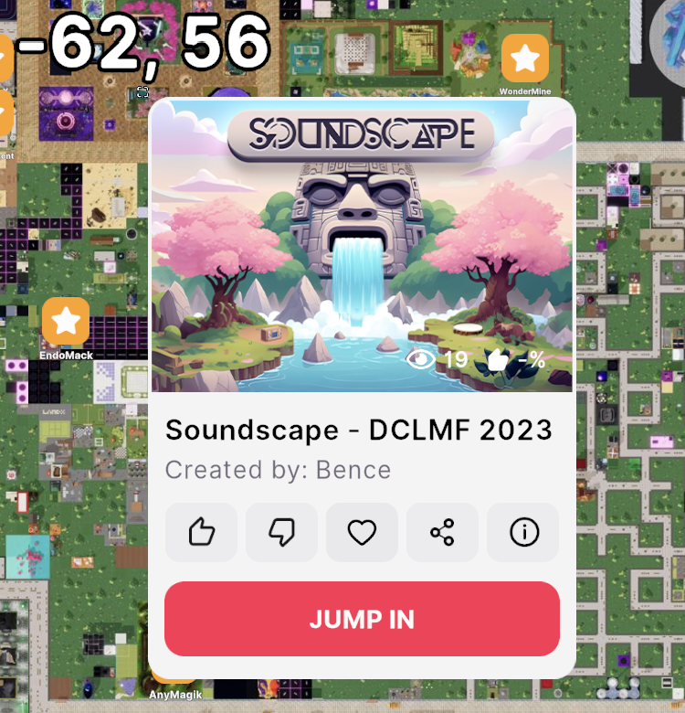
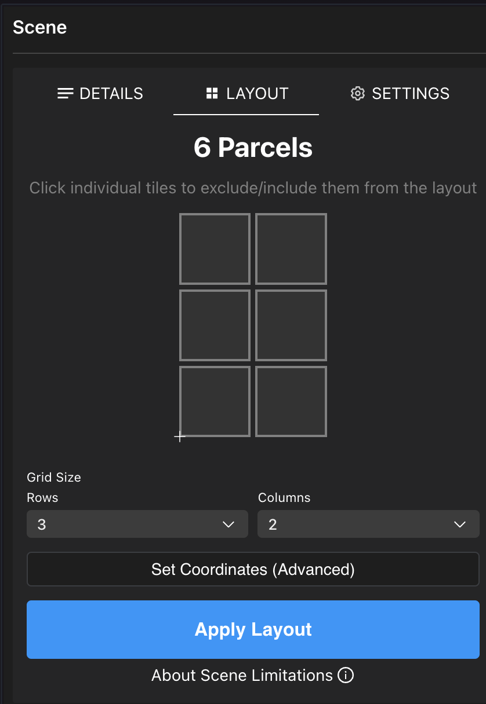
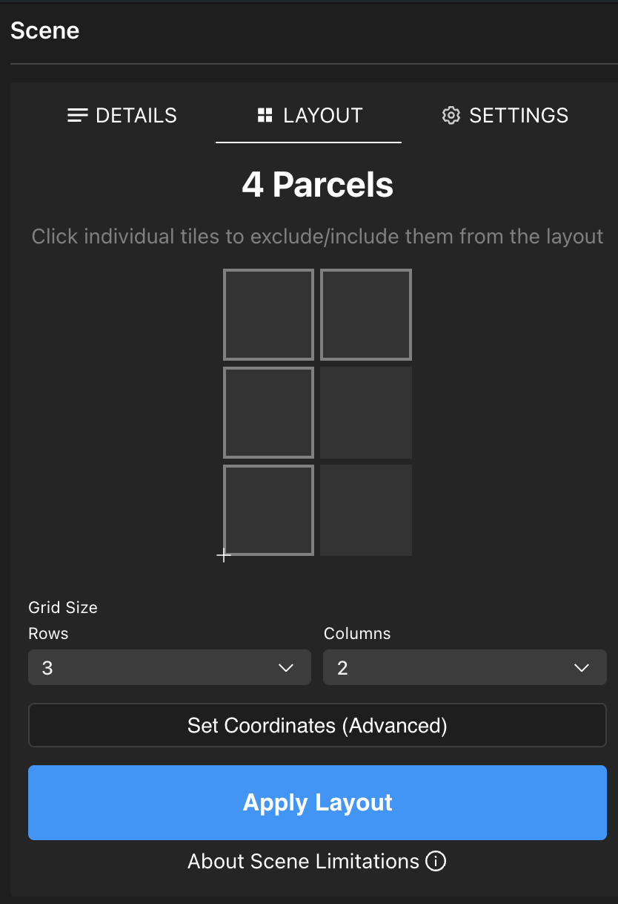
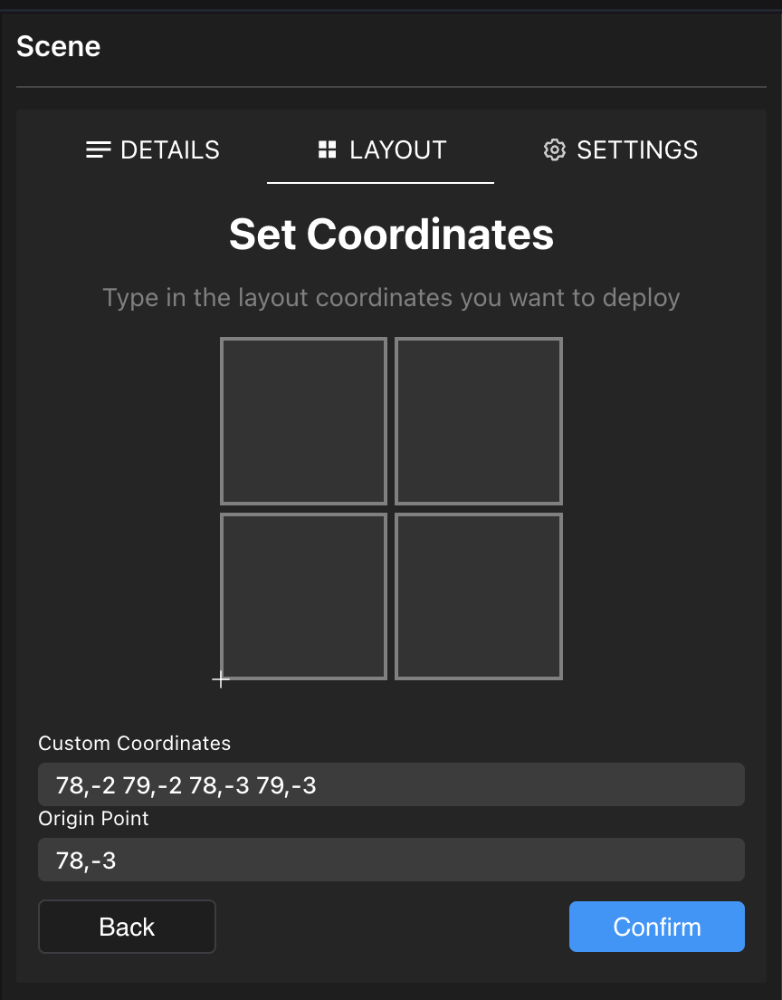
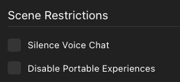
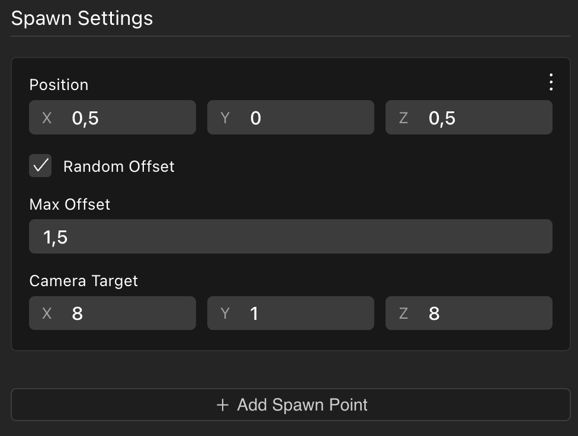
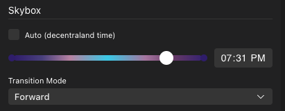

# Scene Settings

Haz clic en el **ícono de Lápiz** en la parte superior derecha de la pantalla. Esto abre una serie de propiedades a nivel de escena para editar.

Aquí puedes configurar múltiples propiedades incluyendo título y miniatura, tamaño de escena, categoría de escena y clasificación por edad, ubicaciones de spawn de jugadores y toggles de características.

Consulta [Scene Metadata](../sdk7/projects/scene-metadata.md).

### Detalles de escena

La pestaña **Details** te permite configurar varios campos sobre tu escena. Estos campos se muestran a los jugadores que podrían visitar tu escena, por ejemplo al expandir la ubicación en el mapa, cuando se les solicita teletransportarse, o al compartir un enlace a la escena en redes sociales. ¡Asegúrate de hacer que la información aquí sea atractiva y precisa para dirigir más tráfico a tu escena!

Los siguientes campos están disponibles:

* **Name**
* **Description**
*   **Thumbnail**

    \{% hint style="info" %\} **💡 Tip**: Si no se proporciona ninguna miniatura, usa la captura automática que ves en la tarjeta de la escena. Recomendamos subir una imagen más atractiva \{% endhint %\}
* **Age rating**
* **Categories**
* **Author**
* **Email**

La miniatura debe ser una imagen .png de un tamaño recomendado de 228x160 píxeles. El tamaño mínimo soportado es 196x143 píxeles. La imagen puede estirarse si las proporciones de ancho a alto no coinciden con 228x160.

Consulta [scene metadata](../sdk7/projects/scene-metadata.md) para más detalles sobre estos campos.

### Layout

Puedes editar el tamaño de tu escena haciendo clic en el _ícono de lápiz_ y luego cambiando el número de filas y columnas.

Las escenas en Decentraland ocupan uno o varios parcels de LAND adyacentes. Cada parcel de LAND mide 16x16 metros.

Establece el número de parcels para las filas y columnas y haz clic en **Apply layout** para que afecte cómo se ve tu escena en el canvas del Scene Editor.

Para construir algo para desplegar en parcels de LAND que posees, asegúrate de que la forma de la escena coincida con la forma de donde quieres desplegarla.


**💡 Tip**: Puedes alternar cada mosaico en la cuadrícula desactivándolo haciendo clic en él. Esto te permite dibujar formas no rectangulares para el layout de tu escena.



Si posees un NAME de Decentraland, también puedes desplegar tu escena en un [Decentraland World](../worlds/about.md). En ese caso, tendrás un número ilimitado de parcels, pero tendrás un límite de tamaño en MB.

Consulta [Kinds of project](../sdk7/projects/kinds-of-project.md) para entender mejor las diferentes opciones.

#### Vista avanzada

También puedes hacer clic en el botón **Set Coordinates (Advanced)** para listar manualmente las coordenadas de tu escena.

En **Custom Coordinates**, escribe las coordenadas de cada uno de los parcels donde deseas publicar. Separa la coordenada x e y con una coma, y cada conjunto de coordenadas separadas por espacios. Recuerda que estas coordenadas deben ser todas adyacentes para ser válidas. Por ejemplo:

`78,-2 79,-2 78,-3 79,-3`

En el campo **Origin Point**, define cuál de las coordenadas en la escena debe tratarse como el punto de origen. Esto tiene que ser una de las coordenadas que listaste en el campo **Custom Coordinates**. Se recomienda establecer el parcel en la esquina inferior izquierda de la escena.

### Restricciones de escena

Puedes deshabilitar ciertas funcionalidades en tu escena si lo deseas, en caso de que puedan ser abusadas o entrar en conflicto con el tipo de experiencia que quieres crear.

* **Silence voice chat**: Evita que los jugadores en tu escena usen el voice chat.
* **Disable portable experiences**: Evita que los jugadores usen [Smart Wearables](../sdk7/projects/smart-wearables.md) o [Portable Experiences](../sdk7/projects/portable-experiences.md).

### Spawn points

Los Spawn Settings en la pestaña Settings definen dónde aparecen los jugadores cuando acceden a tu escena directamente, ya sea escribiendo directamente las coordenadas en el navegador o teletransportándose.

Tu escena podría tener objetos que pueden bloquear a los jugadores de moverse si sucede que aparecen justo sobre ellos, como árboles o escaleras, o tu escena podría tener un terreno elevado. Sería una mala experiencia para los jugadores si aparecieran sobre algo que no les permite moverse. Es por eso que tienes la opción de establecer múltiples posiciones de spawn en ubicaciones ad-hoc.

La posición está compuesta de coordenadas dentro de la escena. Estos números se refieren a una posición dentro del parcel, similar a lo que usarías en un componente Transform.


📔 Nota: Todos los spawn points deben estar dentro de los parcels que componen la escena. No puedes hacer aparecer a un jugador fuera del espacio de estos parcels.


Marca la casilla Random Offset para desplazar aleatoriamente a los jugadores que aparecen alrededor del spawn point, con un valor máximo. Esto evita que todos los jugadores aparezcan superpuestos entre sí cuando aparecen, lo que se ve especialmente mal en escenas concurridas. El valor Max Offset es la distancia máxima posible desde el spawn point original, tanto en el eje X como en el Z.

Establece el Camera Target para establecer la dirección en la que los jugadores comienzan a mirar cuando saltan a tu escena. Esto te permite tener un mejor control sobre su primera impresión.

Haz clic en **Add Spawn Point** para incluir tantos spawn points como desees. Los jugadores aparecerán aleatoriamente en uno de esos.

### Control de Skybox

Puedes controlar la hora del día del skybox en la pestaña **Settings**. Puedes establecer una hora fija del día para tu escena. Todos los jugadores verán la escena con esta hora del día, y el skybox no seguirá el ciclo día/noche.

En el Creator Hub, abre la configuración de escena y haz clic en la pestaña **Settings** para encontrar la sección **Skybox**. Desmarca la opción **Auto** para evitar usar el ciclo día/noche y establece la hora del día que desees.

