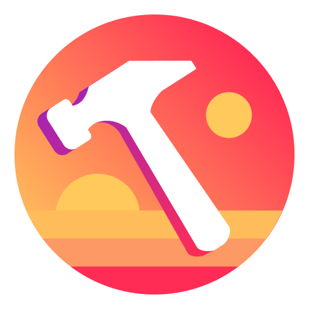
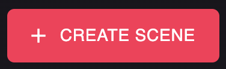
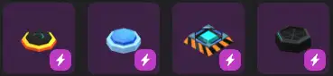

# Acerca del Scene Editor

El Creator Hub incluye un poderoso Scene Editor que combina una interfaz simple sin código con la capacidad de escribir código para personalizar aún más tus escenas.

Consulta [Instalación del Creator Hub](editor-installation.md) para comenzar.

### Crear una escena

Para crear una nueva escena, abre el Creator Hub y presiona el botón _Create scene_.

Luego puedes seleccionar qué template usar como punto de partida. Puedes elegir una escena en blanco o un proyecto con algo de contenido inicial.

Luego se te pedirá que nombres tu escena y elijas una ubicación para guardarla.

Consulta [Gestionar escenas](manage-scenes.md) para más detalles.

### Moverse

Para encontrar tu camino alrededor del Scene Editor:

* Usa **A** y **W** para moverte cerca o lejos. También puedes usar la rueda del mouse, o las teclas **+** y **-**
* Usa **S** y **D** para moverte lateralmente.
* Usa **Q** y **E** para moverte arriba y abajo.
* Usa el **Botón Izquierdo del Mouse** para hacer clic y seleccionar ítems y moverlos.
*   Usa el **Botón Derecho del Mouse** y arrastra para rotar la cámara.

    \{% hint style="info" %\} **💡 Tip**: También puedes rotar la cámara presionando **Alt** en Windows, u **Option** en Mac mientras arrastras. Esto es especialmente útil cuando usas un trackpad en lugar de un mouse. \{% endhint %\}
* Presiona la **barra espaciadora** para restablecer la cámara a la posición predeterminada

### Agregar ítems

Navega por las categorías de asset packs temáticos en el menú de la parte inferior para encontrar diferentes ítems que puedes colocar en tu escena.

Para colocar un ítem, haz clic y arrástralo desde el menú de asset pack hacia una ubicación en tu escena en el canvas.

Haz clic y arrastra un ítem seleccionado para moverlo libremente alrededor de la escena al nivel del suelo. Consulta [Scene editor essentials](scene-editor-essentials.md#position-items) para más detalles.


**💡 Tip**: Algunos ítems son **Smart items**, estos vienen con comportamientos interactivos incorporados. Consulta [Smart items](../interactivity/smart-items.md) para más detalles.


### Preview

Para probar tu escena y experimentarla como un jugador, haz clic en el botón _Preview_ en la esquina superior derecha. Esto abrirá una nueva ventana con el Decentraland Desktop Explorer, ejecutando solo tu escena. Allí puedes moverte por la escena e interactuar con ítems interactivos.


**📔 Nota**: Si no lo tienes instalado en tu máquina, descarga el **Decentraland Launcher** desde [Decentraland.org](https://decentraland.org).


Configura diferentes opciones de preview desde el menú desplegable junto al botón **Preview**:

* **Open Console Window During Preview**: Abre una nueva ventana con la salida de consola de la escena. Esto es útil para depurar errores en la escena.
* **Skip Auth Screen**: Omite la pantalla de selección de cuenta e inicia sesión automáticamente con tu cuenta actualmente conectada. Esto está deshabilitado por defecto, habilítalo si quieres probar múltiples cuentas.
* **Landscape Terrain Enabled**: Alterna el paisaje alrededor de la escena. Esto está habilitado por defecto, deshabilítalo para reducir la huella de memoria de la escena.

### Configuración de escena

Haz clic en el **ícono de Lápiz** en la parte superior derecha de la pantalla. Esto abre una serie de propiedades a nivel de escena para editar, incluyendo nombre, miniatura, tamaño de escena y más.

Consulta [Scene Settings](../configure/scene-settings.md) para más detalles.

### Publicar tu escena

Una vez que estés satisfecho con tu escena, presiona _Publish scene_.

Consulta [Publish scene](../publish/publish-scene.md) para más detalles.

### Ver también

* Consulta [Scene Editor Essentials](scene-editor-essentials.md) para más detalles sobre la interfaz del Scene Editor.
* Consulta [Smart items](../interactivity/smart-items.md) para saber cómo agregar interactividad simple a tu escena.
* Consulta [Combine with code](../code/README.md) para saber cómo editar el código de tu escena.
* Consulta [Publish scene](../publish/publish-scene.md) para saber cómo publicar tu escena en Decentraland.
