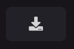
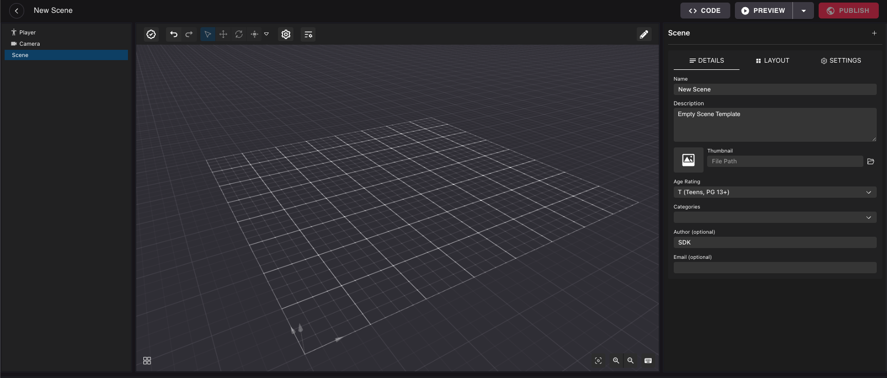

# Migrar desde Web

Si tienes una escena creada con otras herramientas además del Creator Hub, puedes migrarla fácilmente al Creator Hub.

El Creator Hub es la herramienta recomendada para crear escenas de Decentraland. Tiene una interfaz mucho más pulida que el Web Editor y te permite combinar la interfaz fácil de arrastrar y soltar con la capacidad de personalizar más con código. También te permite ejecutar el preview de tu escena usando el último cliente de escritorio.

### Migrar desde Web Editor

Para editar el código en una escena creada con el Web Editor, debes exportar la escena a tu máquina y abrirla con el Creator Hub.


**📔 Nota**: Si no tienes el Creator Hub instalado, sigue los pasos en la siguiente página antes de comenzar.

[Instalar Creator Hub](editor-installation.md)


1. Haz clic en el **ícono de Descarga** en el menú superior del Web Editor mientras editas la escena.



2. Esto descargará un archivo _.zip_, extráelo.
3. Abre el **Creator Hub**, ve a la sección **Scene Editor**.
4. Haz clic en el botón **Import** y selecciona la ruta a tu carpeta de proyecto exportada.


Una vez que hayas terminado, puedes seguir trabajando en tu proyecto dentro del Creator Hub, con una interfaz visual que se parece mucho al Web Editor, pero mucho más pulida.

También puedes editar los archivos bajo la carpeta `/src` para agregar comportamiento con código a tu escena. Consulta [Combine with code](../code/README.md) para saber cómo editar el código de tu escena.

### Migrar un proyecto solo de código

Puedes importar cualquier proyecto solo de código al Creator Hub. Para hacer esto,

1. Abre el Creator Hub, ve a la sección **Scene Editor**.
2. Haz clic en el botón **Import** y selecciona la ruta a tu carpeta de proyecto exportada.


Una vez hecho, puedes comenzar a trabajar en tu proyecto dentro del Creator Hub, esto no te impide seguir usando tu editor de código favorito para editar el código de tu escena, o usar la línea de comandos para ejecutar o desplegar tu escena.

Después de importar tu proyecto, cualquier contenido que se cree a través de código no será visible ni editable en el canvas del Creator Hub, lo que puede dificultar la colocación y alineación de nuevos ítems. Inicialmente verás tu escena como una cuadrícula vacía.



En lugar de agregar manualmente tu contenido al canvas desde cero, puedes ejecutar un comando para agregarlo automáticamente por ti. Para hacer esto, asegúrate de tener la última versión del SDK instalada y ejecuta el siguiente comando en tu terminal:

```
npx sdk-commands code-to-composite
```


**❗Advertencia**: Asegúrate de tener un backup de tu proyecto antes de ejecutar este comando.

Este comando sobrescribirá el archivo `main.composite` con la nueva instantánea. También comentará todo el código en los archivos `.ts` en la carpeta `src`. Necesitarás descomentar el código para que se ejecute nuevamente.


Este comando ejecuta tu escena y toma una instantánea del contenido que se crea a través de código en el primer frame. Esta instantánea se guarda en el archivo `main.composite`, que el Creator Hub usa para mostrar el contenido de tu escena. El código en tu escena se comenta, para evitar tener duplicados de todas las entidades.

Ten en cuenta que este comando solo captura entidades y los componentes que se pueden representar en la UI del Creator Hub. No replica componentes personalizados, ni reproduce código que lleva a cabo lógica, ni elementos UI que se crean a través de código. Para agregar de nuevo cualquier comportamiento que se comentó, necesitarás editar el código en los archivos `.ts` en la carpeta `src` y descomentar las líneas que necesites.

También puedes querer reescribir parte del código para que en lugar de crear nuevas entidades, haga referencia a entidades existentes por nombre o por tags para darles comportamiento. Consulta [Combine with code](../code/README.md) para saber cómo obtener estas entidades desde tu código.
