# Scene Editor Essentials

La UI del Scene Editor está dividida en algunas secciones diferentes, con diferentes propósitos.

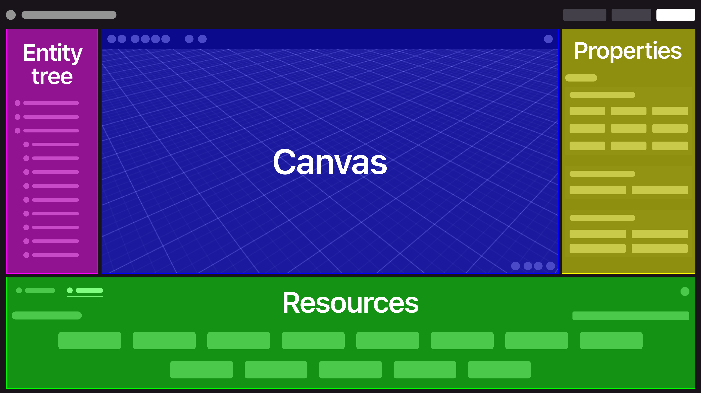

* **Canvas**: Manipula ítems directamente y ve cómo se ve tu escena.
* **Entity tree**: Contiene una lista de todos los ítems en la escena y su jerarquía.
* **Properties**: Muestra detalles sobre el ítem actualmente seleccionado.
* **Resources**: Muestra recursos que están disponibles para usar.

### Moverse

Para encontrar tu camino alrededor del Scene Editor:

* Usa **A** y **W** para moverte cerca o lejos. También puedes usar la rueda del mouse, o las teclas **+** y **-**
* Usa **S** y **D** para moverte lateralmente.
* Usa **Q** y **E** para moverte arriba y abajo.
* Haz clic en el **Botón Derecho del Mouse** y arrastra para rotar la cámara.
* Presiona la **barra espaciadora** para restablecer la cámara a la posición predeterminada
* Usa el **Botón Izquierdo del Mouse** para hacer clic y seleccionar ítems y moverlos.

### Configurar el Suelo

El suelo de la escena puede usar varias texturas diferentes. Puedes encontrarlas en los diferentes asset packs temáticos en el menú de ítems.

Los ítems de tipo **Ground** tienen un ícono de balde de pintura en ellos. Si arrastras uno de estos a tu escena, cubre todo el suelo de tu escena con copias de este ítem.

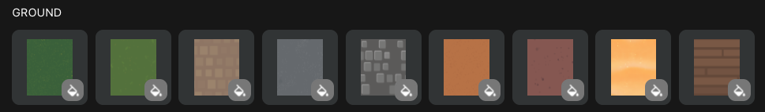

También puedes agregar una sola copia del ítem manteniendo presionado **Shift** mientras arrastras el ground a la escena.

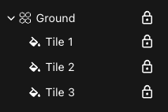

La colección de ítems de ground aparece en el [entity tree](scene-editor-essentials.md#the-entity-tree) dentro de una carpeta. Cada uno de ellos está bloqueado, para evitar seleccionarlos accidentalmente. [Desactiva](scene-editor-essentials.md#bloquear-u-ocultar-items) los ítems para moverlos o editarlos.

### Agregar ítems

Navega por las categorías de asset packs temáticos en el menú de la parte inferior para encontrar diferentes ítems que puedes colocar en tu escena.

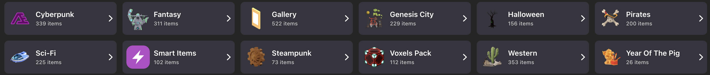

También puedes usar el cuadro de búsqueda. Ten en cuenta que cuando estás dentro de un asset pack, la búsqueda solo busca en ese asset pack.

Para colocar un ítem, haz clic y arrástralo desde el menú de asset pack hacia una ubicación en tu escena en el canvas.

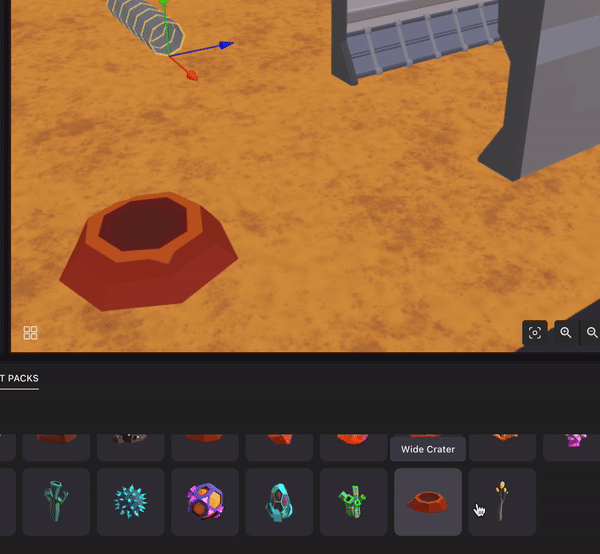


**💡 Tip**: Tus cambios se guardan automáticamente cada vez que agregas, mueves o editas propiedades de cualquiera de los ítems en tu escena.


Para duplicar un ítem, selecciónalo y presiona **Ctrl + C** y luego **Ctrl + V**. También puedes encontrar el ítem en el [entity tree](scene-editor-essentials.md#the-entity-tree) para hacer clic derecho y seleccionar la opción **Duplicate**. El nuevo ítem estará perfectamente superpuesto al original.

Para eliminar un ítem de la escena, selecciónalo y presiona la tecla _Delete_.

Consulta [Import items](../build/import-items.md) para agregar tus propios modelos 3D personalizados desde el disco.


**📔 Nota**: Una vez que arrastras un modelo 3D a tu escena, se descarga en tu carpeta de proyecto y permanece allí incluso si lo eliminas. Estos modelos no utilizados pueden aumentar el tamaño de tu escena.

Abre la pestaña **Local Assets** para eliminar cualquier modelo no utilizado.


### Posicionar ítems {#position-items}

Haz clic con el **Botón Izquierdo del Mouse** y arrastra un ítem seleccionado para moverlo libremente alrededor de la escena al nivel del suelo.

También puedes usar las herramientas en el menú superior:

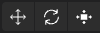

* **Move tool**: Haz clic y arrastra cada flecha para mover el ítem en un solo eje a la vez. Con esta herramienta también puedes posicionar cosas por encima del nivel del suelo.
* **Rotate tool**: Haz clic y arrastra cada uno de los aros alrededor del ítem para rotar el ítem en un eje a la vez.
* **Scale tool**: Haz clic en el centro del gizmo y arrastra hacia adentro o hacia afuera para agrandar. Esta herramienta también te permite estirar un ítem en un solo eje para cambiar sus proporciones, para hacer esto haz clic en uno de los ejes del gizmo y arrastra.

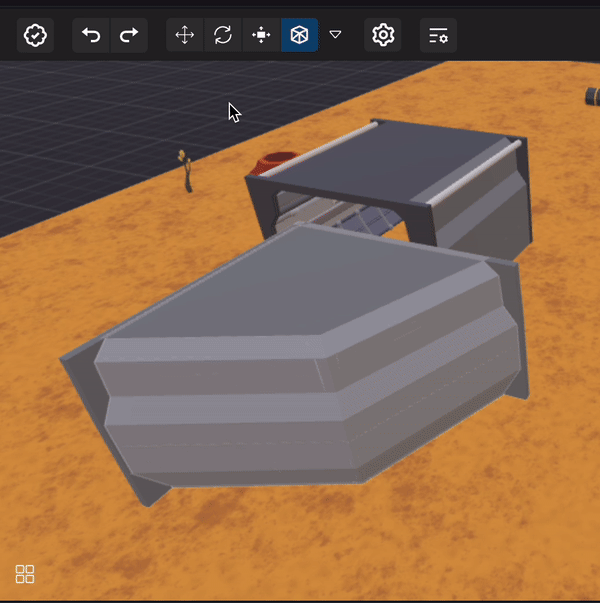

Para tener mayor precisión al mover, rotar o escalar un ítem, presiona y mantén presionada la tecla _Shift_ mientras haces ajustes. Esto evitará el ajuste a la cuadrícula.

Para cambiar la granularidad del movimiento y otras configuraciones, haz clic en la flecha hacia abajo a la derecha de las herramientas. Las siguientes configuraciones están disponibles:

* **Snap**: Activa o desactiva la cuadrícula. Cuando está desactivada, el comportamiento de **Shift** se invierte: no sigues la cuadrícula por defecto, lo haces si mantienes presionado **Shift**.
  * **Position**: El tamaño de los incrementos de movimiento en metros cuando **Snap** está activado.
  * **Rotation**: El tamaño de los incrementos de rotación en grados cuando **Snap** está activado.
  * **Scale**: El tamaño de los incrementos de escala cuando **Snap** está activado.
* **Align to world**: Se refiere al eje de movimiento y rotación. Pueden alinearse siempre con el mundo, o alinearse con la orientación del objeto. Si está alineado con el mundo, los ejes no cambian con la orientación del objeto.
  * **Position**: ¿El eje de Move tool se alinea con la dirección que enfrenta el objeto? ¿O con el mundo?
  * **Rotation**: ¿El eje de Rotate tool se alinea con la orientación del objeto, o con el mundo?

Para seleccionar múltiples ítems al mismo tiempo, presiona y mantén presionada la tecla _Control_ mientras los seleccionas. Luego puedes mover, rotar, escalar, duplicar o eliminar todos ellos en una sola acción.

### Smart items

Los smart items son ítems especiales que vienen con comportamientos interactivos incorporados. Consulta [Smart items](../interactivity/smart-items.md) para más detalles.

### The entity tree

En el margen izquierdo, verás una estructura de árbol con todas las entidades en la escena. Esto incluye todos los ítems que agregues, así como algunas entidades predeterminadas.


**💡 Tip**: Todo en una escena es una Entity, son los bloques de construcción básicos de las escenas. Los ítems son Entities que tienen al menos una posición y una forma visible.


En lugar de seleccionar un ítem haciendo clic en él desde la vista 3D de la escena, puedes seleccionarlo desde la vista de árbol. Haz clic con el botón derecho del mouse en una entidad para revelar más opciones: puedes renombrar, eliminar o duplicar, también crear una entidad hija, o agregar un componente a la entidad.

Las entidades siguen una jerarquía que puede tener tantos niveles como quieras. Establece una relación padre-hijo entre dos entidades arrastrando un ítem sobre otro en el árbol. Una entidad hija hereda la posición del padre, por lo que cuando el padre se mueve, lleva consigo a cualquier hijo. Esto puede ser práctico mientras construyes una escena, por ejemplo puedes establecer vasos y platos como hijos de una mesa, y luego mover la mesa sin necesidad de reajustar nada más. También puede ser importante al interactuar con la escena, para que los ítems se muevan juntos.

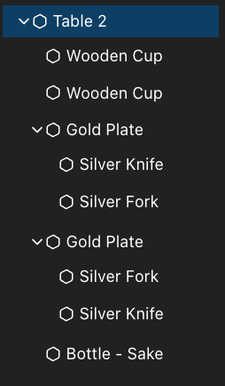

También puedes minimizar o expandir los hijos de una entidad para mantener la vista simple, esta acción no tiene efecto en la escena.

#### Entidades especiales

La escena incluye un par de entidades especiales que puedes ver en el entity tree.

* **Scene**: Esto se refiere a la entidad raíz, todo lo que agregas en la escena es un hijo de esta entidad. Puedes abrirlo para ver [scene settings](scene-editor-essentials.md#scene-settings).
* **Player**: El avatar del jugador. Puedes agregar componentes especiales a esta entidad que pueden cambiar las mecánicas de juego. También puedes arrastrar otras entidades para que sean hijos del avatar. Si una entidad es hija del avatar, su posición estará fija al jugador. Úsalo por ejemplo para agregar un marcador flotante sobre la cabeza del jugador, que siga al jugador.
* **Camera**: La cámara del jugador. Puedes arrastrar otras entidades para que sean hijos de la cámara. Si una entidad es hija de la cámara, su posición estará fija en la pantalla. Úsalo por ejemplo para mostrar un arma en un juego de disparos, que siempre esté a la vista incluso si el jugador apunta hacia arriba o hacia abajo.

#### Bloquear u ocultar ítems

Puede ser útil a veces bloquear un ítem, para evitar seleccionarlo y moverlo accidentalmente. Esto es especialmente útil para ítems de fondo, como el suelo o un edificio. Para bloquear un ítem, búscalo en el entity tree a la izquierda, pasa el mouse sobre él y selecciona el ícono de candado. Puedes alternar este comportamiento activado y desactivado a través de ese mismo ícono.

También puedes querer ocultar un ítem que podría obstruir tu vista mientras colocas otros. Esto es especialmente útil para ocultar el techo de un edificio, mientras trabajas en los interiores. Los ítems ocultos solo están ocultos en la ventana del canvas del Scene Editor, no para los jugadores que ingresan a la escena. Para ocultar un ítem, búscalo en el entity tree a la izquierda, pasa el mouse sobre él y selecciona el ícono de ojo. Puedes alternar este comportamiento activado y desactivado a través de ese mismo ícono.

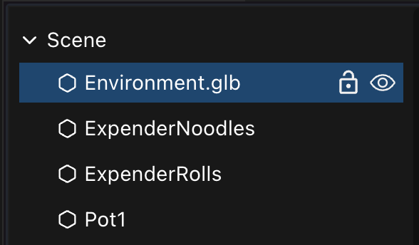

### Panel de propiedades

Selecciona un ítem haciendo clic en él en el canvas o en el entity tree. Luego verás sus componentes mostrados en el panel de propiedades, a la derecha de la pantalla. Diferentes ítems tienen diferentes componentes que cada uno muestra configuraciones específicas.

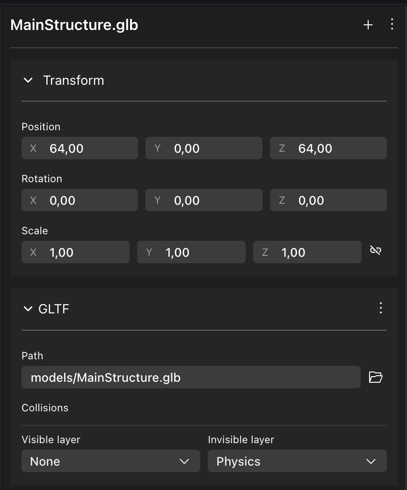

La mayoría de los ítems no interactivos tienen los siguientes componentes:

* **Transform**: Establece posición, rotación y escala del ítem.
* **GLTF**: Qué modelo 3D cargar.

Los [Smart items](../interactivity/smart-items.md) pueden incluir otros componentes.

Consulta [Components](../build/components.md) para aprender más.

### Limitaciones de escena {#scene-sizes}

Las escenas de Decentraland deben seguir ciertas limitaciones, para poder ejecutarlas una al lado de la otra. Hay un número máximo de materiales, texturas, triángulos, etc., que es proporcional al número de parcels en la escena. Consulta [scene limitations](../../sdk7/optimizing/scene-limitations.md) para más detalles.

Si el contenido en tu escena excede cualquiera de estos límites, el Scene Editor lo notificará en la esquina inferior izquierda.

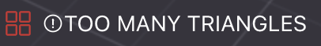

Puedes expandir este menú para ver detalles.

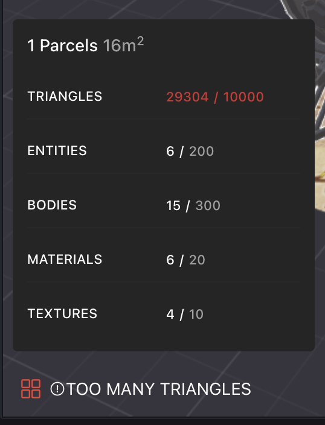


**💡 Tip**: Si estás construyendo un Decentraland World, siempre puedes aumentar el [scene size](scene-editor-essentials.md#scene-sizes) para aumentar tus límites.


El contenido en una escena de Decentraland también debe evitar derramarse en parcels vecinos. Si alguna parte de los modelos en tu escena se extiende más allá de los límites, cuando abras el preview de la escena verás estas partes cortadas. El Scene Editor marcará todo el modelo en rojo, pero solo debes preocuparte realmente por las partes del modelo que se extienden más allá de los límites de la escena.

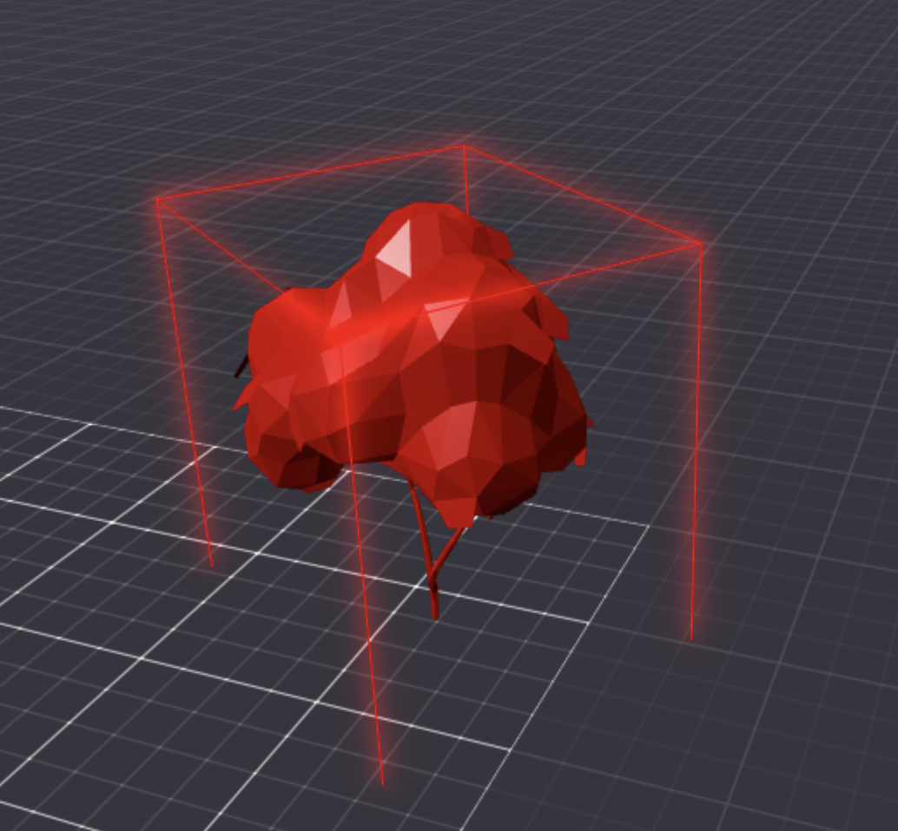


**💡 Tip**: Si los modelos que quieres mostrar no caben, puede que quieras aumentar el tamaño de tu escena. Consulta [scene size](scene-editor-essentials.md#scene-sizes) para agrandar tu escena.


Incluso si toda la geometría del modelo 3D cabe en tu escena, un modelo puede estar marcado en rojo si el Bounding Box del modelo se extiende más allá del área. Si este es el caso, puedes ignorar las advertencias, ya que todo el modelo se mostrará correctamente. Aprende más sobre [Bounding Boxes](../../3d-modeling/meshes.md#bounding-boxes).

### Configuración de escena {#scene-settings}

Haz clic en el **ícono de Lápiz** en la parte superior derecha de la pantalla. Esto abre una serie de propiedades a nivel de escena para editar.

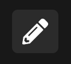

Aquí puedes configurar múltiples propiedades incluyendo título y miniatura, tamaño de escena, categoría de escena y clasificación por edad, ubicaciones de spawn de jugadores y toggles de características.

Consulta [Scene Settings](../configure/scene-settings.md).

### Ver también

* Consulta [Smart items](../interactivity/smart-items.md) para saber cómo agregar interactividad simple a tu escena.
* Consulta [Combine with code](../code/README.md) para saber cómo editar el código de tu escena.
* Consulta [Publish scene](../publish/publish-scene.md) para saber cómo publicar tu escena en Decentraland.
