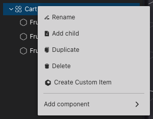
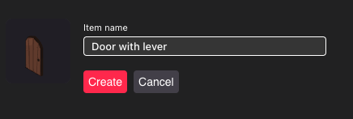
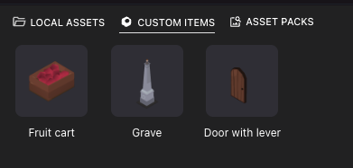

# Custom Items

Define un Custom Item para reutilizarlo fácilmente en cualquiera de tus escenas, o compártelo con otros creadores de escenas. Los custom items pueden consistir en una sola entidad, o tantas entidades como desees. Los custom items pueden ser variaciones de Smart Items existentes, o completamente personalizados, con sus propios modelos y funcionalidad adaptados.

### Cómo Definir un Custom Item

Haz clic derecho en una entidad en el [Entity Tree](../scene-editor/get-started/scene-editor-essentials.md#the-entity-tree), o selecciona varias entidades y luego haz clic derecho en ellas. Selecciona **Create Custom Item**.

En la sección inferior de la pantalla se te pedirá que le des un nombre a tu nuevo Custom Item.

El ítem ahora está listado en la pestaña **Custom Items**, en la parte inferior de tu pantalla. Esta pestaña solo se muestra si existe al menos un Custom Item en tu espacio de trabajo.

Al definir un custom item, puedes seleccionar varias entidades en un mismo nivel jerárquico, pero no entidades de padres separados si no comparten un ancestro común. Cualquier entidad anidada se incluye automáticamente como parte del custom item, no necesitan ser seleccionadas.

Las entidades originales en tu escena no se ven afectadas por la acción de definir un Custom Item.


**📔 Nota**: Al definir un Custom Item, tomas una instantánea del estado de cada componente en las entidades seleccionadas (excepto la posición, rotación y escala de la entidad raíz). Esto incluye **Actions**, **Triggers**, **Multiplayer**, **Visibility**, y cualquier otro componente.

Cualquier acción y trigger de smart item se auto-referenciará a su propia copia. Por ejemplo, si defines un Custom Item que incluye un ascensor y botones, los botones en cada copia del ascensor controlarán la copia del ascensor al que pertenecen, no la copia original del ascensor.


### Usar Custom Items

Simplemente arrastra el ítem desde la pestaña **Custom Items** a tu escena.

Una vez agregado, eres libre de alterar cualquier propiedad de un Custom Item, los cambios que hagas solo afectan _esa copia_ del Custom Item. También puedes editar o eliminar los ítems originales de los que se definió el Custom Item, esto no afectará las copias existentes o futuras.

Ten en cuenta que los Custom Items se muestran con un ícono diferente en el Entity Tree. En la parte superior del menú de propiedades del Item a la derecha, también verás una mención de qué Custom Item se crearon.

Para eliminar un custom item, haz clic derecho en el ítem en el menú **Custom Items** y selecciona **Delete**. Esta acción no afecta ninguna copia existente del ítem en tus escenas, los Custom Items huérfanos permanecen en tu escena sin cambios. Eliminar una definición de Custom Item solo lo elimina de la pestaña Custom Items.

Para renombrar un Custom Item, haz clic derecho en la definición del Custom Item en la pestaña **Custom Items** y selecciona **Rename**.

No puedes modificar la definición de un Custom Item que ya está creado, debes crear una nueva definición y eliminar la original.

### Compartir Custom Items

Puedes compartir tus custom items con otros creadores, para que puedan usarlos en sus propias escenas.

Los Custom Items se almacenan cada uno en una carpeta separada en tu máquina local

* En Windows: _User/AppData/Roaming/creator-hub/Custom Items_
* En Mac: _Users/username/Library/Application Support/creator-hub/Custom Items_


**📔 Nota**: La carpeta _Library_ está oculta en Mac por defecto. La forma más fácil de acceder a ella es abriendo Go > Go to Folder, y escribiendo _application support/creator-hub_


Para compartir con alguien más, simplemente navega con tu explorador de archivos de elección y copia la carpeta completa para el ítem. La persona que use tu Custom Item debe luego pegarla en su propia ruta de Custom Item en su máquina. Esta carpeta contiene todo lo necesario para usar tu Custom Item. Si no pueden verlo en su pestaña **Custom Items**, los usuarios pueden necesitar cerrar y volver a abrir el proyecto.

Cualquier **Asset** usado por tu Custom Item también se almacena en la carpeta del Custom Item. Esto incluye cualquier modelo 3D, imágenes, sonidos y videos referenciados por el ítem.
