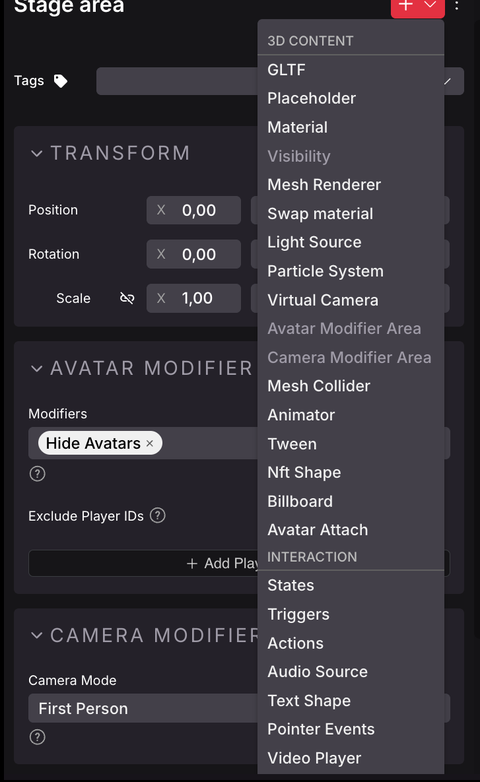

# Hacer Cualquier Ítem Smart



Los smart items son solo ítems regulares con un componente **Action** y/o **Trigger**. Puedes agregar estos componentes a cualquier ítem en tu escena. También puedes importar tus propios modelos 3D personalizados y agregar lo mismo a esos.

Para agregar componentes a un ítem, haz clic en el **Ícono de Plus** junto al nombre del ítem, y selecciona qué componente agregar de la lista desplegable.

Esto permite una gran cantidad de posibilidades creativas. Convierte una vela en una palanca que abre un pasaje secreto detrás de una estantería, reproduce sonidos misteriosos desde dentro de un pozo, haz que los diamantes sean ítems coleccionables que se reducen a 0 cuando se hace clic. ¡Hay toneladas de formas imaginativas de combinar estas mecánicas!

### Interactividad {#interactivity}

Puedes hacer que un ítem reaccione a diferentes acciones del jugador.


**💡 Tip**: Cuando un jugador interactúa con un ítem, deberías mostrar algún tipo de retroalimentación para hacer clara esa interacción. Si el modelo no tiene animaciones, considera al menos reproducir un sonido. En algunos casos podría funcionar hacer que el ítem haga un ligero tween en escala y luego vuelva a su escala original, como una forma de retroalimentación.


Agrega un componente **Trigger**, para detectar diferentes acciones del jugador:

* **Pointer events**: Cuando el jugador hace clic o presiona una tecla mientras apunta su cursor al ítem.
* **Global button events**: Cuando el jugador presiona una tecla, donde sea que estén en la escena.
* **Player proximity**: Cuando el jugador camina hacia la posición del ítem.

El componente **Trigger** se puede configurar para estar al tanto de cualquiera de estos tipos de triggers. Cada vez que ocurre un trigger, puede llamar Actions de su propio componente **Actions**, o de los componentes **Actions** de otros ítems en la escena. Consulta [Smart items - Advanced](smart-items-advanced.md).


**💡 Tip**: También puedes combinar estos triggers con [lógica condicional](states-and-conditions.md), para que las acciones no se llamen cada vez que ocurre el trigger, solo si las condiciones son verdaderas.

Por ejemplo, podrías agregar un trigger **Pointer Events** a una puerta, para que se abra cuando se hace clic, pero incluir lógica condicional para que solo se abra si está desbloqueada.


#### Pointer events

Agrega un componente **Trigger** con eventos de Trigger **On Click** u **On Input Action**.

* **On Click** reacciona cada vez que el jugador hace clic en el botón izquierdo del mouse mientras apunta al ítem.
* **On Input Action** reacciona cada vez que el jugador presiona el Botón Primario (E) mientras apunta al ítem.

**Colliders**

Es importante que para que un ítem sea clickeable, debe tener un **Collider**. De lo contrario, tus clics pasarán a través del modelo, e intentarán interactuar con lo que esté detrás. Los modelos 3D en los Asset Packs predeterminados deberían tener todos colliders, pero si creas tu propio modelo o lo obtienes de otro lugar, puedes encontrar que le falta uno.

Si tu modelo carece de colliders, cualquiera de los siguientes debería arreglarlo:

* Agrega un componente **Mesh Collider**. Esto creará un collider con una [forma primitiva](../../sdk7/3d-essentials/shape-components.md#primitive-shapes) (cubo, plano, cilindro, cubo, esfera).
* Cambia las propiedades de la sección **Collisions** en el componente **GLTF**. La **Visible layer** debe estar asignada a **Pointer**.
* Edita el modelo 3D en Blender para incluir una geometría de collider invisible (cualquier mesh con un nombre que termine en `_collider`). Consulta [colliders](../../3d-modeling/colliders.md).


**💡 Tip**: Si usaste el componente **Mesh Renderer** para darle a tu modelo una forma primitiva, eso solo no le dará un collider. También debes asignarle un componente **Mesh Collider**.


**Personalizar pointer events**

Puedes sobrescribir la configuración predeterminada que se usa cuando un ítem tiene un Trigger Action **On Click** o **On Input Action**.

* **Hover text**: Cambia la pista que los jugadores ven junto al cursor cuando pasan el mouse sobre el ítem. Esto puede ser muy útil para aclarar lo que hace tu ítem.
* **Max distance**: ¿Qué tan lejos puede estar el jugador al interactuar con tu ítem?
* **Show feedback**: Si no está marcado, el ítem no tiene hover-hint cuando el jugador pasa su cursor sobre él.
* **Button**: Si usas el Trigger Action **On Input Action**, puedes reasignar el **Primary (E)** predeterminado a otra tecla. El hover-hint incluirá un ícono para aclarar qué tecla usar. Puedes usar **Secondary (F)**, o **Actions 3 to 6** (teclas numéricas 1 a 4).

#### Global button events

Agrega un componente **Trigger** con eventos de Triggers **On Global Click**, **On Global Primary** u **On Global Secondary**.

* **On Global Click** reacciona cada vez que el jugador hace clic en el botón izquierdo del mouse, en cualquier lugar de la escena.
* **On Global Primary** reacciona cada vez que el jugador presiona el Botón Primario (E), en cualquier lugar de la escena.
* **On Global Secondary** reacciona cada vez que el jugador presiona el Botón Secundario (F), en cualquier lugar de la escena.


**💡 Tip**: A menudo tiene sentido combinar esto con [States and conditions](states-and-conditions.md), para que los ítems solo reaccionen al evento de botón si el jugador está en la habitación, o alguna otra condición.


#### Posición del jugador

Agrega un componente **Trigger** con eventos de Triggers **Player Enters Area**, **Player Leaves Area**.

Esto reaccionará cuando el jugador entre o salga de un área de un tamaño predeterminado de 1x1x1, posicionado en el centro del ítem.


**💡 Tip**: A menudo es mejor usar el smart item [**Trigger Area**](smart-items.md#trigger-areas) en su lugar, ya que las dimensiones de este ítem se pueden visualizar claramente en el Scene Editor.


### Ver también

* [Smart items - Basics](smart-items.md)
* [Smart items - Advanced](smart-items-advanced.md)
* [States and conditions](states-and-conditions.md)
* [Combine with code](../code/README.md)
