# Smart Items Advanced

La mayoría de los smart items tienen un módulo básico donde puedes configurar solo las configuraciones más comunes de una manera simple, pero puedes desplazarte hacia abajo más allá del marcador **Advanced** para personalizar casi cualquier cosa sobre cómo se comporta el ítem.

El siguiente ítem tiene un componente Transform y un módulo básico que expone solo los campos básicos para configurar un botón. Pero si te desplazas hacia abajo más allá del marcador **Advanced**, encontrarás todas las configuraciones disponibles.

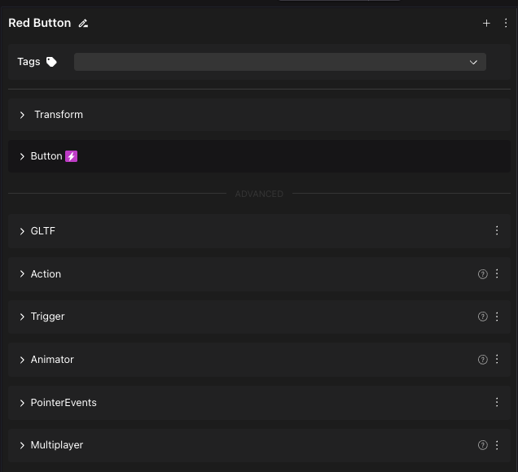


**📔 Nota**: La mayoría de las configuraciones en el módulo básico también están disponibles en los componentes más abajo. Los cambios hechos en el módulo básico se reflejan en los componentes más abajo y viceversa, excepto en algunos casos donde las configuraciones básicas son una abstracción de múltiples configuraciones más abajo. En esos casos, cambiar las configuraciones avanzadas a valores que no son soportados por el módulo básico resultará en que el campo en el módulo básico se marque como indefinido.


### Configuración avanzada

Las propiedades están agrupadas en [**componentes**](../../sdk7/architecture/entities-components.md). Diferentes smart items pueden tener diferentes componentes, dependiendo de su funcionalidad.

El comportamiento de la mayoría de los ítems está controlado por:

* [**Actions**](smart-items-advanced.md#actions): El componente Actions define cosas que el ítem puede hacer. Por ejemplo reproducir un sonido, reproducir una animación, moverse arriba, o volverse invisible.
* [**Triggers**](smart-items-advanced.md#triggers): El componente Triggers asigna qué eventos hacen que esas acciones sucedan. Por ejemplo cuando el jugador hace clic en el ítem, cuando el jugador camina hacia un área, o cuando la escena se carga por primera vez.

Por ejemplo, en un smart item de puerta, el componente **Actions** incluye acciones "Open" y "Close". El componente **Triggers** en ese ítem incluye un trigger **On Click** que activa la acción "Open" cuando el jugador hace clic en la puerta.

Los triggers de un smart item pueden activar acciones en cualquier smart item en la escena, no solo en ese mismo smart item. Por ejemplo, un smart item de botón puede tener un componente **Triggers** que activa la acción "move up" definida en el componente **Actions** de una plataforma flotante.

Los triggers también pueden suceder condicionalmente. Por ejemplo, los smart items de puerta incluyen dos triggers **On Click** en su componente Triggers: uno abre la puerta si esa puerta estaba cerrada, el otro cierra la puerta si estaba abierta. Para más detalles consulta [States and conditional logic](states-and-conditions.md).

### Interacciones entre ítems

Para hacer que los ítems interactúen entre sí:

* Un ítem necesita tener al menos una acción definida en un componente [Actions](smart-items-advanced.md#actions).
* El otro ítem necesita un trigger en el componente [Triggers](smart-items-advanced.md#triggers) que apunte a esa acción.

Por ejemplo, para hacer que un botón abra una puerta:

1. Agrega cualquier smart item de botón, abre su componente **Triggers**. Tiene un evento de trigger predeterminado que reproduce un sonido y una animación para el botón mismo.
2. Haz clic en el signo **+** junto a **Assigned Actions**, para agregar una tercera acción en ese mismo evento de trigger.
3. Selecciona el smart item para la puerta en el primer desplegable.
4. En el segundo desplegable, selecciona la acción "Open".

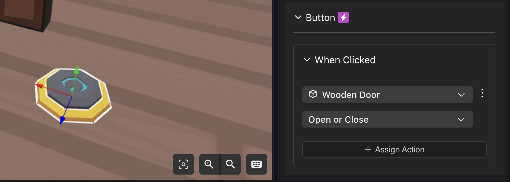


**💡 Tip**: En su lugar, puedes crear un nuevo evento de Trigger que solo maneje la acción de la puerta. Ambos eventos de trigger se llaman cada vez que se hace clic en el botón.

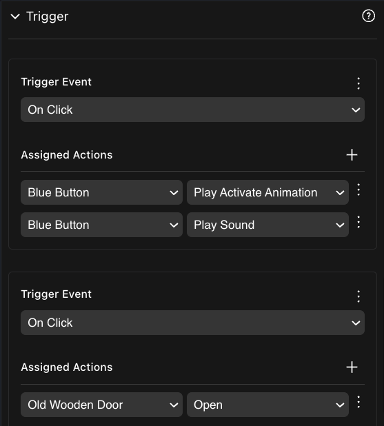


Cualquier ítem puede activar cualquier acción de cualquier otro ítem, siempre que la acción esté definida. Consulta [Triggers](smart-items-advanced.md#triggers) para más formas en las que se puede activar una acción.

Puedes usar [states and conditional logic](states-and-conditions.md) para solo activar una acción si se cumple una condición. La condición puede incluso verificar el estado de un tercer smart item. Por ejemplo, un botón solo abre la puerta si un smart item personalizado "power generator" tiene su estado establecido en "On".

### Actions

El componente **Actions** lista acciones que el ítem puede llevar a cabo. Cada smart item incluye un conjunto de acciones predefinidas. Puedes personalizar acciones existentes o agregar nuevas. Los siguientes tipos de acciones están disponibles:

* **Play Animation**: Reproduce una animación en el modelo 3D del ítem. Consulta [About playing animations](smart-items-advanced.md#about-playing-animations)
* **Stop Animation**: Detiene todas las animaciones que está reproduciendo el modelo 3D del ítem.
* **Play Sound**: Reproduce un sonido desde un archivo, en la ubicación del ítem. Consulta [About playing sounds](smart-items-advanced.md#about-playing-sounds)
* **Stop Sound**: Detiene todos los sonidos que se reproducen desde el ítem.
* **Start Tween**: Hace un cambio gradual en posición, rotación o escala durante un período dado. Consulta [Moving, rotating or scaling](smart-items-advanced.md#moving-rotating-or-scaling).
* **Set Visibility**: Hace el ítem visible o invisible.
* **Attach To Player**: Establece el ítem como hijo del avatar del jugador. Por ejemplo para llevarlo en su mano o sobre su cabeza.
* **Detach From Player**: Desadjunta el ítem del avatar del jugador.
* **Open Link**: Abre un enlace a un sitio web externo.


**📔 Nota**: Esta acción solo puede ocurrir como resultado de hacer clic en un ítem. No puede ser activada caminando hacia un trigger area.


* **Move Player**: Cambia la posición del jugador a un conjunto de coordenadas locales dentro de la escena. Solo es posible mover al jugador dentro de la misma escena.
* **Teleport Player**: Teletransporta a un jugador a las coordenadas de otra escena en Decentraland. Los jugadores aparecerán en el spawn-point de la escena de destino.
* **Move Player**: Cambia la posición del jugador a otra posición dentro de la misma escena, usando coordenadas relativas al origen de la escena.
* **Play Emote**: Hace que el avatar del jugador realice una de las animaciones de avatar predeterminadas (ej: wave o clap).
* **Play Custom Emote**: Hace que el avatar del jugador realice una animación personalizada, desde un archivo subido a la escena.
* **Show Text**: Muestra texto en la UI de la pantalla, para ocultarse después de unos segundos. Ideal para pistas, líneas de diálogo, notificaciones, etc.
* **Hide Text**: Oculta cualquier texto UI que pueda estar mostrándose actualmente.
* **Start Delay**: Retrasa otra acción del mismo ítem por tantos segundos como necesites.
* **Stop Delay**: Cancela cualquier acción retrasada en el ítem.
* **Start Loop**: Repite una acción del mismo ítem recurrentemente a un intervalo dado.
* **Stop Loop**: Cancela cualquier acción en bucle en el ítem.
* **Play Video Stream**: Reproduce un video como material en una forma primitiva.
* **Stop Video Stream**: Detiene cualquier video actualmente reproducido.
* **Play Audio Stream**: Reproduce un audio stream.
* **Stop Audio Stream**: Detiene cualquier audio stream actualmente reproduciéndose.
* **Open link**: Abre un enlace en una pestaña del navegador. Se pregunta a los jugadores si confían en el dominio antes de hacerlo.
* **Clone**: Duplica un ítem en la posición designada.
* **Remove**: Elimina un ítem de la escena.
* **Show Image**: Muestra una imagen en la UI, potencialmente por un tiempo limitado. También puede incluir subtítulo.
* **Hide Image**: Oculta cualquier imagen actualmente mostrada en la UI a través de la acción Show Image.
* **Damage**: Reduce la salud en cualquier barra de salud que esté cerca. La propiedad _Layer_ puede determinar si solo actúa en barras de salud en el jugador, o en otros ítems.
* **Move player here**: Cambia la posición del jugador a la de este ítem.
* **Place on Player**: Cambia la posición del ítem a la del jugador.
* **Rotate as Player**: Cambia la rotación del ítem a la del jugador.
* **Place on Camera**: Cambia la posición del ítem a la de la cámara.
* **Rotate as Camera**: Cambia la rotación del ítem a la de la cámara.
* **Set Position**: Cambia la posición del ítem a una específica. Puede ser absoluta o relativa a su posición actual.
* **Set Rotation**: Cambia la rotación del ítem a una específica. Puede ser absoluta o relativa a su rotación actual.
* **Set Scale**: Cambia la escala del ítem a una específica. Puede ser absoluta o relativa a su escala actual.
* **Follow Player**: Comienza a moverse y girar en dirección a la posición del jugador. Ignora cualquier obstáculo en el camino. Puedes establecer la velocidad y hacer que solo se mueva en ciertos ejes. Min Distance determina qué tan cerca vendrá al jugador.
* **Stop Following Player**: Detiene la acción Follow Player.
* **Random Action**: Una de las acciones listadas aquí se reproducirá al azar con igual probabilidad cada vez que se llame a la acción random. Puedes listar cualquiera de las acciones que pertenecen al ítem.
* **Batch Actions**: Todas las acciones listadas aquí se reproducirán simultáneamente cada vez que se llame a la acción batch. Puedes listar cualquiera de las acciones que pertenecen al ítem.
* **Heal Player**: Restaura salud a la barra de salud del jugador.

Consulta [states and conditional logic](states-and-conditions.md) para aprender sobre otras acciones relacionadas con condiciones de lógica.

El componente **Actions** define acciones posibles, pero estas no hacen nada en la escena a menos que se activen. Las acciones se activan por un [trigger](smart-items-advanced.md#triggers), ya sea del mismo smart item, o de uno diferente.

Para agregar una nueva acción a un ítem, haz clic en el botón **Add New Action** en la parte inferior del componente Action. Luego dale un nombre a la acción, selecciona un tipo y completa cualquier campo adicional específico para el tipo de acción.

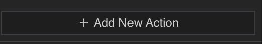

#### Triggers

El componente **Triggers** define eventos de trigger, estos activan acciones cuando ocurre un cierto evento. Los siguientes tipos de eventos de trigger existen:

* **On Click**: Cuando el jugador hace clic en el ítem. Consulta [About click triggers](smart-items-advanced.md#about-click-triggers)
* **Player Enters Area**: Cuando el jugador entra en un área. Consulta [About trigger areas](smart-items.md#trigger-areas)
* **Player Leaves Area**: Cuando el jugador sale de un área. Consulta [About trigger areas](smart-items.md#trigger-areas)
* **On Spawn**: Cuando la escena comienza, o el ítem se genera en la escena. Consulta [Trigger on spawn](smart-items-advanced.md#trigger-on-spawn)

Consulta [states and conditional logic](states-and-conditions.md) para aprender sobre otros triggers relacionados con condiciones de lógica.

Para agregar un nuevo trigger, haz clic en **Add New Trigger Event** en la parte inferior del componente Trigger. Luego selecciona el tipo de trigger, la entidad que deseas activar y una acción de esa entidad.

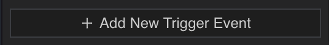


**📔 Nota**: Una acción necesita estar definida en el componente [Actions](smart-items-advanced.md#actions) de la entidad antes de que puedas activarla. Los triggers solo pueden afectar entidades que tienen un componente Actions.


### About Playing Animations

Usa una acción de tipo **Play Animation** para ejecutar una animación en el modelo 3D del smart item. La animación necesita existir ya como parte del archivo del modelo 3D. El desplegable **Select Animation** muestra una lista de todas las animaciones disponibles en el modelo 3D.

El campo **Play Mode** te permite seleccionar si una animación debe reproducirse solo una vez, o si debe seguir en bucle.

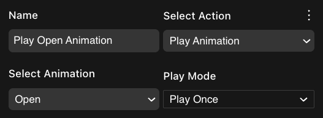

Una vez que la acción se crea, puedes activarla a través del componente [Triggers](smart-items-advanced.md#triggers) de ese mismo ítem o de cualquier otro ítem.

Usa la acción **Stop Animation** para detener todas las animaciones del ítem, tanto en bucle como no en bucle.


**💡 Tip**: Para verificar fácilmente el contenido de un modelo 3D, para ver qué animaciones incluye y cómo se ven, una buena herramienta es el [Babylon Sandbox](https://sandbox.babylonjs.com/). Solo arrastra el archivo del modelo 3D a la ventana. Debería aparecer un desplegable con una lista de sus animaciones en la parte inferior.


Para aprender más sobre animaciones y cómo puedes crear las tuyas propias como parte de un modelo 3D, consulta [Animations](../../3d-modeling/animations.md).

### About Playing sounds

Usa una acción de tipo **Play Sound** para reproducir un archivo de sonido. Puedes reproducir cualquier archivo de sonido siempre que esté importado en el proyecto de escena. El sonido se escucha posicionalmente, desde la ubicación del ítem, lo que significa que suenan más fuerte si el jugador está más cerca.


**💡 Tip**: En lugar de escribir la ruta al archivo de sonido, puedes arrastrarlo al campo **Path** desde el menú de navegación de archivos en la parte inferior del Scene Editor.


Usa el campo **Play Mode** para elegir si reproducir el sonido una vez, o en bucle continuamente.

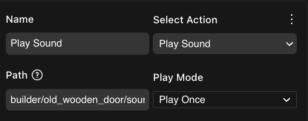

Una vez que la acción se crea, puedes activarla a través del componente [Triggers](smart-items-advanced.md#triggers) de ese mismo ítem o de cualquier otro ítem.

Usa la acción **Stop Sound** para detener todos los sonidos del ítem, tanto en bucle como no en bucle. Esto también detiene sonidos del componente **AudioSource**.

Para hacer que un ítem reproduzca un sonido en bucle siempre, por ejemplo para ambiente o música, es más fácil usar el componente **AudioSource**, en lugar de usar Actions y Triggers. Este componente solo requiere que proporciones una ruta a un archivo, y marques las casillas **Start Playing** y **Loop**.

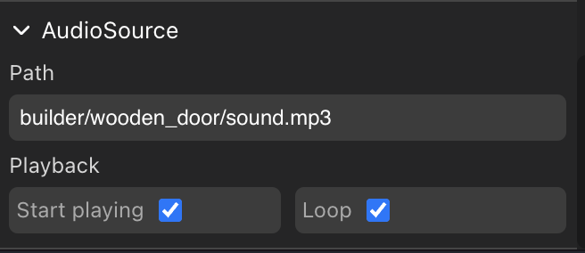


**📔 Nota**: Un smart item solo puede reproducir un sonido a la vez. Llamar a un segundo sonido interrumpirá cualquier otro sonido actualmente sonando. Esto también se aplica a sonidos del componente **AudioSource**. Si necesitas dos sonidos para sonar juntos, considera agregar una entidad invisible en la misma ubicación para contener una acción **Play Sound**.


Consulta [sounds](../../sdk7/3d-essentials/sounds.md) para más sobre reproducir sonidos en Decentraland.

### Moving, rotating, or scaling

Usa una acción **Start Tween** para cambiar la **posición**, **escala** o **rotación**, del ítem durante un período de tiempo. Todas las acciones **Start Tween** comienzan desde el estado original del ítem, y cambian a un estado final durante un período de tiempo.

Los tweens en posición pueden ser relativos o absolutos. Un tween absoluto en posición mueve el ítem a una posición fija en relación con la escena. El ítem se moverá desde donde esté a esa posición. Si ya está allí, no parecerá moverse. Un tween relativo en posición mueve el ítem una cierta distancia desde donde está ahora, por ejemplo un tween a una posición relativa de `1, 0, 0` mueve el ítem 1 metro hacia adelante, en la dirección que está enfrentando actualmente. Si ejecutas la acción tween una segunda vez, el ítem se moverá otro metro hacia adelante.

Los tweens en rotación también pueden ser relativos o absolutos. Una rotación relativa se agrega a la rotación actual del ítem. Un tween absoluto en rotación hará que el ítem enfrente una dirección específica, relativa a la escena.

Usa el campo **Duration** para establecer cuánto tiempo debe tomar todo el movimiento, en segundos. Ten en cuenta que el deslizador va hasta 100 segundos, pero también puedes escribir un número mayor manualmente si es necesario.

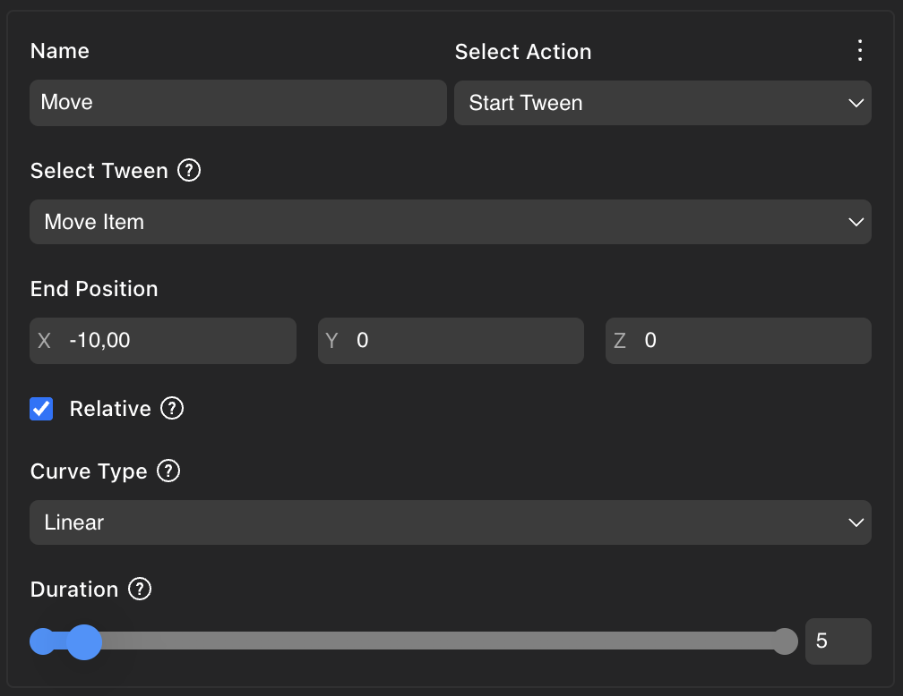

Una vez que la acción se crea, puedes activarla a través del componente [Triggers](smart-items-advanced.md#triggers) de ese mismo ítem o de cualquier otro ítem.

Los tweens pueden seguir diferentes **Curve Types** que afectan la tasa de cambio con el tiempo. Una curva **linear** (predeterminada), significa que la velocidad del cambio es constante de principio a fin. Hay muchas opciones para elegir, que dibujan curvas de diferentes formas dependiendo de si el comienzo y/o el final comienzan lento, y cuánto. Una curva **easeinexpo** comienza lenta y termina rápida, aumentando la velocidad exponencialmente, por el contrario una curva **easeoutexpo** comienza rápida y termina lenta.

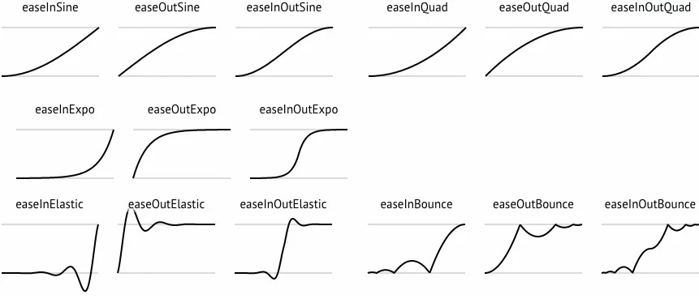


**💡 Tip**: Experimenta con diferentes curvas de movimiento. Las diferencias a menudo son sutiles, pero interpretamos subconscientemente información de cómo se mueven las cosas, como peso, fricción, o incluso personalidad.


Usa eventos de trigger **On Tween End** en el componente **Triggers** para activar una acción después de que un tween haya terminado. Usa [states and conditional logic](states-and-conditions.md) para describir una ruta en bucle para una plataforma flotante, para que se mueva constantemente entre dos ubicaciones.

Cuando un ítem realiza un tween, esto afecta todo sobre el ítem. Por ejemplo, si cambia de escala, cambia la escala de su modelo 3D visible y también la geometría de collider invisible, el tamaño del texto, etc. Si el ítem tiene hijos (anidados en el entity tree a la izquierda), estas entidades hijas también se ven afectadas por el tween.


**📔 Nota**: Cada entidad solo puede realizar un tween a la vez. Por ejemplo, no puedes hacer que un ítem se mueva lateralmente y también rote al mismo tiempo. Como solución alternativa, puedes usar entidades padre. Por ejemplo, puedes tener una entidad padre invisible que se mueva lateralmente, con un hijo visible que rote.


### About click triggers

Para activar una acción haciendo clic en un ítem, crea un trigger **On Click**. La acción se activará cada vez que el jugador haga clic en la entidad.

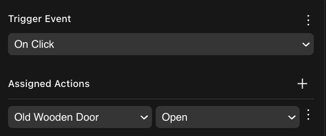

Consulta [Make any item smart](make-any-item-smart.md#interactivity) para más detalles.


**📔 Nota**: Al usar modelos 3D personalizados, el modelo debe tener una geometría de collider invisible para que sea clickeable. Consulta [colliders](../../sdk7/3d-essentials/colliders.md#pointer-blocking).

Como alternativa, puedes configurar el componente **GLTF** del ítem, para que su **Visible Layer** de colisión esté establecida en **Pointer**.

Otra alternativa es agregar un smart item **Click Area**, para dibujar un cubo que se superponga con el ítem que deseas hacer clic. El smart item Click Area es un [invisible item](smart-items-advanced.md#invisible-items).


### Trigger on spawn

Los triggers de tipo **On Spawn** activan una acción cuando se carga la escena. En lugar de esperar a que el jugador interactúe con un ítem, la acción se ejecuta de inmediato.

Por ejemplo, usa esto para hacer que una plataforma se mueva continuamente. Usa un trigger **On Spawn** para activar una acción de tween. Luego usa triggers **On State Change** para mantenerla moviéndose entre dos o más posiciones.

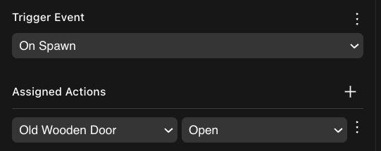

### Multiplayer

Todos los smart items son multijugador por defecto. Consulta [Smart Items - Basic](smart-items.md) para más detalles.

Puedes cambiar o ajustar este comportamiento multijugador para solo sincronizar ciertos componentes del ítem.

En el componente **Multiplayer** del ítem, marca las casillas para los componentes que deseas compartir.

Por ejemplo, una puerta comparte su `Animator` para que todos vean las animaciones de apertura, su `AudioSource` para que todos escuchen su sonido, y su `State` para que todos hagan seguimiento de si está actualmente abierta o cerrada. La puerta no comparte su componente `Visibility`, porque la puerta suele estar siempre visible. Si incluyes acciones para activar su visibilidad encendida y apagada, también podrías querer tener este componente marcado, para que los cambios se sincronicen entre todos los jugadores.

### Invisible items

Algunos ítems no están destinados a ser vistos por el jugador, pero son visibles mientras editas tu escena para hacerlos más fáciles de gestionar. Este es el caso de ítems como **Ambience**, **Trigger Area**, **Click Area**, etc.

En el modo avanzado, estos ítems tienen un componente **Visibility** establecido en invisible. Este componente no afecta la visibilidad de los ítems en el Scene Editor, pero cualquier ítem establecido en invisible no es visto por los jugadores al ejecutar un preview.

### Ver también

* [Smart items - Basics](smart-items.md)
* [States and conditions](states-and-conditions.md)
* [Making any item smart](make-any-item-smart.md)
* [Combine with code](../code/README.md)
