# Smart Items

Algunos de los ítems en el catálogo del Scene Editor son **Smart Items**. Los jugadores pueden interactuar con estos, tienen propiedades configurables y pueden activar acciones en otros smart items. Por ejemplo: puertas que pueden abrirse y cerrarse, plataformas que se mueven arriba y abajo, o botones y palancas que pueden activar otros ítems.

Puedes reconocer estos ítems en el explorador de asset packs porque tienen un ícono de rayo y un fondo de color diferente.


Puedes reconocer qué ítems en tu escena son smart porque tienen el ícono de rayo junto a ellos en el entity tree.

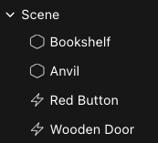

### Usar ítems

Para usar un smart item, arrástralo a la escena como cualquier otro ítem. Todos los ítems incluyen un comportamiento predeterminado, ejecuta un preview de escena para probarlo.

Aquí hay algunos ítems comunes y sus comportamientos predeterminados:

* **Doors**: Las puertas se abren o cierran cuando se hace clic. Puedes cambiar este comportamiento para que se abran con botones, trigger areas, etc.
* **Buttons**: Cuando se hace clic, reproducen sonido y una animación como retroalimentación. Agrega más acciones a sus eventos de trigger para activar otros smart items.
* **Levers**: Cuando se hace clic, cambian entre dos estados. Haz que cada posición de la palanca realice diferentes acciones en otros smart items.
* **Chests**: Se comportan como puertas, por defecto se abren o cierran al hacer clic. Puedes colocar ítems más pequeños dentro de ellos.
* **Platforms**: Se mueven entre dos posiciones. Usa sus acciones de tween para controlar hacia dónde se mueven, su velocidad, etc.
* **Trigger area**: Un ítem invisible que puede activar otros smart items cuando el jugador camina hacia su área. Consulta [About trigger areas](smart-items.md#about-trigger-areas).
* **Video Player**: Una pantalla para mostrar videos o streams en vivo. Consulta [Playing Videos](smart-items.md#playing-videos).
* **Audio Stream**: Reproduce audio desde un stream en vivo. Consulta [Playing Audio Streams](smart-items.md#playing-audio-streams)
* **NFT**: Muestra una imagen NFT como un retrato. Consulta [Displaying NFTs](smart-items.md#displaying-nfts)

Todos los smart items se pueden configurar para comportarse de formas personalizadas. Por ejemplo, qué tan lejos se mueve una plataforma, o qué activa un botón.

### Configurar un ítem

Selecciona un ítem en el Scene Editor para ver todas sus propiedades a la derecha.

Algunos campos típicos que puedes encontrar en muchos ítems son:

* **Hover text**: Qué texto se muestra en la UI como pista cuando el jugador pasa su cursor sobre el ítem. Por ejemplo, una puerta podría decir "Open"
* **Interaction**: ¿Con qué botón se activa el ítem? En un teclado típico:
  * **Primary** es **E**
  * **Secondary** es **F**
  * **Pointer** es **Botón Izquierdo del Mouse**
  * **Action3** es la tecla **1**
  * **Action4** es la tecla **2**
  * **Action5** es la tecla **3**
  * **Action6** es la tecla **4**
* **When clicked**: Selecciona qué acción se lleva a cabo cuando se interactúa con el ítem, usando el botón del campo **Interaction**. Puedes activar tantas acciones como desees, estas pueden ser acciones en ese mismo ítem, o en otros ítems también.

Cada ítem tiene sus propias configuraciones específicas, que pueden variar de un ítem a otro.

Todos los ítems tienen un **Advanced Mode** que te permite configurar casi cualquier cosa sobre ellos. Esto incluye cosas como qué sonidos se reproducen, o en qué dirección se mueve una plataforma. También puedes agregar acciones personalizadas que incluyen todo tipo de cosas, como teletransportar al jugador, reproducir animaciones de avatar, adjuntar un ítem a las manos del jugador, etc. También puedes agregar lógica condicional, para solo activar algo en ciertos escenarios. Consulta [Smart Items - Advanced](../scene-editor/interactivity/smart-items-advanced.md).

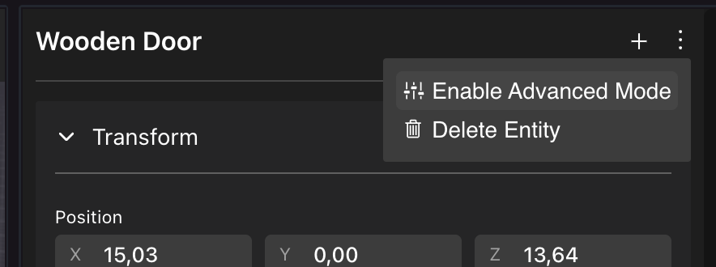

### Llamar una acción en otro ítem

Los smart items pueden activar acciones en otros smart items, para que sucedan cada vez que el ítem se activa. Solo selecciona el ítem que deseas llamar, de una lista de todos los ítems en la escena, luego selecciona una acción. Diferentes ítems exponen diferentes acciones.

Por ejemplo, aquí hay un botón que abre o cierra una puerta. Cada vez que se presiona el botón, la puerta se abrirá o cerrará.


Aquí hay una palanca que abre una puerta cuando se activa, y cierra esa puerta cuando se desactiva.

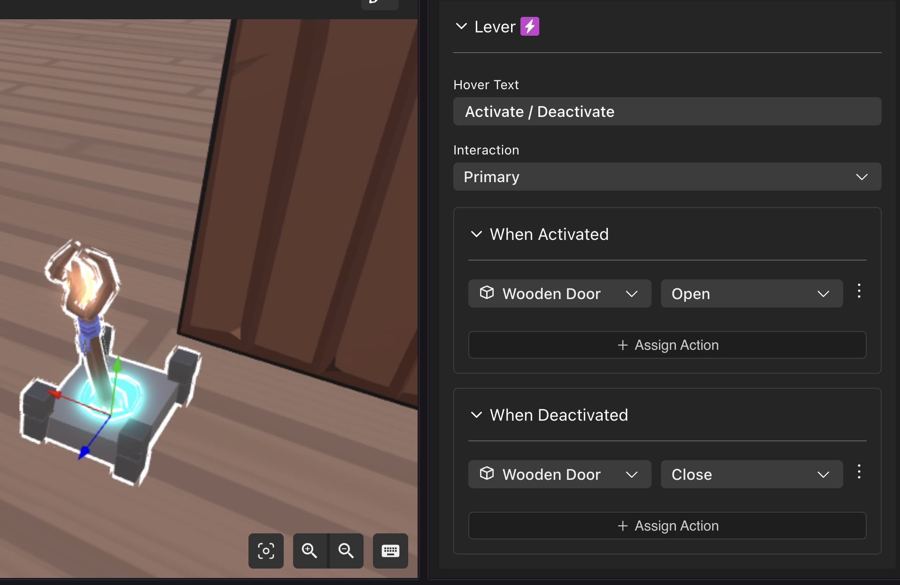

Puedes agregar tantas acciones diferentes de diferentes ítems para que se activen juntas. Solo haz clic en **+ Assign Action**.

Elimina acciones haciendo clic en los tres puntos junto a una acción y seleccionando _Remove action_.

También puedes encadenar acciones. Por ejemplo, si la puerta que se abre con la palanca incluye una acción en su propio campo **When Opened**, esta acción también se activará indirectamente con la palanca.

Si usas el [Advanced mode](../scene-editor/interactivity/smart-items-advanced.md) también puedes agregar lógica condicional a estos tipos de acciones.

### Smart items especiales

Algunos smart items tienen características únicas que los hacen muy útiles para escenarios comunes:

#### Trigger areas

Usa el smart item Trigger Area para activar una acción cuando el jugador camina hacia un área.

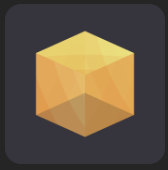

Usa los tipos de trigger **On Player Enters Area** y **On Player Leaves Area** en los componentes **Triggers** del ítem. Las acciones en estos eventos de trigger se activan cada vez que el jugador entra o sale del área.

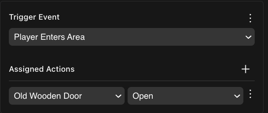

Consulta [Trigger area](../scene-editor/interactivity/trigger-area.md) para más información.

#### Invisible walls

Una colección de formas invisibles que pueden bloquear a los jugadores de caminar a través o hacer clic a través de un área.

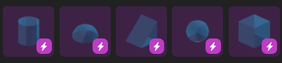

Estos muros invisibles pueden ser útiles al importar un modelo 3D que no tiene un collider mesh, o cuando quieres crear un muro que no sea visible para el jugador.

Consulta [Colliders](../sdk7/3d-essentials/colliders.md) para más información.

#### Click area

Un cubo invisible que puede ser clickeado por los jugadores para activar acciones en cualquier otro smart item. Este ítem puede ser habilitado o deshabilitado por cualquier otro smart item, cuando está deshabilitado no será clickeable. También puedes establecer el texto que los jugadores ven al apuntar su cursor a él.

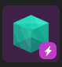

#### Reproducir videos

Reproduce videos desde:

* **Archivos locales**
* **Stream desde una URL**
* **Stream en vivo desde** [**Decentraland Cast**](../creator/worlds/cast.md)


**📔 Nota**: Evita reproducir más de un video en cualquier momento dado en tu escena, porque puede impactar severamente el rendimiento para los jugadores. Siempre detén otros videos antes de reproducir un segundo video.


Consulta [Play Videos](../scene-editor/interactivity/video-screen.md) para más información.

#### Reproducir audio streams

Reproduce un audio stream desde una URL, usando el smart item **Audio Stream**.


**📔 Nota**: No todos los servicios de streaming te permiten reproducir su audio fuera de su sitio. Los siguientes son algunos ejemplos que funcionan en Decentraland:

```ts
GRAFFITI =
	'https://n07.radiojar.com/2qm1fc5kb.m4a?1617129761=&rj-tok=AAABeIR7VqwAilDFeUM39SDjmw&rj-ttl=5'
SIGNS = 'https://edge.singsingmusic.net/MC2.mp3'
DELTA = 'https://cdn.instream.audio/:9069/stream?_=171cd6c2b6e'
JAZZ = 'https://live.vegascity.fm/radio/8010/the_flamingos.mp3'
```


Puedes ajustar el volumen de tu stream. Ten en cuenta que el audio del stream no es posicional, se escucha a un volumen uniforme a través de toda tu escena.

#### Mostrar NFTs

Para mostrar un NFT en un marco de cuadro, usa el smart item **NFT**. Debes proporcionar los siguientes campos:

* Network


**📔 Nota**: Actualmente **ethereum** es la única red soportada.


* NFT Collection Contract: El smart contract para la colección de NFT.
* Token ID: El token ID de este NFT coleccionable en particular.

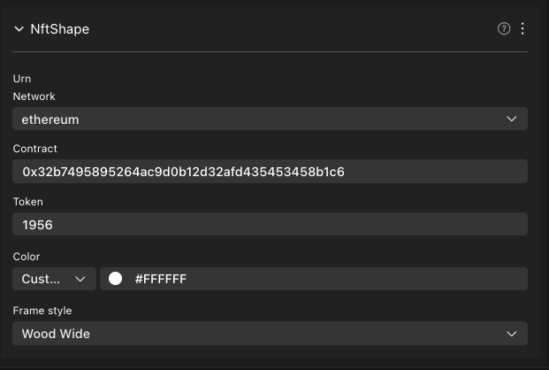

Puedes obtener esta información desde [OpenSea](https://opensea.io), verificando la pestaña **Details** bajo la imagen del NFT.

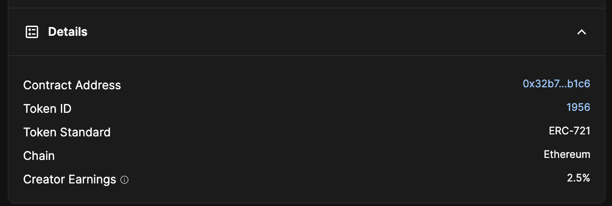


**📔 Nota**: También puedes obtener esta información de la URL de opensea. Por ejemplo, si la URL del NFT es la siguiente:

> `https://opensea.io/assets/ethereum/0x32b7495895264ac9d0b12d32afd435453458b1c6/1956`

Puedes completar los campos con lo siguiente:

* Network: ethereum
* Contract: 0x32b7495895264ac9d0b12d32afd435453458b1c6
* Token: 1956


También puedes configurar un color de fondo, esto es particularmente útil para NFTs con un fondo transparente.

También puedes elegir un **Frame style**, para enmarcar el NFT en una variedad de estilos diferentes, clásicos y modernos.

Consulta [Display an NFT](smart-items.md) para más detalles.

#### Barras de salud

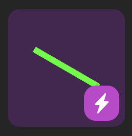

El smart item **Health Bar** es un gran bloque de construcción para varias mecánicas de juego. Se puede usar de varias maneras:

*   Anídalo bajo el **Player** para mostrar la salud del jugador sobre el avatar

    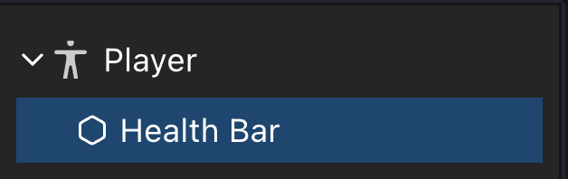
*   Anídalo bajo la **Camera** para mostrarlo fijo en la UI

    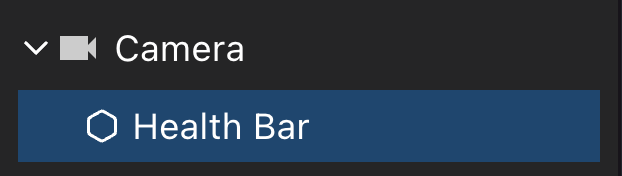
*   Anídalo literalmente bajo cualquier ítem en la escena para hacer seguimiento de la salud de ese ítem

    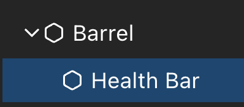

Otros ítems pueden interactuar con la barra de salud para agregar o restar salud de ella.

*   Ítems como los **Spikes** o **Robot Enemy** pueden reducir la salud

    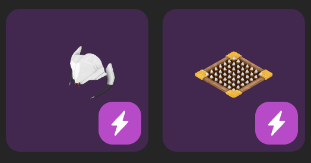
*   Ítems como **First Aid** o el **Healing Pad** pueden restaurarla.

    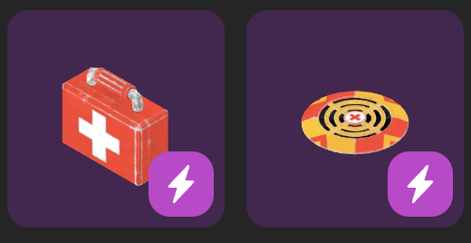

Debes configurar la Health Bar para definir qué sucederá cuando la salud sea igual a 0. Podrías reaparecer al jugador en la posición de un smart item **Respawn Pad**, restablecer el contador para su puntuación, reaparecer cualquier enemigo, mostrar un texto UI, o lo que tenga sentido en tu lógica de juego.

También puedes activar acciones cuando la salud esté por debajo de cierto valor, por ejemplo reproducir una música especial o mostrar una pista UI cuando la salud sea menor a 3.

¡Las barras de salud se pueden configurar para afectar cualquier cosa! Por ejemplo, agrega una barra de salud anidada bajo el smart item **Wooden Door**. Esta barra puede tener su salud reducida por el jugador usando el smart item **Sword**, pero también desde una explosión del **Barrel** o el ataque del **Robot Enemy**. Para que esto funcione, configura la barra de salud para que realice una acción en su ítem padre cuando su valor sea 0.

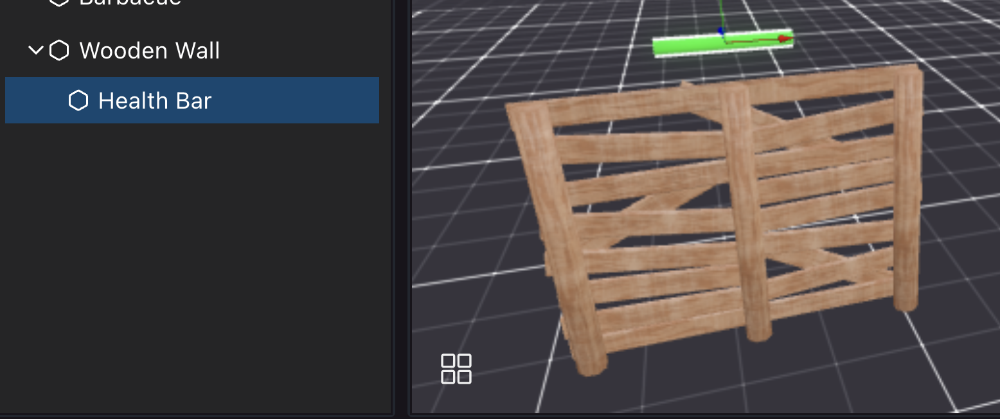

Las armas como la **Sword** pueden ser recogidas por el jugador, y luego usadas para causar daño en cualquier otro ítem con una barra de salud que esté cerca del jugador al realizar la acción.

### Multijugador

Casi todos los smart items tienen comportamiento multijugador, para que todos los jugadores en la escena compartan la misma experiencia a medida que los ítems cambian de estado. Si el jugador A abre una puerta, el jugador B también ve esa puerta abierta. Si el jugador C luego camina hacia la escena mientras los otros jugadores aún están allí, ella verá la puerta como ya abierta también.

Sin embargo, si no hay jugadores cerca de la escena, entonces la escena se restaura a su estado predeterminado. Entonces, si todos los jugadores se van, pero luego el jugador A regresa, encontrará la puerta cerrada (si ese era el estado predeterminado de la puerta).

Asegúrate de diseñar tu escena para que las acciones de un jugador no sabotee la escena para otros que vienen más tarde. Por ejemplo, si la escena es un juego de rompecabezas, puedes usar una acción _delay_ en un smart item _tools_ para hacer que todos los ítems en la escena se restablezcan a su estado inicial unos segundos después de que se resuelva el rompecabezas.

También puedes deshabilitar el comportamiento multijugador de un ítem, consulta [Smart Items - Advanced](../scene-editor/interactivity/smart-items-advanced.md).

### Solución de problemas

* _Un ítem en mi escena debería ser clickeable, pero no se puede hacer clic_.

Asegúrate de que no esté siendo obstruido por algo más. No puedes hacer clic a través de otros ítems. Algunos ítems tienen un _collider mesh_ que tiene una geometría simplificada que puede estar obstruyendo tu ítem, aunque su forma visible no parezca estar haciéndolo. Intenta mover el ítem para ver qué sucede.

### Ver también

* [Smart items - Advanced](../scene-editor/interactivity/smart-items-advanced.md)
* [States and conditions](../scene-editor/interactivity/states-and-conditions.md)
* [Making any item smart](../scene-editor/interactivity/make-any-item-smart.md)
* [Combine with code](../scene-editor/code/overview.md)
