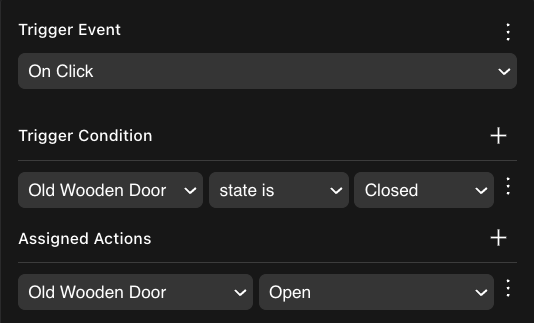
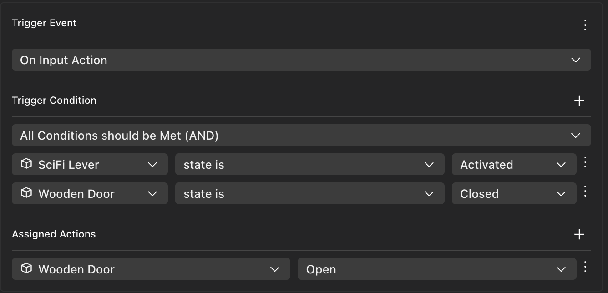
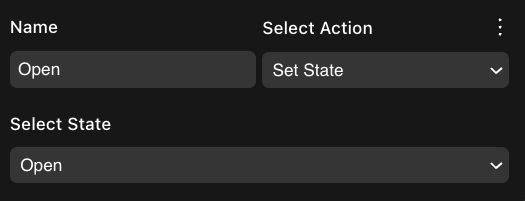
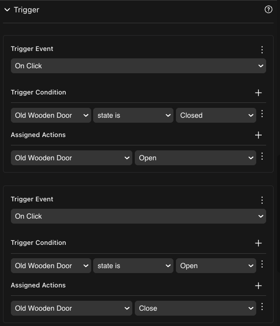
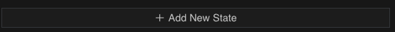
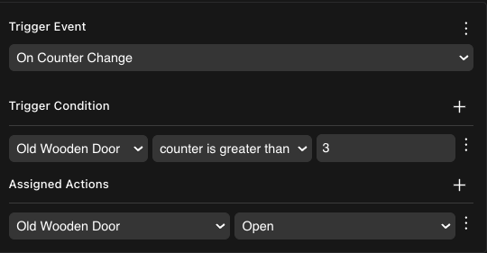

# States and Conditions

### Lógica condicional

Agrega condiciones en un trigger, para que la acción solo ocurra si se cumplen esas condiciones. Por ejemplo, hacer clic en una puerta solo activa la acción "Open" si no estaba ya abierta.

Para agregar una condición, haz clic en el ícono de tres puntos junto a **Trigger event** y selecciona **Add Trigger Condition**.

Un solo trigger puede incluir múltiples condiciones. Haz clic en el ícono **+** para agregar más condiciones. Cuando existe más de una condición, puedes seleccionar una de estas opciones:

* **All Conditions should be met (AND)**: El trigger solo ocurre si cada una de las condiciones es verdadera.
* **Any Condition can be met (OR)**: El trigger ocurre si al menos una de las condiciones es verdadera.

### States

El componente **States** está incluido en varios smart items. Lista posibles estados en los que puede estar el smart item. En cualquier momento dado, el smart item está en uno de estos estados. Por ejemplo, una puerta puede estar _Open_ o _Closed_. La acción Open establece el estado en _Open_, la acción Close establece el estado en _Closed_.

Puedes hacer las siguientes cosas con los estados:

1. Usar una condición en un trigger para verificar el estado de una entidad. De esa manera, la acción solo se lleva a cabo si un estado específico está activo.

2. Cambiar un estado a través de la acción **Set State**.

3. Reaccionar a cambios en el estado a través del evento de trigger **On State Change**.

Para alternar entre dos acciones, define dos triggers, cada uno con una condición que verifica un estado. Por ejemplo, las puertas tienen un trigger que activa la acción Open, con una condición que primero verifica que el estado de la puerta sea _Closed_, y otro trigger que activa la acción Close, con una condición que verifica que el estado de la puerta sea _Open_. Solo uno de los dos se activa cada vez que el jugador hace clic en la puerta.

Puedes agregar tantos estados como desees a un smart item. Solo haz clic en el botón **Add New State** para agregar otro a la lista.

Uno de los estados se selecciona como predeterminado, el ítem siempre comenzará en este estado cuando se ejecute la escena. Puedes asignar un estado diferente para que sea el predeterminado haciendo clic en los tres puntos junto a otro de los estados y seleccionando **Set as Default**.


**💡 Tip**: Mantén las interacciones entre ítems simples. Por ejemplo, evita escenarios como tener un botón que abre una puerta activando tres acciones: reproducir la animación de la puerta, reproducir el sonido de la puerta y cambiar el estado de la puerta. En su lugar, haz que el botón cambie el estado de la puerta. Luego usa un trigger **On State Change** para que la puerta misma maneje reproducir la animación y el sonido cada vez que cambie el estado.


### Counter

Usa el componente **Counter** para hacer seguimiento de un número, que puede cambiar a medida que el jugador realiza acciones en la escena. Puedes usar los valores del contador en lógica condicional.

Cuando una entidad tiene un componente Counter, puedes ejecutar las siguientes acciones en ella:

* **Increment Counter**: Incrementar el valor del contador en 1.
* **Decrease Counter**: Disminuir el valor del contador en 1.
* **Set Counter**: Establecer el valor del contador en un número específico, por ejemplo para restablecerlo a 0.

Usa el trigger **On Counter Change** para realizar una acción cada vez que cambie el valor del contador. Agrega una condición a este trigger para que solo se active después de pasar un cierto umbral.

En una condición, puedes verificar si el valor del contador es

* Mayor que un valor dado
* Menor que un valor dado
* Igual a un valor dado


**💡 Tip**: Para verificar mayor o igual, puedes agregar dos condiciones al evento de trigger, usando la opción AND.

Para hacer que una acción ocurra solo una vez al pasar un umbral, y no se repita en cada incremento después de eso, combina el contador con un componente **State**. Establece el State en "Done" cada vez que alcances el valor deseado, y agrega una condición para verificar este estado en el evento de trigger.


### Ver también

* [Smart items - Basics](smart-items.md)
* [Smart items - Advanced](smart-items-advanced.md)
* [Making any item smart](make-any-item-smart.md)
* [Combine with code](../code/README.md)
