# Scene Admin

Otorga a ciertos jugadores el rol especial de **admin** en tu escena.

Durante un evento en vivo, un admin puede controlar espontáneamente lo que sucede en la escena desde dentro de Decentraland, sin necesidad de pre-programar acciones o depender de un servicio de terceros. Inicia la música cuando se haya reunido suficiente multitud, suelta confeti o haz aparecer una nave espacial cuando el momento se sienta correcto.

Cuando un admin de escena visita tu escena, ve una UI especial en la esquina superior derecha que solo ellos pueden ver. A través de esta UI pueden reproducir videos o streams en vivo, enviar anuncios, banear jugadores o activar cualquier smart item que esté configurado para ser activado así. Estas acciones son vistas por todos los demás jugadores en la escena que están conectados a la misma isla de comms que el admin.

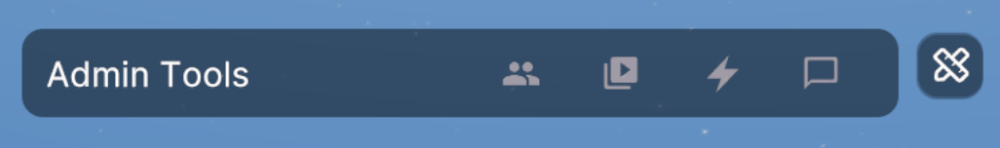

### Configurar admins

Para asignar admins, necesitas agregar el smart item **Scene Admin** a tu escena.

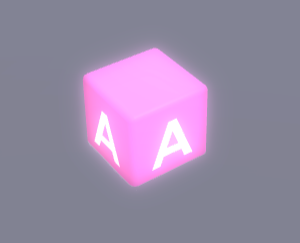


**📔 Nota**: Actualiza tu escena para usar las últimas dependencias. El Smart item Scene Admin no funcionará si la escena está desactualizada.

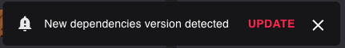


Mientras estás desarrollando la escena y probándola localmente, siempre eres un admin. Una vez que la escena se publica, cualquier persona con permisos de publicación en la escena también es automáticamente un admin. Esto incluye:

* El propietario de los parcels de LAND o World NAME donde se publica la escena
* Cualquiera a quien se le otorguen **derechos de Operator** en estos parcels o name. Consulta [Give permissions](../../../player-spa/marketplace/land-manager.md#dar-permisos).
* Cualquier usuario que alquile esa land. Consulta [Rentals](../../../player-spa/marketplace/rentals.md).

También puedes asignar personas adicionales a la lista de admin una vez que tu escena esté publicada visitando tu escena como admin y abriendo la pestaña **Permissions & Moderation** desde los iconos de la parte superior del panel.

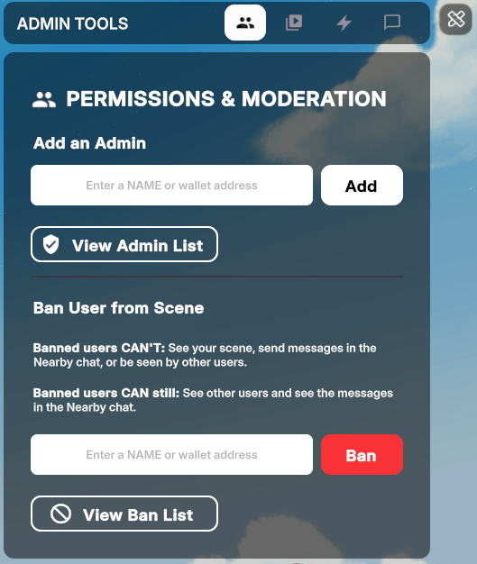

Escribe la dirección de wallet de la persona que deseas agregar a la lista de admin y haz clic en **Add**.

Puedes ver quién es admin en la escena haciendo clic en el botón **View Admin List**. Desde esta pantalla también puedes **Remove** personas de la lista de admin.


**📔 Nota**: Solo es posible eliminar el rol de admin de jugadores que fueron agregados manualmente a la lista a través de la pestaña **Permissions & Moderation**. Los jugadores que son propietarios, operators o renters de la escena se muestran en esta lista pero no se pueden eliminar de sus roles de admin desde esta UI. Para eliminar un rol de admin de un operator, primero debes eliminar su rol de operator.


Cada vez que un jugador admin está en la escena, verá una UI especial en la esquina superior derecha. Los jugadores no-admin no ven esta UI.

### Reproducción de videos

Una de las acciones más comunes que hacen los admins es reproducir videos. El panel de admin incluye una sección de reproductor de video donde pueden controlar cualquier cosa relacionada con videos.

Para habilitar esto, necesitas agregar un smart item **Video Player** a tu escena y vincularlo al smart item Scene Admin.

1.  Agrega un smart item **Video Player** a tu escena

    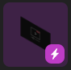

    Consulta [Video Screen](../interactivity/video-screen.md) para más detalles sobre cómo puedes configurar la media source predeterminada, marcador de posición de imagen y otras configuraciones del smart item Video Player. La mayoría de estas configuraciones pueden ser sobrescritas por el admin una vez dentro de la escena.

    \{% hint style="warning" %\} **📔 Nota**: Un admin solo puede gestionar videos que se reproducen en el smart item Video Screen, no en pantallas agregadas a través de código SDK.

    Puedes incluir tantas video screens como desees. En general, evita tener más de un video diferente reproduciéndose al mismo tiempo, ya que eso perjudica mucho el rendimiento. \{% endhint %\}
2.  Abre el Smart Item Scene Admin, asegúrate de que la casilla **Video Screens** esté habilitada para que esta sección se muestre. Luego selecciona la pantalla de una lista desplegable y dale un nombre amigable para mostrar en la UI de Admin. Puedes agregar tantas Video Screens como desees, cada pantalla se controla de forma independiente.

    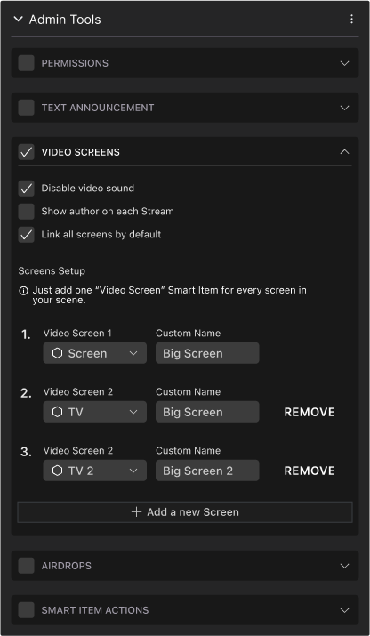

Una vez que lo anterior esté configurado, los usuarios admin en tu escena pueden abrir el panel de admin y seleccionar la sección de video para controlar estas video screens.

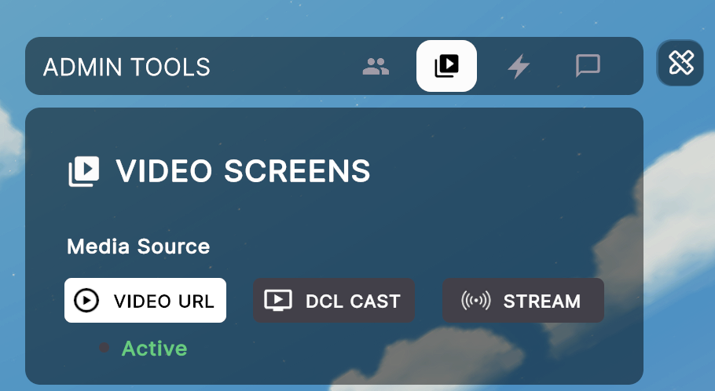

Si tu escena tiene múltiples video screens, el desplegable **Screen** te permite elegir qué video screen controlar. La lista muestra los nombres que diste a cada video screen en la configuración del smart item Admin Tools.

#### Media Sources

El selector de la sección de video permite elegir entre tres fuentes. La fuente activa se indica con una etiqueta; cambiar de pestaña solo muestra su configuración y no interrumpe la reproducción hasta pulsar **Activate**:

*   **Video URL**: Reproduce un video desde una URL. Pega la dirección en el campo **Video URL** y haz clic en **Activate**. El video comenzará a reproducirse en la pantalla seleccionada para todos los jugadores. También puedes detener, pausar, reiniciar, silenciar o cambiar el volumen del video.

    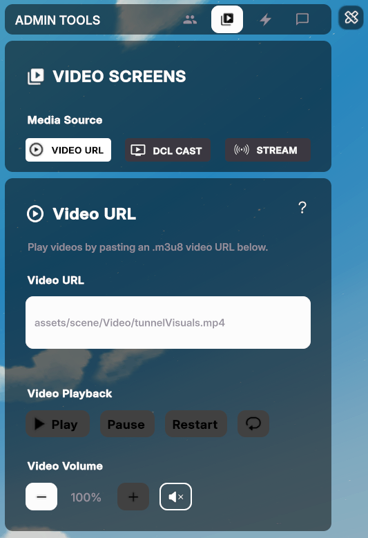

    \{% hint style="warning" %\} **📔 Nota**: No cualquier URL de video funcionará. Los videos de sitios como Youtube, por ejemplo, tienen políticas estrictas sobre su contenido y bloquearán el acceso a ellos desde Decentraland. Consulta [Streaming from other sources](../interactivity/video-screen.md#streaming-from-other-sources) para más información sobre qué puedes y no puedes reproducir en Decentraland. \{% endhint %\}
*   **DCL Cast**: Comparte tu cámara o pantalla con otros jugadores mediante la aplicación web gratuita de Decentraland, sin configurar software de streaming. Consulta [DCL Cast](../../worlds/cast.md).

*   **Stream**: Reproduce un stream en vivo usando la infraestructura de streaming gratuita de Decentraland y un software de streaming como OBS o StreamYard.

    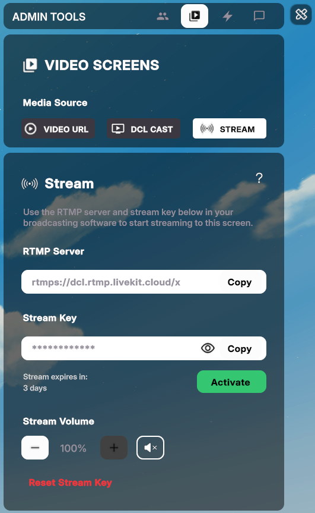

    Consulta [Live Streaming](live-streaming.md) para más información sobre cómo configurar un stream en vivo.

Cada pantalla en tu escena tendrá una de las media sources anteriores establecida como **Active**. Puedes hacer clic en **Video URL**, **DCL Cast** o **Stream** para explorar la configuración en cada sección, no interrumpirás lo que se está reproduciendo actualmente hasta que hagas clic en el botón **Activate** en cualquiera de las secciones.

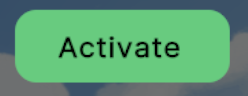

### Anuncios

En la pestaña **Announcements** del panel de admin, los admins pueden escribir mensajes que son vistos por todos los jugadores en la escena. Mensajes como este solo pueden ser enviados por admins, por lo que otros jugadores los percibirán como más legítimos que un mensaje en el chat de alguien que afirma ser un admin.

Selecciona la sección Message de la UI de admin. Escribe un mensaje y haz clic en **Share**. El mensaje puede tener hasta 90 caracteres de largo.

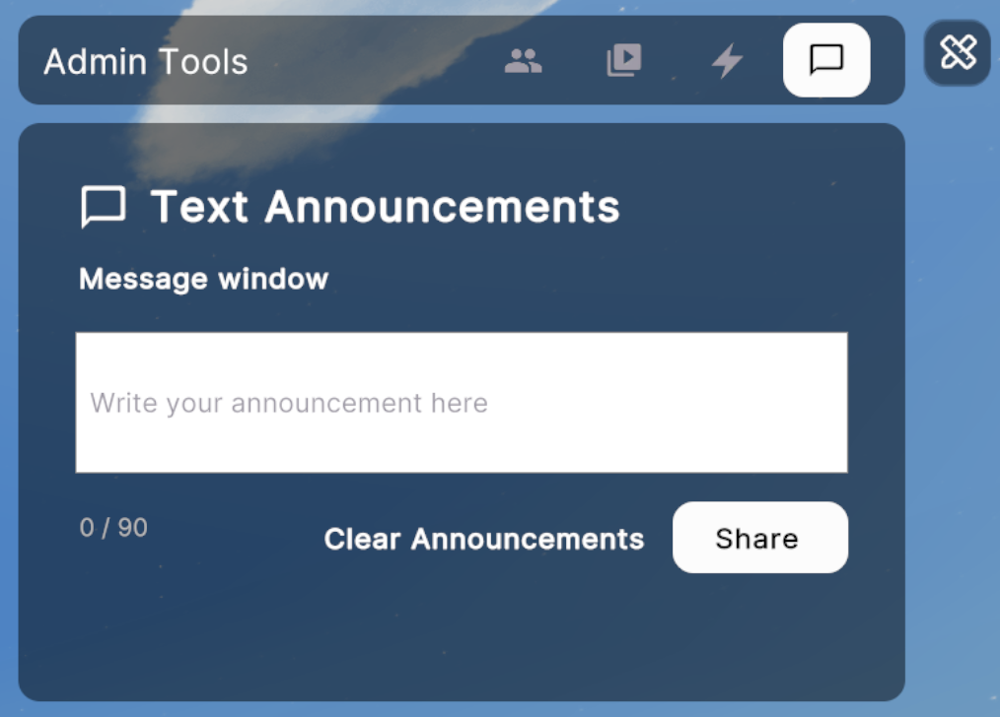

### Banear jugadores

Puedes banear jugadores de tu escena seleccionando la pestaña **Permissions & Moderation** de la UI de admin, escribiendo el nombre o dirección de wallet del jugador que deseas banear y haciendo clic en el botón **Ban**.

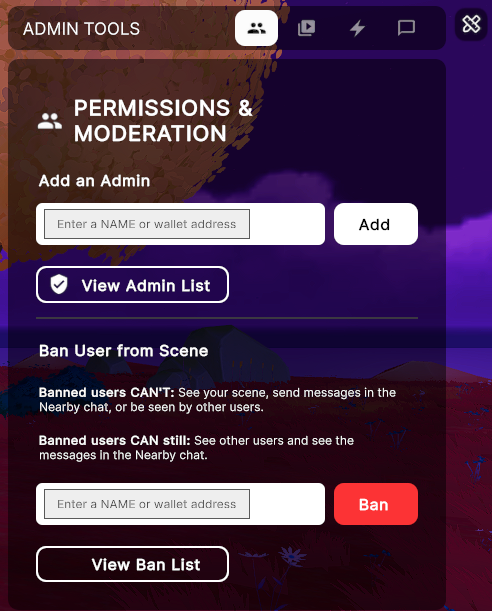


**💡 Tip**: Para obtener la dirección de wallet de un jugador, haz clic en su avatar para abrir su perfil, luego haz clic en el botón **Copy to clipboard** junto a la dirección de wallet.


Los jugadores baneados no podrán cargar tu escena ni interactuar con ninguno de sus contenidos. Otros jugadores no los verán en la escena, ni leerán ninguno de sus mensajes de chat.


**📔 Nota**: Los efectos de tu baneo son inmediatos y permanentes. Una vez que un jugador es baneado, permanecerá baneado hasta que se levante el baneo. Banear a un jugador de tu escena solo afecta lo que los jugadores que están parados dentro de tu escena pueden ver, si un jugador sale de los límites de tu escena, ya no se ven afectados por el baneo. Los jugadores baneados son invisibles para otros jugadores si están parados fuera de tu escena también.


Haz clic en **View Ban List** para ver la lista de jugadores actualmente baneados. Desde esta lista también puedes **Unban** jugadores.

### Activar smart items

Para Activar una acción de cualquier smart item en la escena:

* Agrega un smart item a tu escena
* Abre la configuración del Smart Item **Scene Admin** en el Creator Hub
* En la sección **Smart item actions**, agrega el smart item del desplegable, dale un nombre personalizado y selecciona una acción predeterminada

Una vez que lo anterior esté configurado, los admins pueden activar la acción abriendo la sección **Smart Item Actions** de la UI de admin y luego seleccionando un ítem de la lista desplegable. Luego pueden hacer clic en el botón **Default** para activar la acción predeterminada de ese ítem, o seleccionar cualquier otra de las acciones del ítem de la lista.

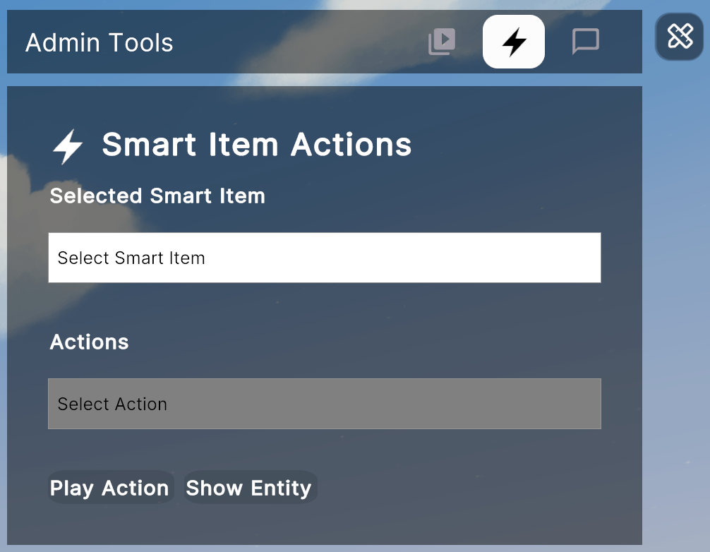

También puedes mostrar u ocultar cualquier smart item en esta lista, incluso si no incluye una acción para hacer eso.
