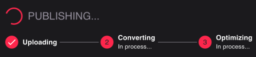
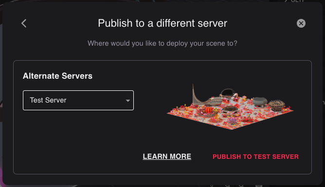

# Publish Scene

### Antes de comenzar

Asegúrate de lo siguiente:

* Tu escena cumple con todas las [scene limitations](../../sdk7/optimizing/scene-limitations.md). La mayoría de estas se validan cada vez que ejecutas un preview de tu escena.
* Tienes una cuenta de [Metamask](https://metamask.io/), con tus parcels de LAND o NAME asignados a ella.
* Posees la cantidad necesaria de parcels de LAND adyacentes o un NAME de Decentraland. De lo contrario, puedes comprar LAND en el [Market](https://market.decentraland.org) o un NAME en el [Builder](https://decentraland.org/builder/names).


**📔 Nota**: Las escenas multi-parcel solo se pueden desplegar en parcels adyacentes.


Verifica los [detalles de tu escena](../configure/scene-settings.md#scene-details), asegúrate de proporcionar un nombre atractivo, descripción, miniatura, categorías, etc.


**❗Advertencia**: Al planear eventos en vivo, asegúrate de no hacer cambios de último minuto en la escena justo antes del evento.

Después de cada publicación, un proceso interno optimiza todos los modelos 3D antes de que puedan ser renderizados. Esto toma alrededor de 15 minutos. Si visitas la escena antes de que esto termine, la escena puede aparecer rota. Este proceso se ejecuta incluso si los modelos 3D fueron todos publicados previamente.


### Publicar tu escena

Para publicar tu escena:

1. Abre tu escena en el Scene Editor y haz clic en **Publish**. Esto abre una pestaña del navegador, mostrando detalles.
2. Selecciona si quieres publicar en LAND o en un WORLD. Consulta [Kinds of projects](../../sdk7/projects/kinds-of-project.md) para entender mejor las diferentes opciones.

3. Si publicas en LAND, selecciona la ubicación en el mapa. Verás tus parcels elegibles marcados en rojo. Si publicas en un WORLD, verás tus NAMEs elegibles en un desplegable.


**💡 Tip**: Si no ves tus parcels o NAMEs, asegúrate de estar conectado al Creator Hub usando la cuenta de usuario correcta. De lo contrario, sal del proyecto y haz clic en el ícono de configuración de usuario en la esquina superior derecha, luego selecciona **Sign Out** y vuelve a iniciar sesión.


4. La siguiente pantalla muestra todos los archivos que estás cargando actualmente y sus tamaños, confirma la operación.
5. El proceso de publicación comenzará entonces. Las etapas **1** y **2** son necesarias para que tu escena sea jugable, una vez hecho aparece un botón **Jump In**. No necesitas esperar la **Etapa 3** para probar tu escena. 

\*\*📔 Nota\*\*: Las tres etapas del despliegue involucran: - \*\*1. Uploading\*\*: Subiendo los archivos a los servidores. - \*\*2. Converting\*\*: Los modelos 3D de la escena se comprimen en Asset Bundles para un rendering más rápido. Esto puede tomar 15 minutos o menos. Puede demorarse más para escenas muy grandes, o si los servidores están actualmente ocupados convirtiendo otras escenas. - \*\*3, Optimizing\*\*: Se generan versiones de Nivel de Detalle Bajo (LOD) de tus assets. Estos solo se usan para renderizar tu escena desde lejos, lo que significa que no necesitas esperar a que esto termine para saltar y probar tu escena.

### Publicar desde un hardware wallet

En lugar de almacenar tus tokens de LAND en una cuenta de Metamask, puedes encontrar más seguro almacenarlos en un dispositivo de hardware wallet, como un [Ledger](https://www.ledger.com/) o un [Trezor](https://trezor.io/), que está físicamente conectado a tu computadora.

Si estás usando uno de estos dispositivos, puedes vincular el hardware wallet a Metamask para habilitar la firma de mensajes, mientras mantienes los tokens más seguros. Consulta [este artículo de Metamask](https://metamask.zendesk.com/hc/en-us/articles/360020394612-How-to-connect-a-Trezor-or-Ledger-Hardware-Wallet) para instrucciones para conectar tu cuenta.

Una vez que tu hardware wallet pueda usarse a través de Metamask, puedes desplegar siguiendo los mismos pasos que si tus tokens estuvieran en una cuenta de Metamask.

### Sobrescritura de escenas

Cuando se despliega una nueva escena, sobrescribe el contenido más antiguo que existía en los parcels que ocupa.

Si una escena que ocupa múltiples parcels es solo parcialmente sobrescrita por otra, todos sus parcels son sobrescritos o borrados.

Supón que desplegaste tu escena _A_ sobre dos parcels _\[100, 100]_ y _\[100, 101]_. Luego vendes el parcel _\[100, 101]_ a un usuario que posee land adyacente y que despliega una escena grande (_B_) a varios parcels, incluyendo _\[100, 101]_.

Tu escena _A_ no puede ser parcialmente renderizada en solo un parcel, por lo que _\[100, 100]_ no mostrará ningún contenido. Debes construir una nueva versión de la escena _A_ que solo ocupe un parcel y desplegarla solo en el parcel _\[100, 100]_.

### Servidores alternativos

#### El servidor de prueba

Puedes desplegar contenido en el servidor catalyst de prueba para ejecutar pruebas completas con múltiples usuarios, las escenas circundantes y un entorno idéntico a producción. El servidor de prueba es idéntico a todos los demás servidores catalyst, la diferencia es que el contenido que se despliega en este servidor no se propaga a los demás. El contenido desplegado en otros servidores por otro lado sí se propaga a este servidor, por lo que las escenas circundantes deberían verse como lo harán en producción.


**📔 Nota**: Para desplegar en parcels en el servidor de prueba, debes tener los mismos permisos requeridos para desplegar en esos parcels en la red principal.


Los jugadores nunca son dirigidos a este servidor, la única forma de acceder a él es proporcionar explícitamente un parámetro de URL para conectarse a él.

Si estás trabajando en un proyecto confidencial que no quieres revelar hasta el lanzamiento, ten en cuenta que el servidor de prueba está relativamente oculto de los jugadores, pero cualquiera que use explícitamente la URL del servidor de prueba podría potencialmente encontrarlo.

Para publicar en el servidor de prueba, haz clic en el botón **Publish** normalmente, luego selecciona **Publish to a different server** en la parte inferior. Luego selecciona **Test Server** del desplegable.

### Publicar en land otorgada

Si estás publicando en land propiedad de la Decentraland Foundation que te fue otorgada a través de una grant, haz clic en el botón **Publish** normalmente, luego selecciona **Publish to a different server** en la parte inferior. Luego selecciona **Custom Server** del desplegable e ingresa la siguiente dirección de servidor: `http://linker-server.decentraland.org`.


**📔 Nota**: Primero debes establecer manualmente las coordenadas de tu escena en la pestaña avanzada de la configuración de Layout. Consulta [Scene Settings](../configure/scene-settings.md#layout) para más información.


### Servidores personalizados

Puedes desplegar contenido en un servidor personalizado que no pertenece a la red oficial de servidores catalyst mantenida por el DAO. Para hacer esto, no necesitas poseer ningún token de LAND o NAME, ya que puedes configurar el servidor para usar cualquier lógica de validación que prefieras para controlar quién puede desplegar dónde. Los servidores personalizados pueden elegir tener contenido de los servidores oficiales, que puedes sobrescribir, o comenzar desde cero y publicar contenido completamente nuevo.

Para publicar en un servidor personalizado, haz clic en el botón **Publish** normalmente, luego selecciona **Publish to a different server** en la parte inferior. Luego selecciona **Custom Server** del desplegable e ingresa la dirección del servidor.

Consulta [How to run your own Catalyst Node](../../../contributor-esp/tutorials/how-to-run-a-catalyst.md) para más información sobre qué puedes hacer con tu propio servidor y cómo configurarlo.


**📔 Nota**: Los jugadores necesitarán escribir manualmente una URL para acceder a tu servidor personalizado. Ciertas validaciones de servicios como el [rewards server](../../rewards/gatting-started.md) o el [quests server (documentación archivada)](https://github.com/decentraland/documentation/blob/5f8c7f73c67a9a36e85095cb02e72dc6355fa590/content/creator/deprecated/quests/overview.md) pueden fallar en estos contextos, ya que a menudo estos servicios requieren que la solicitud provenga de un servidor oficial.


Los jugadores nunca son dirigidos a este servidor, la única forma de acceder a él es escribir explícitamente la URL para conectarse a él.

### Verificar el éxito del despliegue

Una vez que desplegaste tu escena, estos cambios tardarán algunos minutos en propagarse a través de los diversos servidores de contenido en la red. Si ingresas a Decentraland justo después de desplegar, podrías seguir viendo la versión anterior de tu contenido, o que los modelos 3D faltan por completo.

Después de firmar para autorizar el despliegue de tu escena, la dapp de firma comenzará a mostrar confirmaciones de que la nueva versión de tu contenido se ha propagado a través de todos los servidores en la red,

Verás una lista de cada uno de los servidores que componen la red de contenido de Decentraland. Para cada servidor, especifica el timestamp del último cambio subido en ese parcel. Cada uno de estos servidores se refiere a un realm diferente, puedes hacer referencia a cómo estos nombres de servidor se mapean a nombres de realm en la [pantalla del catalyst monitor](https://decentraland.github.io/catalyst-monitor/).
