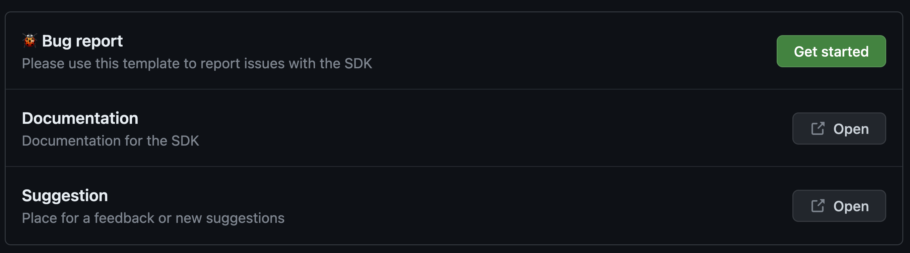
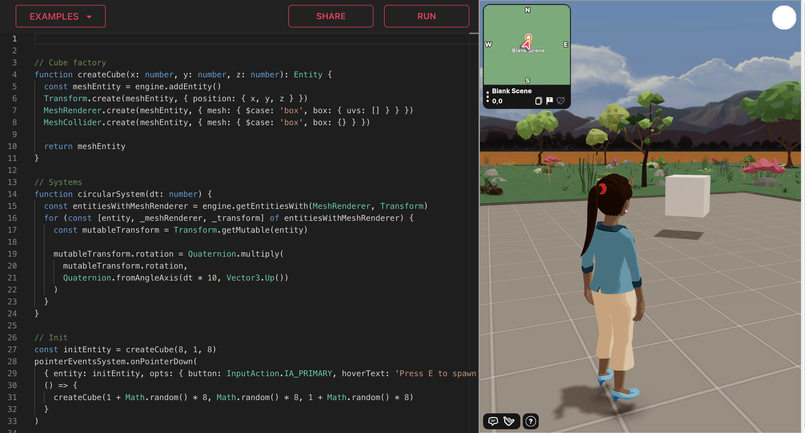

# Report a Bug

Si encuentras cualquier bug o problema con el SDK de Decentraland y el Scene Editor, por favor repórtalos en nuestro repositorio de GitHub [aquí](https://github.com/decentraland/sdk/issues/new/choose).

### Antes de reportar un bug

Antes de enviar un reporte de bug, por favor asegúrate de lo siguiente:

* Asegúrate de estar usando la última versión del SDK, en caso de que el problema ya haya sido corregido en versiones más nuevas.
* Verifica la documentación para la característica que estás intentando usar, para confirmar que se supone que se comporte como esperas, y que esto no es solo un malentendido.
* Descarta que el problema podría ser causado por cómo está construida tu scene. Consulta [Debug in Preview](debug-in-preview.md) y [Debug in Prod](debug-in-prod.md) para consejos.
* Evita duplicados. Verifica la [lista de bugs conocidos](https://github.com/orgs/decentraland/projects/20/views/13) para evitar hacer un duplicado. Si tienes más información para agregar a un problema existente, por favor agrega un comentario al problema en lugar de crear un nuevo problema.

### Reportando un bug

Para reportar un bug con el SDK, necesitarás una cuenta de GitHub. Sigue estos pasos:

1. Visita el siguiente enlace: [New Issue Page](https://github.com/decentraland/sdk/issues/new/choose)
2. Haz clic en **Get Started** junto a **Bug Report**. 
3. Completa todos los campos en la plantilla. La plantilla proporciona instrucciones para cada sección. Cuantos más detalles puedas proporcionar, más rápido nuestros desarrolladores pueden identificar y resolver el problema.
4. Haz clic en **Submit new issue**.

Los desarrolladores pueden hacer preguntas de seguimiento en tu ticket si necesitan aclaraciones o información adicional. Recibirás notificaciones por correo electrónico de actualizaciones a tu reporte de bug.


**📔 Nota**: Para cualquier problema no relacionado con el SDK por favor contacta al equipo de soporte. Para comunicarte, por favor visita esta página [intercom.decentraland.org](https://intercom.decentraland.org/) o envíanos un correo electrónico a [hello@decentraland.org](mailto:hello@decentraland.org). También puedes encontrarnos en [Discord](https://decentraland.org/discord/). El equipo está disponible para ayudar de lunes a domingo, 12pm a 9pm UTC y hará su mejor esfuerzo para ponerse en contacto lo antes posible. Puedes esperar una respuesta dentro de 60 min en Discord durante el horario anterior y dentro de 24h en correo electrónico.

También puedes contactar al equipo de soporte del DAO en el [Discord del DAO](https://discord.gg/bxHtcMxUs4).


**Consejos Adicionales para Reportes de Bug:**

* Crea un problema separado para cada bug. Si encuentras múltiples problemas, asegúrate de crear un nuevo problema para cada uno.
* Evita explicaciones largas. Solo incluye salida de línea de comandos o consola relevante o código de scene cuando sea necesario.
* Adjunta imágenes o videos si es posible. Puedes arrastrarlos y soltarlos fácilmente en el área de texto del problema, y GitHub manejará la carga y el enlace.

### Usando el Decentraland Playground

Proporcionar fragmentos de código que demuestren el problema es extremadamente útil. La reproducibilidad es crucial. Si un bug no puede reproducirse, es desafiante diagnosticarlo y arreglarlo.

Puedes pegar fragmentos de código dentro del texto de tu problema, pero la mejor manera de proporcionar fragmentos de código es usando el [Decentraland Playground](https://playground.decentraland.org/). Sigue estos pasos:

1. Escribe tu fragmento de código a la izquierda, y ve tu scene en el panel derecho.
2. Haz clic en el botón **Share** y pega el enlace en tu reporte de problema.

Usar el playground simplifica la reproducción de problemas y asegura que cualquiera que abra el enlace pueda ver la misma salida, independientemente de su sistema operativo, versión de SDK, versión de Node, etc. También facilita la iteración rápida para identificar condiciones afectadas y señalar la causa del problema.

Mantén tu ejemplo lo más conciso posible, mientras aún reproduzca el problema. Un ejemplo más simple ayuda a eliminar ambigüedad sobre el origen del problema.


**📔 Nota**: No es posible importar assets a tu scene en el Playground. Así que si reproducir el problema requiere importar un modelo 3D o un archivo de sonido, no será posible mostrarlo allí.


### Obtener logs

A menudo es útil obtener los logs del Decentraland explorer al reportar un bug.

Para obtener tus logs, simplemente abre el chat y escribe `/logs`. Esto abrirá una nueva ventana con los logs del Decentraland explorer. Adjunta el archivo `Player.log` a tu reporte de problema.

### Editando la Documentación

Si descubres problemas en el contenido del sitio web de Documentación, puedes enviar solicitudes de cambio. Simplemente desplázate hacia abajo hasta el final de la página y haz clic en el botón **Edit this page**. GitHub te guiará a través de la creación de un pull request con tus cambios. El equipo de la fundación revisará tus cambios y los publicará si se consideran útiles.

### Solicitudes de Características y Sugerencias

Si tienes sugerencias para agregar nueva funcionalidad o características en lugar de reportar un problema, por favor únete al [Servidor de Discord de Decentraland](https://dcl.gg/discord) y publica un mensaje en el [Canal del Creator Hub](https://discord.com/channels/417796904760639509/1288888172318560326) en lugar de crear un GitHub Issue.
