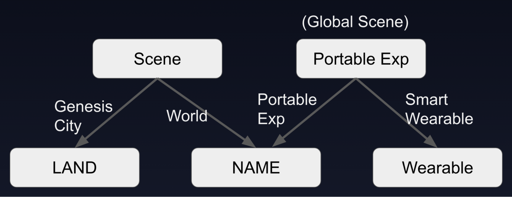

# Tipos de Proyecto

Hay diferentes tipos de contenido que puedes hacer para Decentraland.

### Escenas

Las escenas de Decentraland pueden alojarse en Parcels en Genesis City o en WORLDs.

#### Publicar en LAND

Las escenas que se publican en Parcels pueden encontrarse en coordenadas específicas dentro del mundo abierto de Decentraland.

Estas escenas están vinculadas a tokens LAND o Estate. Cada parcela ocupa 16x16 metros. Múltiples parcelas adyacentes pueden ser usadas por una sola escena, estas pueden disponerse en cualquier forma, siempre que los bordes se toquen.

Los tokens LAND pueden comprarse en el [Marketplace](https://decentraland.org/marketplace/lands). Hay un suministro limitado de ellos, cubriendo el mapa de Genesis City.

Las escenas publicadas en LAND son más fáciles de descubrir, ya que los jugadores pueden encontrárselas mientras visitan contenido cercano o exploran.

Las escenas publicadas en LAND pueden usar hasta 15 MB de espacio por cada parcela en la escena. Mientras más parcelas, más espacio disponible. Esto es para prevenir sobrecargar el CPU del jugador, ya que los jugadores pueden estar experimentando muchas escenas cercanas al mismo tiempo. Consulta [limitaciones de tamaño](../optimizing/scene-limitations.md).

#### Publicar en WORLDs

Las escenas publicadas en un World deben accederse vía un enlace.

Estas escenas están vinculadas a tokens NAME. Los tokens NAME pueden comprarse en el [Marketplace](https://decentraland.org/marketplace/names/claim). Puedes reclamar cualquier nombre que desees siempre que no esté reclamado todavía.

Las escenas publicadas en un World pueden usar hasta 100 MB, y tener tantas parcelas de terreno como desees. Las mismas [limitaciones de tamaño](../optimizing/scene-limitations.md) por parcela aplican como en las escenas publicadas en parcelas LAND, pero puedes agregar más parcelas a tu escena sin ningún costo.

Consulta [Worlds](../../worlds/about.md) para más información.

Los Worlds ofrecen algunas opciones para personalizar el sky box de la escena, que no están disponibles en Genesis City (donde un mismo cielo es compartido por todas las escenas circundantes). Consulta [Valores predeterminados de World](../../worlds/about.md#world-defaults)

### Escenas Globales

Las escenas globales pueden transformar el paisaje ya existente de Decentraland, agregando capas de interactividad y gameplay. Estas son escenas que no están restringidas a ejecutarse solo en ciertas parcelas de LAND o ciertos Worlds. Los jugadores las llevan consigo a donde quiera que vayan.

#### Experiencias Portables

Una experiencia portable está vinculada a un token NAME. Los tokens NAME pueden comprarse en el [Marketplace](https://decentraland.org/marketplace/names/claim). Puedes reclamar cualquier nombre que desees siempre que no esté reclamado todavía.


**📔 Nota**: Si un token NAME está asignado a un World, no puede usarse también para una Experiencia Portable. El contenido anterior se sobrescribirá.


Las experiencias portables pueden activarse como parte del código interactivo de una escena (ya sea en LAND o un World).

Se solicita a los jugadores si quieren ejecutar esta experiencia portable, y si lo hacen la llevarán consigo a donde quiera que vayan durante el resto de su sesión. [Aprende más](portable-experiences.md).

#### Smart Wearables

Los smart wearables están vinculados a tokens Wearable. Estos se venden como NFTs y se compran en el [Marketplace](https://decentraland.org/marketplace/browse?section=wearables\&vendor=decentraland\&page=1\&sortBy=newest\&status=on_sale).

Los Smart Wearables se activan cada vez que el jugador se pone el artículo wearable asociado. Se apagan si el jugador se quita el artículo, o también pueden apagar la escena global manualmente a través de la UI.

* Aprende todo sobre [Crear wearables](../../wearables-and-emotes/wearables/creating-wearables.md).
* Aprende sobre [smart wearables](smart-wearables.md)
