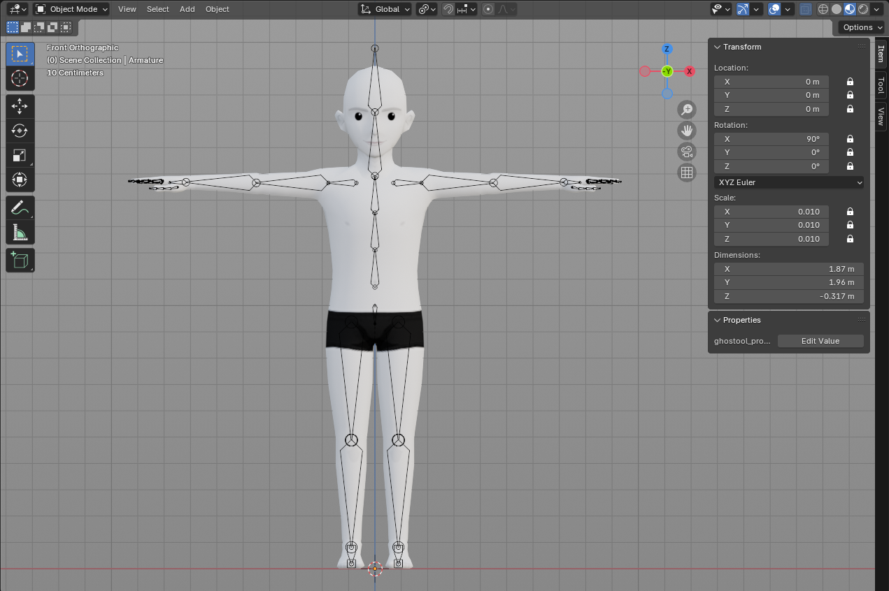
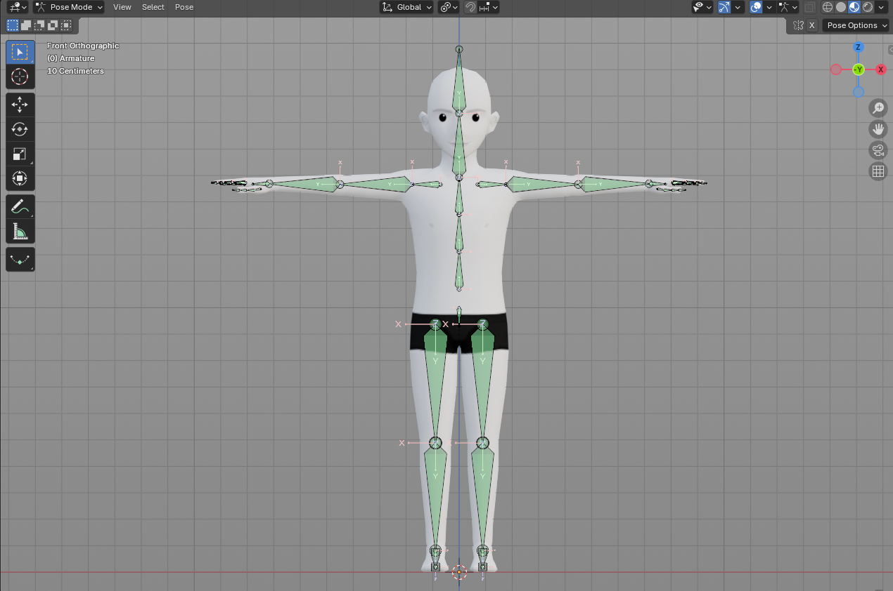
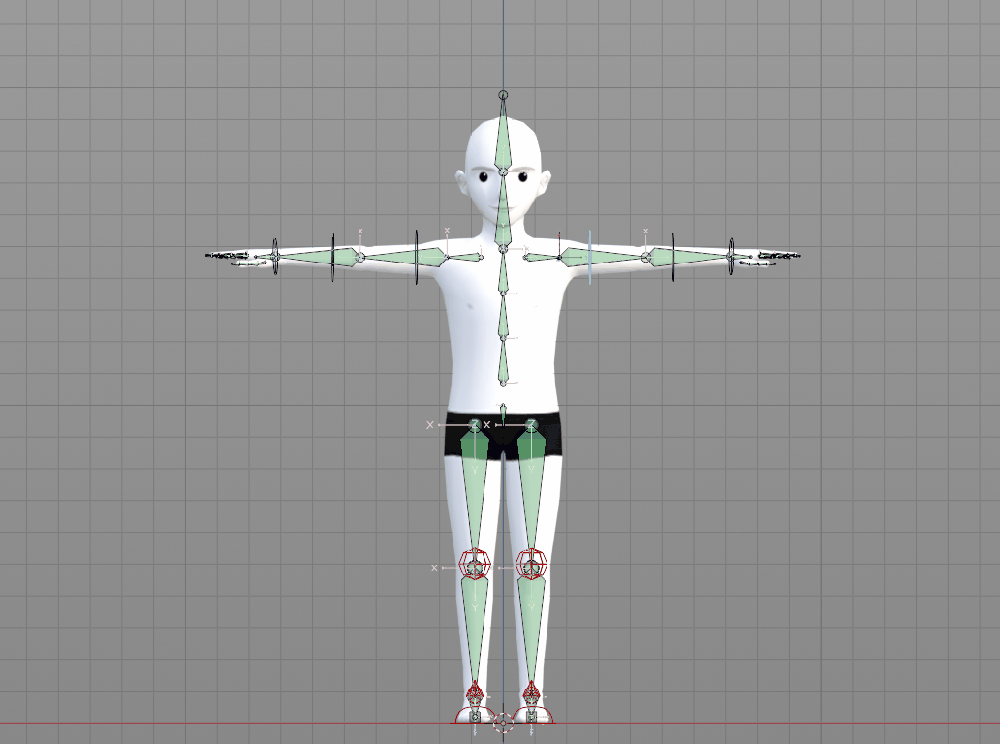
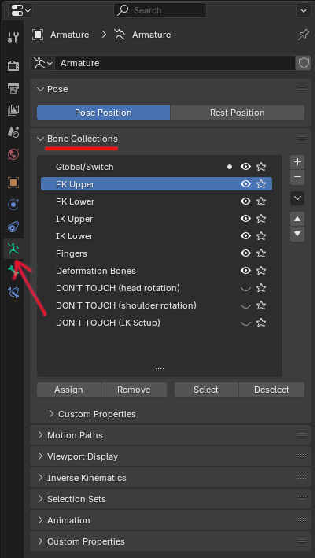
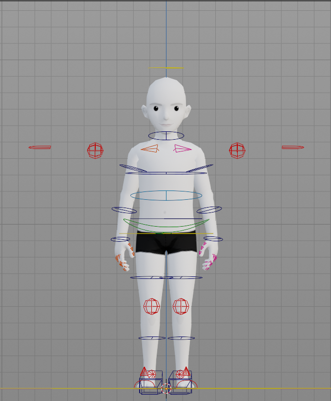

# Rig Features

Esta documentación explica la configuración para Rig 1.0, sus controles y características.

#### Armature Transforms

Estas son las transformaciones de la armature en Object Mode con la configuración de controles. **No edites esto de ninguna manera**. El rig solo debe manipularse en Pose Mode. Para evitar edición no deseada, las transformaciones han sido bloqueadas en Object Mode.

_Transformaciones de Rig 1.0._

> **Advertencia**: **Nunca edites el rig en Object Mode.**

### Orientación de Huesos

Esta es la orientación de huesos para Rig 1.0. Como está ahora mismo, no es posible reflejar el comportamiento en los hombros, brazos, manos o dedos.

_Ejes para orientación de huesos._

_Comportamiento al reflejar poses._

#### Bone Collections

Para evitar cualquier accidente y para facilitar la identificación de los controles, este rig está organizado en bone collections que se pueden acceder en la pestaña _Data Properties_ en Blender. La visibilidad de estas colecciones se puede activar y desactivar haciendo clic en el _Ícono de Ojo._ Por defecto, todas están visibles, excepto las de DON'T TOUCH.

Pestaña de Armature Data Properties.

Así es como los huesos fueron separados en las colecciones:

* Global/Switch: controles globales, como la raíz y los de columna, así como los hombros. Los controles con cualquier atributo personalizado también están en esta colección.
* FK Upper: todos los controles de configuración FK de la parte superior del cuerpo.
* FK Lower: todos los controles de configuración FK de la parte inferior del cuerpo.
* IK Upper: todos los controles de configuración IK de la parte superior del cuerpo.
* IK Lower: todos los controles de configuración IK de la parte inferior del cuerpo.
* Fingers: controles para los dedos de ambas manos.
* Deformation Bones: aquí es donde se almacenan los huesos de deformación.


**💡 ¡Atención!**

Las colecciones DON'T TOUCH contienen las configuraciones para IK y otras restricciones del rig y deben permanecer ocultas. Editar estos huesos podría romper la funcionalidad del rig


### Controles y Agrupación

Los controles son huesos que no deforman que dirigen el esqueleto base. Tienen diferentes colores dependiendo de su categoría:

* Amarillo: controles globales y controles con atributos personalizados
* Verde: cadera (más fácil de identificar en la jerarquía de la columna)
* Azul: controles con comportamiento FK
* Rojo: controles IK
* Rosa: controles del lado izquierdo
* Naranja: controles del lado derecho

_Todos los controles y sus colores._

### Atributos Personalizados y Configuración

#### FK/IK Blend

Aunque los brazos usualmente se configuran como FK y las piernas como IK, hay ciertas situaciones que requerirán una configuración diferente. Si la mano tiene que mantener una cierta posición, como durante flexiones o mientras escala, el IK será la mejor opción. En cuanto a las piernas, mientras está en el aire, nadando o rodando, FK funciona mejor. Para más flexibilidad y libertad en animación, este rig tiene un blend FK/IK en el control UpperBody, siendo 0 completamente FK y 1 completamente IK. Cualquier otro valor entre ellos será un blend de los dos.

_Blend FK/IK para ambos brazos y piernas._

_Cómo funciona el Switch FK > IK._

#### Isolate Rotation FK Blend

Otro atributo personalizado en el control UpperBody es la isolate rotation, que te permite elegir si el hueso heredará la rotación de su padre o no (mientras esté en FK). Mientras esté en 0, el hueso no heredará la rotación, mientras que en 1 seguirá completamente el comportamiento del padre. Cualquier otro valor entre ellos será un blend de los dos. Esta es una herramienta interesante porque hace que el hueso FK mantenga su posición, comportándose un poco como un IK.

_Atributo de isolate rotation para brazos._

_Cómo funciona el atributo IsoRot para los brazos._

El control Head también tiene este atributo. Es realmente útil para ciclos de caminata, por ejemplo, ya que la cabeza mantendrá su rotación aunque el torso esté girando, asegurándose de que siempre esté mirando hacia adelante. Sin esta opción, el animador tendría que rotar manualmente la cabeza cada vez que el torso gire para que esté recta y mire hacia adelante.

_Atributo de isolate rotation para la cabeza._

_Cómo funciona el atributo IsoRot para la cabeza._


\*\*Advertencia\*\*: En versiones antiguas de Blender, incluso si se han seleccionado y hecho keyframe de todos los controles, estos atributos personalizados no tendrán keyframe automáticamente. Asegúrate de insertar manualmente un keyframe en cada atributo para no perder la pose/movimiento que creaste. En Blender 4.4, presionando I, se establece un keyframe en todos los atributos y propiedades personalizadas.


_¡En versiones anteriores de Blender, asegúrate de hacer keyframe de todos los controles y atributos personalizados!_

_En Blender 4.4, presiona I para establecer automáticamente un keyframe en Location, Rotation, Scale & Custom Properties.._

Otra solución para hacer keyframe de propiedades personalizadas es seleccionar _**Keying**_ bajo la pestaña Timeline y en _**Active Keying Set**_ seleccionar Location, Rotation, Scale & Custom Properties, como se muestra en el gif a continuación. De esa manera, cada vez que presiones I, se creará un keyframe sin el menú emergente. Como algunos animadores prefieren el menú, por defecto, esa opción no está habilitada. Pero siéntete libre de elegir el método que mejor te convenga.

_Hacer keyframe con la opción Keying._

#### Reverse IK Foot Setup

Animar un pie FK es bastante directo: solo agarra cualquiera de los controles y rótalo. Como hay un control para el pie y otro para los dedos, el animador tiene control total sobre los movimientos. Sin embargo, para el IK no es tan simple. El pie tiene que adherirse al suelo, mientras también puede rotar en la bola y talones y de lado a lado.

Este rig fue configurado de una manera que da al animador libertad de movimiento del pie sin perder las ventajas del sistema IK. Consiste en cuatro controles:

* Foot roll: este control rota el pie hacia adelante y atrás y de lado a lado. Para evitar doblar demasiado en el talón o demasiado en la bola, se estableció un límite para que el rig del pie no se rompa. Cuando alcanza este límite, el pie dejará de rotar.

_Foot roll: rota en X y se mueve adelante y atrás; rota en Z se mueve de lado a lado._

* Toe tip roll: rota el pie desde la punta de los dedos. Solo rota hacia adelante.

_El toe tip roll solo rota en X positivo._

* Toes control: rota los dedos desde la bola.

_Los dedos pueden rotarse en cualquier dirección._

* Foot control: este es un control global que mueve el pie como un todo. Como es el padre de todos los otros controles del pie, mantendrá cualquier transformación mientras también puede ser agarrado y rotado.

_Cómo funciona el foot control._

#### Locked Transforms

Algunos controles pueden tener un símbolo de candado junto a los parámetros de transformación, lo que significa que esos valores no pueden cambiarse. Esto se hizo a controles que solo deberían comportarse de cierta manera y para evitar cualquier transformación no deseada. Por ejemplo, los codos y rodillas están destinados a rotar solo en un eje, que en este caso es X, y por lo tanto los otros ejes han sido bloqueados. Otros ejemplos de controles con atributos bloqueados son codos y rodillas IK, dedos, foot roll y toe tip.

Se aconseja mantener estos bloqueados, pero en caso de que quieras más libertad de movimiento, simplemente haz clic en el ícono de candado para desbloquearlo.

