# Creating Wearables

## Intro

Esta guía introduce los conceptos básicos para crear modelos 3D personalizados para wearables de Decentraland. Explica cómo funciona el sistema de avatar de Decentraland, e ilustra cómo modelar apropiadamente tus propios wearables.

_Nota: esta guía asume que ya tienes algún conocimiento básico a intermedio de modelado 3D. Si eres nuevo en el modelado 3D,_ [_comienza aquí_](https://docs.decentraland.org/creator/3d-modeling/3d-models/)_._

Antes de comenzar, descarga los archivos de ejemplo para mallas de referencia y texturas: [**Wearables Reference Models**](https://drive.google.com/drive/u/1/folders/12hOVgZsLriBuutoqGkIYEByJF8bA-rAU)

## El Sistema de Avatar de Decentraland

El "sistema de avatar" de Decentraland es la amplia colección de diferentes componentes corporales y subcomponentes que pueden ser decorados con wearables personalizados. Estos componentes son:

* Body shape
* Head
  * Head shape
  * Eyebrows
  * Eyes
  * Mouth
* Upper body
* Lower body
* Handwear
* Feet
* Accessories

### **Base Body Shape**

Después de descargar el archivo de ejemplo de avatar base, carga el modelo en tu editor 3D, como Blender.

Notarás que cada modelo contiene 8 mallas diferentes relacionadas con una armature. Estas mallas representan la cabeza, cejas, ojos, boca, parte superior del cuerpo, parte inferior del cuerpo, manos y pies. Puedes usar estos modelos de ejemplo como referencia y punto de partida para tu propio wearable personalizado.

Actualmente, hay dos formas de cuerpo: A o B.

### **Head**

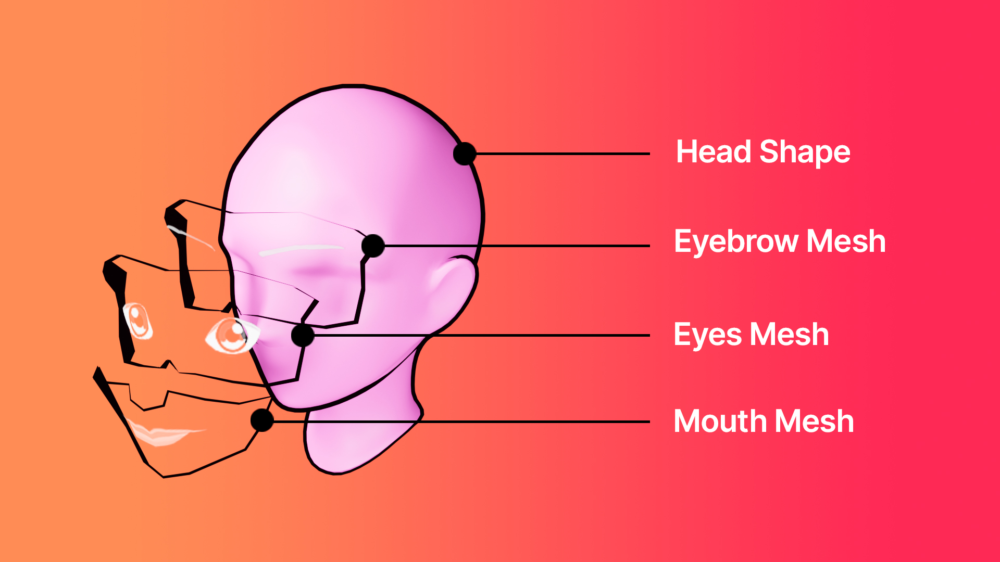

_La cabeza base incluye diferentes mallas adjuntas que pueden ser personalizables como wearables: Eyebrows, Eyes y Mouth funcionan como máscaras de transparencia renderizadas frente a la cara._

### **Upper Body**

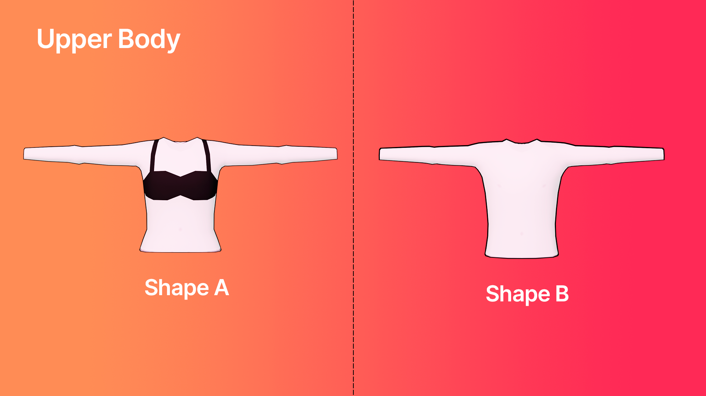

_La parte superior del cuerpo, o torso, de un avatar. No incluye las manos._

### **Lower Body**

_La parte inferior del cuerpo incluye la pelvis y las piernas de un avatar._

### **Hands**

_Las manos son las mismas para Shape A y B, y comienzan en las muñecas de un avatar._

### **Feet**

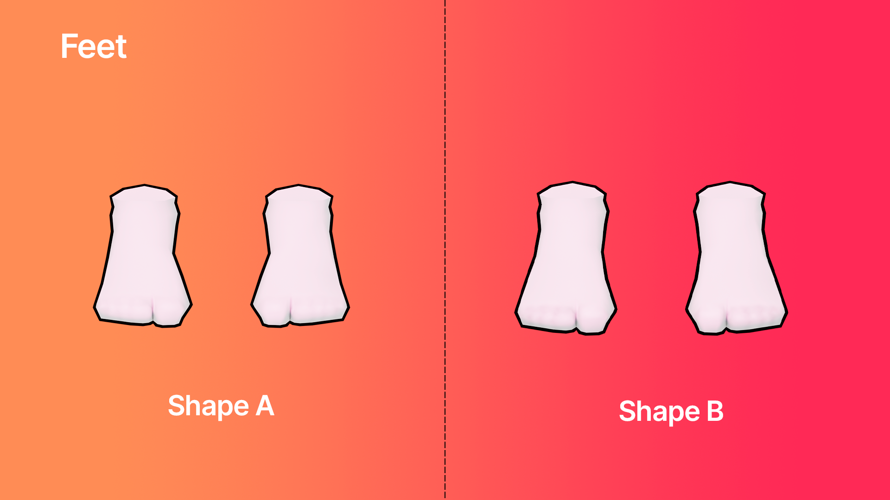

_Los pies incluyen tobillos y pie._


**Importante: No modifiques los vértices "cortes/costuras" entre la cabeza, parte superior y parte inferior del cuerpo.**


Cada parte del cuerpo tiene tapas, haciéndolas "herméticas". Estas tapas existen para prevenir glitches desagradables si hay algún problema de clipping de animación debido a un mal skinning. Es mejor no eliminar estas tapas al editar la malla.

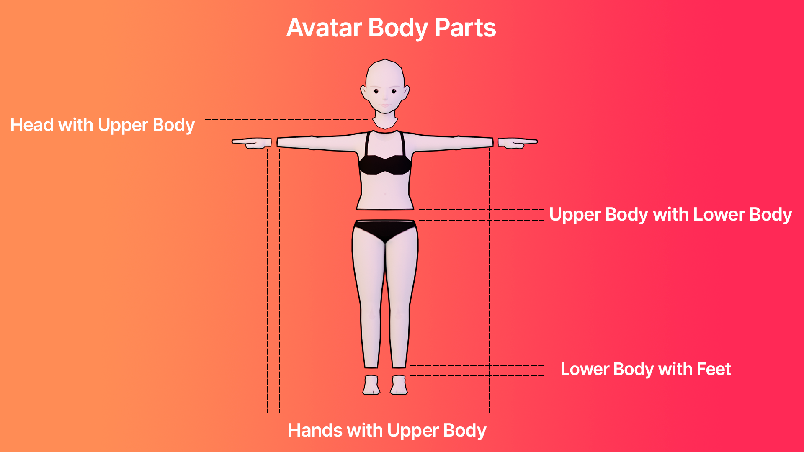

## Construyendo Modelos 3D para Wearables

#### **Limitaciones de tris, materiales y texturas**

Para asegurar que Decentraland funcione sin problemas para todos los jugadores, es importante crear modelos de wearables sin usar demasiados triángulos, materiales y texturas. El objetivo es mantener los modelos 3D tan simples como sea posible para que puedan ser fácilmente renderizados, sin sacrificar demasiado detalle.

Hay límites para el número de triángulos y texturas que se pueden usar para cada wearable o accesorio:

* No más de 1.5K triángulos por slot de wearable: hat, helmet, upper body, lower body, feet y hair.
* No más de 500 triángulos por categorías: mask, eyewear, earring, tiara, top\_head y facial hair.
* Para accesorios de mano, el presupuesto es 1k tris. Si el hand wear oculta la mano base del avatar, el presupuesto es 1.5k tris.
* No más de 2 texturas (a una resolución de 1024x1024px o menor) por wearable. Todas las texturas deben ser cuadradas a una resolución de 72 pixel/inch.
* No más de 2 materiales (sin contar el AvatarSkin\_MAT)
* En el caso de skin wearable, la cantidad de tris permitidos son 5k y 5 texturas.


**Wearable Tris Combiner:**

_Si el wearable oculta otros wearables, el creador puede combinar los tris por slot. Por ejemplo: si quieres hacer un jumpsuit podrías crearlo usando la categoría upper body ocultando lower body; en ese caso podrías tener 1.5&#x4B;_&#x32;= 3K triángulos.\*

En el caso del helmet, si ocultas todos los wearables de la cabeza (head, earrings, eyewear, tiara, hat, facial\_hair, hair y top\_head puedes alcanzar los 4k tris, 2 materiales y 2 texturas)


#### Máximo Ancho, Alto y Profundidad de los Wearables

Hay un límite de distancia para los wearables para asegurar que no obstruyan la visibilidad de las pantallas de otros jugadores o invadan el espacio de la escena de manera excesiva.

La dimensión para los wearables no puede exceder:

> `Height: 2.42 m`, `Width: 2,42 m`, `Depth: 1,4 m`

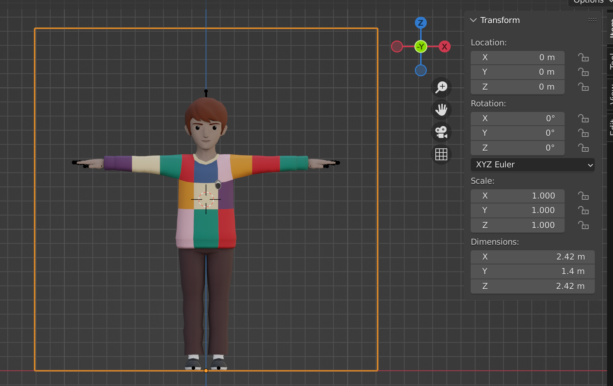 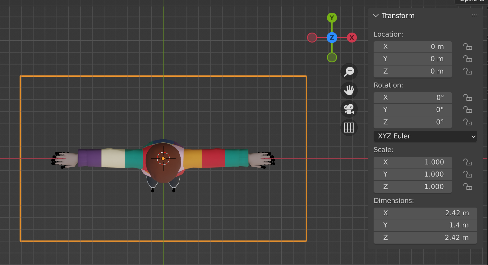

#### **Maps**

Los wearables de Decentraland actualmente soportan 3 tipos de maps, que son:

1. **Base Color**: Esta es la textura principal con los colores y detalles de tu modelo.
2. **Emission**: Este map es para las partes que brillan en tu modelo. El emission map va en un material separado específicamente para emisión.
3. **Alpha**: Este map es para manejar la transparencia. Usa el canal de opacidad de la textura. (_Siempre es preferible usar Alpha Clip en lugar de Alpha Blend, usando una textura en blanco y negro para el recorte_)

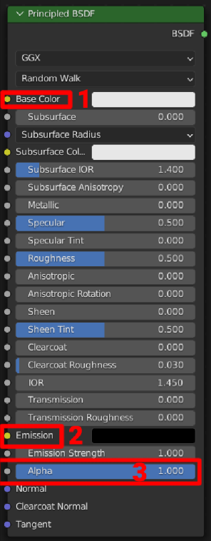

Debido a que el cliente de referencia de Decentraland usa un Toon Shader para los materiales de avatar, algunos maps **no son necesarios** como:

* **Normal maps:** texturas usadas para simular detalles de alta resolución en modelos de bajo polígono codificando normales de superficie como valores RGB.
* **Roughness maps:** texturas usadas para definir la rugosidad de la superficie de objetos 3D.

Para usar estos maps en Decentraland la solución alternativa es hornearlos en una textura. Puedes encontrar más información sobre hornear texturas aquí: [https://docs.blender.org/manual/en/latest/render/cycles/baking.html](https://docs.blender.org/manual/en/latest/render/cycles/baking.html)

#### **Normals**

**El motor de Decentraland renderiza solo normales de un lado.** (Eso significa que un plano solo será visible desde un lado, el otro lado no se renderizará) Entonces, para asegurar que tu 3D esté absolutamente correcto con las normales podemos verificar eso de dos formas diferentes.

La primera es activar el "Backface culling" en la configuración de propiedades de Material, esta es una buena práctica para detectar normales invertidas, como en esta imagen:

 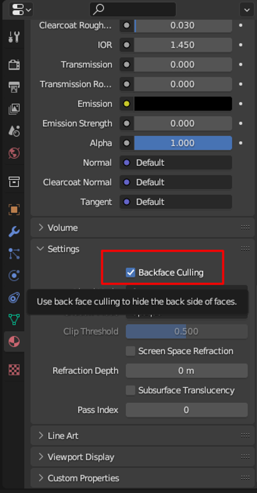

La segunda forma de verificar si las normales están bien es activando "Face orientation" en las opciones de superposición del viewport. Volverá tu modelo azul, pero no te preocupes. Las caras azules son las correctas y las rojas son las que necesitan ser corregidas, puedes encontrar esta opción aquí:

#### **Armature**

Recuerda no cambiar ninguna de las especificaciones, convenciones de nomenclatura, jerarquía o transformaciones de la armature dada. Cambiar cualquiera de estas hará que el wearable deje de funcionar en el cliente después de exportar.

Asegúrate de que la armature importada no tenga ningún hueso _end_ o _neutral_, de lo contrario el wearable no va a funcionar después de exportar al builder. Si estás importando un .fbx que tiene este problema puedes activar _**Ignore Leaf Bones**_ al importar la armature.

#### **Eyebrows, Eyes and Mouth**

Estas mallas funcionan con un shader transparente, por lo que no tienes que hacer nada aparte de crear tu propia textura png para el nuevo estilo de ceja, ojo o boca que deseas y colocarla correctamente en el mapa UV. Estas texturas deben ser de 256x256px y necesitan tener un canal alpha para transparencia.

Aquí hay algunos ejemplos de texturas png:

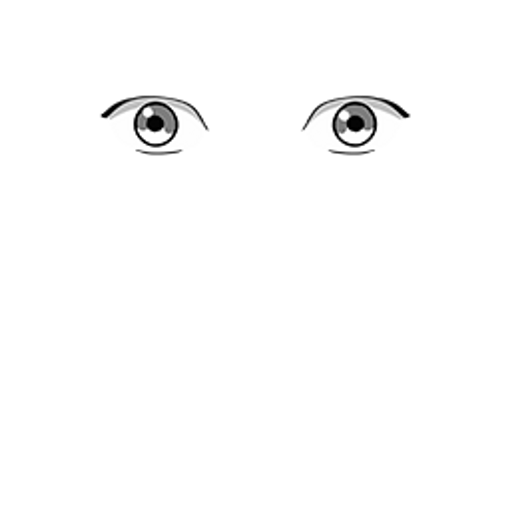 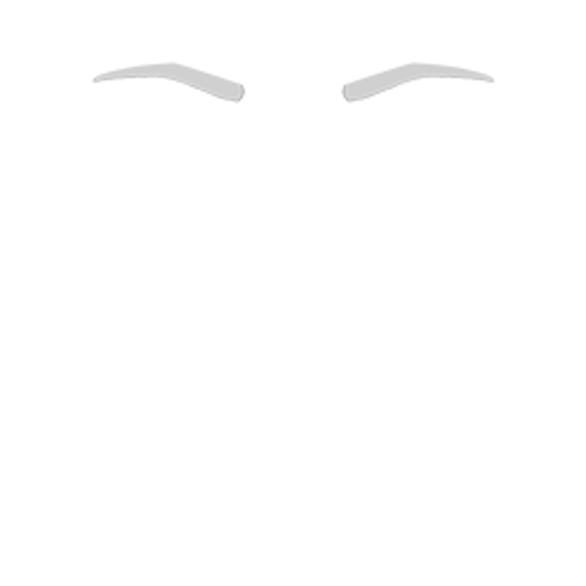 

_Eyes y Eyebrows usan la misma malla y mapa UV._

 

_Malla y mapa UV de Mouth._

Para visualizar el resultado final necesitarás usar estos nodos (en Blender):

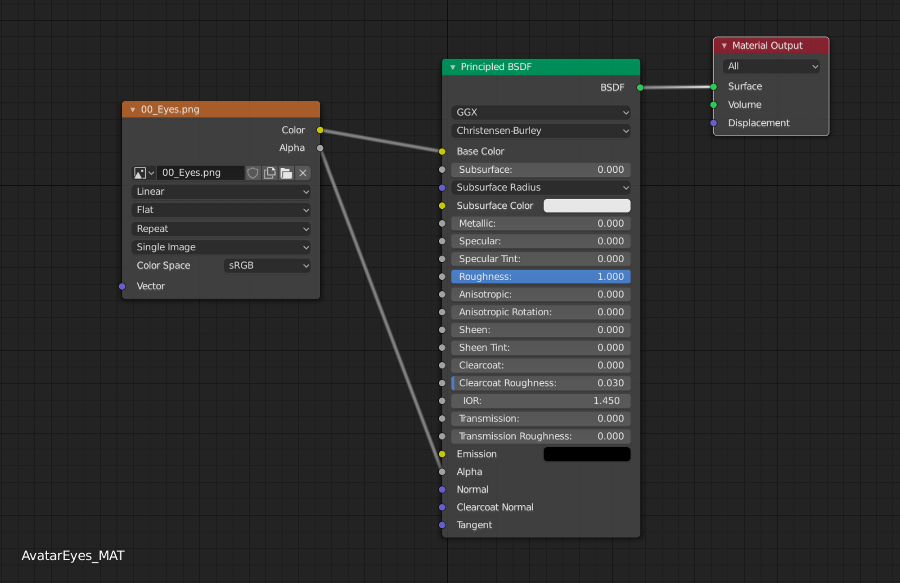 

**Masks:** El Avatar Editor tiene diferentes opciones de color que los jugadores pueden elegir para personalizar sus avatares.

Estas elecciones de color se aplican a una máscara específica en el wearable.

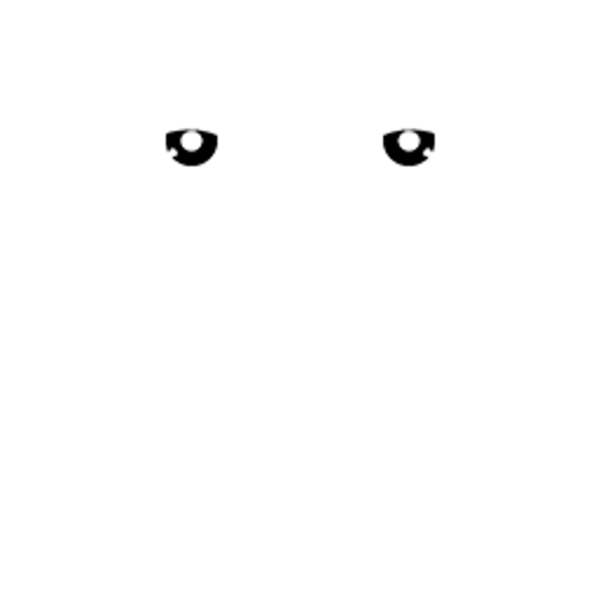 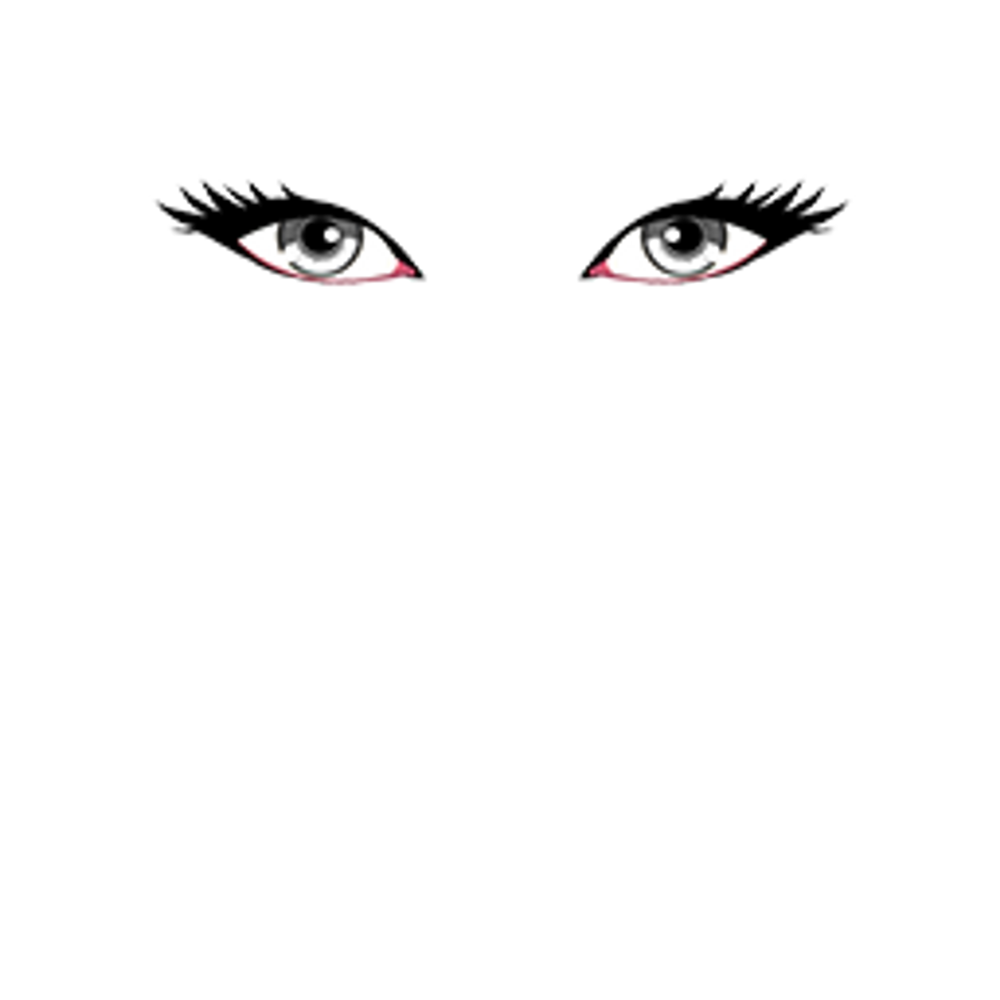

El área negra en la imagen de la izquierda (Eyes Mask) indica el área de la textura de la derecha (Eyes Base) que será coloreada. Es importante recordar que los iris siempre necesitan tener una escala de grises (si el iris es negro puro, el tinte no va a funcionar. Por el contrario, si el iris es blanco puro estaría completamente teñido por el color seleccionado usando el editor).

#### **Handwear**

Hay dos tipos de **Handwear** que puedes hacer bajo la misma categoría.

1. **Replacing Hands:**

Si quieres crear handwear que reemplace ambas manos probablemente necesitarás sobrescribir la malla base _**hand**_. Haciendo eso, el límite para el wearable handwear sería 1500 tris.

2. **Hand Accessories:**

También puedes crear accesorios de mano como relojes, pulseras, anillos, etc. En ese sentido, la mano no necesita ser sobrescrita y el límite es 1000 tris por ítem.


Nota: La categoría **handwear** es específicamente para accesorios de mano o reemplazar manos que siguen la armature del avatar con skinning apropiado. No está destinada para ítems como espadas, escudos o cualquier asset similar. Enviar un ítem que no sigue estas especificaciones puede resultar en rechazo por el comité de curadores.


#### **Hair and Facial Hair**

Hay dos cosas importantes para recordar al crear wearables de cabello personalizados.

Primero, intenta seguir la forma de la cabeza. Siempre puedes referirte a la malla de cabeza proporcionada en los archivos de ejemplo si necesitas un lugar para comenzar.

Segundo, si quieres que los usuarios puedan cambiar el color del cabello o vello facial usando el editor de avatar, entonces necesitas pintar el cabello en escala de grises y usar "Hair" en el nombre del material (ejemplo "M\_Hair\_Short"). Si quieres incluir otro objeto que no esté influenciado por el tinte, simplemente no agregues esa convención de nomenclatura.

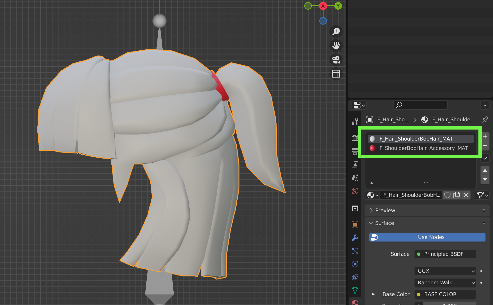 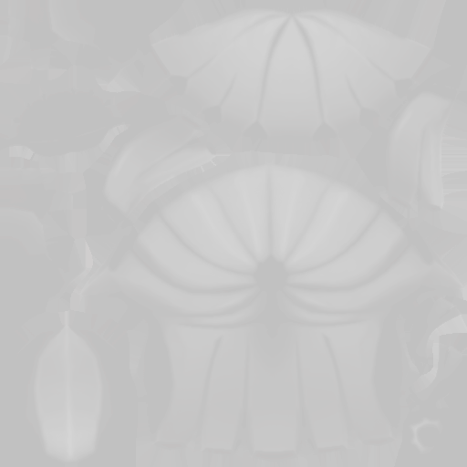 

_Los tonos más bajos de gris aparecerán más oscuros y los tonos más altos de gris aparecerán más brillantes, multiplicados por el color seleccionado por el usuario en el editor de avatar._

### **Base Materials and Textures**

Hay tres materiales básicos para modelos de avatar. Uno es el material usado para el wearable en sí, otro se usa para la piel y otro para las cejas, ojos y boca.

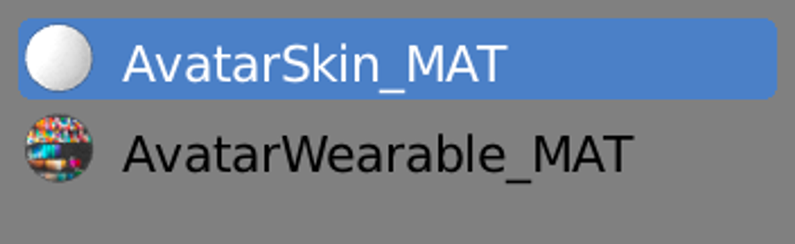

Cada malla base viene con su propia textura de piel.

 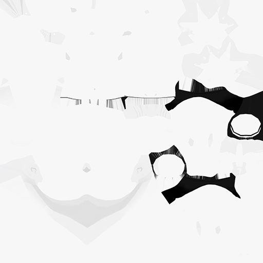

La textura de piel está hecha en escala de grises para que permita al motor de renderizado teñir la piel del avatar usando el editor según la preferencia del usuario. Para poder teñir el color de piel usando el editor, el nombre del material debe ser _AvatarSkin\_MAT_.

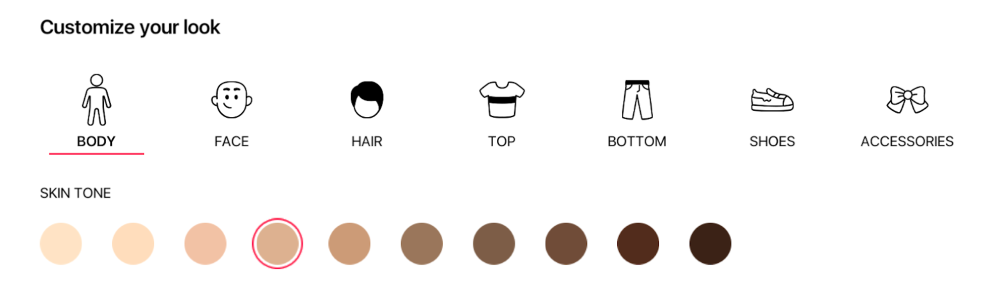


Importante: siempre preserva el mapeo UV para cualquier parte del cuerpo que esté expuesta por un wearable, como las piernas expuestas por shorts o faldas.


\src="../images/wearables-and-emotes/creating-wearables/19\_skin\_uv.png"width="600"/>

¡Puedes crear texturas personalizadas para tus wearables! Sin embargo, siempre es mejor usar un solo archivo de textura muy pequeño para cada wearable. ¡Usar la textura predeterminada AvatarWearable\_MAT proporcionada en los archivos de ejemplo garantizará que tus wearables sean eficientes!

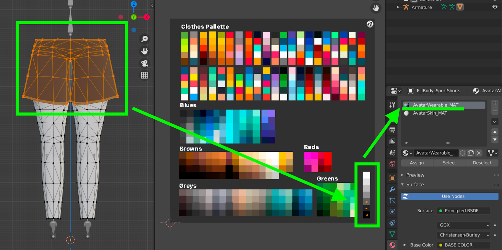


Para prevenir activar shaders específicos de características faciales, no incluyas '\_mouth', '\_eyebrows' o '\_eyes' en el nombre de ninguna malla. Estos términos están reservados para características faciales, y usarlos inapropiadamente aplicará el shader equivocado a la malla.


✨ En caso de que quieras hacer tus propias texturas para el modelo recomendamos los siguientes addons para mejor UV Unwrapping:

**UVPacker**

UvPacker es un addon gratuito que te ayuda a empaquetar y organizar tus uvs con solo unos clics. Como Decentraland trabaja con texturas de hasta 1024x para los wearables, esta herramienta es una gran ayuda para crear mejores y más organizadas texturas.

Puedes descargar directamente desde el sitio web aquí:

[**https://www.uv-packer.com/download/**](https://www.uv-packer.com/download/)

**UVToolKit**

UvToolKit es un addon que te ayuda a expandir tus configuraciones y opciones de UV para crear grandes UVs en blender.

Aquí está el enlace para la descarga: [**https://alexbel.gumroad.com/l/NbMya**](https://alexbel.gumroad.com/l/NbMya)

### **Skin Weighting**

Skin weighting es el proceso de determinar qué huesos en el rigging del avatar afectan qué wearables durante una animación.

Al hacer skin weighting de nuestros nuevos wearables, hay varias consideraciones que necesitamos tener en cuenta.

Cada asset debe estar weighted al esqueleto completo. Por ejemplo, un asset de upper body se verá así al aplicar skin weights:

Los wearables que se encuentran en intersecciones entre partes del cuerpo deben estar completamente weighted al mismo hueso. Por ejemplo, en estas dos zonas verdes, los vértices en el cuello necesitan estar completamente weighted solo al hueso "Neck".

#### **Key Bones**

Los huesos "clave" para usar al hacer skin weighting son:

**Head Bone:** para el cabello, aretes, tiaras, ojos, cejas, boca y cualquier accesorio que necesite seguir el movimiento de la cabeza.

**Neck Bone:** para los vértices de intersección de la cabeza principal y parte superior del cuerpo.

**Hips Bone:** para los vértices de intersección de la parte superior del cuerpo y parte inferior del cuerpo.

**Right Leg and Left Leg Bones:** para los vértices de intersección de la parte inferior del cuerpo y pies.

**Right Forearm and Left Forearm** para los vértices de intersección de las manos.


⚠️ **Hint**

* Recuerda, ¡puedes usar cualquier hueso para influenciar los vértices de cualquier malla! Por ejemplo, podrías crear una nueva malla de pie para un par de botas altas, y hacer skin weight de la parte superior de la bota a los "Leg Bones". O, podrías crear cabello largo y usar los huesos "Shoulder" o "Spine" para influenciar el cabello cuando el avatar se mueva.
* Siempre es recomendable mantener simetría de ambos lados del rig, izquierda y derecha deben tener influencias de huesos similares.
* Como consejo común, un vértice no puede ser influenciado por más de 4 huesos o joints.
* Ten en cuenta exportar la armature exactamente como la proporcionada en la documentación. Si tiene otros huesos como _"\_end\_bones"_ o similar no va a funcionar en el cliente.


#### **Exporting Wearables**

Al exportar wearables, asegúrate de que no haya otros huesos fuera de la Armature dada. Un problema común al importar armatures entre diferentes software es la aparición de huesos _"\_end"_ o _"\_neutral"_. Asegúrate de eliminar esos antes de exportar. De lo contrario, es muy probable que los wearables no funcionen en el cliente después.

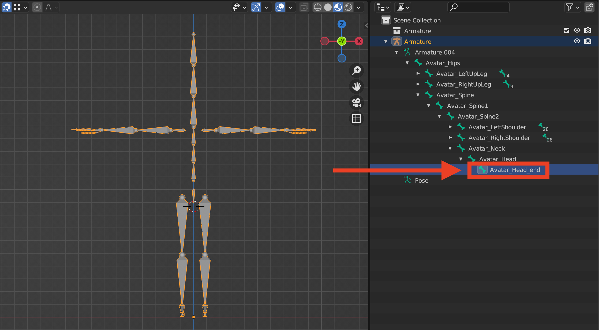

Para exportar el wearable, selecciona el objeto y luego la armature. Asegúrate de no exportar nada más, como cámaras, luces u objetos vacíos.

A continuación, exporta el wearable en formato _glTF2.0_. Asegúrate de exportar solo el wearable con sus propiedades de skinning, y sin ninguna otra característica innecesaria como animación o shape keys.

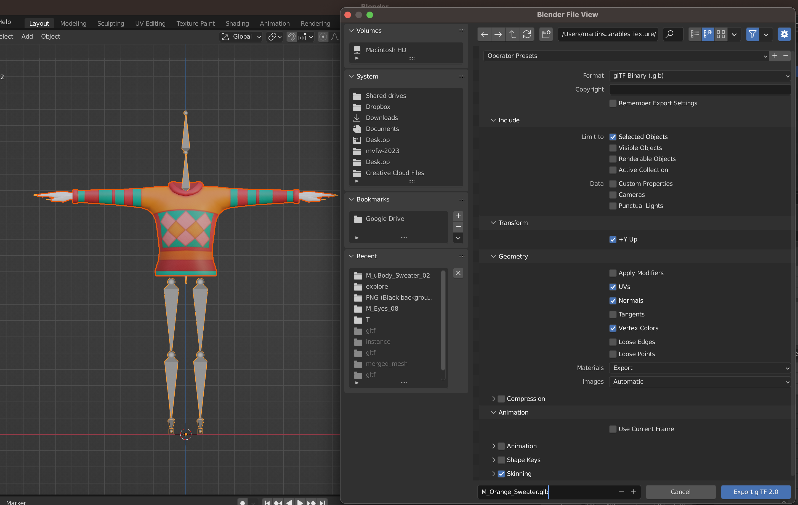

## Buenas Prácticas Para Modelado

### **Cambia Tu Malla De T-Pose A A-Pose**

Cuando estás haciendo wearables, la mejor manera de visualizar el resultado final, y para facilitar cómo manejas la topología y posición del wearable es trabajar con el modelo en A-Pose. Para hacer eso tienes que seguir estos simples pasos:

1. Primero selecciona la parte superior del cuerpo, luego tienes que activar "**Edit mode**" y "**On cage**" en el modificador de armature.

2. Ahora, en pose mode puedes rotar los brazos 60°.

3. Puedes editar tu malla en A-Pose en lugar de T-pose.

4. Pero también es bueno tener en cuenta que puedes alternar fácilmente de A-Pose a T-Pose simplemente activando de nuevo "Edit mode" y "On cage" en el modificador de armature.

### **Joint deformation:**

Para obtener los mejores resultados en la topología del wearable cuando se trata de joints (brazos o piernas, por ejemplo) es importante tener buenas prácticas al crear loops. Aquí podemos ver la diferencia en la deformación de la malla para diferentes loop cuts:

Una buena manera de asegurar que todo se esté deformando correctamente es hacer un weight paint como el siguiente ejemplo:

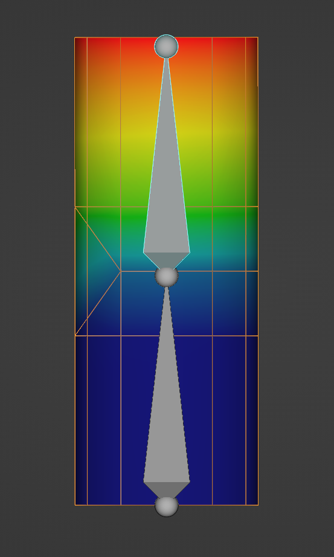 

### **Skirts**

Un consejo útil y buena práctica al modelar faldas/vestidos es agregar loopcuts adicionales en las intersecciones de los pliegues. Esto será muy útil cuando tengas que pintar los weights del rig.

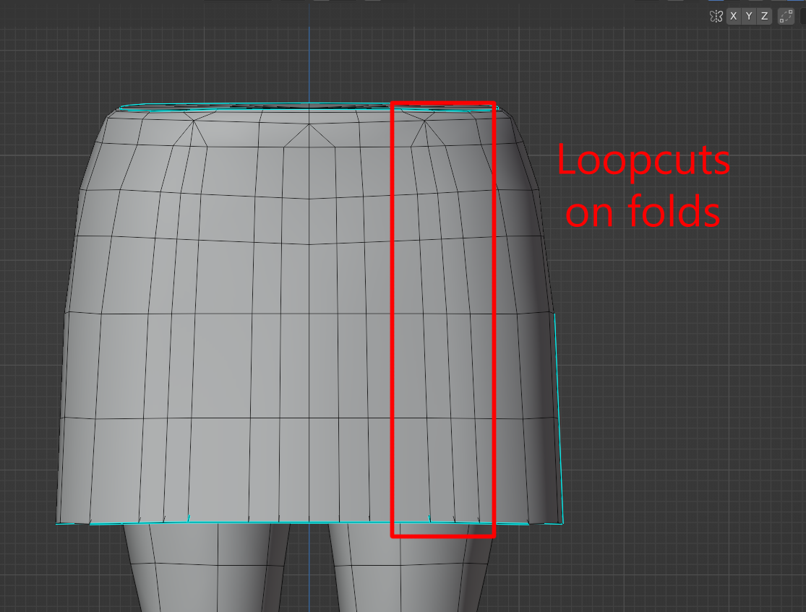

Con estos loopcuts la influencia del vértice se ve mucho más suave y te da mejores resultados cuando estás animando una falda/vestido.

Aquí hay un ejemplo de cómo debería ser la influencia del hueso:

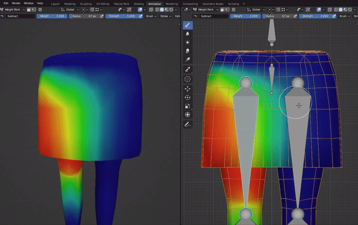

### **Hats**

Una buena práctica al crear sombreros es agregar cabello a la malla base del sombrero y luego ocultar la categoría _hair_ usando el editor. Hacer esto va a prevenir que el sombrero haga clip con otros cabellos y reducir resultados inesperados.

### **Add Polygon Count**

Un consejo valioso es siempre hacer seguimiento del polycount de tus modelos. Para hacer eso en blender necesitas activar estadísticas en el panel de superposiciones del viewport.

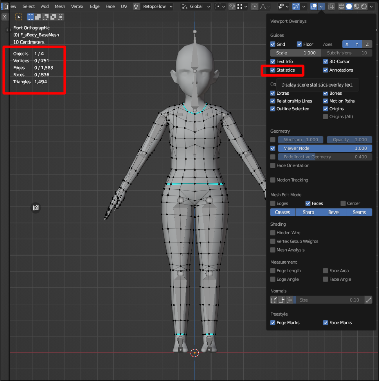

### Recursos

En esta carpeta compartida puedes encontrar modelos base, texturas y varios otros recursos, incluyendo ejemplos de wearables completamente creados. Siéntete libre de aprovechar estos recursos al crear los tuyos propios.

[**Wearables Reference Models**](https://drive.google.com/drive/u/1/folders/12hOVgZsLriBuutoqGkIYEByJF8bA-rAU)
