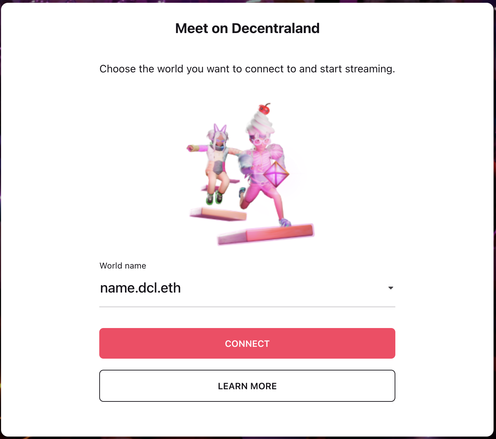
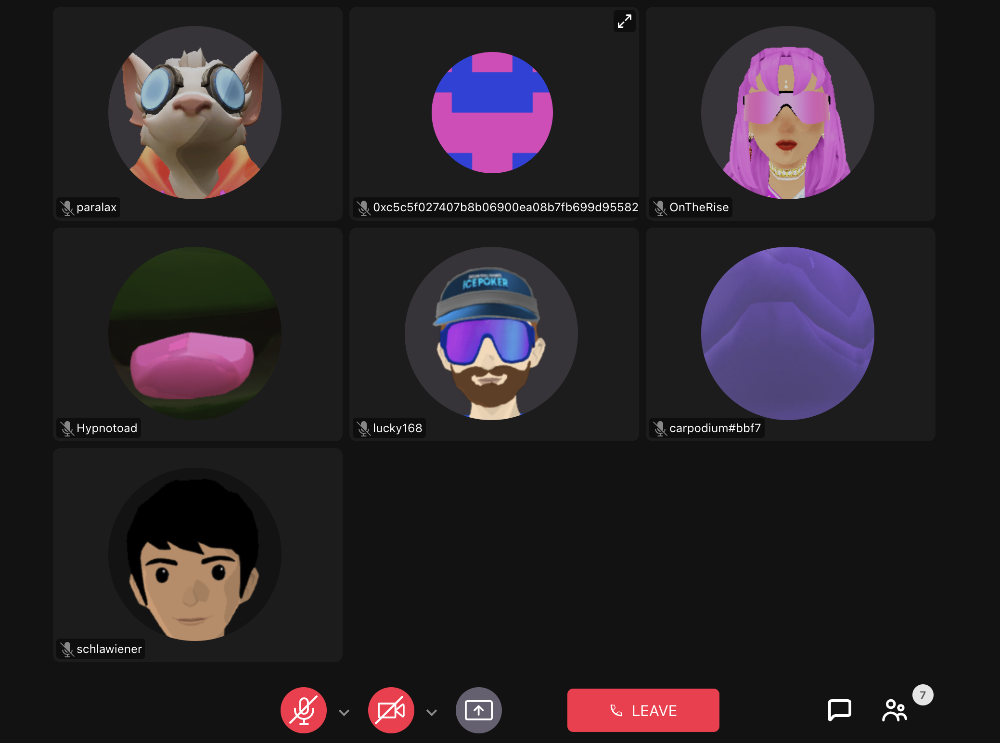
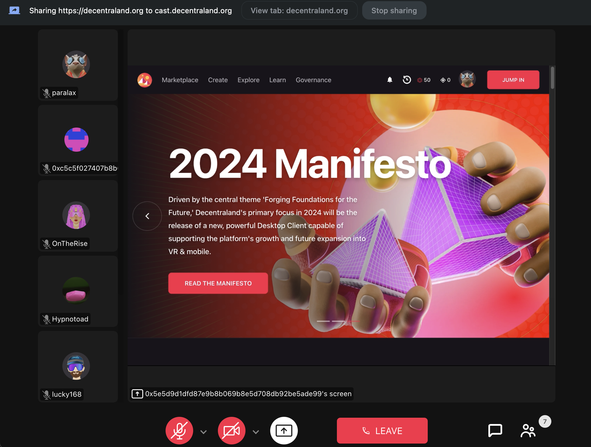
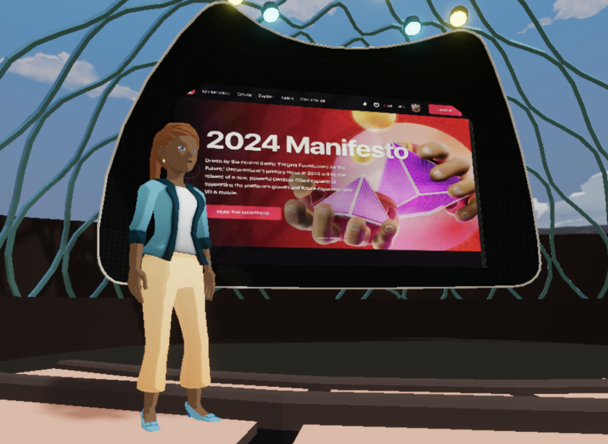
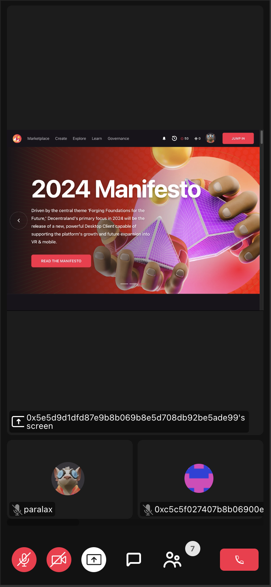

---
metaLinks:
  alternates:
    - https://app.gitbook.com/s/oPnXBby9S6MrsW83Y9qZ/worlds/cast
---

# Cast

Decentraland Cast es una herramienta especializada diseñada para propietarios de worlds y otros individuos autorizados. Ofrece la capacidad de transmitir video de cámara o compartir pantallas sin problemas dentro de su world, todo sin la necesidad de alojar un servidor. Con transmisión de baja latencia, la experiencia es fluida e inmediata, mejorando la conexión virtual.

### Transmitir

La transmisión a través de Decentraland Cast es una característica exclusiva disponible solo para propietarios de World o aquellos con derechos de transmisión para una escena de World. Para más detalles sobre estos derechos, consulta la sección [Listas de Control de Acceso](about.md#access-control-lists-acl).

1. Visita [Decentraland Cast](https://cast.decentraland.org/)
2. Selecciona tu World: Inicia sesión y selecciona el world al que transmitir.\
   \
   \\
3. Únete a la Sesión: Una vez que se selecciona el world, se unirá a una sesión.\
   \
   \\
4. Compartir Pantalla o Video de Cámara: Si está autorizado, los usuarios tienen la opción de activar sus cámaras o compartir sus pantallas directamente dentro de la aplicación.


**📔 Nota**: Si tienes la intención de transmitir un video junto con su audio, es aconsejable utilizar Google Chrome o un navegador construido sobre el motor de Chrome. Estos navegadores ofrecen la funcionalidad para compartir fácilmente tanto video como audio directamente desde una pestaña del navegador.


\
5\. Integración Perfecta: La integración de Decentraland Cast con el world garantiza comunicación ininterrumpida, permitiendo a los usuarios enviar, recibir y escuchar mensajes de chat y voz sin esfuerzo.\

### Mostrar la transmisión en un world

1. Primero debes desplegar una escena en el world con la capacidad de manejar transmisiones de video. Para profundizar en los detalles de esta integración, consulta la documentación del SDK de [Reproducir Videos](../../creator/sdk7/media/video-playing.md#streaming-using-decentraland-cast).


**💡 Nota**: Para comenzar rápidamente, descarga la escena de ejemplo de Decentraland Cast y modifica la URL del world en el archivo scene.json para que coincida con tu world específico.


3. Asegúrate de que haya una sesión abierta en Decentraland Cast.
4. Únete al world y prueba la transmisión que se está mostrando.


**❗Advertencia**\
Como la sesión en Decentraland Cast es la misma sesión de LiveKit dentro del world, una dirección puede estar presente en el World o en la sesión de Decentraland Cast, pero no en ambos simultáneamente. Si esto ocurre, toda la sesión de casting será desconectada para todos los usuarios. Para propósitos de prueba, se recomienda entrar al world como invitado para que la sesión de Decentraland Cast permanezca activa.


### Espectadores

Se recomienda que los espectadores se unan al world (no a la aplicación de Decentraland Cast) a menos que accedan a través de teléfonos móviles. En Decentraland Cast, todos los usuarios podrán ver lo que se está transmitiendo, el chat y otras personas en la sesión, pero aquellos que carezcan de autorización encontrarán sus capacidades restringidas. Específicamente, no tendrán permisos para transmitir ningún dato, ya sea video, chat de voz o mensajería de texto.

