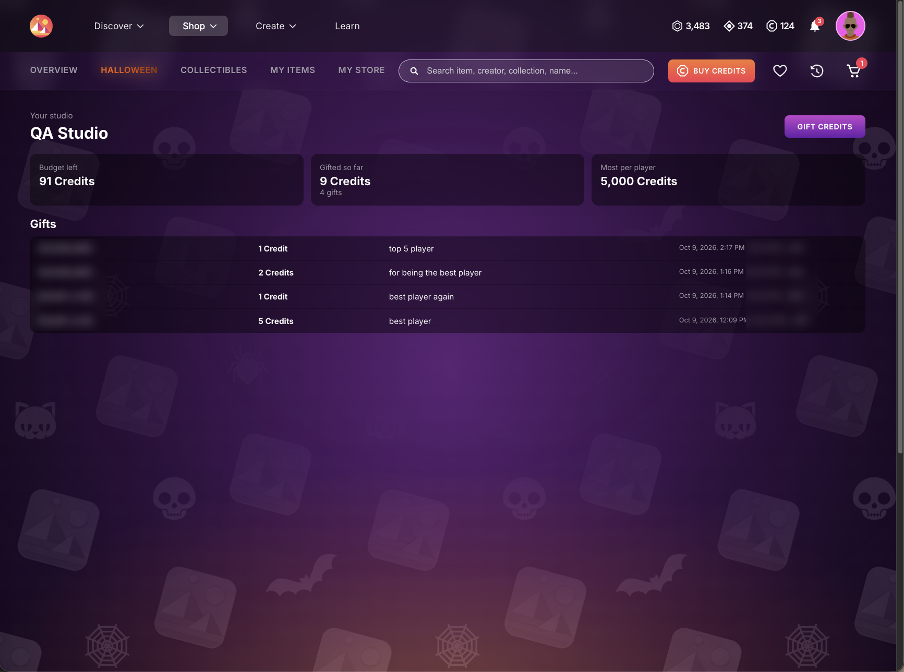
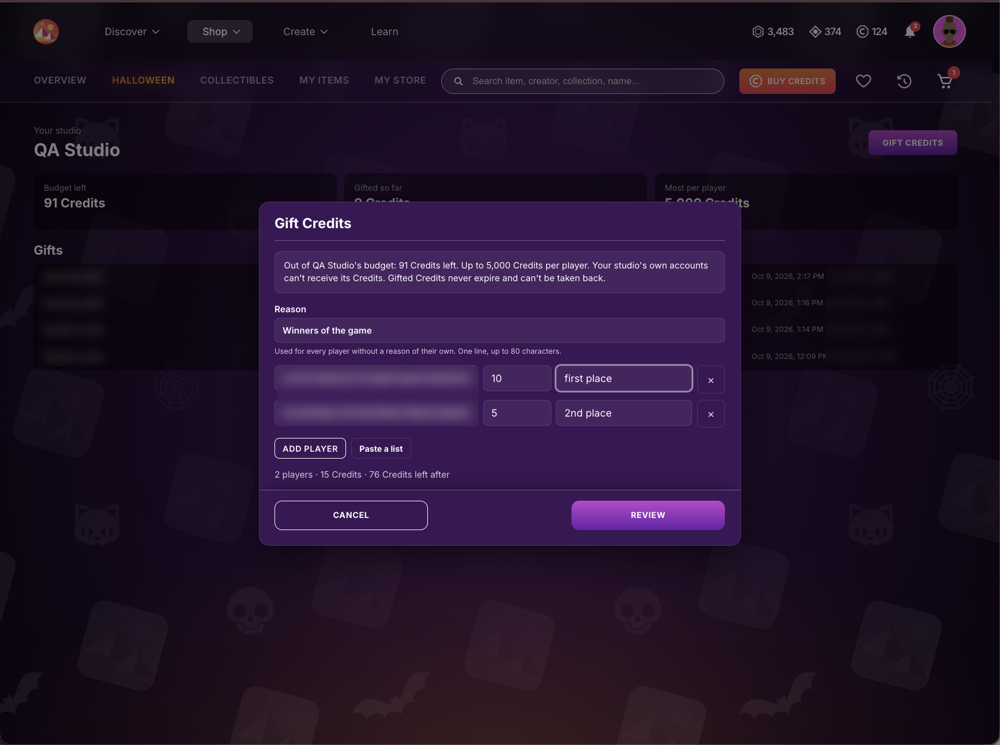
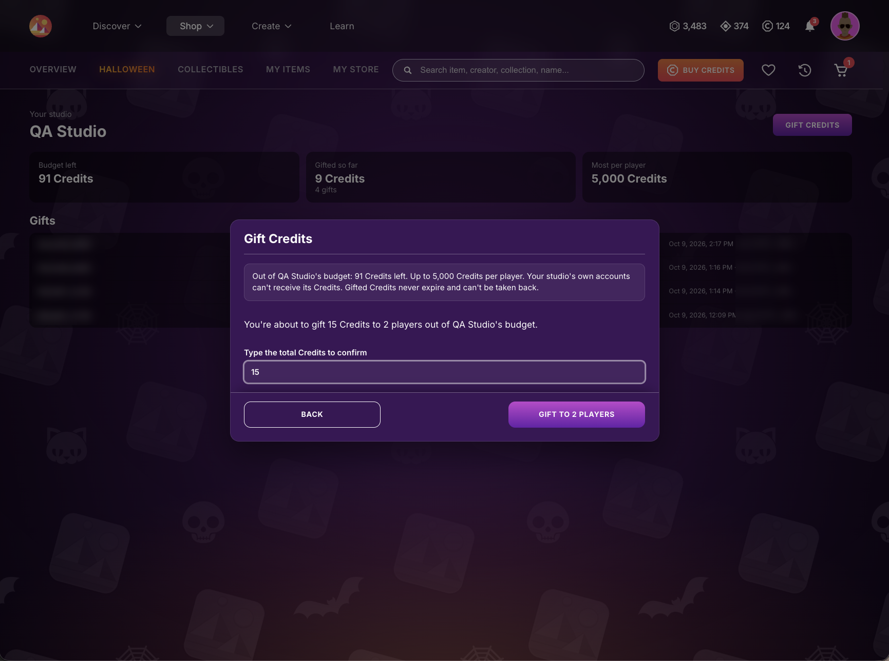

# Gifting Credits

If Decentraland gave your studio a Credits budget, you gift those Credits to your players from the Shop, at [decentraland.org/shop/studio](https://decentraland.org/shop/studio). Players can spend them on anything in the Shop.

## Before you start

* **Your account must manage the studio.** Decentraland adds the accounts that can gift for your studio. If you sign in and see _This account doesn't manage a studio_, ask your Decentraland contact to add that account.
* **Your studio's own accounts can't receive its Credits.** Use a different account for any test gift.
* **Gifts are final.** Gifted Credits never expire and can't be taken back, so check the list before you confirm it.

## Your studio page

Sign in at [decentraland.org/shop/studio](https://decentraland.org/shop/studio). If your account manages more than one studio, pick it from the **Studio** menu. The page shows:

* **Budget left**: the Credits your studio can still gift.
* **Gifted so far**: what your studio has gifted, and in how many gifts.
* **Most per player**: the largest gift a single player can get at once.
* **Gifts**: every gift your studio made, with the player, the Credits, the reason, the date and who sent it.



If the page says the studio is paused, it can't gift until Decentraland resumes it.

## Gift Credits

1. Press **Gift Credits**.
2. Write a **Reason**. It is used for every player without a reason of their own: one line, up to 80 characters, such as _Top player of the week_.
3. Add the players, one per row: their account (the `0x…` address) and the Credits to gift. You can give a row its own reason.
   * **Add player** adds one row.
   * **Paste a list** takes one player per line: account, Credits and an optional reason. Columns copied from a spreadsheet work too.

     ```
     0x…, 100, Top player of the week
     0x…, 50
     ```
   * Write amounts without thousands separators (`1000`, not `1,000`).
   * Each account goes in one row only: if a player gets two amounts, add them up.
4. Check the summary under the list (players, total Credits, and the budget left after), then press **Review**.

   
5. The review warns you about any player who got the same gift (same Credits and reason) from your studio in the last 30 days. Go back and remove them unless you mean to gift them again.
6. Type the total Credits to confirm, and press **Gift to … players**.

   

The gifts are sent one by one and each row shows how it went. If the window closes or you stop the list, open **Gift Credits** again and press **Continue**: players who already got their gift never get it twice.

## What your players get

* A notification in Decentraland saying your studio gifted them Credits.
* An email, if they have confirmed their email in their Decentraland account.
* The gift in their Shop activity, and the Credits in their balance, ready to spend.

## If a gift doesn't go through

| Message | What to do |
| --- | --- |
| This account belongs to your studio | Your studio's own accounts can't receive its Credits. Remove the row. |
| This account can't receive gifts | This player can't receive Credits. Remove the row. |
| Above the most per player | Lower the amount to the **Most per player** shown on your studio page. |
| There isn't enough budget left | Ask your Decentraland contact for more budget, or gift less. |
| The studio is paused | Wait until Decentraland resumes the studio, then press **Continue**. |
| We didn't get a confirmation | Check the **Gifts** list before sending it again: the gift may already be there. Pressing **Continue** never gifts anyone twice. |
