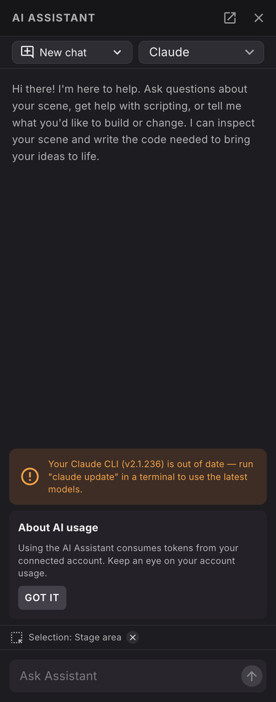
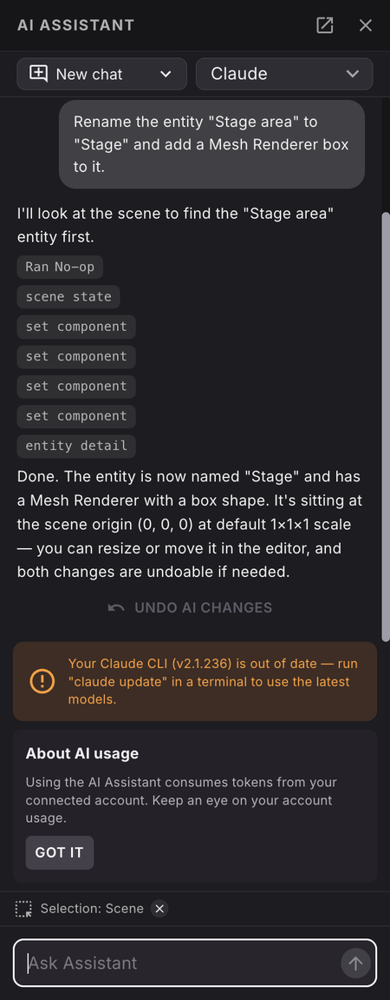
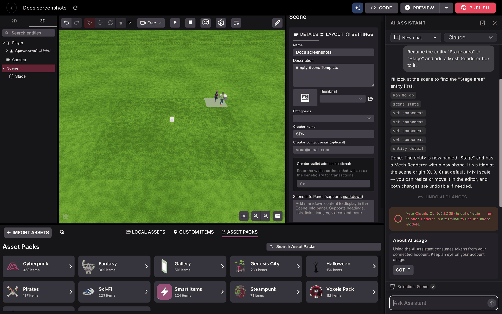

# AI Assistant

The Creator Hub can run an AI assistant that sees your open scene and edits it for you. Ask it to place items, wire up behavior, write scripts, or run the preview and check the result.


**📔 Note**: The assistant runs a coding CLI that you install and sign into, with full access to your machine, the same reach it has in your terminal. Only enable it if you trust what you ask it to do.


## Where its settings live

The assistant is on by default. Its settings have their own tab:

1. Click the Creator Hub logo in the top-left corner and select **Settings**.
2. Go to the **AI** tab.

That tab holds the **Enable AI Assistant** switch, the **Bill this to an API key instead** option, the **Connect** list of coding CLIs, and the **Expose AI assistant MCP server** settings.

When the assistant is on, an **AI Assistant** button (the sparkles icon) appears in the editor's top bar, to the left of the **Code** button. Click it to open the chat panel beside your scene.




## Connect a coding CLI

The assistant does not use an API key of its own. It runs a coding CLI that you install and sign into, so the work is billed to that tool's own subscription.

Four are supported: Claude, Codex, Cursor and Gemini. You install each one with its vendor's own installer, from a terminal.

### Install a CLI

Run the command for your operating system:

| CLI | macOS and Linux | Windows |
| --- | --- | --- |
| Claude | `curl -fsSL https://claude.ai/install.sh \| bash` | `winget install Anthropic.ClaudeCode` |
| Codex | `curl -fsSL https://chatgpt.com/codex/install.sh \| sh` | `powershell -ExecutionPolicy ByPass -c "irm https://chatgpt.com/codex/install.ps1 \| iex"` |
| Cursor | `curl https://cursor.com/install -fsS \| bash` | `powershell -ExecutionPolicy ByPass -c "irm 'https://cursor.com/install?win32=true' \| iex"` |
| Gemini | `npm install -g @google/gemini-cli` | `npm install -g @google/gemini-cli` |

You don't have to copy these by hand. The Creator Hub shows the exact commands for your operating system in two places, along with a link to that vendor's install guide:

* The setup card in the chat panel, which appears the first time you open the panel with no CLI connected.
* The settings, on the **AI** tab under **Connect**, in the **Via Terminal** section below each CLI. Each command there has a **Copy** button.

The vendor guides:

* [Claude Code install guide](https://code.claude.com/docs/en/terminal-guide)
* [Codex CLI install guide](https://developers.openai.com/codex/cli)
* [Cursor CLI install guide](https://cursor.com/docs/cli/installation)
* [Gemini CLI install guide](https://www.geminicli.com/docs/get-started/installation)

After installing, click **Recheck** on the chat panel's setup card so the Creator Hub picks up the new CLI, with no need to restart the app. The **AI** tab checks again on its own each time you open it.


**📔 Note**: Claude Desktop is not the same thing as Claude Code. The assistant needs Claude Code, Anthropic's terminal tool, and signing into the desktop app does not sign you into it. If the Creator Hub finds Claude Desktop without Claude Code, it says so and shows you the install command.

Gemini CLI needs a paid Gemini API key, or a Gemini Code Assist Standard or Enterprise license.


### Sign in

| CLI | Sign in |
| --- | --- |
| Claude | `claude auth login` |
| Codex | `codex login` |
| Cursor | `cursor-agent login` |
| Gemini | run `gemini` and follow the prompts |

Run the sign-in command in a terminal. It finishes in your browser.

Codex has a shortcut: if it isn't installed yet, the Creator Hub can install it and sign you in for you. Click **Sign in with Codex** on the chat panel's setup card, or **Sign in** next to Codex under **Connect** on the **AI** tab. The Creator Hub runs the login and opens your browser, and a **Sign out** link then appears in the same place. If you installed Codex yourself with the command above, there is no button: sign in from a terminal like the others.

A green dot and **Connected** next to a CLI mean it is ready to use.


**💡 Tip**: If you have more than one CLI signed in, a dropdown in the chat panel lets you switch between them.


### When an agent asks you to sign in again

A saved sign-in can expire while the CLI still looks connected. When a CLI answers a message with "not logged in", the Creator Hub shows a **Sign-in needed** state with an amber dot instead of passing the raw command line through to the chat.

The chat panel and the **Via Terminal** section on the **AI** tab show the two commands to run, one at a time, finishing in your browser:

| CLI | Sign out, then sign back in |
| --- | --- |
| Claude | `claude auth logout`, then `claude auth login` |
| Codex | `codex logout`, then `codex login` |
| Cursor | `cursor-agent logout`, then `cursor-agent login` |
| Gemini | run `gemini`, then `/auth logout`, then `/auth login` |

If the Creator Hub installed Codex for you, use **Sign out** and then **Sign in** on the **AI** tab instead.

Send your message again once you are signed in. The agent stays enabled the whole time, so you don't have to set it up from scratch.

### Bill to an API key instead

If you would rather pay per token than use a CLI subscription, switch on **Bill this to an API key instead** on the **AI** tab of the settings. It reads your provider's API key from your environment: `ANTHROPIC_API_KEY`, `OPENAI_API_KEY`, `CURSOR_API_KEY` or `GEMINI_API_KEY`. This is off by default.

This is also a way around a sign-in you can't complete. When a CLI is in the **Sign-in needed** state, the Creator Hub shows an **Or use an API key** hint with the matching variable name.

## What it can do

The assistant works on the scene you have open. It can:

* **Edit the scene**: create and delete entities, change components, place [smart items](../interactivity/smart-items.md), attach [scripts](script-component.md), and read and write `scene.json`.
* **Write code** in your scene's files.
* **Run the preview** and drive it: take screenshots, walk around, click things, read the logs, and check performance.
* **Read your selection**, so you can select an entity and say "make this one taller".

Changes are saved as they happen and go into the normal undo history. To take back a whole exchange at once, use **Undo AI changes** on the assistant's reply.



While the assistant works, its changes show up live in the entity tree and the canvas.



## Working with the chat

* **New chat** starts a fresh conversation.
* **Chat history** lists earlier conversations with how long ago they ran. Conversations are saved per project, so reopening a scene brings its chats back.
* **Open in a separate window** pops the assistant out into its own window, which is handy on a second monitor. **Dock back in the editor** returns it.
* The panel can be dragged wider or narrower.

An **About AI usage** card reminds you that the assistant consumes tokens from your connected account. Keep an eye on that account's usage.

The assistant runs one message at a time. While a reply is in progress, a **Thinking…** indicator stays up until the turn finishes, including during long tool calls. Sending a second message doesn't cancel the first one: wait for the reply, or press **Stop** to end the turn yourself.

Some replies ask you a question before continuing. If you leave one unanswered for too long, it closes with "This question is no longer active." and you can ask again.

### Attach files to a prompt

Sometimes it's easier to show the assistant something than to describe it. You can attach files to any message in three ways:

* Click the paperclip icon on the left of the message box, labeled **Attach files**, and pick one or more files.
* Drag files from your file explorer onto the message box. A **Drop files to attach** hint appears while you drag.
* Paste an image straight from your clipboard, for example a screenshot you just took.

Each attached file shows up as a chip above the message box, with an icon for its kind: image, 3D model (`.glb`, `.gltf`), audio (`.mp3`, `.wav`, `.ogg`, `.m4a`, `.flac`), or a generic file for anything else. Click the **Remove** cross on a chip to drop it before sending. You can attach up to 8 files to a single message, and you can send attachments with no text at all.

Files you drag in or pick from disk are handed to the assistant by their real path, so nothing is copied and there is no size limit. The assistant can look at images directly, and it can reference a model or audio file by its path when it writes scene code. Pasted images have no file on disk, so the Creator Hub saves them to a temporary file first; those are capped at 8 MB each.

If your Claude CLI is too old, the panel shows a warning. Run `claude update` in a terminal to fix it.

### Point at an asset in your prompt

Attaching a file sends its contents. Mentioning an asset is lighter: it just tells the assistant which asset in your project you mean, so you can say "use this one" instead of typing out a path.

With the assistant open, double-click any asset in the **Local Assets** tab. It appears as a chip above the message box, reading **Asset: _filename_**, or **Built-in animation: _name_** for one of the built-in avatar animations.

* Mention as many assets as you like. Each one gets its own chip and its own **Remove** cross.
* Mentions sit next to the **Selection** chip, so you can point at an entity in your scene and an asset at the same time: "put this animation on that NPC".
* Mentions apply to your next message only. They clear once you send it.


**💡 Tip**: Selecting the Scene root counts as selecting nothing, so it is never sent to the assistant. Select a real entity when you want the assistant to act on it.


## Decentraland skills are installed for you

When the assistant runs, the Creator Hub downloads the official [Decentraland SDK Skills](../../sdk7/getting-started/vibe-coding.md) and links them into your project, so the assistant follows verified SDK7 patterns instead of guessing.

They are linked at `.claude/skills` and `.agents/skills` inside your project folder, and both are added to a `.gitignore` for you, so they never end up in your repo.

## Files the assistant leaves in your scene folder

The assistant can read and edit your open scene through a local MCP server. Each CLI is told about that server differently, so depending on which one you use, you may find new files in your project:

| CLI | What appears in the scene folder |
| --- | --- |
| Cursor | `.cursor/mcp.json`, plus `.cursor/rules/creator-hub.mdc` |
| Gemini | `.gemini/settings.json` |
| Claude | Nothing. The configuration goes in a temporary file outside your project. |
| Codex | Nothing. The configuration is passed on the command line. |

If you already have one of those configuration files, the Creator Hub merges its entry into it instead of overwriting your own servers.


**📔 Note**: `.cursor/mcp.json` is the one file that contains the access token itself, because Cursor's configuration format has no way to read it from the environment. The Creator Hub adds it to your `.gitignore` before writing it, so don't commit it or remove that line. The Gemini file references the token through a `$CREATOR_HUB_MCP_TOKEN` environment variable instead, so it holds no secret and isn't ignored.


## Use your own AI tool instead

If you already work in Claude Code, Cursor, Codex, or another tool that speaks MCP, you can point it at the open scene rather than using the built-in panel. MCP (Model Context Protocol) is a standard way for an AI tool to call out to another program.

1. Open the main menu from the Creator Hub logo, select **Settings**, and on the **AI** tab expand **Expose AI assistant MCP server**.
2. Click **Copy configuration**.
3. Paste it into your tool's MCP configuration.

The copied configuration looks like this, with a real port and token filled in:

```json
{
  "mcpServers": {
    "creator-hub": {
      "type": "http",
      "url": "http://127.0.0.1:<PORT>/mcp",
      "headers": { "Authorization": "Bearer <TOKEN>" }
    }
  }
}
```

For Claude Code, you can instead add it from a terminal in your scene folder:

```bash
claude mcp add --transport http --scope local creator-hub http://127.0.0.1:<PORT>/mcp \
  --header "Authorization: Bearer <TOKEN>"
```


**📔 Note**: The port and the token are new every time the Creator Hub starts. If your tool suddenly gets a `401` error, copy the configuration again. The server only listens on your own machine, and only ever acts on the scene you have open.


## Related pages

* [Vibe Coding with AI](../../sdk7/getting-started/vibe-coding.md): the full guide to the SDK Skills and to prompting well.
* [Combine with code](overview.md): open your scene in a code editor.
* [Using the Script Component](script-component.md): attach behavior to an entity from a file.
