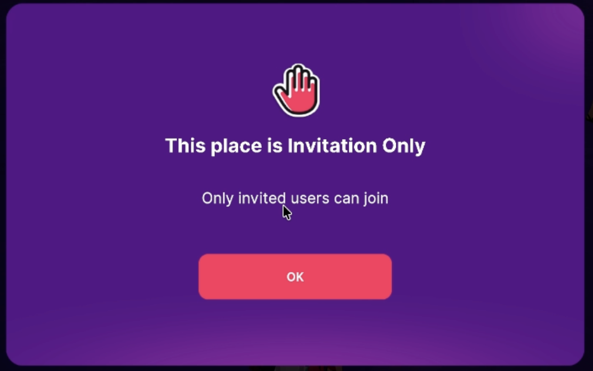
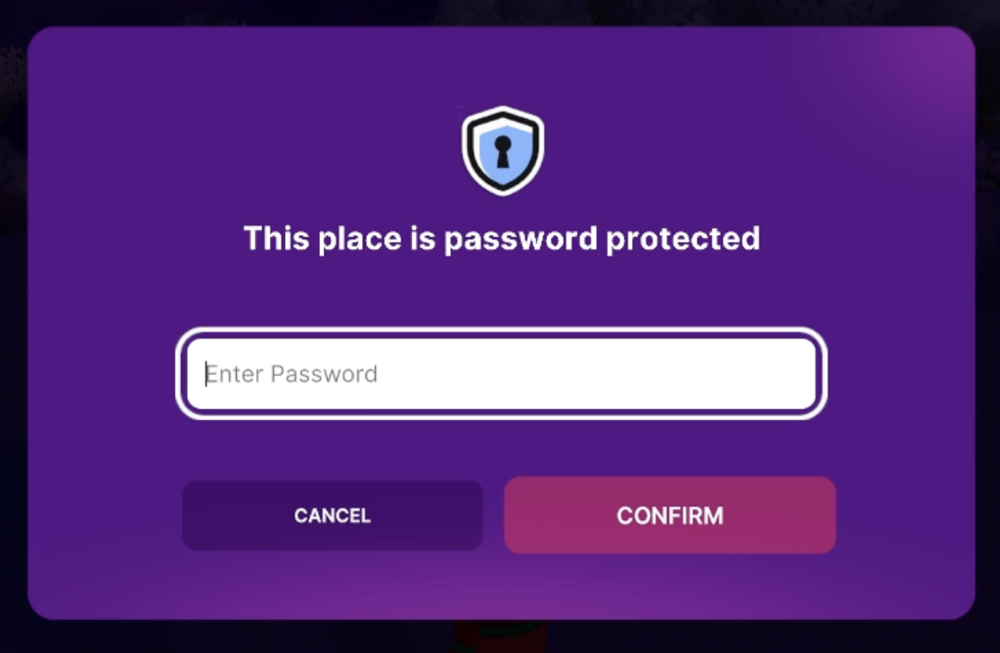

# Manage LANDs and Worlds

The **Manage** page of the Creator Hub lists every LAND and World you can publish to. From there you can open each one to rename it, see and unpublish its scenes, add collaborators, and change who can enter a World.

## Open the Manage page

1. Sign in to the Creator Hub.
2. Click **Manage** in the top navigation bar.
3. Pick the **Worlds** or the **LANDs** tab.

[Screenshot: the Manage page on the LANDs tab, with the View filter, the Sort by dropdown, the search field and a grid of LAND cards with role tags.]

Both tabs work the same way:

- **View**: show **All**, **Published** or **Not Published** places.
- **Sort by**: **Last Updated** or **Name**.
- **Search**: filter the cards by name.

If you're signed out, the page shows **Sign In to start managing your Worlds and LANDs.** If you have nothing to manage yet, it links to where you can get some: **Rent or Buy LAND** on the **LANDs** tab, or a Decentraland NAME on the **Worlds** tab.

### Card tags and options

Each card shows the place, how many scenes it has, and your role. LAND you own has no tag. Other LAND shows **Collaborator** (you were given publish rights on it, as a collaborator or as a manager) or **Tenant** (you rent it). A World where you're a collaborator shows **Collaborator**.

Click the **⋮** button on a card for quick actions:

| Option | LAND | World |
| --- | --- | --- |
| **Jump In** | Opens the LAND in Decentraland. | Opens the World in Decentraland. |
| **Copy URL** | Copies a link to the LAND. | Copies a link to the World. |
| **Create Event** | Opens the Events page to schedule an event. | Same. |
| **Transfer** | Owners only. See [Transfer a LAND](#transfer-a-land). | |
| **View Storage** | | Opens the [server data](../live-ops/server-data.md) of the World's scenes. |
| **Unpublish** | | Owners only. Takes every scene in the World offline. |

Click the card itself to open the detail page of that LAND or World.

## Manage a LAND

The LAND detail page has up to four tabs: **Details**, **Scenes**, **Collaborators** and **Managers**. Which ones you see depends on your role:

| Your role | Tabs you see |
| --- | --- |
| Owner | Details, Scenes, Collaborators, Managers |
| Manager | Details, Scenes, Collaborators |
| Collaborator or tenant | Details, Scenes |
| Owner of LAND that is rented out | Details, Scenes (read only) |

[Screenshot: the LAND detail page on the Details tab, with the Land Name and Description fields, the Domain Name dropdown, and the Details, Scenes, Collaborators and Managers tabs.]

Changes on a LAND are blockchain transactions. When you save, the Creator Hub asks you to **Confirm this transaction in your browser**, then waits until the transaction is confirmed. Some changes take two transactions, shown as **Step 1 of 2** and **Step 2 of 2**. Each one has a **View on Etherscan** link.

### Name and description

On the **Details** tab, edit the **Land Name** (up to 50 characters) and the **Description** (up to 140 characters), then click **Save**. Both are stored on the blockchain in a single transaction. Owners, managers and collaborators can edit them. A tenant sees them read-only.

### Link a NAME to your LAND

You can use a Decentraland NAME you own as a short, custom link to your LAND. Visitors who open `<your-name>.dcl.eth.limo` in a browser are sent to your LAND's jump-in page.

1. On the **Details** tab, open the **Domain Name** dropdown (**Choose a NAME**).
2. Pick one of your NAMEs and confirm.
3. Approve the transaction in your browser.

If the NAME has never been set up for a link, the Creator Hub runs two transactions: **Set up NAME**, then **Link to LAND**.

To unlink it, open the dropdown again and choose **Remove link**. If you don't own a NAME yet, click **Claim a NAME**.

The link points at the LAND's base parcel. A NAME linked to a LAND with an older method shows as not linked here: link it again to use it.

### See, download and unpublish scenes

The **Scenes** tab lists the scenes published on the LAND, with their **Name**, **Parcels**, **Location**, **Last Updated** date and who they were **Published by**.

- **Unpublish** a scene from its row, or tick several scenes and click **Unpublish selected**. Unpublishing replaces the scene with an empty one. Owners, managers, collaborators and tenants can unpublish.
- **Download** a scene to get a project you can open in the Creator Hub. This is useful to recover a scene you no longer have on your computer.


**📔 Note**: A downloaded scene always includes its published files, but its original source code can't always be recovered. Read the `RECOVERY.md` file in the downloaded folder to see what came back and what didn't.


### Add collaborators

Collaborators can publish scenes on this LAND. On the **Collaborators** tab:

1. Click **Add** and enter a wallet address or a NAME (for example `name.dcl.eth`).
2. Confirm, then approve the transaction in your browser.

For an Estate, use the **Deploy Permissions in** column to choose where each collaborator can publish: **All Parcels**, or **Custom parcels…** to pick parcels on a map.

To remove collaborators, use the trash button on their row, or tick several and remove them together.

### Add managers

Managers can publish scenes and add or remove collaborators on **all** your LAND, not only the one you're viewing. Only the owner sees the **Managers** tab. Adding a manager covers your LAND and your Estates, and takes a transaction for each.

### Transfer a LAND

To give a LAND to another wallet, click **⋮** on its card in the **Manage** page and select **Transfer**. Enter the recipient's wallet address or NAME and confirm.


**❗Warning**: A transfer can't be undone. Check the address carefully before you confirm.


## Manage a World

The World detail page has up to four tabs: **Details**, **Scenes**, **Settings** and **Collaborators**. Which ones you see depends on your role:

| Your role | Tabs you see |
| --- | --- |
| Owner (the wallet that holds the NAME) | Details, Scenes, Settings, Collaborators |
| Collaborator who can publish anywhere in the World | Details, Scenes, Settings (without **Access**) |
| Collaborator who can publish on some parcels only | Scenes, showing only the scenes on your parcels |

Collaborators who can only stream into a World see its card, but it doesn't open a detail page.

[Screenshot: the World detail page on the Settings tab, with Spawn Coordinate, Night/Day Time (skybox), the General checkboxes and the Access options.]

When you change a field, **CANCEL** and **SAVE** buttons appear. If you try to leave with unsaved changes, the Creator Hub asks whether to save them first.

### Details

The **Details** tab holds the information shown for your World in Decentraland Places and inside the World:

- **World Name**: up to 50 characters.
- **Description**: up to 140 characters.
- **Categories**: up to three.
- **Thumbnail**: a PNG or JPG image, 1920x1080 (16:9). Keep the file at 1 MB or smaller, larger thumbnails are rejected when you save. See [Keep the file under 1 MB](../configure/scene-settings.md#keep-the-file-under-1-mb).

A successful save shows **Changes saved**.


**📔 Note**: If your World contains a single scene, publishing that scene overwrites these details with the scene's own name, description and thumbnail. See [World metadata vs scene metadata](publish-scene.md#world-metadata-vs-scene-metadata).


### Scenes and storage

The **Scenes** tab lists the World's scenes, with the same columns, **Download** and **Unpublish** options as on a LAND.

- The owner also sees how much storage the World uses, with a **Manage Storage** link. See [World storage budget](#world-storage-budget).
- A **Multi-Scene World** indicator shows whether the World can hold more than one scene. You turn this on while publishing, see [Multi-Scene Worlds](publish-scene.md#multi-scene-worlds).
- The **World Map** toggle shows where each scene sits in the World.


**❗Warning**: Unpublishing the last scene of a World takes the World offline and deletes its name, description, thumbnail and settings.


### Settings

The **Settings** tab controls how the World behaves:

- **Spawn Coordinate**: the parcel where players arrive. The scene on that parcel decides the exact spawn point inside it. For example, if the spawn coordinate is `1,1` and the scene there has a spawn point at `1,0,1`, players arrive at that point of that scene.
- **Night/Day Time (skybox)**: keep **Auto (Decentraland Time)** to follow the day and night cycle, or set a fixed time.
- **Single Player**: each player is alone in the World. Live streaming doesn't work in single player mode, see [Live Streaming](../live-ops/live-streaming.md).
- **Discoverable in Places**: list the World in Decentraland Places.

### Control who can enter

Only the owner sees the **Access** section of the **Settings** tab. Access changes are saved as soon as you make them, without the **SAVE** button. Pick one of three types:

- **Public**: anyone can enter. This is the default.
- **Invitation Only**: only the wallets and Communities on your **Invited** list can enter.
- **Password Protected**: anyone with the password can enter.

To invite people to an **Invitation Only** World, use one of the three tabs:

- **Add User Wallet**: add wallets one at a time.
- **Add Community**: search for a public Community and add it. Every member of that Community can enter.
- **Import CSV**: drop a CSV file, or browse for one, with one wallet address or Community ID per line. For example:

```
0x0000000000000000000000000000000000000001
0x0000000000000000000000000000000000000002
```

To remove an invite, use the trash button on its row, or tick several and remove them together.


**📔 Note**: If you switch the access type away from **Invitation Only**, your list of approved addresses is erased. Keep a copy if you may need it again.


To protect a World with a password, choose **Password Protected** and click **Create New Password**. A password needs at least 8 characters and at least 2 numbers. Once saved it can't be shown again, so write it down. Use **Change Password** to replace it.

### What players see in a private World

If a player tries to enter a World that isn't public:

- **Invitation Only**: if their address is on the list, they enter normally. If not, they're told the World is invitation only.



- **Password Protected**: they're asked for the password, with up to 10 attempts.



### World collaborators

On the **Collaborators** tab, the owner can give up to 100 wallets permission to publish or to stream in the World. Add a wallet address or NAME, then set:

- **Deploy Permissions in**: **All Parcels**, a number of parcels you pick on a map, or **None** for a wallet that only streams.
- **Stream**: whether they can stream into the World. When streaming is open to everyone in the World, this column is checked for everyone and can't be changed.

[Screenshot: the World Collaborators tab, with a collaborator row showing the Deploy Permissions in dropdown and the Stream checkbox.]


**📔 Note**: Collaborators who can publish on **All Parcels** can overwrite any scene in the World, including scenes published by the owner or by other collaborators.


To publish into a World as a collaborator, see [Deploying to a Multi-Scene World as a Collaborator](publish-scene.md#deploying-to-a-multi-scene-world-as-a-collaborator).

## World storage budget

Scenes published to Worlds count against a storage budget shared by all the Worlds your wallet owns. Each Decentraland NAME or LAND parcel you own grants 100 MB, and every 2,000 MANA in your wallet grants another 100 MB. Worlds on ENS domains have a fixed limit of 36 MB each instead.

The **Worlds** tab of the **Manage** page shows a **Space Used** bar with how much of the budget you use. Click **View Details** to see how your MANA, LAND and NAME holdings add up. You can also check it in the **Worlds** tab of the [Builder](https://decentraland.org/builder/worlds).

To free space, unpublish scenes you no longer need from the World's **Scenes** tab. See [Worlds size limits](../../sdk7/projects/kinds-of-project.md#size-limits) for the full rules, including what happens when you go over the budget.

## Related pages

- [Publish a Scene](publish-scene.md): publish to LAND or to a World.
- [Server Data](../live-ops/server-data.md): view and edit the data your scene's Multiplayer Server stores.
- [Kinds of project](../../sdk7/projects/kinds-of-project.md): how LAND and Worlds differ.
