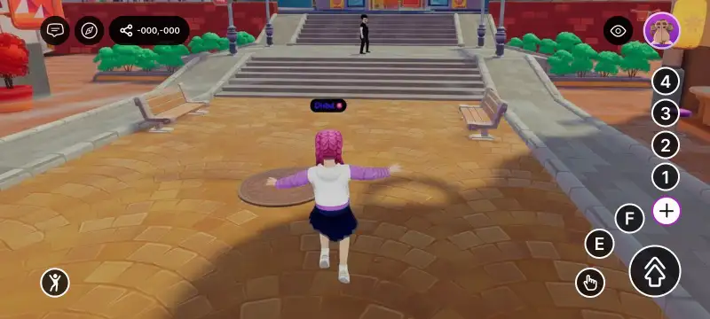
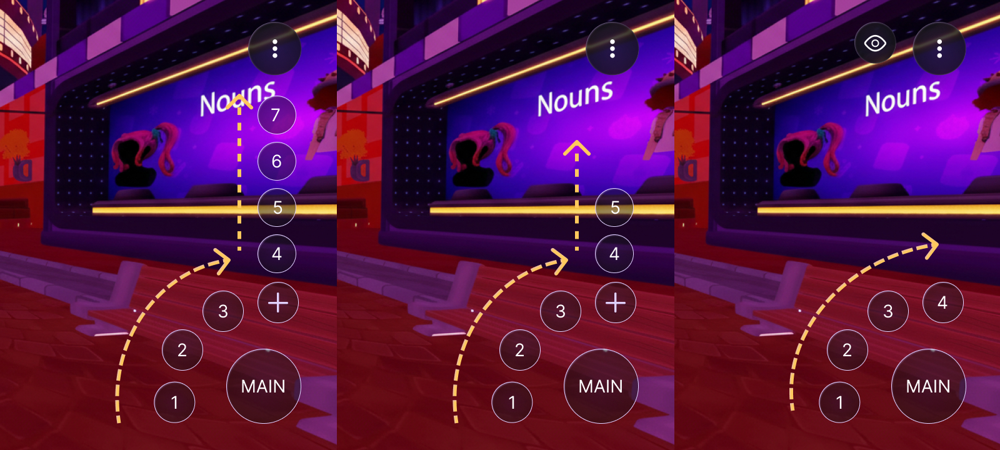
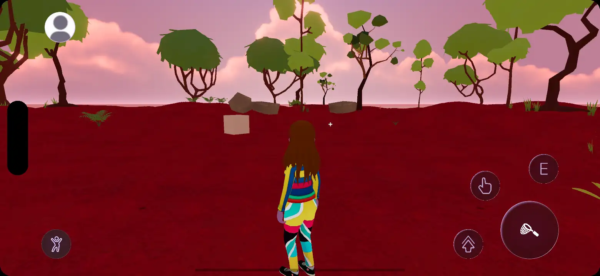

# On-screen Controls

On the mobile client, players interact with your scene through a set of native on-screen controls — a virtual joystick, a crosshair, and a gamepad of buttons. The `TouchScreenControls` component lets your scene reshape that HUD: declutter it, hide the joystick or crosshair, change what the large central button does, swap a button's glyph for your own icon, or hide buttons entirely and replace them with your own UI.

<figure><figcaption><p>The default on-screen controls, before any customization: jump, interaction and E</p></figcaption></figure>


The component is applied automatically while the player is inside your scene and stops applying the moment they leave. It only affects platforms with native on-screen controls: it's a no-op on desktop and has no effect in VR.


## Default buttons

Every scene starts with only three buttons visible. The others stay hidden until your scene turns them on:

| InputAction | Button | Default |
| --- | --- | --- |
| `IA_JUMP` | Jump (large central button) | Shown |
| `IA_POINTER` | Interaction | Shown |
| `IA_PRIMARY` | E | Shown |
| `IA_SECONDARY` | F | Hidden |
| `IA_ACTION_3` / `IA_ACTION_4` / `IA_ACTION_5` / `IA_ACTION_6` | 1 / 2 / 3 / 4 | Hidden |

The SDK writes this default set into `TouchScreenControls` when your scene starts, before `main()` runs. To use F or the numbered buttons, turn them on with `TouchScreenControls`:

* `TouchScreenControls.showAll()` shows all eight buttons.
* `showAll()` followed by `hide([...])` shows only the ones you want (see [Common tasks](#common-tasks)).
* Writing the component yourself with `createOrReplace` replaces the default set: any button you don't list is shown.


Reacting to F or 1–4 through `PointerEvents` or `inputSystem` does **not** show the button. If your scene uses them, turn them on as shown above, or mobile players can't reach them.



A scene that removes the component (`TouchScreenControls.deleteFrom(engine.RootEntity)`) shows all eight buttons.


## How the button layout works

The gamepad buttons form a single **priority stack**. The order is fixed:

1. `IA_JUMP`
2. `IA_POINTER`
3. `IA_PRIMARY` (E)
4. `IA_SECONDARY` (F)
5. `IA_ACTION_3` (1)
6. `IA_ACTION_4` (2)
7. `IA_ACTION_5` (3)
8. `IA_ACTION_6` (4)

The on-screen positions are fixed too. The **visible** buttons fill those positions from the top of the stack down — so what you change is *which* buttons are visible and *which one leads*, not their order.

| When you… | The controls… |
| --- | --- |
| **Hide a button** (any button, including jump) | Every lower-priority button moves up to fill the gap. Hide jump and `IA_POINTER` takes the central spot. |
| **Leave the default set alone** | Three buttons show: `IA_JUMP` as the large central button, with `IA_POINTER` and `IA_PRIMARY` (E) beside it. There is no "+" menu. |
| **Set a main button** with `mainAction` | That action jumps to the front and becomes the central button; every other button keeps its normal order. |
| **Set a main button that is also hidden** | Hiding wins — the button stays hidden. This includes F and 1–4, which are hidden by default: turn the button on as well (see [Change the main button](#common-tasks)). |
| **Leave 5 or fewer buttons visible** | All of them show directly (the central button plus up to four around it); there is no "+" menu. |
| **Leave more than 5 buttons visible** | The "+" takes the last slot, so four show directly (the central button plus three) and the rest sit behind the "+" overflow toggle. |

<figure><figcaption><p>How the buttons reflow with the visible count. <strong>Left (7 buttons):</strong> the main button, an arc of 1–3, and the "+" holding the overflow (4–7) in a column that climbs upward. <strong>Center (5 buttons):</strong> the same arc, with a shorter overflow column (4–5) behind the "+". <strong>Right (4 buttons):</strong> all four show directly and the "+" disappears.</p></figcaption></figure>


The `1`/`2`/`3`/`4` buttons are hidden until your scene turns them on. Once on, they show directly as long as five or fewer buttons are visible; with more, the last ones move behind the "+".


## Common tasks

`TouchScreenControls` ships a set of convenience helpers. Each one writes the component onto the scene's `RootEntity` (where the client reads it) and merges with the current value, so you can call them from anywhere.

**Change the main button** — make the large central button trigger a different action:

```ts
import { TouchScreenControls, InputAction } from '@dcl/sdk/ecs'

export function main() {
	TouchScreenControls.setMainAction(InputAction.IA_PRIMARY)
}
```

`setMainAction()` doesn't turn a button on. To lead with F or a numbered button, turn it on as well, or it stays hidden:

```ts
TouchScreenControls.showAll()
TouchScreenControls.hide([
	InputAction.IA_ACTION_3,
	InputAction.IA_ACTION_4,
	InputAction.IA_ACTION_5,
	InputAction.IA_ACTION_6,
])
TouchScreenControls.setMainAction(InputAction.IA_SECONDARY)
```

**Hide the joystick or crosshair** — remove the movement stick and/or the aiming reticle, and bring them back with their `show` counterparts:

```ts
TouchScreenControls.hideJoystick()
TouchScreenControls.hideCrosshair()

// and to bring them back:
TouchScreenControls.showJoystick()
TouchScreenControls.showCrosshair()
```

**Hide specific buttons** — pass the actions you want gone (the rest cascade up). The call adds to the buttons already hidden, so with the default set this leaves the interaction button as the central button and E beside it:

```ts
TouchScreenControls.hide([InputAction.IA_JUMP])
```

**Use F or the numbered buttons** — F and 1–4 are hidden by default. Show every button, then hide the ones your scene doesn't use:

```ts
// Show F and 1, keep 2–4 hidden
TouchScreenControls.showAll()
TouchScreenControls.hide([InputAction.IA_ACTION_4, InputAction.IA_ACTION_5, InputAction.IA_ACTION_6])
```

**Hide, show or reset every button** — clear the HUD, show all eight buttons, or go back to the default set:

```ts
TouchScreenControls.hideAll()
TouchScreenControls.showAll()
TouchScreenControls.showDefault()
```

These only affect the gamepad buttons — they don't restore a hidden joystick or crosshair. Use `showJoystick()` / `showCrosshair()` for those. `showDefault()` also keeps your main button and custom icons.

**Replace a button's icon** — for full control (custom icons, several changes at once), write the raw component on `engine.RootEntity`. This replaces the default set, so every button you don't list is shown; call `showDefault()` afterwards to hide F and 1–4 again while keeping your icons:

```ts
import { engine, TouchScreenControls, InputAction } from '@dcl/sdk/ecs'

export function main() {
	TouchScreenControls.createOrReplace(engine.RootEntity, {
		hideJoystick: false,
		hideCrosshair: true,
		mainAction: InputAction.IA_PRIMARY,
		touchInputs: [
			{
				inputAction: InputAction.IA_PRIMARY,
				hide: false,
				icon: { tex: { $case: 'texture', texture: { src: 'images/grab.png' } } },
			},
		],
	})
	TouchScreenControls.showDefault()
}
```

The helpers at a glance:

| Helper | What it does |
| --- | --- |
| `setMainAction(action)` | Sets which action the large central button triggers. |
| `hideJoystick()` | Hides the native virtual joystick. |
| `showJoystick()` | Shows the native virtual joystick again. |
| `hideCrosshair()` | Hides the on-screen crosshair / reticle. |
| `showCrosshair()` | Shows the on-screen crosshair / reticle again. |
| `hide(actions)` | Hides the given gamepad buttons, on top of the ones already hidden (including the default set). |
| `hideAll()` | Hides every gamepad button. |
| `showAll()` | Shows all eight gamepad buttons. Does **not** affect the joystick/crosshair. |
| `showDefault()` | Goes back to the [default set](#default-buttons): jump, interaction and E shown, F and 1–4 hidden. Keeps the main button, custom icons, joystick and crosshair. |

## Properties

Write these directly when you use `createOrReplace`. `hideJoystick`, `hideCrosshair`, `touchInputs` and each entry's `hide` are required by the TypeScript type:

| Property | Type | Description |
| --- | --- | --- |
| `hideJoystick` | _boolean_ | Hides the native virtual movement joystick. |
| `hideCrosshair` | _boolean_ | Hides the on-screen crosshair / reticle. |
| `mainAction` | [_InputAction_](button-events/click-events.md#pointer-buttons) | Moves this action to the front of the stack, making it the large central button; the other buttons keep their order. Only gamepad actions are valid (see below). When unset, the first visible button (`IA_JUMP` by default) leads. It doesn't show a hidden button, F and 1–4 included. See [How the button layout works](#how-the-button-layout-works). |
| `touchInputs` | _array_ | Per-button overrides. The SDK writes the [default set](#default-buttons) here as `hide: true` entries for F and 1–4. A value you write with `createOrReplace` replaces them: a button that isn't listed is shown, with its default glyph. |

Each `touchInputs` entry has:

| Field | Type | Description |
| --- | --- | --- |
| `inputAction` | [_InputAction_](button-events/click-events.md#pointer-buttons) | Which on-screen button this entry configures. |
| `hide` | _boolean_ | Hides this button. Default is `false` (shown); F and 1–4 are hidden through the entries the SDK writes for the default set. Any button can be hidden, **including `IA_JUMP`** — the rest cascade up to fill its place. |
| `icon` | [_TextureUnion_](../2d-ui/ui_background.md#background) (optional) | Overrides the button glyph with a scene image. Use the `texture` variant with a content-mapped `src` (an image included in your scene) — `{ tex: { $case: 'texture', texture: { src: 'images/grab.png' } } }`. Only scene-content paths are supported (not external URLs, avatar or video textures). For the jump button this replaces all of its dynamic states (jump / double-jump / glide). If the path can't be resolved, the built-in glyph is used. |

## Which actions map to which buttons

The [`InputAction`](button-events/click-events.md#pointer-buttons) values here are the same ones used across [Input on mobile](../../build-for-mobile/develop/input-on-mobile.md) and [Click events](button-events/click-events.md). These are the actions that map to on-screen buttons:

| InputAction | On-screen button |
| --- | --- |
| `IA_JUMP` | The large central button (default) |
| `IA_POINTER` | The interaction button |
| `IA_PRIMARY` | The E button |
| `IA_SECONDARY` | The F button |
| `IA_ACTION_3` / `IA_ACTION_4` / `IA_ACTION_5` / `IA_ACTION_6` | The 1 / 2 / 3 / 4 buttons |


`IA_ANY` and `IA_MODIFIER` are meta values — they don't map to a button and can't be used here.


## Example

To hide the joystick and make F the central button with a custom icon shipped in your scene. F is hidden by default, so the example lists it, and hides 1–4 so they stay off:

```ts
import { engine, TouchScreenControls, InputAction } from '@dcl/sdk/ecs'

export function main() {
	TouchScreenControls.createOrReplace(engine.RootEntity, {
		hideJoystick: true,
		hideCrosshair: false,
		mainAction: InputAction.IA_SECONDARY,
		touchInputs: [
			{
				inputAction: InputAction.IA_SECONDARY,
				hide: false,
				icon: { tex: { $case: 'texture', texture: { src: 'images/fishing.png' } } },
			},
			{ inputAction: InputAction.IA_ACTION_3, hide: true },
			{ inputAction: InputAction.IA_ACTION_4, hide: true },
			{ inputAction: InputAction.IA_ACTION_5, hide: true },
			{ inputAction: InputAction.IA_ACTION_6, hide: true },
		],
	})
}
```

<figure><figcaption><p>The result: joystick gone, F leading with a custom icon, and jump, interaction and E around it</p></figcaption></figure>

To replace the native controls entirely, hide them here and build your own touch buttons with [UI Input Binding](../2d-ui/ui_input_binding.md).

## Related

* [UI Input Binding](../2d-ui/ui_input_binding.md)
* [Input on mobile](../../build-for-mobile/develop/input-on-mobile.md)
* [Click events](button-events/click-events.md)
* [Detect the platform from code](../../build-for-mobile/develop/detect-platform.md)
