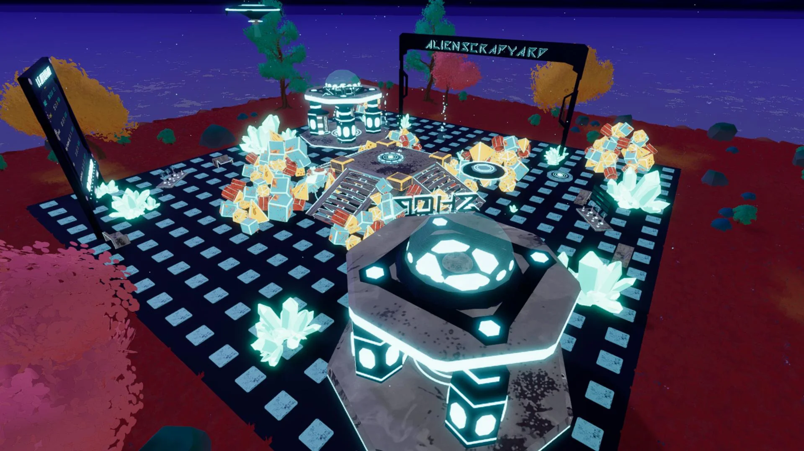

# Alien Scrapyard

<!-- example-context:start -->
**Maintained by:** Community · procesista

[View upstream source](https://github.com/procesista/Alienscrap)

**License:** Not identified in this catalog. Consult the upstream repository and maintainer for applicable terms before reuse.

This community project is maintained outside the Decentraland GitHub organization. Its source code and live deployment may change independently. Inclusion in this catalog does not imply a security audit or guarantee of safety. Review code, dependencies, and installation scripts before running or reusing it.

[Report a catalog concern](https://github.com/decentraland/docs/issues/new). For suspected vulnerabilities, follow the upstream project's security policy. Do not include exploit details or credentials in public issues.
<!-- example-context:end -->

- [Play on Decentraland](https://decentraland.org/jump?realm=alienscrapyard.dcl.eth)

A cooperative, timed building game where players work together to assemble alien technology and unlock new scores and shapes.

<!-- example-highlights:start -->
### Explore the code

These links point to a specific source snapshot so the explanations remain useful as upstream development continues. They are learning references, not a security assessment.

- **Represent build puzzles as data.** Slot definitions describe the required part, position, scale, and label for each piece. Template helpers recenter and scale the layouts, expose a sequence of puzzles, and look up individual slots. This is useful for studying how to add new constructions through data. Read it alongside the shared scene-center and part-type constants. Sources: [Slot definitions](https://github.com/procesista/Alienscrap/blob/be0b1b93580452f9cc778dc36554fe9354ee0ea2/src/shared/templates.ts#L3-L39); [Template helpers](https://github.com/procesista/Alienscrap/blob/be0b1b93580452f9cc778dc36554fe9354ee0ea2/src/shared/templates.ts#L140-L184).
- **Tie a cinematic camera to round state.** The cinematic system activates shots for countdown and performance phases, handles players joining mid-round, and releases the camera when the snapshot is stale. The final update adds round-change and elapsed-time exits before moving the camera along its shot. The example depends on the client snapshot, shared timing constants, and HUD visibility helpers. Sources: [The cinematic system](https://github.com/procesista/Alienscrap/blob/be0b1b93580452f9cc778dc36554fe9354ee0ea2/src/client/cinematic.ts#L93-L129); [The final update](https://github.com/procesista/Alienscrap/blob/be0b1b93580452f9cc778dc36554fe9354ee0ea2/src/client/cinematic.ts#L158-L176).
<!-- example-highlights:end -->

