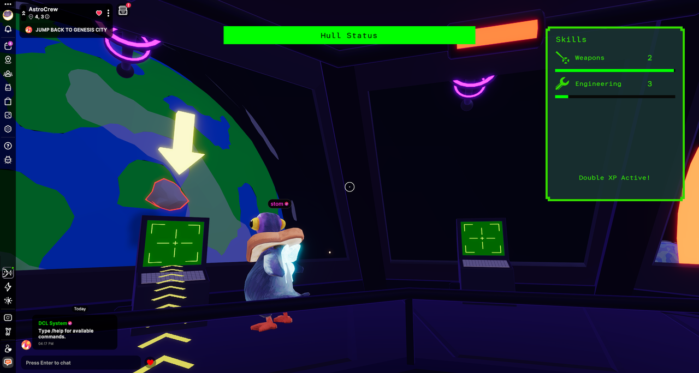

# Astro Crew

A co-op scene where the crew shares one ship. At each stop they shoot incoming asteroids and saucers, repair hull breaches, and raise gunner and engineering levels. The fight runs on an authoritative multiplayer server.

- [Play on Decentraland](https://decentraland.org/play/?realm=astrocrew.dcl.eth "Play on Decentraland")

<!-- example-context:start -->
## Project information

**Maintained by:** Community · DansStuff

[View upstream source](https://github.com/DansStuff/AstroCrew)

**License:** Not identified in this catalog. Consult the upstream repository and maintainer for applicable terms before reuse.


**Community-maintained code — review before use**

This community project is maintained outside the Decentraland GitHub organization. Its source code and live deployment may change independently.

Inclusion in this catalog does not imply a security audit or guarantee of safety. Review code, dependencies, and installation scripts before running or reusing it.

[Report a catalog concern](https://github.com/decentraland/docs/issues/new). For suspected vulnerabilities, follow the upstream project's security policy. Do not include exploit details or credentials in public issues.

<!-- example-context:end -->

## Key features

- **Authoritative multiplayer** for the whole fight. Clients send requests to target, repair, and overcharge. The server owns hull, breaches, and spawns, and synced `GameState` and `PlayerStats` only accept writes from the multiplayer server.
- **Storage** for each player's gunner and engineering levels, and a weekly mission leaderboard.
- **Virtual cameras** on the three turrets, blended in with a timed transition. Impacts shake those cameras. Taking a gun freezes the avatar with **InputModifier** and hides the mobile joystick and crosshair with **TouchScreenControls**.
- **PrimaryPointerInfo** aims each shot from the pointer's world ray. **PointerLock** stays released so **PointerEvents** can still drive the consoles, the hold-to-repair breaches, and the mission table.
- **GltfNodeModifiers** recolor the ship's emissive meshes: green while cruising, red during an encounter, and a second set while weapons are overcharged.
- **ReactEcs** HUD for hull, skill levels, and the end-of-round board. Off-screen breach icons sit on the screen edge, placed with **UiCanvasInformation**.
- **Billboards**, **TextShape**, and **avatar textures** on each target: a camera-facing crosshair, a "Target Locked" label, and portraits of whoever is shooting it.
- **Animator** loops the saucer spin clip. **AudioSource** plays stingers and loops, with a pool of laser one-shots so a shot can restart while the last clip is still playing. Clips are preloaded with **AssetLoad**.
- In-world **TextShape** rows for the weekly board. Clicking a row opens that mission's results.
- **AvatarModifierArea** turns off the passport prompt across the scene.

<!-- example-highlights:start -->
## Explore the code

These links point to a specific source snapshot so the explanations remain useful as upstream development continues. They are learning references, not a security assessment.

### Point players toward off-screen objectives

edgePositionForBreach projects a breach direction onto the camera's horizontal axes, finds an edge of a rectangle, and clamps the icon inside the screen using the canvas aspect ratio. BreachIcon connects that position to a pulsing ReactEcs marker.

**Project context:** Read it with the scene's breach positions, active-breach state, and UI constants.

**Source references:**

- [edgePositionForBreach](https://github.com/DansStuff/AstroCrew/blob/dbe11b05be2a753b27b6d5dd866d0554ff73344f/src/ui/breachIcons.tsx#L27-L76)
- [BreachIcon](https://github.com/DansStuff/AstroCrew/blob/dbe11b05be2a753b27b6d5dd866d0554ff73344f/src/ui/breachIcons.tsx#L78-L107)

### Add camera shake that returns to the original pose

shakeEntity records a base transform and combines overlapping shakes using intensity and remaining duration. CameraShakeSystem applies diminishing position and rotation offsets, then restores the base pose and removes the component.

**Project context:** The effect uses the project's amplitude constants and must be registered as an ECS system.

**Source references:**

- [shakeEntity](https://github.com/DansStuff/AstroCrew/blob/dbe11b05be2a753b27b6d5dd866d0554ff73344f/src/effects/cameraShake.ts#L13-L47)
- [CameraShakeSystem](https://github.com/DansStuff/AstroCrew/blob/dbe11b05be2a753b27b6d5dd866d0554ff73344f/src/effects/cameraShake.ts#L87-L121)

<!-- example-highlights:end -->
