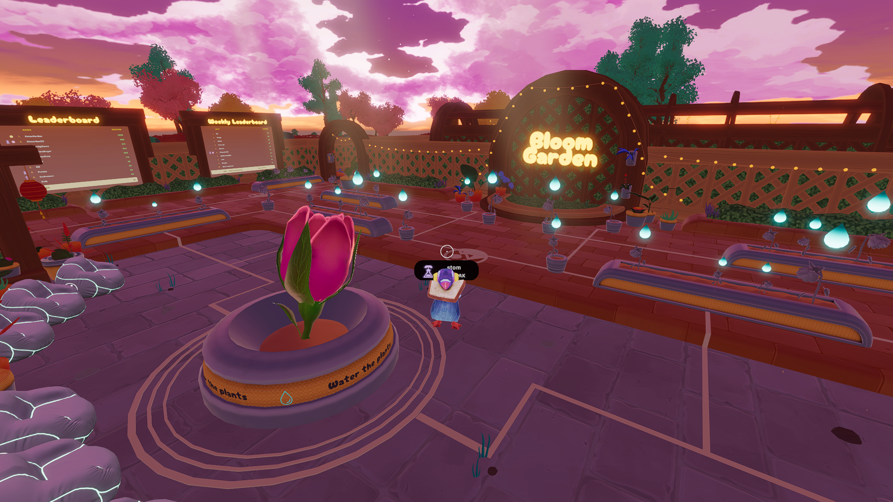

# Bloom Garden

<!-- example-context:start -->
**Maintained by:** Community · TheLivingGarden

[View upstream source](https://github.com/TheLivingGarden/TheLivingGarden/tree/main-main)

This community project is maintained outside the Decentraland GitHub organization. Its source code and live deployment may change independently. Inclusion in this catalog does not imply a security audit or guarantee of safety. Review code, dependencies, and installation scripts before running or reusing it.

[Report a catalog concern](https://github.com/decentraland/docs/issues/new). For suspected vulnerabilities, follow the upstream project's security policy. Do not include exploit details or credentials in public issues.
<!-- example-context:end -->

- [Play on Decentraland](https://decentraland.org/jump?realm=bloomgarden.dcl.eth)

A cooperative garden experience where players work together to maintain a living garden and awaken the Big Bloom.

Its Multiplayer Server uses built-in Storage for plant state, a weekly leaderboard, and per-player watering limits.

### Explore the code

These links point to a specific source snapshot so the explanations remain useful as upstream development continues. They are learning references, not a security assessment.

- **Estimate the offset between server and client clocks.** [The clock helper](https://github.com/TheLivingGarden/TheLivingGarden/blob/b2c9a90791b1eed5c92a4ffadf6ac480d91510ea/src/shared/clockSync.ts#L3-L55) keeps five offset samples, rejects large deviations, and converts server timestamps into local time. [The watering client](https://github.com/TheLivingGarden/TheLivingGarden/blob/b2c9a90791b1eed5c92a4ffadf6ac480d91510ea/src/wateringSystem.ts#L1144-L1146) feeds it timestamps received through the scene's message definitions. This illustrates a lightweight timing estimate; network transit time is included in the samples.
- **Let temporary effects finish naturally.** [The petal setup and controls](https://github.com/TheLivingGarden/TheLivingGarden/blob/b2c9a90791b1eed5c92a4ffadf6ac480d91510ea/src/petalSystem.ts#L119-L173) create a reusable pool from the scene's named Petal model, then start or settle the effect. [The update phases](https://github.com/TheLivingGarden/TheLivingGarden/blob/b2c9a90791b1eed5c92a4ffadf6ac480d91510ea/src/petalSystem.ts#L207-L310) scale petals in, let them fall and rest, and shrink them before recycling. Study this when an effect should stop spawning while existing objects complete their animation. Placement depends on BLOOM_CENTER and the module's timing constants.

