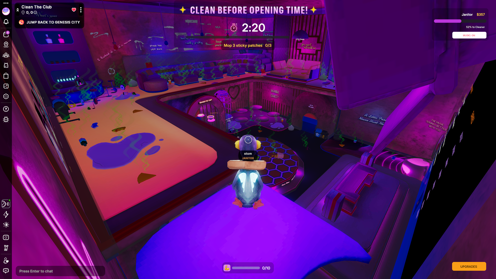

# Clean The Club

<!-- example-context:start -->
**Maintained by:** Community · CleanTheClub

[View upstream source](https://github.com/CleanTheClub/CleanTheClub)

This community project is maintained outside the Decentraland GitHub organization. Its source code and live deployment may change independently. Inclusion in this catalog does not imply a security audit or guarantee of safety. Review code, dependencies, and installation scripts before running or reusing it.

[Report a catalog concern](https://github.com/decentraland/docs/issues/new). For suspected vulnerabilities, follow the upstream project's security policy. Do not include exploit details or credentials in public issues.
<!-- example-context:end -->

- [Play on Decentraland](https://decentraland.org/jump?realm=cleantheclub.dcl.eth)

A cooperative cleanup game where players race to restore a nightclub before the next party.

### Explore the code

These links point to a specific source snapshot so the explanations remain useful as upstream development continues. They are learning references, not a security assessment.

- **Share one component scan across several systems.** [onClutterPoll](https://github.com/CleanTheClub/CleanTheClub/blob/8ffc6c1fa24ff0da22a1d82ecdf2f9ce72f47f73/src/client/clutterWatcher.ts#L15-L54) gathers ClutterSync entries once per polling interval, builds an item-ID lookup, and passes the same snapshot to subscribers. Each consumer can do its own filtering and change detection. This is useful for studying how to avoid repeated ECS scans; it depends on the shared schema and phase-gate polling interval, and subscriptions belong in client initialization.
- **Show another player's carried equipment.** [updateRemoteCarry](https://github.com/CleanTheClub/CleanTheClub/blob/8ffc6c1fa24ff0da22a1d82ecdf2f9ce72f47f73/src/client/carrySystem.ts#L805-L846) attaches a prop hierarchy to the other avatar's left hand, selects a model from the current gear or hauling state, and scales the bag by its fill fraction. It also removes the hierarchy when there is nothing to display. Read this with the carry message handlers, theme model lookup, and model-fit offsets: those provide the state and asset-specific positioning.

