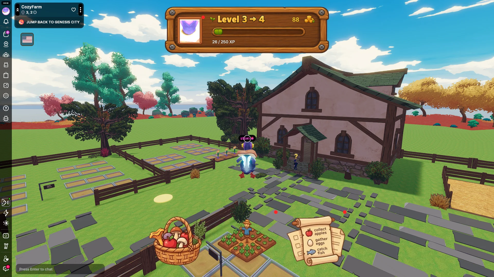

# Cozy Farm

A social farming game focused on growing crops, expanding a farm, and meeting other players.

- [Play on Decentraland](https://decentraland.org/jump?realm=cozyfarm.dcl.eth)

<!-- example-context:start -->
## Project information

**Maintained by:** Community · dcl-regenesislabs

[View upstream source](https://github.com/dcl-regenesislabs/cozy-farm)

**License:** Not identified in this catalog. Consult the upstream repository and maintainer for applicable terms before reuse.


**Community-maintained code — review before use**

This community project is maintained outside the Decentraland GitHub organization. Its source code and live deployment may change independently.

Inclusion in this catalog does not imply a security audit or guarantee of safety. Review code, dependencies, and installation scripts before running or reusing it.

[Report a catalog concern](https://github.com/decentraland/docs/issues/new). For suspected vulnerabilities, follow the upstream project's security policy. Do not include exploit details or credentials in public issues.

<!-- example-context:end -->

<!-- example-highlights:start -->
## Explore the code

These links point to a specific source snapshot so the explanations remain useful as upstream development continues. They are learning references, not a security assessment.

### Turn elapsed time into crop growth stages

`growthSystem` derives progress from a planting timestamp, adjusts the duration for tutorial crops and fertilizer, and swaps models only when a stage changes.

**Project context:** Follow it alongside `PlotState`, `CROP_DATA`, and the model helpers in `game/actions` to see how simulation state drives visual feedback.

**Source references:**

- [`growthSystem`](https://github.com/dcl-regenesislabs/cozy-farm/blob/440805a68d4d93a665c42cf17830735804b54a71/src/systems/growthSystem.ts#L62-L142)

### Build multiple farms from one entity hierarchy

`cloneEntityTree` recursively recreates a template's children, preserves local transforms, copies selected rendering components, and records each clone by name. This shows how repeated areas can share an authored layout.

**Project context:** The helper expects the scene's child map and copies an explicit component list, so new component types need deliberate handling.

**Source references:**

- [`cloneEntityTree`](https://github.com/dcl-regenesislabs/cozy-farm/blob/440805a68d4d93a665c42cf17830735804b54a71/src/systems/farmInstances.ts#L127-L168)

<!-- example-highlights:end -->
