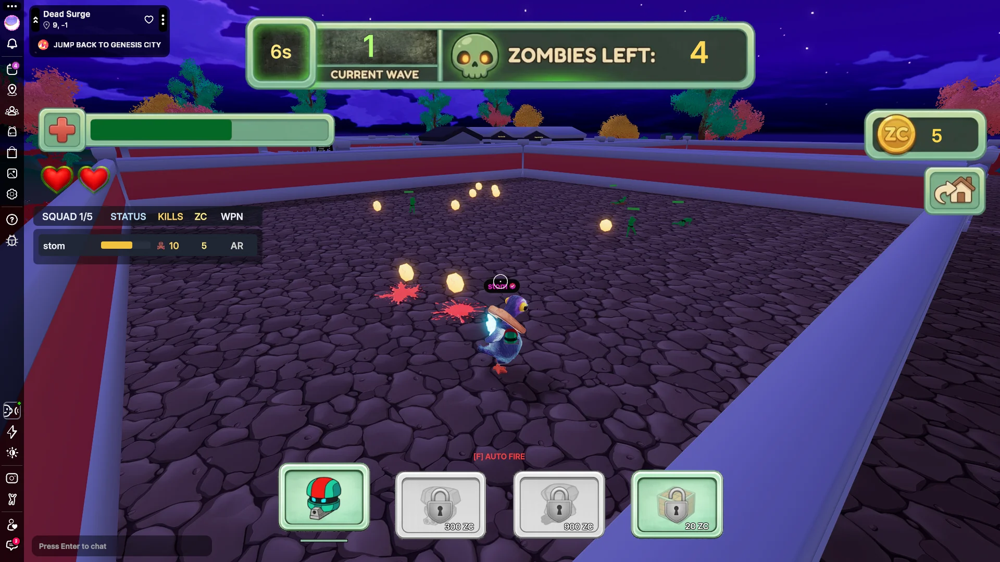

# Dead Surge

<!-- example-context:start -->
**Maintained by:** Community · dcl-regenesislabs

[View upstream source](https://github.com/dcl-regenesislabs/dead-surge)

This community project is maintained outside the Decentraland GitHub organization. Its source code and live deployment may change independently. Inclusion in this catalog does not imply a security audit or guarantee of safety. Review code, dependencies, and installation scripts before running or reusing it.

[Report a catalog concern](https://github.com/decentraland/docs/issues/new). For suspected vulnerabilities, follow the upstream project's security policy. Do not include exploit details or credentials in public issues.
<!-- example-context:end -->

- [Play on Decentraland](https://decentraland.org/jump?realm=deadsurge.dcl.eth)

Zombie survival game with combat and weapon progression.

### Explore the code

These links point to a specific source snapshot so the explanations remain useful as upstream development continues. They are learning references, not a security assessment.

- **Reuse entities for floating reward text.** [`spawnZcRewardTextAtPosition` and its pool initializer](https://github.com/dcl-regenesislabs/dead-surge/blob/4e967ba0590e0cdf7d6550ebbf56ea3b246a36dd/src/zombie.ts#L592-L640) cycle through a fixed set of text entities. The [`rewardTextSystem`](https://github.com/dcl-regenesislabs/dead-surge/blob/4e967ba0590e0cdf7d6550ebbf56ea3b246a36dd/src/zombie.ts#L815-L850) makes them rise, face the camera, and fade before hiding them for reuse. Read the scene's `RewardTextComponent` and game-time updates with these functions to understand their lifetime tracking.
- **Steer enemies around each other and simple obstacles.** [`getZombieSeparationDirection`](https://github.com/dcl-regenesislabs/dead-surge/blob/4e967ba0590e0cdf7d6550ebbf56ea3b246a36dd/src/zombie.ts#L868-L896) combines repulsion from nearby zombies. [`resolveZombieMovePosition`](https://github.com/dcl-regenesislabs/dead-surge/blob/4e967ba0590e0cdf7d6550ebbf56ea3b246a36dd/src/zombie.ts#L898-L939) tries the desired direction, a fallback, and individual movement axes against circular brick obstacles. This illustrates local steering; the behavior depends on the scene's movement entries, obstacle positions, and radius constants.

