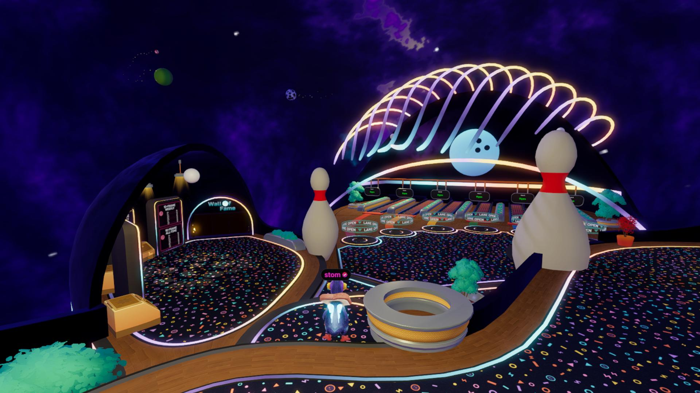

# Fastlane Bowling

- [Source on GitHub](https://github.com/stom66/dcl-bowling)
- [Play on Decentraland](https://decentraland.org/jump?realm=stom.dcl.eth)

A multiplayer bowling game with realistic physics provided by Cannon-ES. Multiple games run across separate lanes in a shared space.
### Key features

- **[Cannon-ES](https://github.com/pmndrs/cannon-es) physics** on the Multiplayer Server, with compressed keyframes replayed by clients.
- **Storage** for player progression, stats, preferences, inventory, and weekly/all-time leaderboards.
- Dynamic **lights** with rotating shadow masks and spotlights that follow the ball.
- **Particle** trails and unlock effects, with reduced particle counts on mobile.
- **Virtual cameras** for the arrival fly-in, aiming, and roll playback.
- **`GltfNodeModifiers`** for scrolling neon texture UVs.
- SDK-controlled **glTF animations** for lane bumpers, countdowns, and scoring effects.

