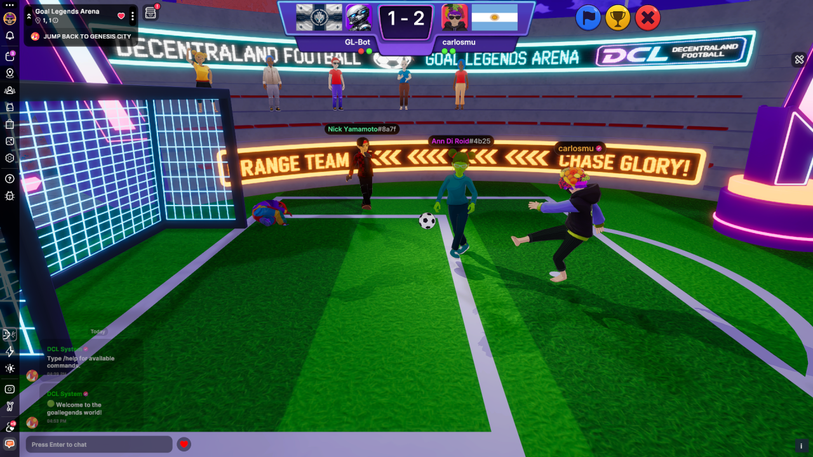

# Goal Legends

- [Source on GitHub](https://github.com/carlosmu/goal-legends-arena)
- [Play on Decentraland](https://decentraland.org/jump?realm=goallegends.dcl.eth)

A multiplayer penalty shootout game. Duel another player or the GL-Bot: pick left, center or right to score or save. Every round ends with a replay in the style of a TV broadcast, with the crowd reacting live.
### Key features

- **Multiplayer Server** runs the matches
- **Storage** for daily/all-time PvP/PvE leaderboards, and each player’s country flag.
- **Scene** **emotes**
- Animator-synced ball props for kicks, dives, goals and saves.
- **Virtual cameras** for the gameplay views and a winner cinematic everyone sees.
- **AvatarShape** crowd NPCs that react to each goal and save.
- **Particles** for the fireworks
- A portal with lights and **`GltfNodeModifiers`** that takes you to another World.

