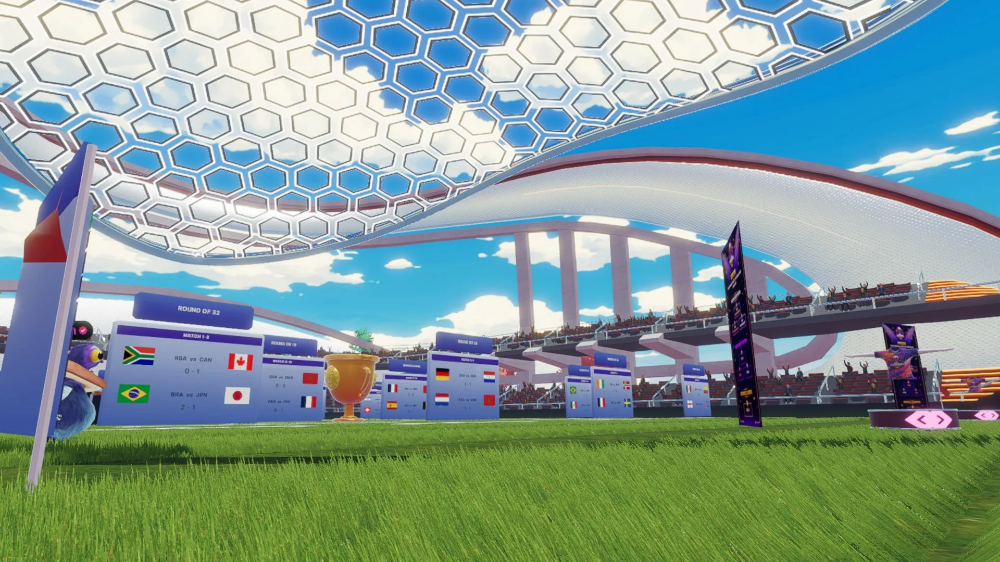

# Kick Off

<!-- example-context:start -->
**Maintained by:** Community · dcl-regenesislabs

[View upstream source](https://github.com/dcl-regenesislabs/kickoff-2026)

This community project is maintained outside the Decentraland GitHub organization. Its source code and live deployment may change independently. Inclusion in this catalog does not imply a security audit or guarantee of safety. Review code, dependencies, and installation scripts before running or reusing it.

[Report a catalog concern](https://github.com/decentraland/docs/issues/new). For suspected vulnerabilities, follow the upstream project's security policy. Do not include exploit details or credentials in public issues.
<!-- example-context:end -->

- [Play on Decentraland](https://decentraland.org/jump?realm=kickoff.dcl.eth)

A seasonal World Cup prediction game.

### Explore the code

These links point to a specific source snapshot so the explanations remain useful as upstream development continues. They are learning references, not a security assessment.

- **Connect a charged kick to immediate visual feedback.** The [charge-and-release loop](https://github.com/dcl-regenesislabs/kickoff-2026/blob/1813434548c1c56d9eec46575cc001d2bbdcebfd/client/ball.ts#L491-L536) combines keyboard and mobile input, grows and recolors a charge bar, sends a kick message, and starts local ball motion. [`releaseOptimistic`](https://github.com/dcl-regenesislabs/kickoff-2026/blob/1813434548c1c56d9eec46575cc001d2bbdcebfd/client/ball.ts#L155-L178) initializes that motion. Study it with the project's `prodeNet` room and ball message handlers to understand the relationship between input, feedback, and multiplayer messages.
- **Scale UI from a reference canvas.** [`layoutScale`](https://github.com/dcl-regenesislabs/kickoff-2026/blob/1813434548c1c56d9eec46575cc001d2bbdcebfd/schedule/responsive.ts#L1-L21) reads `UiCanvasInformation`, compares both dimensions with a 1920×1080 design space, clamps the result, and applies an additional mobile factor. It is a compact example of a shared layout helper; the limits and mobile factor are tuned for this project's panels.

