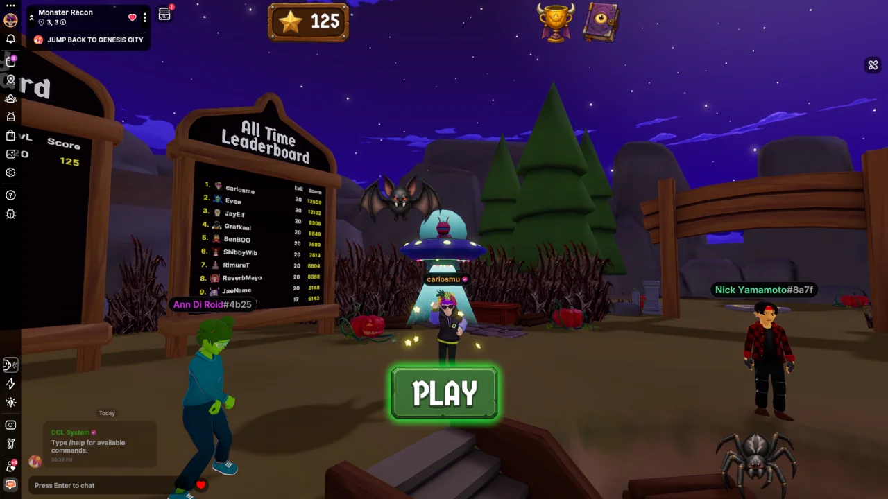

# Monster Recon

<!-- example-context:start -->
**Maintained by:** Community · carlosmu

[View upstream source](https://github.com/carlosmu/dcl-monster-recon)

This community project is maintained outside the Decentraland GitHub organization. Its source code and live deployment may change independently. Inclusion in this catalog does not imply a security audit or guarantee of safety. Review code, dependencies, and installation scripts before running or reusing it.

[Report a catalog concern](https://github.com/decentraland/docs/issues/new). For suspected vulnerabilities, follow the upstream project's security policy. Do not include exploit details or credentials in public issues.
<!-- example-context:end -->

- [Play on Decentraland](https://decentraland.org/jump?realm=monsterrecon.dcl.eth)

A memory-match game where you clear timed boards, then chase down the monster you revealed before it escapes. Collect rare finds in your Codex and climb the weekly and all-time leaderboards.
### Key features

- Multiplayer Server
- Storage for progress, best times, leaderboards and weekly rewards.
- Virtual cameras
- Scene emotes
- Trigger areas
- Particles
- Tweens
- TextShapes
- 3D Leaderboard (with player profile pictures)
- Custom bitmap font for UI
- Synced live feed of other players’ catches

