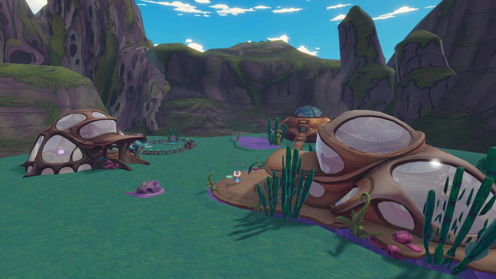

# My Dear Pet

A pet collecting game.

- [Play on Decentraland](https://decentraland.org/jump?realm=marshcolony.dcl.eth)

<!-- example-context:start -->
## Project information

**Maintained by:** Community · dcl-regenesislabs

[View upstream source](https://github.com/dcl-regenesislabs/marsh-colony)

**License:** Not identified in this catalog. Consult the upstream repository and maintainer for applicable terms before reuse.


**Community-maintained code — review before use**

This community project is maintained outside the Decentraland GitHub organization. Its source code and live deployment may change independently.

Inclusion in this catalog does not imply a security audit or guarantee of safety. Review code, dependencies, and installation scripts before running or reusing it.

[Report a catalog concern](https://github.com/decentraland/docs/issues/new). For suspected vulnerabilities, follow the upstream project's security policy. Do not include exploit details or credentials in public issues.

<!-- example-context:end -->

<!-- example-highlights:start -->
## Explore the code

These links point to a specific source snapshot so the explanations remain useful as upstream development continues. They are learning references, not a security assessment.

### Give moving pets acceleration and braking

`petMotionStep` keeps a speed per entity, limits the target speed using the remaining stopping distance, and returns a frame-sized movement step. The caller still supplies the route and updates the transform.

**Project context:** Read the arrival-distance, acceleration, and braking values in `shared/config` alongside this helper when studying its movement feel.

**Source references:**

- [`petMotionStep`](https://github.com/dcl-regenesislabs/marsh-colony/blob/55dea4d3e13b3d821aa20bd277fbc4e0bc920b6f/src/client/petMotion.ts#L9-L35)

### Animate editor-placed props with different phases

`setupEggShake` finds named egg entities, remembers their original rotations, and applies a small sine-wave rotation with a different phase for each egg. This adds variation while retaining each prop's authored orientation.

**Project context:** It depends on the egg names generated from the Creator Hub scene.

**Source references:**

- [`setupEggShake`](https://github.com/dcl-regenesislabs/marsh-colony/blob/55dea4d3e13b3d821aa20bd277fbc4e0bc920b6f/src/client/eggShake.ts#L29-L53)

<!-- example-highlights:end -->
