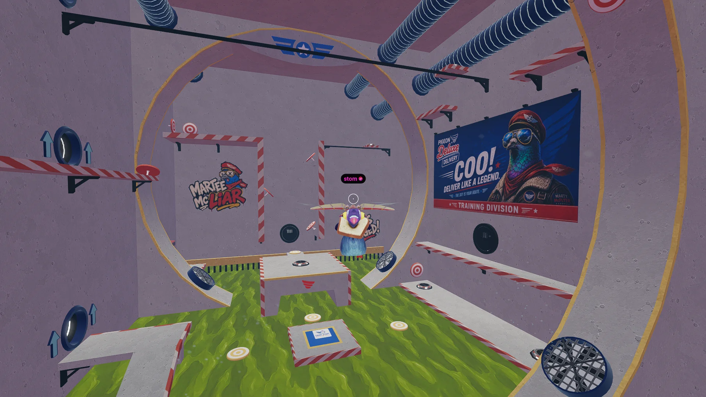

# Pigeon Deluxe

<!-- example-context:start -->
**Maintained by:** Community · PepeGawd

[View upstream source](https://github.com/PepeGawd/Pigeon-Deluxe)

**License:** Not identified in this catalog. Consult the upstream repository and maintainer for applicable terms before reuse.

This community project is maintained outside the Decentraland GitHub organization. Its source code and live deployment may change independently. Inclusion in this catalog does not imply a security audit or guarantee of safety. Review code, dependencies, and installation scripts before running or reusing it.

[Report a catalog concern](https://github.com/decentraland/docs/issues/new). For suspected vulnerabilities, follow the upstream project's security policy. Do not include exploit details or credentials in public issues.
<!-- example-context:end -->

- [Play on Decentraland](https://decentraland.org/jump?realm=pigeondeluxe.dcl.eth)

A timed delivery game where players collect parcels, carry them to another pad, and earn extra time for deliveries.

<!-- example-highlights:start -->
### Explore the code

These links point to a specific source snapshot so the explanations remain useful as upstream development continues. They are learning references, not a security assessment.

- **Point toward an objective while attached to an avatar.** `initParcelDirectionPointer` and its update system attach an arrow above the avatar's name tag, calculate the world-space direction to the active target, and convert that rotation into the parent's local space. Rotation advances using `dt`, so the arrow turns toward the objective over time. The target comes from the parcel system and the arrow uses the scene's `FaceDirection1.glb` asset. Sources: [`initParcelDirectionPointer` and its update system](https://github.com/PepeGawd/Pigeon-Deluxe/blob/1c24bcb3c82d73dbb1aad8b1035f3f7edab5d315/src/Game/parcelDirectionPointer.ts#L26-L96).
- **Separate scoring from delivery animation.** `startNewRound` and `handleSpawnAreaEnter` assign pickup and delivery roles to pads, track whether a parcel is being carried, and award points and time as soon as the delivery pad is entered. The next round starts when the drop animation finishes. Read this with the scene's game timer and parcel-attachment helpers to see how gameplay state and visual feedback fit together. Sources: [`startNewRound` and `handleSpawnAreaEnter`](https://github.com/PepeGawd/Pigeon-Deluxe/blob/1c24bcb3c82d73dbb1aad8b1035f3f7edab5d315/src/Game/parcelCollectDeliver.ts#L363-L433).
<!-- example-highlights:end -->

