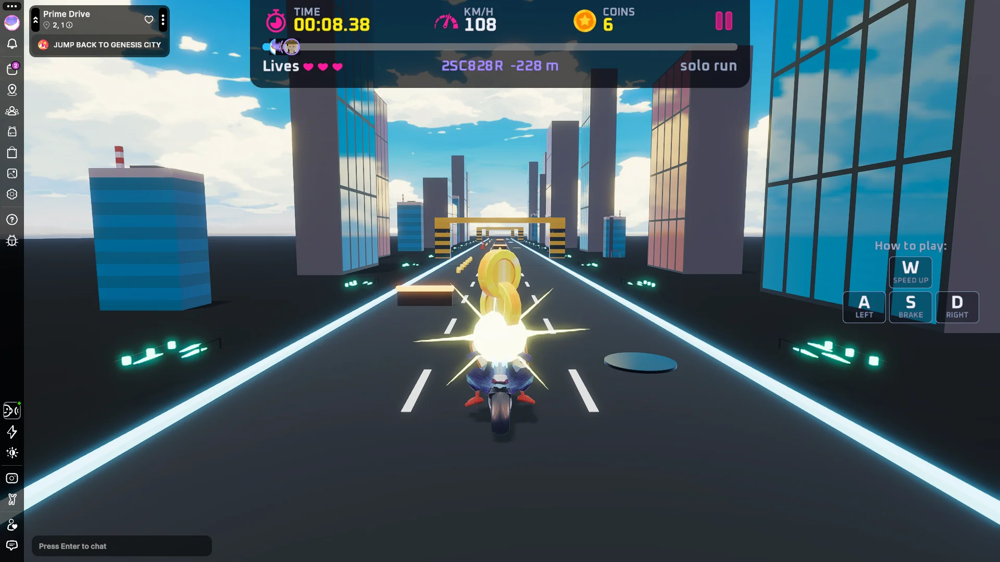

# Prime Drive

<!-- example-context:start -->
**Maintained by:** Community · carlosmu

[View upstream source](https://github.com/carlosmu/dcl-prime-drive)

**License:** Not identified in this catalog. Consult the upstream repository and maintainer for applicable terms before reuse.

This community project is maintained outside the Decentraland GitHub organization. Its source code and live deployment may change independently. Inclusion in this catalog does not imply a security audit or guarantee of safety. Review code, dependencies, and installation scripts before running or reusing it.

[Report a catalog concern](https://github.com/decentraland/docs/issues/new). For suspected vulnerabilities, follow the upstream project's security policy. Do not include exploit details or credentials in public issues.
<!-- example-context:end -->

- [Play on Decentraland](https://decentraland.org/jump?realm=primedrive.dcl.eth)

A three-lane bike racing game where players dodge obstacles, collect coins, and chase the track-record ghost over a 10 km course.

<!-- example-highlights:start -->
### Explore the code

These links point to a specific source snapshot so the explanations remain useful as upstream development continues. They are learning references, not a security assessment.

- **Create a long race with recycled scenery.** `setWorldOffset` and `scrollTrack` move a shared world root sideways for lane changes and wrap road decorations back ahead after they pass the player. The bike stays in place while the scenery supplies the sense of movement. Read the ring builders and shared `TRACK`/`SPAWN` settings to understand spacing and wrap distances. Sources: [`setWorldOffset` and `scrollTrack`](https://github.com/carlosmu/dcl-prime-drive/blob/d3767141bc39ccef031e56ff9640592ecb349645/src/client/game/track.ts#L43-L92).
- **Show record ghosts relative to the player.** `updateGhosts` places ghost bikes from their distance gap, hides ghosts outside the viewing range, and smoothly moves them into lanes away from the player. This module consumes `GhostRunView` data; it displays supplied progress and does not itself record a replay. Sources: [`updateGhosts`](https://github.com/carlosmu/dcl-prime-drive/blob/d3767141bc39ccef031e56ff9640592ecb349645/src/client/game/ghost.ts#L129-L183).
<!-- example-highlights:end -->

