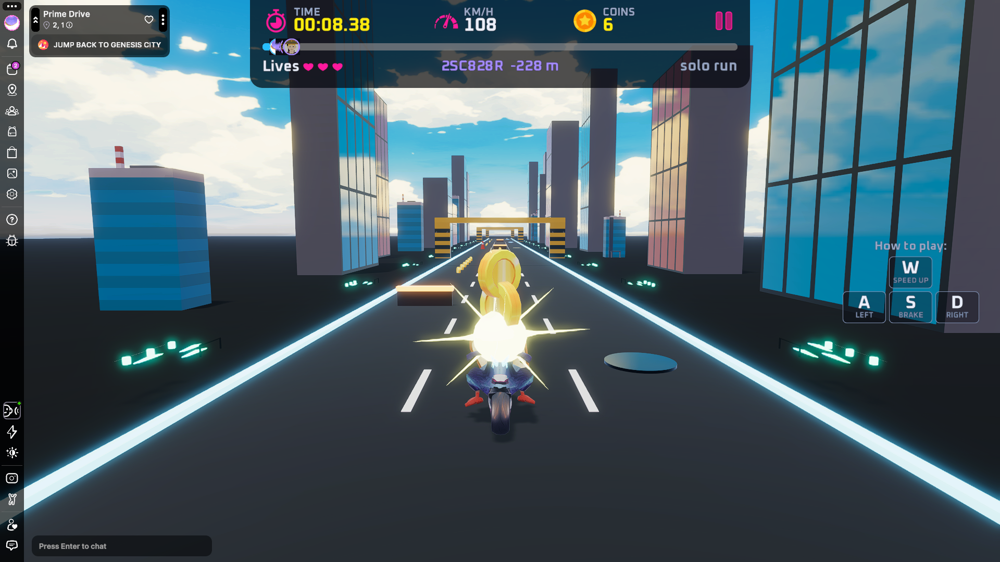

# Prime Drive

- [Source on GitHub](https://github.com/carlosmu/dcl-prime-drive)
- [Play on Decentraland](https://decentraland.org/jump?realm=primedrive.dcl.eth)

A three-lane bike racing game where players dodge obstacles, collect coins, and chase the track-record ghost over a 10 km course.

### Key features

- TBD

