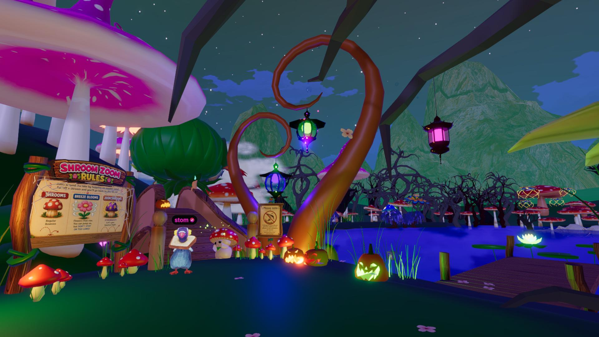

# Shroom Zoom

<!-- example-context:start -->
**Maintained by:** Community · CanessaDCL

[View upstream source](https://github.com/CanessaDCL/dcl-shroomzoom)

This community project is maintained outside the Decentraland GitHub organization. Its source code and live deployment may change independently. Inclusion in this catalog does not imply a security audit or guarantee of safety. Review code, dependencies, and installation scripts before running or reusing it.

[Report a catalog concern](https://github.com/decentraland/docs/issues/new). For suspected vulnerabilities, follow the upstream project's security policy. Do not include exploit details or credentials in public issues.
<!-- example-context:end -->

- [Play on Decentraland](https://decentraland.org/jump?realm=shroomzoom.dcl.eth)

A platforming and time-trial game with double-jumping, gliding, collectibles, and exploration.
### Key features

- Multiplayer server
- Physics impulses for bouncy mushrooms

