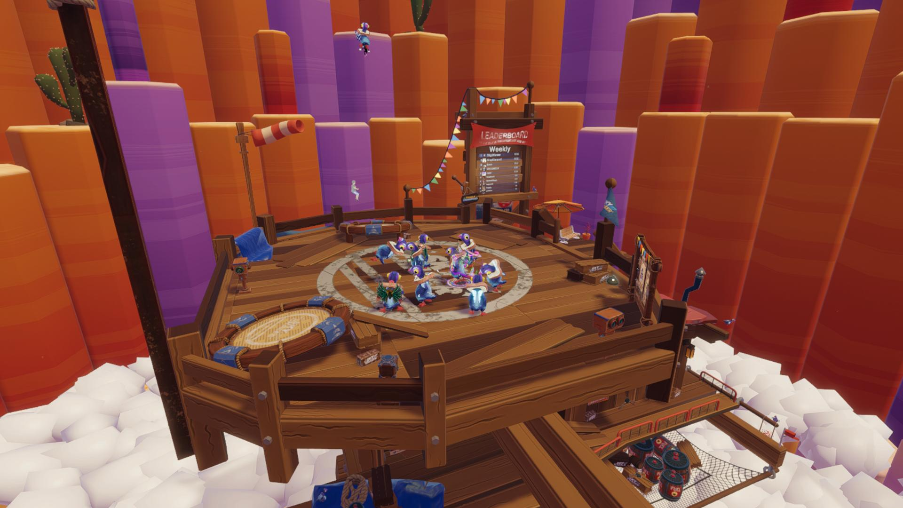

# Sky Chaser

<!-- example-context:start -->
**Maintained by:** Community · stom66

[View upstream source](https://github.com/stom66/dcl-sky-chaser)

This community project is maintained outside the Decentraland GitHub organization. Its source code and live deployment may change independently. Inclusion in this catalog does not imply a security audit or guarantee of safety. Review code, dependencies, and installation scripts before running or reusing it.

[Report a catalog concern](https://github.com/decentraland/docs/issues/new). For suspected vulnerabilities, follow the upstream project's security policy. Do not include exploit details or credentials in public issues.
<!-- example-context:end -->

- [Play on Decentraland](https://decentraland.org/jump?realm=skychaser.dcl.eth)

A multiplayer game where players compete to catch escaping packages in each round. The scene includes weekly and all-time leaderboards.
### Key features

- Multiplayer server
- Synced gameplay via synced Mulberry32 RNG
- Storage API for leaderboards
- Player locomotion tweaks and physics forces for booster/trampolines/explosions
- Particle systems (boost trails, explosions, pickups)

