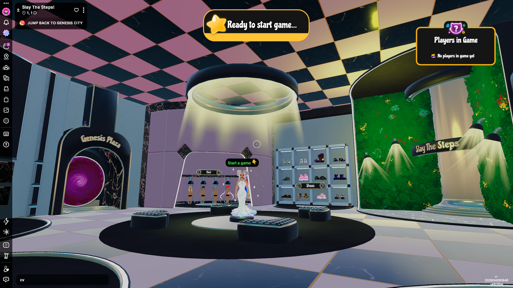

# Slay the Steps

<!-- example-context:start -->
**Maintained by:** Community · stom66

[View upstream source](https://github.com/stom66/dcl-slay-the-steps)

This community project is maintained outside the Decentraland GitHub organization. Its source code and live deployment may change independently. Inclusion in this catalog does not imply a security audit or guarantee of safety. Review code, dependencies, and installation scripts before running or reusing it.

[Report a catalog concern](https://github.com/decentraland/docs/issues/new). For suspected vulnerabilities, follow the upstream project's security policy. Do not include exploit details or credentials in public issues.
<!-- example-context:end -->

- [Play on Decentraland](https://decentraland.org/jump?realm=slaythesteps.dcl.eth)

A Studio-made Multiplayer Server experience built for Decentraland Festive Trail 2025. It includes custom avatars, Marketplace API integration, and a custom colour-wheel picker. Its code separates client, server, and shared modules, and includes the source assets alongside the deployable scene.
### Key features

- Cinematic **virtual cameras**
- **AvatarShapes** for showcasing wearables
- **Multiplayer** for syncing rounds/player outfits
- Custom 3D color picker

