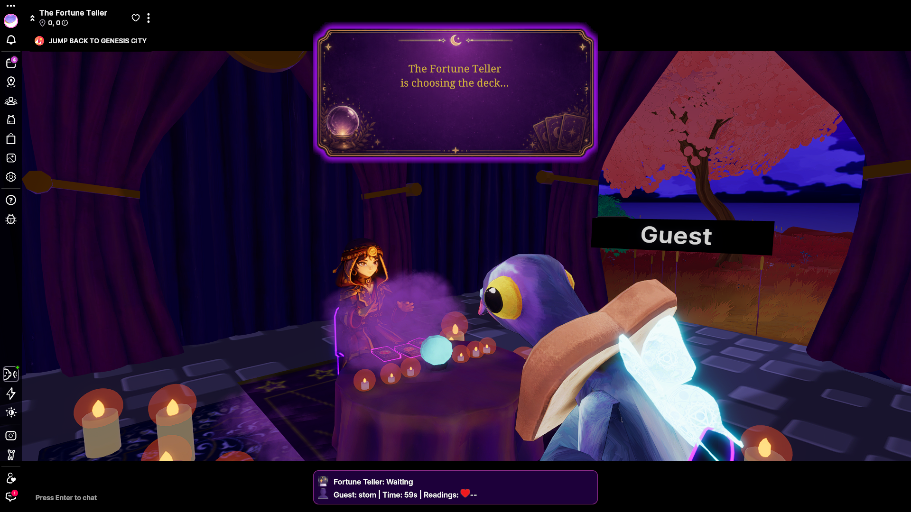

# The Fortune Teller

<!-- example-context:start -->
**Maintained by:** Community · carlosmu

[View upstream source](https://github.com/carlosmu/circus_fortune_teller)

This community project is maintained outside the Decentraland GitHub organization. Its source code and live deployment may change independently. Inclusion in this catalog does not imply a security audit or guarantee of safety. Review code, dependencies, and installation scripts before running or reusing it.

[Report a catalog concern](https://github.com/decentraland/docs/issues/new). For suspected vulnerabilities, follow the upstream project's security policy. Do not include exploit details or credentials in public issues.
<!-- example-context:end -->

- [Play on Decentraland](https://decentraland.org/jump?realm=fortunes.dcl.eth)

A social roleplay experience where players can receive fortunes or tell fortunes for friends.
### Key features

- TBD

